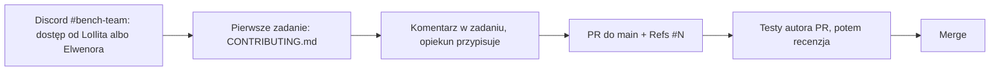

# benchmarks-fabryka-ai

Budujemy otwarte modele językowe dla ludzi, z publicznymi wagami, danymi i kodem.

Mierzymy modele językowe na benchmarkach odtworzonych zgodnie z oryginałem. Budujemy też polskie benchmarki. Dziś
mierzymy polsko-angielski **Slayer 1B** i pięć modeli odniesienia, a później każdy następny model. Przyda się każda
pomoc, nawet 2 godziny pracy.

## Jak dołączyć

**1. Dołącz do Discorda.** Nasz kanał to **#bench-team**: https://discord.gg/HnTkVR4c5T. Napisz tam do LoIlita albo
Elwenora i podaj swój login GitHub. Dodadzą Cię do zespołu Benchmark Team. Od tej chwili możesz brać zadania,
przesuwać karty na tablicy i pushować gałęzie do repo. Na Discordzie zadajesz też pytania i piszesz, gdy coś nie
działa.

**2. Weź pierwsze zadanie** według [`CONTRIBUTING.md`, „Pierwsze zadanie”](CONTRIBUTING.md#pierwsze-zadanie).

**3. Przygotuj komputer** według sekcji [„Przygotowanie (raz)”](research/README.md#przygotowanie-raz) w
`research/README.md`.

**4. Przeczytaj metodologię** w [`research/METODOLOGIA.md`](research/METODOLOGIA.md). Opisuje, w jakiej kolejności
powstaje benchmark i co trafia do każdego pliku.

**5. Otwórz PR do `main`** według [`CONTRIBUTING.md`](CONTRIBUTING.md). W opisie PR wpisz `Refs #N` z numerem
zadania.



Przydatne linki:

- Zadania: https://github.com/slayerlabs/benchmarks-fabryka-ai/issues
- Tablica zadań: https://github.com/orgs/slayerlabs/projects/10
- Kamienie: https://github.com/slayerlabs/benchmarks-fabryka-ai/milestones
- Wyniki Slayera 1B w Space: https://huggingface.co/spaces/SlayerLab/Slayer1B-Benchmarks
- Organizacje: https://github.com/slayerlabs, https://huggingface.co/SlayerLab

## Kto jest kim

- **LoIlita i Elwenor** koordynują zespół. Dodają nowe osoby do zespołu Benchmark Team, co daje dostęp do zadań,
  tablicy i repo. Piszesz do nich na Discordzie, na kanale #bench-team.
- **Arek** jest właścicielem modelu Slayer i Space z wynikami. Wgrywa wyniki do Space.

## Definicja „zrobione”

Benchmark jest zrobiony, gdy PR do `main` zawiera katalog `research/benchmarks/<name>/` założony z
[`research/benchmarks/_template/`](research/benchmarks/_template/README.md). Zamiast jednego PR może być kilka, po
jednym na etap. W katalogu musi być:

1. `ORIGINAL.md` (etap A) i `REPRODUCTION.md` (etap B) ze spełnionym warunkiem odtworzenia. Benchmark bez oryginału
   ma zamiast nich `DATASET.md` i kontrolę na modelu, który zna polski. Wersja polska leży w osobnym katalogu
   `research/benchmarks/<name>-pl/` i ma `POLISH.md` (etap D).
2. Kod liczący wynik (etap C). To wywołanie kodu z etapu B albo własna implementacja z testem zgodności
   `research/tests/test_<name>_zgodnosc.py`.
3. Test kodu `research/tests/test_<name>.py` z próbką danych. Test przechodzi bez sieci i bez wag.
4. Wynik mierzonego modelu (dziś Slayer 1.06) z n i SE. Obok niego wynik modelu kontrolnego, liczony tym samym
   kodem. Oba wyniki liczy autor PR. Dla benchmarku z oryginałem modelem kontrolnym jest pierwszy dostępny model z
   listy w sekcji [„Model kontrolny etapu B”](research/METODOLOGIA.md#model-kontrolny-etapu-b). Dla benchmarku
   polskiego i bez oryginału jest nim model, który zna polski (`speakleash/Bielik-1.5B-v3` albo
   `utter-project/EuroLLM-1.7B`).
5. Porównanie z modelem kontrolnym jako różnica w SE z werdyktem. Testy z wyborem odpowiedzi mają też bazę losową,
   bazę większościową i udział najczęstszej predykcji.
6. `RECIPE.md` z wpisem dla każdego wyniku.
7. Komendy z sekcji [„Przed PR”](#przed-pr) zakończone kodem 0.
8. `Refs #N` zadania w opisie PR.

Autor PR nie liczy pięciu modeli odniesienia. Policzy je przebieg centralny, który jest jeszcze w budowie (kamień
[„Przebieg centralny: 5 modeli odniesienia”](https://github.com/slayerlabs/benchmarks-fabryka-ai/milestone/8)).
Każdy punkt wyjaśnia [`research/METODOLOGIA.md`](research/METODOLOGIA.md).

## Przed PR

Przed otwarciem PR uruchom w katalogu `research/` komendy niżej. To testy zmienionego benchmarku,
`tests/test_liczby_raportow.py` i bramka liczb. Każda komenda musi zakończyć się kodem 0. Katalog `research/` nie ma
CI, więc uruchamiasz je sam.

```bash
.venv-eval/bin/python tools/liczby.py && .venv-eval/bin/python tools/sprawdz_raporty.py
.venv-eval/bin/python tests/test_<name>.py
.venv-eval/bin/python tests/test_<name>_zgodnosc.py   # tylko gdy benchmark ma własną implementację
.venv-eval/bin/python tests/test_liczby_raportow.py
```

## Co jest w repo

- [`research/`](research/README.md): benchmarki, analizy, kod wspólny, bramka liczb, testy.
- [`AGENTS.md`](AGENTS.md): krótki opis układu repo. Mówi też, gdzie dodać nowe pliki i co musi przejść przed PR.
- [`frontend-beta/`](frontend-beta/README.md): prototyp tablicy wyników w React, na danych syntetycznych. Dziś
  nieużywany.
