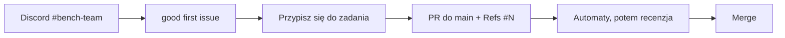

# benchmarks-fabryka-ai

Mierzymy modele językowe (dziś polsko-angielski **Slayer 1B** i pięć modeli odniesienia, jutro każdy następny) na
benchmarkach odtworzonych zgodnie z oryginałem i budujemy polskie benchmarki. Każda para rąk się przyda, nawet na
2 godziny.

## Jak dołączyć

**1. Dołącz do Discorda**, kanał **#bench-team**: https://discord.gg/HnTkVR4c5T. Tam pytasz, ogłaszasz, że bierzesz
zadanie, i dostajesz dostęp do repo (napisz swój nick GitHub do Elwenora).

**2. Weź pierwsze zadanie** z etykietą `good first issue`: jeden etap pracy (np. karta oryginału jednego benchmarku,
około 2 h, bez GPU) albo recenzja cudzej karty. Zadania na start:
[w tym repo](https://github.com/slayerlabs/benchmarks-fabryka-ai/issues?q=is%3Aopen+label%3A%22good+first+issue%22) i
na [tablicy zadań, widok dla nowych](https://github.com/users/LoIlita/projects/2/views/4).

**3. Przygotuj komputer** według sekcji [„Przygotowanie (raz)”](research/README.md#przygotowanie-raz) w
`research/README.md`.

**4. Przeczytaj metodologię:** [`research/METODOLOGIA.md`](research/METODOLOGIA.md). Mówi, w jakiej kolejności
powstaje benchmark i co jest w każdym pliku.

**5. Otwórz PR do `main`** według [`CONTRIBUTING.md`](CONTRIBUTING.md).

Dokąd zmierzamy:

- Kamienie z terminami: https://github.com/slayerlabs/benchmarks-fabryka-ai/milestones
- Tablica zadań: https://github.com/users/LoIlita/projects/2
- Wyniki Slayera 1B w Space: https://huggingface.co/spaces/SlayerLab/Slayer1B-Benchmarks
- Organizacje: https://github.com/slayerlabs, https://huggingface.co/SlayerLab

## Definicja „zrobione”

Benchmark jest zrobiony, gdy jeden PR do `main` (albo kilka, po jednym na etap) zawiera katalog
`research/benchmarks/<name>/` założony z [`research/benchmarks/_template/`](research/benchmarks/_template/README.md), a
w nim:

1. `ORIGINAL.md` (etap A) i `REPRODUCTION.md` (etap B) ze spełnionym warunkiem odtworzenia; benchmark bez oryginału
   zamiast nich ma `DATASET.md` i kontrolę na modelu, który zna polski; wersja polska ma też `POLISH.md` (etap D);
2. kod liczący: wywołanie kodu z etapu B albo własną implementację z testem zgodności `research/tests/test_<name>_zgodnosc.py`
   (etap C);
3. test kodu `research/tests/test_<name>.py` z próbką danych, który przechodzi bez sieci i bez wag;
4. wynik mierzonego modelu (dziś Slayer 1.06) z n i SE oraz wynik modelu kontrolnego
   `EleutherAI/pythia-1b-v0` @ `step143000` liczony tym samym kodem;
5. porównanie z modelem kontrolnym jako różnicę w SE z werdyktem, a dla testów z wyborem odpowiedzi bazę losową,
   większościową i udział najczęstszej predykcji;
6. `RECIPE.md` z wpisem dla każdego wyniku;
7. bramkę liczb i testy z kodem 0 ([komendy](research/README.md#bramka-liczb));
8. `Refs #N` zadania w opisie PR.

Pięciu modeli odniesienia autor nie liczy: to zadanie przebiegu centralnego, który jest w budowie (kamień
[„Przebieg centralny: 5 modeli odniesienia”](https://github.com/slayerlabs/benchmarks-fabryka-ai/milestone/8)).
Znaczenie każdego punktu: [`research/METODOLOGIA.md`](research/METODOLOGIA.md).

## Co jest w repo

- [`research/`](research/README.md): benchmarki, analizy, kod wspólny, bramka liczb, testy.
- [`AGENTS.md`](AGENTS.md): skrót: układ repo, gdzie co dodać, co musi przejść przed PR.
- [`frontend-beta/`](frontend-beta/README.md): prototyp tablicy wyników (React, dane syntetyczne), teraz nieużywany.
