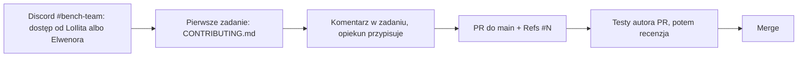

# benchmarks-fabryka-ai

Mierzymy modele językowe (dziś polsko-angielski **Slayer 1B** i pięć modeli odniesienia, jutro każdy następny) na
benchmarkach odtworzonych zgodnie z oryginałem i budujemy polskie benchmarki. Każda para rąk się przyda, nawet na
2 godziny.

## Jak dołączyć

**1. Dołącz do Discorda**, kanał **#bench-team**: https://discord.gg/HnTkVR4c5T, i napisz do LoIlita albo
Elwenora swój login GitHub. Dodadzą Cię do zespołu Benchmark Team: wtedy możesz brać zadania, przesuwać karty na
tablicy i pushować gałęzie do repo. Na Discordzie pytasz też o wszystko i zgłaszasz potknięcia.

**2. Weź pierwsze zadanie** według [`CONTRIBUTING.md`, „Pierwsze zadanie”](CONTRIBUTING.md#pierwsze-zadanie).

**3. Przygotuj komputer** według sekcji [„Przygotowanie (raz)”](research/README.md#przygotowanie-raz) w
`research/README.md`.

**4. Przeczytaj metodologię:** [`research/METODOLOGIA.md`](research/METODOLOGIA.md). Mówi, w jakiej kolejności
powstaje benchmark i co jest w każdym pliku.

**5. Otwórz PR do `main`** według [`CONTRIBUTING.md`](CONTRIBUTING.md), z `Refs #N` zadania w opisie.



Dokąd zmierzamy:

- Zadania: https://github.com/slayerlabs/benchmarks-fabryka-ai/issues
- Tablica zadań: https://github.com/orgs/slayerlabs/projects/10
- Kamienie: https://github.com/slayerlabs/benchmarks-fabryka-ai/milestones
- Wyniki Slayera 1B w Space: https://huggingface.co/spaces/SlayerLab/Slayer1B-Benchmarks
- Organizacje: https://github.com/slayerlabs, https://huggingface.co/SlayerLab

## Kto jest kim

- **LoIlita i Elwenor:** koordynacja zespołu, dodawanie do zespołu Benchmark Team (zadania, tablica, repo). Kontakt
  przez Discord, kanał #bench-team.
- **Arek:** właściciel modelu Slayer i Space z wynikami; wgrywa wyniki do Space.

## Definicja „zrobione”

Benchmark jest zrobiony, gdy jeden PR do `main` (albo kilka, po jednym na etap) zawiera katalog
`research/benchmarks/<name>/` założony z [`research/benchmarks/_template/`](research/benchmarks/_template/README.md), a
w nim:

1. `ORIGINAL.md` (etap A) i `REPRODUCTION.md` (etap B) ze spełnionym warunkiem odtworzenia; benchmark bez oryginału
   zamiast nich ma `DATASET.md` i kontrolę na modelu, który zna polski; wersja polska to osobny katalog
   `research/benchmarks/<name>-pl/` z `POLISH.md` (etap D);
2. kod liczący: wywołanie kodu z etapu B albo własną implementację z testem zgodności `research/tests/test_<name>_zgodnosc.py`
   (etap C);
3. test kodu `research/tests/test_<name>.py` z próbką danych, który przechodzi bez sieci i bez wag;
4. wynik mierzonego modelu (dziś Slayer 1.06) z n i SE oraz wynik modelu kontrolnego liczony tym samym kodem; oba
   liczy autor PR. Model kontrolny: dla benchmarku z oryginałem pierwszy dostępny z listy w sekcji
   [„Model kontrolny etapu B”](research/METODOLOGIA.md#model-kontrolny-etapu-b); dla benchmarku polskiego i bez
   oryginału model, który zna polski (`speakleash/Bielik-1.5B-v3` albo `utter-project/EuroLLM-1.7B`);
5. porównanie z modelem kontrolnym jako różnicę w SE z werdyktem, a dla testów z wyborem odpowiedzi bazę losową,
   większościową i udział najczęstszej predykcji;
6. `RECIPE.md` z wpisem dla każdego wyniku;
7. komendy z sekcji [„Przed PR”](#przed-pr) z kodem 0;
8. `Refs #N` zadania w opisie PR.

Pięciu modeli odniesienia autor nie liczy: to zadanie przebiegu centralnego, który jest w budowie (kamień
[„Przebieg centralny: 5 modeli odniesienia”](https://github.com/slayerlabs/benchmarks-fabryka-ai/milestone/8)).
Znaczenie każdego punktu: [`research/METODOLOGIA.md`](research/METODOLOGIA.md).

## Przed PR

Autor PR uruchamia w `research/` testy zmienionego benchmarku, `tests/test_liczby_raportow.py` i bramkę liczb; każda
komenda kończy się kodem 0. CI dla `research/` nie ma, więc te komendy uruchamiasz sam.

```bash
.venv-eval/bin/python tools/liczby.py && .venv-eval/bin/python tools/sprawdz_raporty.py
.venv-eval/bin/python tests/test_<name>.py
.venv-eval/bin/python tests/test_<name>_zgodnosc.py   # tylko gdy benchmark ma własną implementację
.venv-eval/bin/python tests/test_liczby_raportow.py
```

## Co jest w repo

- [`research/`](research/README.md): benchmarki, analizy, kod wspólny, bramka liczb, testy.
- [`AGENTS.md`](AGENTS.md): skrót: układ repo, gdzie co dodać, co musi przejść przed PR.
- [`frontend-beta/`](frontend-beta/README.md): prototyp tablicy wyników (React, dane syntetyczne), teraz nieużywany.
