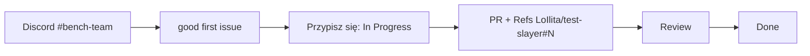

# Jak dołączyć

Mierzymy polsko-angielski model **Slayer 1B** na 50 testach i budujemy polskie benchmarki. Każda para rąk się przyda, nawet na 2 godziny.

**1. Dołącz do Discorda**, kanał **#bench-team**: https://discord.gg/HnTkVR4c5T. Tam pytasz, ogłaszasz, że bierzesz zadanie, i dostajesz dostęp do repo (napisz swój nick GitHub do Elwenora).

**2. Weź pierwsze zadanie** z etykietą `good first issue`. Są małe (do 2 h) i mają dokładne kroki:
- [#5](https://github.com/LoIlita/test-slayer/issues/5) Social IQa ma w Space status not_run dla Slayera 1.06
- [#6](https://github.com/LoIlita/test-slayer/issues/6) Winograd Schema Challenge ma w Space status not_run dla Slayera 1.06
- [#7](https://github.com/LoIlita/test-slayer/issues/7) LogiQA ma w Space status not_run dla Slayera 1.06
- [#16](https://github.com/LoIlita/test-slayer/issues/16) MathQA ma w Space status not_run dla Slayera 1.06

Wszystkie zadania dla nowych: https://github.com/users/LoIlita/projects/2/views/4

**3. Zobacz, dokąd zmierzamy:**
- Tablica zadań: https://github.com/users/LoIlita/projects/2
- Kamienie z terminami: https://github.com/LoIlita/test-slayer/milestones
- Szybkie zadania (do 2 h): https://github.com/users/LoIlita/projects/2/views/5
- Wyniki modelu (Space): https://huggingface.co/spaces/SlayerLab/Slayer1B-Benchmarks
- Kod i PR-y: https://github.com/slayerlabs/benchmarks-fabryka-ai
- Organizacja na GitHubie: https://github.com/slayerlabs
- Organizacja na Hugging Face (model, Space): https://huggingface.co/SlayerLab

**4. Przygotuj komputer** według sekcji „Przygotowanie (raz)” w [`research/README.md`](research/README.md#przygotowanie-raz) i otwórz pierwszy PR.

Szczegóły (pola, etykiety, definicja „zrobione”): [README test-slayer](https://github.com/LoIlita/test-slayer#readme). Układ katalogów, uruchomienie, testy i bramka liczb: [`research/README.md`](research/README.md).

## Co jest w repo

- [`research/`](research/README.md): benchmarki, kod wspólny, bramka liczb, wyniki.
- [`frontend-beta/`](frontend-beta/README.md): prototyp tablicy wyników (React, dane syntetyczne), teraz nieużywany.
