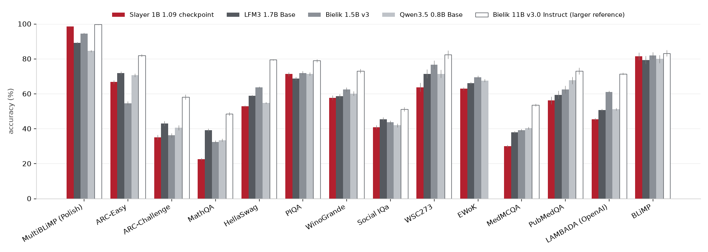

# Results

Slayer 1B next to models of its size, on the same benchmarks with the same settings.

<table>
<tr><th align="left">Benchmark</th><th>Slayer 1B 1.09 checkpoint</th><th>LFM3 1.7B Base</th><th>Bielik 1.5B v3</th><th>Qwen3.5 0.8B Base</th><th>Bielik 11B v3.0 Instruct</th></tr>
<tr><td colspan="6"><b>Polish</b></td></tr>
<tr><td>MultiBLiMP (Polish)</td><td align="right"><b>98.6</b></td><td align="right">89.2</td><td align="right"><ins>94.5</ins></td><td align="right">84.5</td><td align="right">99.6</td></tr>
<tr><td colspan="6"><b>English · reasoning and science</b></td></tr>
<tr><td>ARC-Easy</td><td align="right">66.6</td><td align="right"><b>71.7</b></td><td align="right">54.6</td><td align="right"><ins>70.5</ins></td><td align="right">81.9</td></tr>
<tr><td>ARC-Challenge</td><td align="right">35.0</td><td align="right"><b>42.9</b></td><td align="right">36.1</td><td align="right"><ins>40.4</ins></td><td align="right">58.1</td></tr>
<tr><td>MathQA</td><td align="right">22.5</td><td align="right"><b>39.1</b></td><td align="right">32.4</td><td align="right"><ins>33.4</ins></td><td align="right">48.5</td></tr>
<tr><td colspan="6"><b>English · commonsense</b></td></tr>
<tr><td>HellaSwag</td><td align="right">52.8</td><td align="right"><ins>58.9</ins></td><td align="right"><b>63.7</b></td><td align="right">54.8</td><td align="right">79.4</td></tr>
<tr><td>PIQA</td><td align="right">71.2</td><td align="right">68.6</td><td align="right"><b>71.9</b></td><td align="right"><ins>71.3</ins></td><td align="right">78.9</td></tr>
<tr><td>WinoGrande</td><td align="right">57.7</td><td align="right">58.6</td><td align="right"><b>62.4</b></td><td align="right"><ins>60.1</ins></td><td align="right">73.0</td></tr>
<tr><td>Social IQa</td><td align="right">40.9</td><td align="right"><b>45.4</b></td><td align="right"><ins>43.6</ins></td><td align="right">41.9</td><td align="right">51.1</td></tr>
<tr><td>WSC273</td><td align="right">63.7</td><td align="right"><ins>71.4</ins></td><td align="right"><b>76.6</b></td><td align="right"><ins>71.4</ins></td><td align="right">82.4</td></tr>
<tr><td>EWoK</td><td align="right">62.8</td><td align="right">66.0</td><td align="right"><b>69.5</b></td><td align="right"><ins>67.6</ins></td><td align="right">n/a</td></tr>
<tr><td colspan="6"><b>English · medical knowledge</b></td></tr>
<tr><td>MedMCQA</td><td align="right">30.1</td><td align="right">37.8</td><td align="right"><ins>39.1</ins></td><td align="right"><b>40.3</b></td><td align="right">53.6</td></tr>
<tr><td>PubMedQA</td><td align="right">56.2</td><td align="right">59.4</td><td align="right"><ins>62.4</ins></td><td align="right"><b>67.6</b></td><td align="right">73.0</td></tr>
<tr><td colspan="6"><b>English · language modeling and grammar</b></td></tr>
<tr><td>LAMBADA (OpenAI)</td><td align="right">45.4</td><td align="right">50.7</td><td align="right"><b>61.1</b></td><td align="right"><ins>51.2</ins></td><td align="right">71.4</td></tr>
<tr><td>WikiText-2 ↓</td><td align="right">1.702</td><td align="right"><b>1.616</b></td><td align="right"><ins>1.674</ins></td><td align="right">1.717</td><td align="right">1.566</td></tr>
<tr><td>BLiMP</td><td align="right"><ins>81.5</ins></td><td align="right">79.3</td><td align="right"><b>81.9</b></td><td align="right">79.9</td><td align="right">83.2</td></tr>
</table>

Accuracy in %, 0-shot. ↓ lower is better (WikiText-2: perplexity per byte). **Bold**: best of the four small models, <ins>underlined</ins>: second. Bielik 11B is about ten times larger and is shown for reference, without a rank.

**Instruction following (IFEval):** Bielik 11B v3.1 Instruct 55.3, Slayer 1B 1.08 18.1. Slayer is a base model without a chat template, so its score mostly reflects broken output, not instruction following. [Details](instruction-following.md).

[All models](all-models.md) · [Instruction following](instruction-following.md) · [All results as JSONL](results.jsonl) · [Benchmark status](../BENCHMARKS.md)

## Notes

- **Slayer 1B 1.09 is a training checkpoint** (step 40 000), not a release.
- **How it was measured:** the full test set of each benchmark, 0-shot, each answer scored by the model's probability of it (lm-eval; BLiMP and EWoK: their own code), float32 (Bielik 11B: bfloat16), no chat template. Slayer's inputs start with one BOS token, the other models' with none.
- **Small differences are noise.** Values with their standard errors are in [all models](all-models.md) and [`results.jsonl`](results.jsonl); a difference of one or two points is often within them. Standard errors are over questions, except over minimal-pair paradigms for BLiMP, over item templates for EWoK, over twin-sentence pairs for WinoGrande, and over schemas for WSC273.
- **Bielik 11B and LFM3-1.7B (in the full tables) are instruction-tuned**, scored here on raw text like the base models.
- Results flagged for checking by the research review are marked † in the [full tables](all-models.md); none is on this page.
- Generated by `python -m codesota.leaderboard` from the result files below; do not edit by hand.

## Sources

- Log-likelihood benchmarks: [`research/results/full-run-2026-11/`](../../research/results/full-run-2026-11/README.md), manifest [`manifest.jsonl`](../../research/results/full-run-2026-11/manifest.jsonl) (commands, revisions, weight checksums).
- IFEval: [`research/api-benchmarks/ifeval/results/`](../../research/api-benchmarks/ifeval/results/), per-prompt outputs in `*.jsonl.gz`.
- Every row of [`results.jsonl`](results.jsonl) names its source file.
