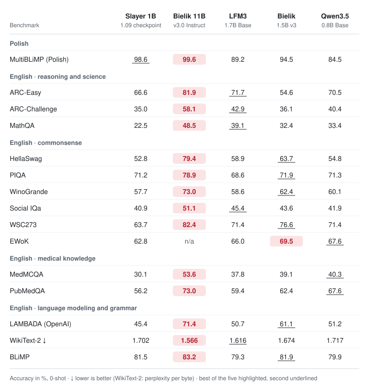

# Results

Slayer 1B next to its reference models, on the same benchmarks with the same settings.

<picture>
  <source media="(prefers-color-scheme: dark)" srcset="charts/headline-table-dark.svg">
  
</picture>

**Instruction following (IFEval):** Bielik 11B v3.1 Instruct 55.3, Slayer 1B 1.08 18.1. Slayer is a base model without a chat template, so its score mostly reflects broken output, not instruction following. [Details](instruction-following.md).

<picture>
  <source media="(prefers-color-scheme: dark)" srcset="charts/headline-dark.png">
  
</picture>

[All models](all-models.md) · [Instruction following](instruction-following.md) · [All results as JSONL](results.jsonl) · [Benchmark status](../BENCHMARKS.md)

## Notes

- **Slayer 1B 1.09 is a training checkpoint** (step 40 000), not a release.
- **Bielik 11B is about ten times larger** than the others and instruction-tuned; it is the closest Polish reference. LFM3-1.7B (in the full tables) is instruction-tuned too. All are scored on raw text.
- **How it was measured:** the full test set of each benchmark, 0-shot, each answer scored by the model's probability of it (lm-eval; BLiMP and EWoK: their own code), float32 (Bielik 11B: bfloat16), no chat template. Slayer's inputs start with one BOS token, the other models' with none.
- **Small differences are noise:** a difference of one or two points is often within the standard errors below.
- Results flagged for checking by the research review are marked † in the [full tables](all-models.md); none is on this page.
- Generated by `python -m codesota.leaderboard` from the result files below; do not edit by hand.

## Values

Value ± standard error, accuracy in %. Standard errors are over questions, except over minimal-pair paradigms for BLiMP, over item templates for EWoK, over twin-sentence pairs for WinoGrande, and over schemas for WSC273.

<table>
<tr><th align="left">Benchmark</th><th>Slayer 1B 1.09 checkpoint</th><th>Bielik 11B v3.0 Instruct</th><th>LFM3 1.7B Base</th><th>Bielik 1.5B v3</th><th>Qwen3.5 0.8B Base</th></tr>
<tr><td colspan="6"><b>Polish</b></td></tr>
<tr><td>MultiBLiMP (Polish)</td><td align="right">98.6 ± 0.2</td><td align="right">99.6 ± 0.1</td><td align="right">89.2 ± 0.5</td><td align="right">94.5 ± 0.4</td><td align="right">84.5 ± 0.6</td></tr>
<tr><td colspan="6"><b>English · reasoning and science</b></td></tr>
<tr><td>ARC-Easy</td><td align="right">66.6 ± 1.0</td><td align="right">81.9 ± 0.8</td><td align="right">71.7 ± 0.9</td><td align="right">54.6 ± 1.0</td><td align="right">70.5 ± 0.9</td></tr>
<tr><td>ARC-Challenge</td><td align="right">35.0 ± 1.4</td><td align="right">58.1 ± 1.4</td><td align="right">42.9 ± 1.4</td><td align="right">36.1 ± 1.4</td><td align="right">40.4 ± 1.4</td></tr>
<tr><td>MathQA</td><td align="right">22.5 ± 0.8</td><td align="right">48.5 ± 0.9</td><td align="right">39.1 ± 0.9</td><td align="right">32.4 ± 0.9</td><td align="right">33.4 ± 0.9</td></tr>
<tr><td colspan="6"><b>English · commonsense</b></td></tr>
<tr><td>HellaSwag</td><td align="right">52.8 ± 0.5</td><td align="right">79.4 ± 0.4</td><td align="right">58.9 ± 0.5</td><td align="right">63.7 ± 0.5</td><td align="right">54.8 ± 0.5</td></tr>
<tr><td>PIQA</td><td align="right">71.2 ± 1.1</td><td align="right">78.9 ± 1.0</td><td align="right">68.6 ± 1.1</td><td align="right">71.9 ± 1.0</td><td align="right">71.3 ± 1.1</td></tr>
<tr><td>WinoGrande</td><td align="right">57.7 ± 1.3</td><td align="right">73.0 ± 1.2</td><td align="right">58.6 ± 1.3</td><td align="right">62.4 ± 1.3</td><td align="right">60.1 ± 1.3</td></tr>
<tr><td>Social IQa</td><td align="right">40.9 ± 1.1</td><td align="right">51.1 ± 1.1</td><td align="right">45.4 ± 1.1</td><td align="right">43.6 ± 1.1</td><td align="right">41.9 ± 1.1</td></tr>
<tr><td>WSC273</td><td align="right">63.7 ± 2.4</td><td align="right">82.4 ± 2.4</td><td align="right">71.4 ± 2.4</td><td align="right">76.6 ± 2.4</td><td align="right">71.4 ± 2.3</td></tr>
<tr><td>EWoK</td><td align="right">62.8 ± 0.8</td><td align="right">n/a</td><td align="right">66.0 ± 0.8</td><td align="right">69.5 ± 0.8</td><td align="right">67.6 ± 0.8</td></tr>
<tr><td colspan="6"><b>English · medical knowledge</b></td></tr>
<tr><td>MedMCQA</td><td align="right">30.1 ± 0.7</td><td align="right">53.6 ± 0.8</td><td align="right">37.8 ± 0.7</td><td align="right">39.1 ± 0.8</td><td align="right">40.3 ± 0.8</td></tr>
<tr><td>PubMedQA</td><td align="right">56.2 ± 2.2</td><td align="right">73.0 ± 2.0</td><td align="right">59.4 ± 2.2</td><td align="right">62.4 ± 2.2</td><td align="right">67.6 ± 2.1</td></tr>
<tr><td colspan="6"><b>English · language modeling and grammar</b></td></tr>
<tr><td>LAMBADA (OpenAI)</td><td align="right">45.4 ± 0.7</td><td align="right">71.4 ± 0.6</td><td align="right">50.7 ± 0.7</td><td align="right">61.1 ± 0.7</td><td align="right">51.2 ± 0.7</td></tr>
<tr><td>WikiText-2 ↓</td><td align="right">1.702 ± 0.016</td><td align="right">1.566 ± 0.011</td><td align="right">1.616 ± 0.014</td><td align="right">1.674 ± 0.011</td><td align="right">1.717 ± 0.013</td></tr>
<tr><td>BLiMP</td><td align="right">81.5 ± 2.1</td><td align="right">83.2 ± 1.8</td><td align="right">79.3 ± 2.3</td><td align="right">81.9 ± 2.0</td><td align="right">79.9 ± 2.2</td></tr>
</table>

## Sources

- Log-likelihood benchmarks: [`research/results/full-run-2026-11/`](../../research/results/full-run-2026-11/README.md), manifest [`manifest.jsonl`](../../research/results/full-run-2026-11/manifest.jsonl) (commands, revisions, weight checksums).
- IFEval: [`research/api-benchmarks/ifeval/results/`](../../research/api-benchmarks/ifeval/results/), per-prompt outputs in `*.jsonl.gz`.
- Every row of [`results.jsonl`](results.jsonl) names its source file.
