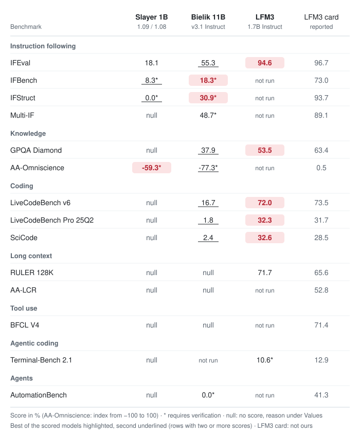

# Results

Slayer 1B next to its reference models. Two tables: the log-likelihood benchmarks, measured for every model with the same code and settings, and the generative and agentic benchmarks, where each model answers in its own format and each benchmark has its own protocol.

## Log-likelihood benchmarks

<picture>
  <source media="(prefers-color-scheme: dark)" srcset="charts/headline-table-dark.svg">
  
</picture>

## Generative and agentic benchmarks

<picture>
  <source media="(prefers-color-scheme: dark)" srcset="charts/api-benchmarks-table-dark.svg">
  
</picture>

**\* requires verification:** the result comes from a pull request that is still in review, or it is not the benchmark's main row; the reason for each benchmark is on [Generative and agentic benchmarks](api-benchmarks.md). Merged and reviewed: IFEval, IFBench, IFStruct, Multi-IF, AA-Omniscience, LiveCodeBench v6, LiveCodeBench Pro 25Q2, SciCode, RULER 128K, AA-LCR, BFCL V4, Terminal-Bench 2.1, AutomationBench.

- **Incomplete by design:** "null" means the model cannot run the benchmark (for example, its context window is too short, or it has no tool-call format; research/METHODOLOGY.md). "not run" means the benchmark was not run for the model: by decision, for compute budget, or not yet. The Generative values table gives the reason of each. Neither is a zero.
- **Slayer 1B is a base model** without a chat template or a tool-call format: on the agentic benchmarks it cannot run, and where it is scored its output is mostly degenerate. Its column mixes versions: IFEval is 1.08, the instruction-following, knowledge, tool and agent rows step 60 000 of 1.09, the others step 70 000.
- **Bielik 11B v3.1 ran in three setups**, depending on the benchmark: the Fabryka API (IFEval, LiveCodeBench v6, LiveCodeBench Pro 25Q2, SciCode, RULER 128K, AA-LCR); our own vLLM (IFBench, IFStruct, Multi-IF, AA-Omniscience, BFCL V4, AutomationBench); local lm-eval, greedy (GPQA Diamond). The setups are not interchangeable: on IFEval our vLLM with the template defaults scores 5.36 ± 1.86 points above the API. Where a benchmark samples, Bielik uses the LFM3 card's settings (temperature 0.6, top_p 0.95). **LFM3-1.7B** is the instruction-tuned model, with reasoning on; **LFM3 card** is the value Liquid AI reports for it, not measured by us.
- **IFEval:** the values are prompt-level strict accuracy. The card does not name its metric and probably does not report strict: LFM3 scores 94.64 strict and 96.49 prompt-level loose, against the card's 96.66 (README, Deviations). Bielik's value is the API run; with its template defaults on our vLLM it scores 60.63, 5.36 ± 1.86 points higher.
- **Multi-IF:** n counts turns: 13447 turns of 4501 conversations; the standard error is a cluster bootstrap over conversations.
- **GPQA Diamond:** the exploratory run caps answers at 8192 tokens, and 74 of LFM3's 198 answers are cut there (13 of them still score correct). With a larger cap LFM3 reaches 58.59 at 16384 and 62.63 to 64.65 at 32768 (two compositions), within noise of the card's 63.37. Bielik is not limited by the cap (36.36 at 2048). Both models ran locally with lm-eval, on different GPUs.
- **AA-Omniscience:** Slayer's higher index is not more knowledge: it answers 10 of 600 correctly (accuracy 1.67, Bielik 11.17), and its index is higher only because 223 of its answers, cut at the 1280-token limit, are graded not attempted, which the index does not subtract. The row is therefore not ranked. Our grades come from a different judge (GPT-6.1 Sol) than the official grader (Gemini 2.5 Flash Preview), so the values cannot be compared with the card's 0.50 or with Artificial Analysis' numbers (README).
- **LiveCodeBench v6:** Bielik without reasoning (the API default; reasoning cannot be switched on through the API). LFM3 with the card's sampling: 73.08 ± 1.37.
- **LiveCodeBench Pro 25Q2:** LFM3 without thinking: 28.74 ± 3.50.
- **SciCode:** n counts the 288 steps; the standard error is clustered over the 65 problems, as in the README (over steps it would be 2.76 for LFM3). The control against the card passes both with and without background (22.92), so it cannot confirm the card's setup. LFM3 without thinking: 24.65. Slayer without background: 0.00 (0/288).
- **RULER 128K:** RULER's substring scorer has no answer cap here, so 71.69 is not comparable to RULER numbers in the literature; capped to RULER's answer budget: 67.20 ± 1.00. The control against the card failed.
- **BFCL V4:** Bielik's Overall is not computed, because the web_search categories (20% of its weight) were not run. The other categories bound it: at least 28.41, and at most 48.41 with web_search at 100, below the card's 71.39.

[Slayer versions](slayer-versions.md) · [All models](all-models.md) · [Instruction following](instruction-following.md) · [Generative and agentic benchmarks](api-benchmarks.md) · [All results as JSONL](results.jsonl) · [Benchmark status](../BENCHMARKS.md)

## Notes on the log-likelihood benchmarks

- **Slayer 1B 1.09 is a training checkpoint** (step 70 000), not a release. Step 70 000 was measured in its own run, on 8 x RTX 4090 with the same code and settings ([protocol](../../research/results/full-run-2026-11/slayer-1.09-k70000/PROTOKOL.md)); every other result of the full run on an RTX 5090. Earlier versions and step 40 000: [Slayer versions](slayer-versions.md).
- **Random** is the chance level: the score of picking an answer at random (the mean of 1 / number of options). On PubMedQA, always giving its most common answer scores 55.2.
- **Bielik 11B is about ten times larger** than the others and instruction-tuned; it is the closest Polish reference. LFM3-1.7B (in the full tables) is instruction-tuned too. All are scored on raw text.
- **How it was measured:** the full test set of each benchmark, 0-shot, each answer scored by the model's probability of it (lm-eval; BLiMP and EWoK: their own code), float32 (Bielik 11B: bfloat16), no chat template. Slayer's inputs start with one BOS token, the other models' with none.
- **Small differences are noise:** a difference of one or two points is often within the standard errors below.
- Results flagged for checking by the research review are marked † in the [full tables](all-models.md); none is on this page.
- Generated by `python -m codesota.leaderboard` from the result files below; do not edit by hand.

## Values

Value ± standard error, accuracy in %. Standard errors are over questions, except over minimal-pair paradigms for BLiMP, over item templates for EWoK, over twin-sentence pairs for WinoGrande, and over schemas for WSC273.

<table>
<tr><th align="left">Benchmark</th><th>Slayer 1B 1.09 step 70k</th><th>Bielik 11B v3.0 Instruct</th><th>LFM3 1.7B Base</th><th>Bielik 1.5B v3</th><th>Qwen3.5 0.8B Base</th><th>Random chance</th></tr>
<tr><td colspan="7"><b>Polish</b></td></tr>
<tr><td>MultiBLiMP (Polish)</td><td align="right">98.2 ± 0.2</td><td align="right">99.6 ± 0.1</td><td align="right">89.2 ± 0.5</td><td align="right">94.5 ± 0.4</td><td align="right">84.5 ± 0.6</td><td align="right">50.0</td></tr>
<tr><td colspan="7"><b>English · reasoning and science</b></td></tr>
<tr><td>ARC-Easy</td><td align="right">66.2 ± 1.0</td><td align="right">81.9 ± 0.8</td><td align="right">71.7 ± 0.9</td><td align="right">54.6 ± 1.0</td><td align="right">70.5 ± 0.9</td><td align="right">25.0</td></tr>
<tr><td>ARC-Challenge</td><td align="right">35.4 ± 1.4</td><td align="right">58.1 ± 1.4</td><td align="right">42.9 ± 1.4</td><td align="right">36.1 ± 1.4</td><td align="right">40.4 ± 1.4</td><td align="right">25.0</td></tr>
<tr><td>MathQA</td><td align="right">22.0 ± 0.8</td><td align="right">48.5 ± 0.9</td><td align="right">39.1 ± 0.9</td><td align="right">32.4 ± 0.9</td><td align="right">33.4 ± 0.9</td><td align="right">20.0</td></tr>
<tr><td colspan="7"><b>English · commonsense</b></td></tr>
<tr><td>HellaSwag</td><td align="right">55.3 ± 0.5</td><td align="right">79.4 ± 0.4</td><td align="right">58.9 ± 0.5</td><td align="right">63.7 ± 0.5</td><td align="right">54.8 ± 0.5</td><td align="right">25.0</td></tr>
<tr><td>PIQA</td><td align="right">72.7 ± 1.0</td><td align="right">78.9 ± 1.0</td><td align="right">68.6 ± 1.1</td><td align="right">71.9 ± 1.0</td><td align="right">71.3 ± 1.1</td><td align="right">50.0</td></tr>
<tr><td>WinoGrande</td><td align="right">57.4 ± 1.3</td><td align="right">73.0 ± 1.2</td><td align="right">58.6 ± 1.3</td><td align="right">62.4 ± 1.3</td><td align="right">60.1 ± 1.3</td><td align="right">50.0</td></tr>
<tr><td>Social IQa</td><td align="right">41.8 ± 1.1</td><td align="right">51.1 ± 1.1</td><td align="right">45.4 ± 1.1</td><td align="right">43.6 ± 1.1</td><td align="right">41.9 ± 1.1</td><td align="right">33.3</td></tr>
<tr><td>WSC273</td><td align="right">63.7 ± 2.3</td><td align="right">82.4 ± 2.4</td><td align="right">71.4 ± 2.4</td><td align="right">76.6 ± 2.4</td><td align="right">71.4 ± 2.3</td><td align="right">50.0</td></tr>
<tr><td>EWoK</td><td align="right">63.9 ± 0.7</td><td align="right">n/a</td><td align="right">66.0 ± 0.8</td><td align="right">69.5 ± 0.8</td><td align="right">67.6 ± 0.8</td><td align="right">50.0</td></tr>
<tr><td colspan="7"><b>English · medical knowledge</b></td></tr>
<tr><td>MedMCQA</td><td align="right">27.9 ± 0.7</td><td align="right">53.6 ± 0.8</td><td align="right">37.8 ± 0.7</td><td align="right">39.1 ± 0.8</td><td align="right">40.3 ± 0.8</td><td align="right">25.0</td></tr>
<tr><td>PubMedQA</td><td align="right">55.2 ± 2.2</td><td align="right">73.0 ± 2.0</td><td align="right">59.4 ± 2.2</td><td align="right">62.4 ± 2.2</td><td align="right">67.6 ± 2.1</td><td align="right">33.3</td></tr>
<tr><td colspan="7"><b>English · language modeling and grammar</b></td></tr>
<tr><td>LAMBADA (OpenAI)</td><td align="right">45.8 ± 0.7</td><td align="right">71.4 ± 0.6</td><td align="right">50.7 ± 0.7</td><td align="right">61.1 ± 0.7</td><td align="right">51.2 ± 0.7</td><td align="right">0.0</td></tr>
<tr><td>WikiText-2 ↓</td><td align="right">1.714 ± 0.015</td><td align="right">1.566 ± 0.011</td><td align="right">1.616 ± 0.014</td><td align="right">1.674 ± 0.011</td><td align="right">1.717 ± 0.013</td><td align="right">n/a</td></tr>
<tr><td>BLiMP</td><td align="right">81.5 ± 2.1</td><td align="right">83.2 ± 1.8</td><td align="right">79.3 ± 2.3</td><td align="right">81.9 ± 2.0</td><td align="right">79.9 ± 2.2</td><td align="right">50.0</td></tr>
</table>

## Generative values

Value ± standard error, in % (AA-Omniscience: index). Each benchmark's standard error is the one its directory reports (over tasks, questions, or problems; see its README).

<table>
<tr><th align="left">Benchmark</th><th>Slayer 1B 1.09 / 1.08</th><th>Bielik 11B v3.1 Instruct</th><th>LFM3 1.7B Instruct</th><th>LFM3 card reported</th></tr>
<tr><td colspan="5"><b>Instruction following</b></td></tr>
<tr><td>IFEval</td><td align="right">18.1 ± 1.7</td><td align="right">55.3 ± 2.1</td><td align="right">94.6 ± 1.0</td><td align="right">96.66</td></tr>
<tr><td>IFBench</td><td align="right">8.3 ± 1.6</td><td align="right">18.3 ± 2.2</td><td align="right">not run</td><td align="right">73.03</td></tr>
<tr><td>IFStruct</td><td align="right">0.0 ± 0.0</td><td align="right">30.9 ± 1.0</td><td align="right">not run</td><td align="right">93.72</td></tr>
<tr><td>Multi-IF</td><td align="right">not run run stopped after 2 of 3 turns (compute budget); turn 3 ran at about 10 conversations per minute</td><td align="right">48.7 ± 0.4</td><td align="right">not run</td><td align="right">89.10</td></tr>
<tr><td colspan="5"><b>Knowledge</b></td></tr>
<tr><td>GPQA Diamond</td><td align="right">not run not run yet, an open item of the README (no result file)</td><td align="right">37.9 ± 3.5*</td><td align="right">53.5 ± 3.5*</td><td align="right">63.37</td></tr>
<tr><td>AA-Omniscience</td><td align="right">-59.3 ± 2.1</td><td align="right">-77.3 ± 2.6</td><td align="right">not run</td><td align="right">0.50</td></tr>
<tr><td colspan="5"><b>Coding</b></td></tr>
<tr><td>LiveCodeBench v6</td><td align="right">not run a cost decision: Slayer 1B passed 0 of the 30 Python tasks of PAPER.md, H5.1, so the benchmark was judged not worth its cost (README, Deviations; no result file)</td><td align="right">16.7 ± 1.1</td><td align="right">72.0 ± 1.4</td><td align="right">73.46</td></tr>
<tr><td>LiveCodeBench Pro 25Q2</td><td align="right">0.0 ± 0.0</td><td align="right">1.8 ± 1.0</td><td align="right">32.3 ± 3.6</td><td align="right">31.74</td></tr>
<tr><td>SciCode</td><td align="right">null with background, 216 of 288 prompts leave fewer than 256 of its 4096 context tokens for the answer, so the score is null (README, PROTOCOL.md Amendment 3)</td><td align="right">2.4 ± 1.0</td><td align="right">32.6 ± 3.6</td><td align="right">28.47</td></tr>
<tr><td colspan="5"><b>Long context</b></td></tr>
<tr><td>RULER 128K</td><td align="right">null the 4096-token context window does not hold a 131072-token RULER sample</td><td align="right">null the 32768-token context window does not hold a 131072-token RULER sample</td><td align="right">71.7 ± 0.9</td><td align="right">65.56</td></tr>
<tr><td>AA-LCR</td><td align="right">null the 4096-token window holds no AA-LCR prompt (shortest 85211 tokens)</td><td align="right">null the 32768-token window holds no AA-LCR prompt (shortest 100913 tokens)</td><td align="right">not run</td><td align="right">52.83</td></tr>
<tr><td colspan="5"><b>Tool use</b></td></tr>
<tr><td>BFCL V4</td><td align="right">null Slayer 1B is a base model without a chat template or tool-calling format; the serving endpoint rejects requests with tools (HTTP 400), so no syntactically valid call is possible.</td><td align="right">not run Overall Acc needs the web_search categories (200 tasks, 40% x 1/2 of the weight), which were not run: they need a search API key. See other_metrics.</td><td align="right">not run</td><td align="right">71.39</td></tr>
<tr><td colspan="5"><b>Agentic coding</b></td></tr>
<tr><td>Terminal-Bench 2.1</td><td align="right">null base model without a chat template or a tool-call format, so the agent cannot drive it</td><td align="right">not run not run yet; it needs a 48 GB GPU (README)</td><td align="right">10.6 ± 2.7</td><td align="right">12.92</td></tr>
<tr><td colspan="5"><b>Agents</b></td></tr>
<tr><td>AutomationBench</td><td align="right">null Slayer 1B is a base model without a chat template or tool-calling format; the serving endpoint rejects requests with tools (HTTP 400), so no syntactically valid call is possible.</td><td align="right">0.0 ± 0.0</td><td align="right">not run</td><td align="right">41.29</td></tr>
</table>

## Sources

- Log-likelihood benchmarks: [`research/results/full-run-2026-11/`](../../research/results/full-run-2026-11/README.md), manifest [`manifest.jsonl`](../../research/results/full-run-2026-11/manifest.jsonl) (commands, revisions, weight checksums).
- IFEval: [`research/api-benchmarks/ifeval/results/`](../../research/api-benchmarks/ifeval/results/), per-prompt outputs in `*.jsonl.gz`.
- Generative and agentic benchmarks: [`research/api-benchmarks/<benchmark>/results/`](../../research/api-benchmarks/), one directory per benchmark with its README, `run.sh`, and per-task outputs.
- Every row of [`results.jsonl`](results.jsonl) names its source file.
