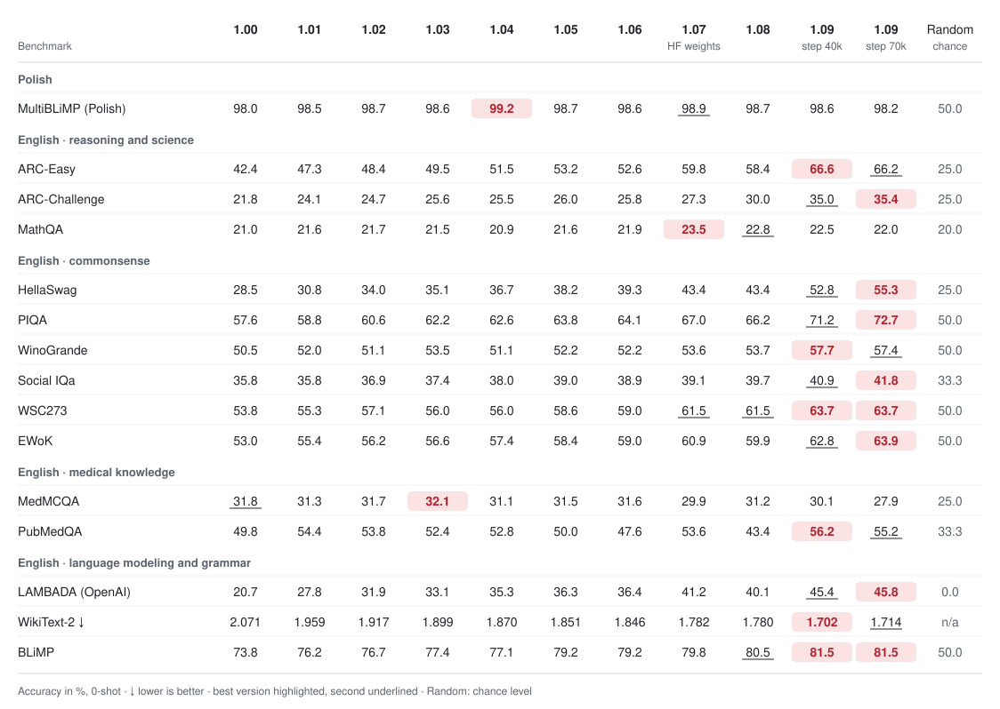

# Slayer 1B versions

Every Slayer 1B release and the 1.09 training checkpoints, on the same benchmarks with the same settings. [Back to the results](README.md).

<picture>
  <source media="(prefers-color-scheme: dark)" srcset="charts/slayer-versions-dark.svg">
  
</picture>

## Notes

- **1.09 is still training:** steps 40 000 and 70 000 are checkpoints, not releases. 1.09 starts from the weights of 1.08.
- Step 70 000 was measured in its own run, on 8 x RTX 4090 with the same code and settings ([protocol](../../research/studies/2026-10-lm-eval-benchmarks/results/full-run-2026-11/slayer-1.09-k70000/PROTOKOL.md)); every other result of the full run on an RTX 5090.
- **1.07** is scored from its weights on the Hugging Face Hub (`SlayerLab/Slayer1B-1.07`).
- **A version is not better on a test because its value is higher:** differences of one or two points are often within the standard errors below. The paired comparisons of 1.09 step 40 000 with 1.08 are in [its report](../../research/studies/2026-10-lm-eval-benchmarks/results/full-run-2026-11/slayer-1.09-k40000/RAPORT.md).
- Generated by `python -m codesota.leaderboard` from the result files; do not edit by hand.

## Values

Value ± standard error, accuracy in %. Standard errors are over questions, except over minimal-pair paradigms for BLiMP, over item templates for EWoK, over twin-sentence pairs for WinoGrande, and over schemas for WSC273.

<table>
<tr><th align="left">Benchmark</th><th>1.00 </th><th>1.01 </th><th>1.02 </th><th>1.03 </th><th>1.04 </th><th>1.05 </th><th>1.06 </th><th>1.07 HF weights</th><th>1.08 </th><th>1.09 step 40k</th><th>1.09 step 70k</th><th>Random chance</th></tr>
<tr><td colspan="13"><b>Polish</b></td></tr>
<tr><td>MultiBLiMP (Polish)</td><td align="right">98.0 ± 0.2</td><td align="right">98.5 ± 0.2</td><td align="right">98.7 ± 0.2</td><td align="right">98.6 ± 0.2</td><td align="right">99.2 ± 0.2</td><td align="right">98.7 ± 0.2</td><td align="right">98.6 ± 0.2</td><td align="right">98.9 ± 0.2</td><td align="right">98.7 ± 0.2</td><td align="right">98.6 ± 0.2</td><td align="right">98.2 ± 0.2</td><td align="right">50.0</td></tr>
<tr><td colspan="13"><b>English · reasoning and science</b></td></tr>
<tr><td>ARC-Easy</td><td align="right">42.4 ± 1.0</td><td align="right">47.3 ± 1.0</td><td align="right">48.4 ± 1.0</td><td align="right">49.5 ± 1.0</td><td align="right">51.5 ± 1.0</td><td align="right">53.2 ± 1.0</td><td align="right">52.6 ± 1.0</td><td align="right">59.8 ± 1.0</td><td align="right">58.4 ± 1.0</td><td align="right">66.6 ± 1.0</td><td align="right">66.2 ± 1.0</td><td align="right">25.0</td></tr>
<tr><td>ARC-Challenge</td><td align="right">21.8 ± 1.2</td><td align="right">24.1 ± 1.3</td><td align="right">24.7 ± 1.3</td><td align="right">25.6 ± 1.3</td><td align="right">25.5 ± 1.3</td><td align="right">26.0 ± 1.3</td><td align="right">25.8 ± 1.3</td><td align="right">27.3 ± 1.3</td><td align="right">30.0 ± 1.3</td><td align="right">35.0 ± 1.4</td><td align="right">35.4 ± 1.4</td><td align="right">25.0</td></tr>
<tr><td>MathQA</td><td align="right">21.0 ± 0.7</td><td align="right">21.6 ± 0.8</td><td align="right">21.7 ± 0.8</td><td align="right">21.5 ± 0.8</td><td align="right">20.9 ± 0.7</td><td align="right">21.6 ± 0.8</td><td align="right">21.9 ± 0.8</td><td align="right">23.5 ± 0.8</td><td align="right">22.8 ± 0.8</td><td align="right">22.5 ± 0.8</td><td align="right">22.0 ± 0.8</td><td align="right">20.0</td></tr>
<tr><td colspan="13"><b>English · commonsense</b></td></tr>
<tr><td>HellaSwag</td><td align="right">28.5 ± 0.5</td><td align="right">30.8 ± 0.5</td><td align="right">34.0 ± 0.5</td><td align="right">35.1 ± 0.5</td><td align="right">36.7 ± 0.5</td><td align="right">38.2 ± 0.5</td><td align="right">39.3 ± 0.5</td><td align="right">43.4 ± 0.5</td><td align="right">43.4 ± 0.5</td><td align="right">52.8 ± 0.5</td><td align="right">55.3 ± 0.5</td><td align="right">25.0</td></tr>
<tr><td>PIQA</td><td align="right">57.6 ± 1.2</td><td align="right">58.8 ± 1.1</td><td align="right">60.6 ± 1.1</td><td align="right">62.2 ± 1.1</td><td align="right">62.6 ± 1.1</td><td align="right">63.8 ± 1.1</td><td align="right">64.1 ± 1.1</td><td align="right">67.0 ± 1.1</td><td align="right">66.2 ± 1.1</td><td align="right">71.2 ± 1.1</td><td align="right">72.7 ± 1.0</td><td align="right">50.0</td></tr>
<tr><td>WinoGrande</td><td align="right">50.5 ± 1.3</td><td align="right">52.0 ± 1.3</td><td align="right">51.1 ± 1.2</td><td align="right">53.5 ± 1.3</td><td align="right">51.1 ± 1.3</td><td align="right">52.2 ± 1.2</td><td align="right">52.2 ± 1.2</td><td align="right">53.6 ± 1.3</td><td align="right">53.7 ± 1.3</td><td align="right">57.7 ± 1.3</td><td align="right">57.4 ± 1.3</td><td align="right">50.0</td></tr>
<tr><td>Social IQa</td><td align="right">35.8 ± 1.1</td><td align="right">35.8 ± 1.1</td><td align="right">36.9 ± 1.1</td><td align="right">37.4 ± 1.1</td><td align="right">38.0 ± 1.1</td><td align="right">39.0 ± 1.1</td><td align="right">38.9 ± 1.1</td><td align="right">39.1 ± 1.1</td><td align="right">39.7 ± 1.1</td><td align="right">40.9 ± 1.1</td><td align="right">41.8 ± 1.1</td><td align="right">33.3</td></tr>
<tr><td>WSC273</td><td align="right">53.8 ± 2.0</td><td align="right">55.3 ± 2.1</td><td align="right">57.1 ± 2.2</td><td align="right">56.0 ± 2.2</td><td align="right">56.0 ± 2.2</td><td align="right">58.6 ± 2.2</td><td align="right">59.0 ± 2.0</td><td align="right">61.5 ± 2.1</td><td align="right">61.5 ± 2.2</td><td align="right">63.7 ± 2.4</td><td align="right">63.7 ± 2.3</td><td align="right">50.0</td></tr>
<tr><td>EWoK</td><td align="right">53.0 ± 0.8</td><td align="right">55.4 ± 0.8</td><td align="right">56.2 ± 0.8</td><td align="right">56.6 ± 0.8</td><td align="right">57.4 ± 0.7</td><td align="right">58.4 ± 0.7</td><td align="right">59.0 ± 0.7</td><td align="right">60.9 ± 0.7</td><td align="right">59.9 ± 0.7</td><td align="right">62.8 ± 0.8</td><td align="right">63.9 ± 0.7</td><td align="right">50.0</td></tr>
<tr><td colspan="13"><b>English · medical knowledge</b></td></tr>
<tr><td>MedMCQA</td><td align="right">31.8 ± 0.7</td><td align="right">31.3 ± 0.7</td><td align="right">31.7 ± 0.7</td><td align="right">32.1 ± 0.7</td><td align="right">31.1 ± 0.7</td><td align="right">31.5 ± 0.7</td><td align="right">31.6 ± 0.7</td><td align="right">29.9 ± 0.7</td><td align="right">31.2 ± 0.7</td><td align="right">30.1 ± 0.7</td><td align="right">27.9 ± 0.7</td><td align="right">25.0</td></tr>
<tr><td>PubMedQA</td><td align="right">49.8 ± 2.2</td><td align="right">54.4 ± 2.2</td><td align="right">53.8 ± 2.2</td><td align="right">52.4 ± 2.2</td><td align="right">52.8 ± 2.2</td><td align="right">50.0 ± 2.2</td><td align="right">47.6 ± 2.2</td><td align="right">53.6 ± 2.2</td><td align="right">43.4 ± 2.2</td><td align="right">56.2 ± 2.2</td><td align="right">55.2 ± 2.2</td><td align="right">33.3</td></tr>
<tr><td colspan="13"><b>English · language modeling and grammar</b></td></tr>
<tr><td>LAMBADA (OpenAI)</td><td align="right">20.7 ± 0.6</td><td align="right">27.8 ± 0.6</td><td align="right">31.9 ± 0.6</td><td align="right">33.1 ± 0.7</td><td align="right">35.3 ± 0.7</td><td align="right">36.3 ± 0.7</td><td align="right">36.4 ± 0.7</td><td align="right">41.2 ± 0.7</td><td align="right">40.1 ± 0.7</td><td align="right">45.4 ± 0.7</td><td align="right">45.8 ± 0.7</td><td align="right">0.0</td></tr>
<tr><td>WikiText-2 ↓</td><td align="right">2.071 ± 0.019</td><td align="right">1.959 ± 0.018</td><td align="right">1.917 ± 0.017</td><td align="right">1.899 ± 0.017</td><td align="right">1.870 ± 0.016</td><td align="right">1.851 ± 0.016</td><td align="right">1.846 ± 0.016</td><td align="right">1.782 ± 0.015</td><td align="right">1.780 ± 0.015</td><td align="right">1.702 ± 0.016</td><td align="right">1.714 ± 0.015</td><td align="right">n/a</td></tr>
<tr><td>BLiMP</td><td align="right">73.8 ± 2.6</td><td align="right">76.2 ± 2.3</td><td align="right">76.7 ± 2.3</td><td align="right">77.4 ± 2.2</td><td align="right">77.1 ± 2.3</td><td align="right">79.2 ± 2.1</td><td align="right">79.2 ± 2.0</td><td align="right">79.8 ± 2.1</td><td align="right">80.5 ± 2.1</td><td align="right">81.5 ± 2.1</td><td align="right">81.5 ± 2.1</td><td align="right">50.0</td></tr>
</table>
