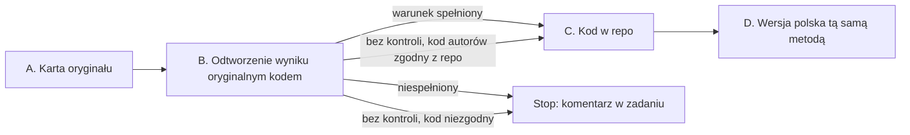

# Metodologia: najpierw oryginał, potem wersja polska

Każdy benchmark ma autorów, pracę i kod, który liczy wynik. Zanim dodasz benchmark do tego repo albo zbudujesz jego
polską wersję, poznajesz i odtwarzasz oryginał. Polska wersja przenosi tę samą metodę (format, metrykę, agregację) na
inny język. Nie wymyśla nowej.

Ten sam benchmark liczony innym promptem, inną normalizacją albo inną agregacją daje inną liczbę. Bez odtworzonego
oryginału nie wiadomo, czy różnica w wyniku to model, czy kod. Jedna wspólna ścieżka (np. format cloze w
`common/hipoteza_formatu.py`) pasuje do części testów, ale nie do wszystkich. Generacja, perpleksja, pary zdań i testy
z agregacją po kategoriach liczą się inaczej.

Repo mierzy każdy model, który da się pobrać z Hugging Face, nie tylko Slayera 1B. Wszystkie ścieżki niżej są względne
wobec katalogu `research/`.

## Etapy pracy

Praca ma cztery etapy. Każdy kończy się plikiem w katalogu benchmarku `benchmarks/<name>/`. Wzory plików są w
[`benchmarks/_template/`](benchmarks/_template/README.md). Etap B kończy się **warunkiem odtworzenia**. Bez
odtworzonego wyniku nie przechodzisz dalej. Wyjątkiem jest benchmark „bez kontroli” (sekcja „Bez kontroli”).
Warunku odtworzenia nie myl z **bramką liczb** z `tools/`. Bramka liczb sprawdza liczby w raportach. Opisuje ją
sekcja „Bramka liczb” w [`README.md`](README.md#bramka-liczb).

Benchmark, który nie ma oryginału (np. polski zbiór pisany od zera, held-out), zamiast etapów A i B ma kartę zbioru.
Opisuje ją sekcja „Benchmark bez oryginału: karta zbioru (DATASET.md)”.

Każdy etap możesz oddać osobnym PR. Etapy A i B najlepiej oddać we wcześniejszym, osobnym PR. Wtedy recenzent
sprawdza kartę i odtworzenie, zanim ktokolwiek policzy model.

## A. Karta oryginału (ORIGINAL.md)

Przeczytaj pracę i kod autorów. Wypełnij każde pole. Gdy czegoś nie da się ustalić, wpisz „nieustalone” i dopisz,
gdzie szukałeś.

| pole | co wpisać |
|---|---|
| Co mierzy | umiejętność, jednym zdaniem, słowami autorów |
| Źródła | praca (arXiv/ACL), repo autorów z commitem, karta zbioru na HF z rewizją |
| Dane | split używany do wyników w pracy, n, licencja, czy split testowy ma ukryte odpowiedzi |
| Format zadania | wybór z k opcji, para zdań, uzupełnienie, generacja, perpleksja |
| Prompt | dokładny szablon z pracy albo kodu (separatory, spacje, etykiety odpowiedzi), liczba przykładów w prompcie i skąd są brane |
| Ocena | metryka (acc, acc_norm, exact match, F1, perpleksja, BPB) i sposób jej liczenia: po czym normalizowana jest długość (znaki, bajty, tokeny), jak normalizowany jest tekst odpowiedzi |
| Metryka decyzyjna | **jedna** metryka, po której porównujesz modele i podejmujesz decyzje; pozostałe to metryki pomocnicze |
| Agregacja | średnia po pytaniach czy po kategoriach/paradygmatach, wagi |
| Bazy | baza losowa i większościowa (sekcja „Bazy: losowa i większościowa” w [`README.md`](README.md#bazy-losowa-i-większościowa)) |
| SNR | stosunek sygnału do szumu (Słowniczek): rozrzut wyników między modelami albo checkpointami, SE pomiaru, iloraz i na jakich modelach. Wolno go policzyć z opublikowanych wyników (praca, plik wyników, leaderboard) albo wpisać „nieustalone” z tym, gdzie szukałeś; własny pomiar nie jest potrzebny |
| Wyniki referencyjne | co najmniej jeden opublikowany wynik modelu, który da się pobrać (model, liczba, tabela w pracy albo plik wyników), jako snapshot z datą odczytu; gdy takiego wyniku nie ma: „brak” i miejsca, w których szukano (etap B idzie wtedy jako „bez kontroli”) |
| Train policy | `eval_only` (żaden split nie trafia do treningu), `decon_only` (zbiór służy tylko do dekontaminacji danych treningowych) albo `train_allowed` (wymień, które splity wolno trenować); sekcja „Czystość benchmarku” |
| Decyzja treningowa | co oznacza słaby wynik: jakie dane albo jaka metoda treningu z niego wynika, a czego nie wolno z niego wnioskować |
| Znane rozbieżności | czym różnią się popularne implementacje (np. zadanie lm-eval) od kodu autorów, znane błędy w danych, kontaminacja |

Liczbę spoza `results/LICZBY.json`, np. wynik referencyjny z pracy, oznaczasz na końcu jej linii znacznikiem
`<!-- liczba-spoza-wynikow: skąd jest liczba -->`. Bez znacznika bramka liczb ją odrzuci. Wzór jest w
`benchmarks/wikitext-2/ORIGINAL.md`.

## B. Odtworzenie wyniku oryginalnym kodem (REPRODUCTION.md)

1. Uruchom kod autorów. Gdy autorzy nie opublikowali kodu, użyj implementacji, którą wskazuje praca albo leaderboard
   z wynikami referencyjnymi. Często jest to zadanie lm-eval z konkretnego commitu. Zapisz, dlaczego wybrałeś tę
   implementację.
2. Policz model, który ma wynik referencyjny w karcie. Użyj tego samego splitu, tego samego promptu i tej samej
   rewizji modelu. Domyślnie to model kontrolny z sekcji „Model kontrolny etapu B”. Gdy żaden model z listy nie ma
   opublikowanego wyniku, praca się nie zatrzymuje. Etap B idzie wtedy według sekcji „Bez kontroli”.
3. Zapisz komendę, commit kodu oraz rewizje zbioru i modelu. Zapisz też n, wynik z SE i różnicę wobec wartości
   referencyjnej. Ten przebieg dostaje wpis w `RECIPE.md`, jak każdy inny.

**Warunek odtworzenia** dla trafności jest spełniony, gdy różnica mieści się w ±2 pkt. Gdy 2 SE > 2 pkt, różnica ma
się mieścić w granicach 2 SE. Próg dla perpleksji i BPB opisuje sekcja „Próg dla perpleksji i BPB”.

### Próg dla perpleksji i BPB

Wspólny próg zgodności dla perpleksji i BPB jest **do ustalenia** (kamień
[„Pipeline ewaluacji zgodny ze Space i odtwarzalny przez nową osobę”](https://github.com/slayerlabs/benchmarks-fabryka-ai/milestone/2)).
Do tego czasu autor zapisuje w `REPRODUCTION.md` własny próg z uzasadnieniem, zanim policzy wynik. Bez progu
zapisanego przed pomiarem werdykt etapu B brzmi „nierozstrzygalny”, nawet gdy liczby wyglądają na zgodne.

Niespełniony warunek zatrzymuje pracę. Wpisz w komentarzu zadania, co policzyłeś i jaką różnicę dostałeś. Ta
informacja przyda się całemu zespołowi, bo ta sama różnica siedziałaby w każdym wyniku liczonym dalej. Brak
opublikowanego wyniku nie jest niespełnionym warunkiem. Wtedy obowiązuje sekcja „Bez kontroli”.

### Bez kontroli

Gdy żaden model z listy w sekcji „Model kontrolny etapu B” nie ma opublikowanego wyniku, w `REPRODUCTION.md` wpisujesz
„bez kontroli” i miejsca, w których szukałeś. Zamiast odtworzenia wyniku sprawdzasz wtedy zgodność kodu. Ten sam
model liczysz kodem autorów i kodem z repo (lm-eval), na tych samych danych. Może to być np. Pythia-1B v0,
`EleutherAI/pythia-1b-v0` @ `step143000`. Warunek to co najmniej 99% zgodnych decyzji na przykład, jak w teście
zgodności z etapu C. Dla perpleksji i BPB różnica ma być poniżej 0,1%.

Czasem kodu autorów nie da się uruchomić, np. gdy autorzy go nie opublikowali. Wtedy wpisz powód w `REPRODUCTION.md`,
a zgodność sprawdzi recenzent PR. Niezgodny kod zatrzymuje pracę tak samo jak niespełniony warunek. Szukasz przyczyny
i opisujesz ją w REPRODUCTION.md, zanim liczysz dalej.

## C. Kod w repo

Domyślnie repo woła kod z etapu B. Robi to bezpośrednio albo przez cienką nakładkę. Nakładka tylko ładuje model i
zapisuje wyniki per pytanie. Nie zmienia promptu ani metryki. Model z biblioteki transformers ładuje się zwykłym
`AutoModelForCausalLM`. Slayer 1B ładuje się przez `common/slayer_model.py`, bo jego `config.json` nie ma
`model_type`.

Własna implementacja (np. klucz w `common/hipoteza_formatu.py`) jest dopuszczalna tylko po teście zgodności:

- ten sam model i te same pytania co w etapie B;
- wynik w granicach SE od wyniku oryginalnego kodu;
- zgodność decyzji per pytanie co najmniej 99% (dla perpleksji: różnica per dokument poniżej 0,1%);
- test zgodności zapisany jako `tests/test_<name>_zgodnosc.py` na próbce 10–20 pytań z wynikami oryginalnego kodu w
  pliku, bez sieci.

Dodatkowe sposoby liczenia, np. cloze, BPB poprawnej odpowiedzi, PMI albo inny format promptu, stoją obok wyniku
liczonego oryginalną metodą. Nigdy go nie zastępują. W raporcie mają osobną tabelę z nazwą metody.

Kod wspólny trafia do `common/` dopiero wtedy, gdy używa go więcej niż jeden benchmark.

## D. Wersja polska (POLISH.md)

Wersja polska to osobny katalog `benchmarks/<name>-pl/`, założony z [`benchmarks/_template/`](benchmarks/_template/README.md). Zamiast `ORIGINAL.md` i `REPRODUCTION.md` ma
`POLISH.md`. Wzór to [`benchmarks/_template/POLISH.md`](benchmarks/_template/POLISH.md). `POLISH.md` wskazuje
katalog oryginału `benchmarks/<name>/`, w którym są etapy A–C. Wersja polska ma też własne `RECIPE.md`, kod i
`results/`, jak każdy benchmark.

`benchmarks/ewok-pl/` nie jest wzorem. Powstał przed tą metodologią i jest uzupełniany w zadaniu
[#34](https://github.com/slayerlabs/benchmarks-fabryka-ai/issues/34).

### D1. Przetłumaczyć czy napisać od zera?

Najpierw ustal, czy treść benchmarku przechodzi na polski. Metoda (format, metryka, agregacja) przechodzi zawsze. Treść
nie zawsze. Pytanie o stan w USA, amerykańskie prawo, sport czy obyczaje po przetłumaczeniu na polski dalej sprawdza
wiedzę o USA. Wiedzy o Polsce nie sprawdza.

| typ treści | przykłady | co robisz |
|---|---|---|
| Niezależna od kraju i języka | GSM8K, MathQA (matematyka), logika | tłumaczysz 1:1; zmieniasz tylko waluty, imiona i jednostki, gdy brzmią obco |
| Wiedza uniwersalna | ARC, SciQ, OpenBookQA (fizyka, biologia) | tłumaczysz i sprawdzasz próbkę |
| Wiedza lokalna i kulturowa | fakty o kraju, prawo, historia, geografia, instytucje, normy społeczne (części MMLU, TriviaQA, Social IQa) | osoba z Polski pisze nowe pytania od zera |
| Zjawiska językowe | BLiMP, LAMBADA, WinoGrande, WSC | osoba z Polski pisze nowe przykłady od zera na zjawiskach polszczyzny (np. przypadki, rodzaj, aspekt) |

**Testy kulturowe i językowe pisze od zera osoba z Polski.** Nie tłumaczy oryginalnych pytań, nie parafrazuje ich i
nie szuka „polskiego odpowiednika” konkretnego pytania. Z oryginału bierze tylko metodę. Metoda to format zadania,
metryka, agregacja i liczba przykładów, która daje SE nie gorsze niż w oryginale. Pytania są inne, bo mają sprawdzać
polski teren.

Żeby to rozstrzygnąć, wylosuj 50 przykładów i oznacz każdy jednym z czterech typów z tabeli. Zapisz podział w
`POLISH.md` razem z wynikiem. Wynik rozstrzyga tak:

- prawie wszystkie (ponad 90%) to treść niezależna albo uniwersalna → tłumaczenie;
- lokalnych albo językowych jest ponad 10% → usuwasz je z tłumaczenia. Gdy to większość zbioru, cały zbiór piszesz od
  zera według sekcji „Benchmark bez oryginału: karta zbioru (DATASET.md)”;
- zbiór pisany od zera ma ten sam format i metrykę co oryginał. Liczba przykładów daje w nim SE nie gorsze niż w
  oryginale.

Polskie wersje zacznij od benchmarków, które da się przetłumaczyć (pierwsze dwa wiersze tabeli). Pisanie od zera to
osobne, większe zadanie na dłuższy czas. Chodzi o testy wiedzy o Polsce i polszczyźnie, których nikt jeszcze nie ma.
Wstępny podział 38 angielskich testów ze Space i listę istniejących polskich benchmarków znajdziesz w
[BENCHMARKI_PL.md](BENCHMARKI_PL.md).

### D2. Mapowanie metody

Wersja polska zachowuje metodę z karty. Zanim zbudujesz dane, wypełnij tabelę. Przy każdym wierszu karty oryginału
wpisz „bez zmian” albo „zmiana: co i dlaczego”.

| element | zwykle | uwagi |
|---|---|---|
| Metryka, agregacja, liczba opcji, liczba przykładów w prompcie | bez zmian | zmiana tylko z zapisanym powodem |
| Normalizacja długości | po bajtach albo znakach, jak w oryginale | po tokenach zależy od tokenizera; polskie litery z ogonkiem to 2 bajty UTF-8, co przesuwa normalizację po bajtach względem znaków |
| Prompt | tłumaczony szablon o tej samej strukturze | etykiety („Odpowiedź:”), separatory i spacje jak w oryginale |
| Dane | tłumaczenie albo nowe pytania napisane od zera | przy tłumaczeniu: kto, jakim narzędziem, próbka min. 50 przykładów sprawdzona przez człowieka, lista usuniętych przykładów (np. gra słów, która nie przechodzi na polski) |
| Kontaminacja | sprawdzona dla nowego zbioru | szczególnie gdy źródło polskich danych jest w sieci |

### D3. Dwie kontrole przed pierwszym wynikiem

1. **Kod wersji polskiej na danych oryginalnych.** Kod wersji polskiej uruchamiasz na angielskim zbiorze i modelu z
   etapu B. Ma dać wynik z etapu B, według tych samych kryteriów zgodności co w etapie C. To dowód, że metoda nie
   zmieniła się przy przenoszeniu na polski.
2. **Bazy i model, który zna polski.** Liczysz bazę losową i większościową polskiego zbioru. Liczysz też wynik
   modelu, który zna polski, np. `speakleash/Bielik-1.5B-v3` albo `utter-project/EuroLLM-1.7B` z sekcji „Pięć modeli
   odniesienia”. Gdy taki model wypada na poziomie bazy, coś jest nie tak z danymi albo z promptem. Taki wynik nic
   jeszcze nie mówi o mierzonym modelu.

## Benchmark bez oryginału: karta zbioru (DATASET.md)

Zbiór, który nie ma pracy ani kodu autorów do odtworzenia (polski test pisany od zera, held-out tekst),
nie przechodzi etapów A i B. Zamiast nich ma kartę zbioru `DATASET.md` i kontrolę na modelu, który zna polski. Wzór
karty to [`benchmarks/_template/DATASET.md`](benchmarks/_template/DATASET.md). Etap C, etap D (jeśli dotyczy) i
przepis zostają bez zmian.

| pole | co wpisać |
|---|---|
| Co mierzy | umiejętność, jednym zdaniem; jaką metodę (format, metryka, agregacja) przejmuje i od jakiego benchmarku, jeśli od jakiegoś |
| Jak powstał | źródło tekstów, daty, narzędzia, kryteria doboru, licencja |
| Kto pisał i kto sprawdzał | osoby (nick GitHub), co sprawdzał drugi człowiek i na ilu przykładach |
| Jawna próbka | około 10% zbioru w repo, ta sama dla wszystkich; do testów kodu i do ręcznego sprawdzenia oceny |
| Ukryta reszta | gdzie leży (poza repo), kto ją trzyma, jak poprosić o przebieg na niej |
| Jak liczyć | metryka decyzyjna, prompt, ocena (dla odpowiedzi tekstowych: lista dopuszczalnych form, ocena deterministyczna, bez modelu-sędziego), agregacja, n i oczekiwane SE |
| Bazy | baza losowa i większościowa |
| SNR | jak w karcie oryginału (Słowniczek) |
| Train policy i decyzja treningowa | jak w karcie oryginału |

**Kontrola** zastępuje warunek odtworzenia. Model, który zna polski (sekcja D3, punkt 2), ma mieć wynik wyraźnie
powyżej bazy. Wyraźnie znaczy, że różnica od bazy przekracza 2 SE. Wynik na poziomie bazy zatrzymuje pracę tak samo
jak niespełniony warunek odtworzenia.

Zbiór liczony przez NLL albo BPB nie ma odpowiedzi do wyboru, więc nie ma też bazy losowej. Kontrola wygląda wtedy
inaczej. Model, który zna język zbioru, ma mieć BPB niższe niż model bez tego języka, o co najmniej 2 SE. Dla
polskiego model znający język to `speakleash/Bielik-1.5B-v3` albo `utter-project/EuroLLM-1.7B`. Model bez tego
języka to `EleutherAI/pythia-1b-v0` @ `step143000`. SE różnicy liczysz bootstrapem po dokumentach. Losujesz
dokumenty ze zwracaniem i na każdej próbie liczysz różnicę BPB obu modeli.

## Modele: kontrolny i odniesienia

### Model kontrolny etapu B

Model kontrolny to model, który da się pobrać, z opublikowanym wynikiem na tym benchmarku. Bierzesz **pierwszy
dostępny z listy**, w tej kolejności:

1. **`EleutherAI/pythia-1b-v0` @ `step143000`.** Opublikowane wyniki 0-shot z pełnym zapisem ustawień:
   [plik wyników Pythii v0](https://github.com/EleutherAI/pythia/blob/main/evals/pythia-v0/pythia-1b/zero-shot/pythia-1b-0shot-global_step143000_eval_results_11-28-2022-15-14-35.json).
   Liczby policzono w 2022 r. starszą wersją lm-eval, więc w `REPRODUCTION.md` zapisz wersję, której użyłeś. Plik ma
   tylko te zadania: `arc_challenge`, `arc_easy`, `lambada_openai`, `logiqa`, `piqa`, `sciq`, `winogrande`, `wsc`, 67
   zadań `blimp_*` i 57 zadań `hendrycksTest-*` (MMLU). Jego `wsc` to SuperGLUE WSC (104 przykłady), nie WSC273.
2. **`utter-project/EuroLLM-1.7B`** tam, gdzie jego karta modelu podaje wynik (ARC-Challenge, HellaSwag).
3. **Opublikowany wynik dowolnego modelu, który da się pobrać:** z tabeli w pracy autorów benchmarku albo z
   [Open LLM Leaderboard](https://huggingface.co/spaces/open-llm-leaderboard/open_llm_leaderboard). Zapisz model z
   rewizją i ustawienia, z którymi policzono wynik (prompt, liczba przykładów w prompcie, metryka, wersja kodu).

Kontrolę liczysz tym samym kodem co mierzony model. Jeśli wynik kontroli odbiega od opublikowanego, błąd jest w kodzie
ewaluacji, nie w mierzonym modelu.

**Kontrola musi odróżniać działający kod od zepsutego.** Opublikowany wynik modelu kontrolnego ma leżeć ponad 2 SE nad
bazą losową i nad bazą większościową (udział najczęstszej odpowiedzi). Inaczej ten sam wynik da też kod, który
zgaduje albo zawsze wybiera jedną odpowiedź. Wtedy bierzesz następny model z listy. Przykład: Pythia v0 na
ARC-Challenge i LogiQA leży przy poziomie losowym, a na BoolQ znany wynik 1B leży pod bazą większościową.

**Model kontrolny nie sprawdza ładowania Slayera.** Gdy Space ma wynik Slayera na tym teście, Slayer policzony Twoim
kodem na tych samych pytaniach panelu Space ma się z nim zgadzać w granicach 2 SE. Wynik referencyjny nie może
pochodzić z kodu, który sprawdzasz.

Gdy żaden model z listy nie ma opublikowanego wyniku, etap B idzie według sekcji „Bez kontroli” (wyżej). Praca się
wtedy nie zatrzymuje.

Benchmark polski albo bez oryginału nie ma opublikowanego wyniku do odtworzenia. Jego kontrolą jest model, który zna
polski (`speakleash/Bielik-1.5B-v3` albo `utter-project/EuroLLM-1.7B` z tabeli niżej). Warunkiem jest wynik wyraźnie
powyżej bazy (sekcja „Benchmark bez oryginału: karta zbioru (DATASET.md)”). Pythia nie jest tu wymagana. Wyjątkiem
jest zbiór liczony przez NLL albo BPB (karta zbioru).

### Pięć modeli odniesienia

Każdy benchmark porównuje mierzony model z pięcioma modelami, zawsze w tych rewizjach:

| model | rewizja | uwagi |
|---|---|---|
| `Qwen/Qwen3.5-0.8B-Base` | `dc7cdfe2ee4154fa7e30f5b51ca41bfa40174e68` | multimodalny; transformers z gałęzi main, commit przypięty w środowisku |
| `LiquidAI/LFM2.5-1.2B-Base` | `7453bca97ca1e67754c4035a4b4c584e1c9dd725` | ten sam co w Space |
| `speakleash/Bielik-1.5B-v3` | `4b25049621bf3952a1fc9314c89773102eda0333` | repo z bramką zgody na HF |
| `LiquidAI/LFM3-1.7B-Base` | `545fc8f4c7b5fa9f405105274cd29c4f8f44b526` | `trust_remote_code`, kod modelu z tej rewizji |
| `utter-project/EuroLLM-1.7B` | `c730cd9b616799ace3c65e927d63191446f59374` | |

### Kto liczy które modele

- **Autor PR** liczy tym samym kodem mierzony model i model kontrolny. Mierzony model to dziś Slayer 1B 1.06,
  `SlayerLab/Slayer1B-1.06` @ `ef81be58742544ad32e1afab38db011fec209609`. Model kontrolny wybierasz tak:
  - benchmark z oryginałem: pierwszy dostępny z listy w sekcji „Model kontrolny etapu B”;
  - benchmark polski i bez oryginału: model, który zna polski (`speakleash/Bielik-1.5B-v3` albo
    `utter-project/EuroLLM-1.7B`). Pythia nie jest wymagana, poza zbiorem liczonym przez NLL albo BPB (karta zbioru).
- **Przebieg centralny** liczy pięć modeli odniesienia na wspólnym GPU. Robi to dla każdego benchmarku po recenzji i
  zapisuje wyniki w `benchmarks/<name>/results/<model>/`. **Jest w budowie** i dziś jeszcze nie działa (kamień
  [„Przebieg centralny: 5 modeli odniesienia”](https://github.com/slayerlabs/benchmarks-fabryka-ai/milestone/8)).
  Do tego czasu autor PR nie musi liczyć modeli odniesienia.

## Przepis (RECIPE.md)

Każdy benchmark ma `RECIPE.md` z wpisem dla każdego wyniku. Wpis podaje:

- commit kodu z `main` (hash z gałęzi roboczej znika po spłaszczeniu historii);
- lockfile środowiska, z przypiętą wersją transformers;
- rewizje modelu i zbioru;
- dokładną komendę;
- seed, precyzję, sprzęt i datę.

Z samego przepisu ktoś inny za dwa tygodnie ma odtworzyć ten sam wynik. Czego nie zapisano, wpisz jako
„niezapisane”. Nie zgaduj. Wzór to [`benchmarks/_template/RECIPE.md`](benchmarks/_template/RECIPE.md).

Jest **w budowie** automat, który co tydzień odtworzy 20 pytań z losowego wyniku według jego przepisu. Różnicę
zgłosi sam. Prace śledzi kamień [„Tygodniowy automat odtwarzania”](https://github.com/slayerlabs/benchmarks-fabryka-ai/milestone/9).

## Czystość benchmarku

- Pytania benchmarku nie trafiają do treningu żadnego modelu. Nie piszemy też na ich podstawie danych treningowych,
  także jako „przykładów w podobnym stylu”.
- Zbiór benchmarku służy do deduplikacji i dekontaminacji danych treningowych. Kto składa dane treningowe, usuwa z
  nich teksty pokrywające się z benchmarkiem.
- Pojedyncze pytania wolno oglądać, żeby sprawdzić, czy ocena działa poprawnie (prompt, parsowanie odpowiedzi,
  normalizacja). Wniosek o modelu wyciągasz z wyniku zbiorczego, nie z pojedynczych pytań.
- Train policy (`eval_only`, `decon_only`, `train_allowed`) stoi w karcie. Wynik na zbiorze, którego split był w
  treningu, oznaczasz w raporcie jako trenowany.

## Wersja lm-eval

**Obowiązuje środowisko z `common/requirements.lock.txt`.** Instalację opisuje sekcja „Przygotowanie (raz)” w
[`README.md`](README.md#przygotowanie-raz). Środowisko zawiera lm-eval 0.4.9.1 z PyPI. Tej wersji używa cały kod w
`common/`.

Jedna różnica zostaje. Protokół Space (`METHOD.md`) podaje lm-eval w commicie
[`6d2abda4`](https://github.com/EleutherAI/lm-evaluation-harness/commit/6d2abda4fd171e68a8789330c4149e37c1ca0bda)
(wersja 0.4.8, 5.03.2025). Tag `v0.4.9.1` jest 160 commitów dalej. Dlatego dla każdego benchmarku liczonego przez
lm-eval porównaj plik zadania w obu wersjach, czyli YAML i funkcje przetwarzania. Wynik zapisz w karcie, w polu
„Znane rozbieżności”. Wpisz, że plik jest identyczny, albo czym się różni. Wzór jest w
`benchmarks/wikitext-2/ORIGINAL.md`.

Nikt w tym repo nie sprawdził instalacji samego commitu `6d2abda4`
(`pip install "lm_eval @ git+https://github.com/EleutherAI/lm-evaluation-harness@6d2abda4"`). Jeśli jej użyjesz, zrób
to w osobnym środowisku i zapisz w `RECIPE.md`.

## Wyjątek: 7 testów Space do 8.11

Część testów ma w Space
[SlayerLab/Slayer1B-Benchmarks](https://huggingface.co/spaces/SlayerLab/Slayer1B-Benchmarks) status `not_run` dla
Slayera 1.06. To PIQA, WSC273, LogiQA, MathQA, IFEval, PubMedQA i Social IQa. Liczysz je do 8.11 protokołem Space,
czyli według `METHOD.md` Space i ustawień z `tasks_50.json`. Wersja lm-eval jest taka, jak w sekcji „Wersja lm-eval”.

**Kontrola** to pierwszy dostępny model z listy w sekcji „Model kontrolny etapu B”, liczony na tym samym lm-eval.
Najpierw `EleutherAI/pythia-1b-v0` @ `step143000`, potem `utter-project/EuroLLM-1.7B`. Na końcu opublikowany wynik
dowolnego modelu, który da się pobrać, z pracy autorów albo z Open LLM Leaderboard, z rewizją i ustawieniami.
Kontrola liczy się tylko wtedy, gdy odróżnia działający kod od zepsutego (warunek w „Model kontrolny etapu B”). Open
LLM Leaderboard v2 ma z tych testów tylko IFEval. IFEval nie ma bazy losowej, więc bazą jest wynik stałej, pustej
odpowiedzi.

**Próg wstrzymania** jest ten sam co warunek odtworzenia z sekcji B. Różnica kontroli wobec opublikowanej wartości
ma się mieścić w ±2 pkt. Gdy 2 SE > 2 pkt, ma się mieścić w granicach 2 SE. Różnica poza tym progiem wstrzymuje
wysłanie wyniku. Przy 200 pytaniach 2 SE często przekracza 2 pkt. WSC273 ma SE około 3 pkt, więc próg wynosi około
±6 pkt. PubMedQA ma SE około 2,2 pkt, więc próg wynosi
około ±4,4 pkt.

Co jest w [pliku wyników Pythii v0](https://github.com/EleutherAI/pythia/blob/main/evals/pythia-v0/pythia-1b/zero-shot/pythia-1b-0shot-global_step143000_eval_results_11-28-2022-15-14-35.json)
(odczyt 31.10.2026, 0-shot, `version` 0 każdego zadania):

| test Space | zadanie w pliku Pythii | kontrola z Pythii |
|---|---|---|
| PIQA | `piqa` | jest |
| LogiQA | `logiqa` | jest |
| WSC273 | brak; `wsc` w pliku to SuperGLUE WSC (104 przykłady), inny zbiór niż WSC273 (273) | nie, następny z listy |
| MathQA | brak | nie, następny z listy |
| PubMedQA | brak | nie, następny z listy |
| Social IQa | brak | nie, następny z listy |
| IFEval | brak | nie, następny z listy |

Gdy żadnej kontroli z listy nie ma, wynik i tak idzie do Space, ale jako wstępny. Autor wpisuje w opisie PR „bez
kontroli, wynik wstępny” i wymienia, gdzie szukał. Brak kontroli nie wstrzymuje terminu.

Minimum obowiązuje także tu (sekcja „Siła dowodu”): wynik Slayera i kontroli jest w `results/LICZBY.json` z SE, a
bramka liczb kończy się kodem 0. Wynik przekazujesz w opisie PR. Wklejasz wartość, n, CI95, komendę i rewizje.
Dopisujesz kontrolę albo „bez kontroli, wynik wstępny”. Po merge'u Arek, właściciel modelu Slayer i Space, wgrywa wynik do `results.json` Space. Kartę oryginału
(etap A) i resztę „zrobione” dopisujesz po terminie, w osobnym zadaniu.

## Pierwsze zadanie i recenzja

Pierwsze zadanie opisuje [`CONTRIBUTING.md`, „Pierwsze zadanie”](../CONTRIBUTING.md#pierwsze-zadanie).

**Recenzja idzie w dwóch krokach:**

1. Najpierw automaty. Komendy z sekcji [„Przed PR”](../README.md#przed-pr) README repo kończą się kodem 0. To testy
   zmienionego benchmarku z testem zgodności z etapu C, `tests/test_liczby_raportow.py` i bramka liczb. Uruchamia je
   autor PR przed otwarciem PR, bo `research/` nie ma CI. Recenzent sprawdza, że autor je uruchomił. W razie
   wątpliwości uruchamia je sam.
2. Potem osoba, która zna ten kod, czyta kartę i odtwarza co najmniej jeden wynik z `RECIPE.md`.

Nie ma stałych ról. Recenzuje ktoś inny niż autor, kto zna dany kod albo benchmark. Wynik, który idzie dalej, do Space
albo do decyzji o treningu, dostaje etykietę `needs-recheck`. Wtedy druga osoba liczy go od zera, na innym sprzęcie.
Nie zagląda przy tym w liczby autora. Wynik różny od wartości, która już stoi w Space, nie zmienia Space bez takiego
przeliczenia.

## Siła dowodu

Siła wymaganego dowodu rośnie z kosztem błędnej decyzji i kosztem jej odwrócenia. Minimum obowiązuje każdy raport
zawsze: liczba jest w `results/LICZBY.json`, a każde porównanie ma SE i werdykt (sekcja „SE i werdykt” w
[`README.md`](README.md#se-i-werdykt)). Proporcjonalność tego minimum nie luzuje. Decyzji taniej do cofnięcia, jak
wybór narzędzia albo wstępna eksploracja, wystarcza jeden przebieg oznaczony w raporcie jako wstępny. Przykład to
sprawdzenie, czy format cloze z `common/hipoteza_formatu.py` w ogóle pasuje do nowego testu. Decyzja droga albo
wychodząca na zewnątrz wymaga więcej: odtworzenia wyniku przez recenzenta (etykieta `needs-recheck`), kilku seedów
albo przebiegów i kontroli. Tak jest z wynikiem wysyłanym do Space i porównywanym z cudzym wynikiem, ze startem
długiego treningu w `slayer-1b/wygaszanie/` i ze zmianą protokołu, np. wersji lm-eval albo formatu odpowiedzi. Gdy
nie wiesz, do której grupy należy decyzja, traktuj ją jak drogą.

## Kamienie bez terminu

Kamień [#6](https://github.com/slayerlabs/benchmarks-fabryka-ai/milestone/6) dotyczy opisu zbiorów (baza, format, n,
SNR, kontaminacja). Nie ma terminu. Terminu nie mają też kamienie #8–#10 (przebieg centralny, tygodniowy automat
odtwarzania, polskie benchmarki od zera). To prace ciągłe albo w budowie. Zamyka się je, gdy spełnią opis kamienia,
a nie w dniu z kalendarza. Terminy mają kamienie #1–#5.

## Co oddajesz

PR do `main` z katalogiem `benchmarks/<name>/` według [`benchmarks/_template/`](benchmarks/_template/README.md).
Benchmark jest skończony, gdy spełnia sekcję „Definicja „zrobione”” w [README repo](../README.md#definicja-zrobione).

## Słowniczek

- **Repo benchmarków:** to repo,
  [slayerlabs/benchmarks-fabryka-ai](https://github.com/slayerlabs/benchmarks-fabryka-ai).
- **Space:** strona z wynikami Slayera 1B na Hugging Face,
  [SlayerLab/Slayer1B-Benchmarks](https://huggingface.co/spaces/SlayerLab/Slayer1B-Benchmarks). Sama nic nie liczy,
  tylko wyświetla `results.json`. Protokół liczenia opisuje
  [`METHOD.md`](https://huggingface.co/spaces/SlayerLab/Slayer1B-Benchmarks/blob/main/METHOD.md).
- **T01–T50:** numer testu w Space (38 angielskich, 12 polskich). Ustawienia każdego testu są w `tasks_50.json`
  Space. Ten sam numer ma wpis w `common/zadania.py`.
- **Próbka 200 (panel 200):** Space liczy każdy test na najwyżej 200 pytaniach wybranych po haszu SHA-256, tych samych
  dla wszystkich modeli (WikiText-2 w całości). Przy 200 pytaniach SE trafności to kilka punktów.
- **Metryka decyzyjna:** metryka, według której porównujesz modele (pole w karcie oryginału).
- **Perpleksja:** średnia niepewność modelu na tekście, liczona z NLL na token albo na słowo. Niżej znaczy lepiej.
  Porównujesz ją tylko przy tym samym tokenizerze albo na słowach.
- **acc:** trafność; model wybiera odpowiedź o największym log-prawdopodobieństwie.
- **acc_norm:** jak acc, ale log-prawdopodobieństwo dzielone przez długość odpowiedzi (w znakach albo bajtach), żeby
  długie odpowiedzi nie przegrywały z krótkimi.
- **cloze i litery:** w cloze model ocenia treść każdej odpowiedzi doklejoną do pytania. W literach (MC) odpowiedzi
  są podpisane A/B/C/D, a model ocenia samą literę.
- **PMI:** log P(odpowiedź | pytanie) − log P(odpowiedź). Usuwa z wyboru wpływ tego, że jakaś odpowiedź jest po
  prostu częsta.
- **BPB** (bity na bajt): koszt tekstu albo poprawnej odpowiedzi w bitach na bajt. Przy tym samym tekście niżej
  znaczy lepiej. BPB da się porównać między modelami o różnych tokenizerach. BPB nie jest trafnością, więc nie podaje
  się go w punktach procentowych.
- **SE** (błąd standardowy) i **werdykt**: SE mówi, o ile wynik waha się od samego doboru pytań. Różnicę dwóch wyników
  dzielisz przez jej SE i dostajesz z. Werdykt: |z| ≥ 3 „pewne”, od 2 do 3 „prawdopodobne”, poniżej 2 „szum” (pomiar
  nie rozstrzyga). Wzory są w [`README.md`, „SE i werdykt”](README.md#se-i-werdykt).
- **SNR** (stosunek sygnału do szumu): jak bardzo benchmark rozróżnia modele wobec szumu samego pomiaru. Liczysz
  go jako odchylenie standardowe wyników kilku modeli (albo kolejnych checkpointów jednego modelu) podzielone przez
  typowe SE pomiaru jednego wyniku. SNR bliski 1 lub mniejszy znaczy, że różnice między modelami giną w szumie.
- **Held-out:** tekst albo pytania odłożone tak, że nie było ich w danych treningowych żadnego mierzonego modelu.
  Wynik na nich mierzy uogólnianie, a nie pamięć.
- **Kontaminacja:** sytuacja, w której pytania albo odpowiedzi benchmarku trafiły do danych treningowych modelu, więc
  wynik mierzy pamięć zamiast umiejętności.
- **13-gram:** ciąg 13 kolejnych słów (tokenów). Tekst treningowy, który dzieli z pytaniem benchmarku choć jeden
  taki ciąg, uznaje się zwykle za pokrywający się z benchmarkiem.
- **Dekontaminacja:** usunięcie z danych treningowych tekstów pokrywających się z benchmarkiem (sekcja „Czystość
  benchmarku”), żeby model nie widział pytań przed testem.
- **lm-eval:** [lm-evaluation-harness](https://github.com/EleutherAI/lm-evaluation-harness) EleutherAI, biblioteka,
  która liczy większość standardowych benchmarków. Wersję obowiązującą w repo podaje sekcja „Wersja lm-eval”.
- **HF:** Hugging Face, serwis, z którego pobierasz modele i zbiory danych i na którym stoi Space.
- **Rewizja:** konkretny commit repozytorium modelu albo zbioru na HF (hash), który przypina dokładnie te pliki, na
  których liczono wynik.
- **Split:** wydzielona część zbioru (np. `train`, `validation`, `test`). Wynik podajesz zawsze z nazwą splitu, bo
  różne splity dają różne liczby.
- **NLL** (ujemne log-prawdopodobieństwo): −log P(tekstu według modelu). Z NLL liczy się perpleksję i BPB. Niższe NLL
  znaczy, że model lepiej przewiduje tekst.
- **Pythia v0:** pierwsze wydanie wag modeli Pythia od EleutherAI (np. `EleutherAI/pythia-1b-v0`). W repo używasz
  checkpointu `step143000`, czyli końca treningu.
- **Checkpoint:** zapis wag modelu z danego kroku treningu (np. `step143000` Pythii), który da się pobrać i policzyć
  osobno.
- **CI95** (95% przedział ufności): zakres wynik ± 1,96 SE, który przy wielokrotnym losowaniu pytań obejmowałby
  prawdziwą wartość w 95% przypadków.
- **0-shot:** model dostaje samo pytanie, bez przykładów rozwiązanych zadań w prompcie (k-shot = k takich przykładów).
- **Warunek odtworzenia i bramka liczb:** pierwszy kończy etap B (sekcja B), druga sprawdza liczby w raportach
  (`tools/`). To dwie różne rzeczy.

## Gdzie pytać i zgłaszać potknięcia

Pytasz na Discordzie, na kanale **#bench-team**: https://discord.gg/HnTkVR4c5T. Napisz tam, gdy utkniesz albo coś w
dokumencie jest niejasne. Podaj krok, w którym utknąłeś, i czego zabrakło. Wystarczy jedno zdanie. Na podstawie tych
zgłoszeń poprawiamy dokumentację.
