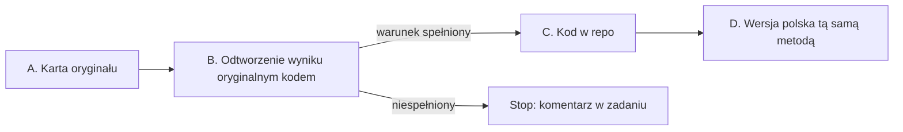

# Metodologia: najpierw oryginał, potem wersja polska

Każdy benchmark ma autorów, pracę i kod, który liczy wynik. Zanim dodasz benchmark do tego repo albo zbudujesz jego
polską wersję, poznajesz i odtwarzasz oryginał. Polska wersja przenosi tę samą metodę (format, metrykę, agregację) na
inny język. Nie wymyśla nowej.

Dlaczego tak: ten sam benchmark liczony innym promptem, inną normalizacją albo inną agregacją daje inną liczbę. Bez
odtworzonego oryginału nie wiadomo, czy różnica w wyniku to model, czy kod. Jedna wspólna ścieżka (np. format cloze w
`common/hipoteza_formatu.py`) pasuje do części testów, ale nie do wszystkich: generacja, perpleksja, pary zdań i testy z
agregacją po kategoriach liczą się inaczej.

Repo mierzy każdy model, który da się pobrać z Hugging Face, nie tylko Slayera 1B. Wszystkie ścieżki niżej są względne
wobec katalogu `research/`.

## Etapy pracy

Praca ma cztery etapy. Każdy kończy się plikiem w katalogu benchmarku `benchmarks/<name>/` (wzór plików:
[`benchmarks/_template/`](benchmarks/_template/README.md)). Etap B kończy się **warunkiem odtworzenia**: bez
odtworzonego wyniku nie przechodzisz dalej. (Nie myl go z **bramką liczb** z `tools/`, która sprawdza liczby w
raportach; sekcja „Bramka liczb” w [`README.md`](README.md#bramka-liczb).)

Benchmark, który nie ma oryginału (np. polski zbiór pisany od zera, held-out), zamiast etapów A i B ma kartę zbioru:
sekcja „Benchmark bez oryginału: karta zbioru (DATASET.md)”.

Każdy etap można oddać osobnym PR. Etapy A i B w osobnym, wcześniejszym PR to dobry pomysł: recenzent sprawdza kartę i
odtworzenie, zanim ktokolwiek policzy model.

## A. Karta oryginału (ORIGINAL.md)

Przeczytaj pracę i kod autorów. Wypełnij każde pole; czego nie da się ustalić, wpisz „nieustalone” z tym, gdzie
szukałeś.

| pole | co wpisać |
|---|---|
| Co mierzy | umiejętność, jednym zdaniem, słowami autorów |
| Źródła | praca (arXiv/ACL), repo autorów z commitem, karta zbioru na HF z rewizją |
| Dane | split używany do wyników w pracy, n, licencja, czy split testowy ma ukryte odpowiedzi |
| Format zadania | wybór z k opcji, para zdań, uzupełnienie, generacja, perpleksja |
| Prompt | dokładny szablon z pracy albo kodu (separatory, spacje, etykiety odpowiedzi), liczba przykładów w prompcie i skąd są brane |
| Ocena | metryka (acc, acc_norm, exact match, F1, perpleksja, BPB) i sposób jej liczenia: po czym normalizowana jest długość (znaki, bajty, tokeny), jak normalizowany jest tekst odpowiedzi |
| Metryka decyzyjna | **jedna** metryka, po której porównujesz modele i podejmujesz decyzje; pozostałe to metryki pomocnicze |
| Agregacja | średnia po pytaniach czy po kategoriach/paradygmatach, wagi |
| Bazy | baza losowa i większościowa (sekcja „Bazy: losowa i większościowa” w [`README.md`](README.md#bazy-losowa-i-większościowa)) |
| SNR | stosunek sygnału do szumu (Słowniczek): rozrzut wyników między modelami albo checkpointami, SE pomiaru, iloraz i na jakich modelach. Wolno go policzyć z opublikowanych wyników (praca, plik wyników, leaderboard) albo wpisać „nieustalone” z tym, gdzie szukałeś; własny pomiar nie jest potrzebny |
| Wyniki referencyjne | co najmniej jeden opublikowany wynik modelu, który da się pobrać (model, liczba, tabela w pracy albo plik wyników), jako snapshot z datą odczytu |
| Train policy | `eval_only` (żaden split nie trafia do treningu), `decon_only` (zbiór służy tylko do dekontaminacji danych treningowych) albo `train_allowed` (wymień, które splity wolno trenować); sekcja „Czystość benchmarku” |
| Decyzja treningowa | co oznacza słaby wynik: jakie dane albo jaka metoda treningu z niego wynika, a czego nie wolno z niego wnioskować |
| Znane rozbieżności | czym różnią się popularne implementacje (np. zadanie lm-eval) od kodu autorów, znane błędy w danych, kontaminacja |

Liczbę spoza `results/LICZBY.json` (np. wynik referencyjny z pracy) oznaczasz na końcu jej linii znacznikiem
`<!-- liczba-spoza-wynikow: skąd jest liczba -->`, inaczej bramka liczb ją odrzuci (wzór:
`benchmarks/wikitext-2/ORIGINAL.md`).

## B. Odtworzenie wyniku oryginalnym kodem (REPRODUCTION.md)

1. Uruchom kod autorów. Gdy autorzy kodu nie opublikowali, użyj implementacji, którą wskazuje praca albo leaderboard
   podający wyniki referencyjne (często zadanie lm-eval z konkretnego commitu), i zapisz, dlaczego ta.
2. Policz model z wynikiem referencyjnym z karty: ten sam split, ten sam prompt, ta sama rewizja modelu. Domyślnie to
   model kontrolny z sekcji „Model kontrolny etapu B”.
3. Zapisz komendę, commit kodu, rewizję zbioru i modelu, n, wynik z SE i różnicę wobec wartości referencyjnej.
   Ten przebieg dostaje wpis w `RECIPE.md` jak każdy inny.

**Warunek odtworzenia** jest spełniony, gdy różnica mieści się w ±2 pkt dla trafności; gdy 2 SE > 2 pkt, w granicach
2 SE. Dla perpleksji i BPB: sekcja „Próg dla perpleksji i BPB”.

### Próg dla perpleksji i BPB

Wspólny próg zgodności dla perpleksji i BPB jest **do ustalenia** (kamień
[„Pipeline ewaluacji zgodny ze Space i odtwarzalny przez nową osobę”](https://github.com/slayerlabs/benchmarks-fabryka-ai/milestone/2)).
Do tego czasu autor zapisuje w `REPRODUCTION.md` własny próg z uzasadnieniem, zanim policzy wynik. Bez progu
zapisanego przed pomiarem werdykt etapu B brzmi „nierozstrzygalny”, nawet gdy liczby wyglądają na zgodne.

Niespełniony warunek zatrzymuje pracę. Wpisz w komentarzu zadania, co policzyłeś i jaką różnicę dostałeś. Rozbieżność z
oryginałem to informacja, której szuka cały zespół: w każdym wyniku liczonym dalej siedziałaby ta sama różnica.

## C. Kod w repo

Domyślnie repo woła kod z etapu B, bezpośrednio albo cienką nakładką, która tylko ładuje model i zapisuje wyniki per
pytanie. Model z biblioteki transformers ładuje się zwykłym `AutoModelForCausalLM`; Slayer 1B, którego `config.json`
nie ma `model_type`, ładuje się przez `common/slayer_model.py`. Nakładka nie zmienia promptu ani metryki.

Własna implementacja (np. klucz w `common/hipoteza_formatu.py`) jest dopuszczalna tylko po teście zgodności:

- ten sam model i te same pytania co w etapie B;
- wynik w granicach SE od wyniku oryginalnego kodu;
- zgodność decyzji per pytanie co najmniej 99% (dla perpleksji: różnica per dokument poniżej 0,1%);
- test zgodności zapisany jako `tests/test_<name>_zgodnosc.py` na próbce 10–20 pytań z wynikami oryginalnego kodu w
  pliku, bez sieci.

Dodatkowe sposoby liczenia (cloze, BPB poprawnej odpowiedzi, PMI, inny format promptu) są dodatkiem obok wyniku
oryginalną metodą, nigdy w jego miejsce. W raporcie stoją w osobnej tabeli z nazwą metody.

Kod wspólny trafia do `common/` dopiero wtedy, gdy używa go więcej niż jeden benchmark.

## D. Wersja polska (POLISH.md)

Wersja polska to osobny katalog `benchmarks/<name>-pl/`, założony z [`benchmarks/_template/`](benchmarks/_template/README.md). Zamiast `ORIGINAL.md` i `REPRODUCTION.md` ma
`POLISH.md` (wzór: [`benchmarks/_template/POLISH.md`](benchmarks/_template/POLISH.md)), który wskazuje katalog
oryginału `benchmarks/<name>/` z etapami A–C. Własne `RECIPE.md`, kod i `results/` ma jak każdy benchmark.

`benchmarks/ewok-pl/` nie jest wzorem: to katalog sprzed tej metodologii, uzupełniany w zadaniu
[#34](https://github.com/slayerlabs/benchmarks-fabryka-ai/issues/34).

### D1. Przetłumaczyć czy napisać od zera?

Najpierw ustal, czy treść benchmarku przechodzi na polski. Metoda (format, metryka, agregacja) przechodzi zawsze. Treść
nie zawsze: pytanie o stan w USA, amerykańskie prawo, sport czy obyczaje przetłumaczone na polski dalej sprawdza wiedzę
o USA, a nie o Polsce.

| typ treści | przykłady | co robisz |
|---|---|---|
| Niezależna od kraju i języka | GSM8K, MathQA (matematyka), logika | tłumaczysz 1:1; zmieniasz tylko waluty, imiona i jednostki, gdy brzmią obco |
| Wiedza uniwersalna | ARC, SciQ, OpenBookQA (fizyka, biologia) | tłumaczysz i sprawdzasz próbkę |
| Wiedza lokalna i kulturowa | fakty o kraju, prawo, historia, geografia, instytucje, normy społeczne (części MMLU, TriviaQA, Social IQa) | osoba z Polski pisze nowe pytania od zera |
| Zjawiska językowe | BLiMP, LAMBADA, WinoGrande, WSC | osoba z Polski pisze nowe przykłady od zera na zjawiskach polszczyzny (np. przypadki, rodzaj, aspekt) |

**Testy kulturowe i językowe pisze od zera osoba z Polski.** Nie tłumaczy oryginalnych pytań, nie parafrazuje ich i
nie szuka „polskiego odpowiednika” konkretnego pytania. Z oryginału zostaje tylko metoda: format zadania, metryka,
agregacja i liczba przykładów dająca SE nie gorsze niż oryginał. Pytania są inne, bo mają sprawdzać polski teren.

Jak rozstrzygnąć: wylosuj 50 przykładów i oznacz każdy jednym z czterech typów. Zapisz to w `POLISH.md` razem z
wynikiem:

- prawie wszystkie (ponad 90%) to treść niezależna albo uniwersalna → tłumaczenie;
- lokalnych albo językowych jest ponad 10% → te przykłady usuwasz z tłumaczenia; jeśli to większość zbioru, cały
  zbiór pisze się od zera według sekcji „Benchmark bez oryginału: karta zbioru (DATASET.md)”;
- zbiór pisany od zera ma ten sam format i metrykę co oryginał oraz liczbę przykładów dającą SE nie gorsze niż
  oryginał.

Na start polskich wersji bierz benchmarki, które da się przetłumaczyć (pierwsze dwa wiersze tabeli). Pisanie od zera
to osobne, większe zadanie i długoterminowy kierunek: testy wiedzy o Polsce i polszczyźnie, których nikt jeszcze nie
ma. Wstępny podział 38 angielskich testów ze Space i istniejące polskie benchmarki: [BENCHMARKI_PL.md](BENCHMARKI_PL.md).

### D2. Mapowanie metody

Wersja polska zachowuje metodę z karty. Zanim zbudujesz dane, wypełnij tabelę: każdy wiersz karty oryginału i decyzja
„bez zmian” albo „zmiana: co i dlaczego”.

| element | zwykle | uwagi |
|---|---|---|
| Metryka, agregacja, liczba opcji, liczba przykładów w prompcie | bez zmian | zmiana tylko z zapisanym powodem |
| Normalizacja długości | po bajtach albo znakach, jak w oryginale | po tokenach zależy od tokenizera; polskie litery z ogonkiem to 2 bajty UTF-8, co przesuwa normalizację po bajtach względem znaków |
| Prompt | tłumaczony szablon o tej samej strukturze | etykiety („Odpowiedź:”), separatory i spacje jak w oryginale |
| Dane | tłumaczenie albo nowe pytania napisane od zera | przy tłumaczeniu: kto, jakim narzędziem, próbka min. 50 przykładów sprawdzona przez człowieka, lista usuniętych przykładów (np. gra słów, która nie przechodzi na polski) |
| Kontaminacja | sprawdzona dla nowego zbioru | szczególnie gdy źródło polskich danych jest w sieci |

### D3. Dwie kontrole przed pierwszym wynikiem

1. **Kod wersji polskiej na danych oryginalnych.** Ten sam kod uruchomiony na angielskim zbiorze i modelu z etapu B
   daje wynik z etapu B (te same kryteria zgodności co w etapie C). To dowód, że przy przenoszeniu na polski nie
   zmieniła się metoda.
2. **Bazy i model, który zna polski.** Baza losowa i większościowa polskiego zbioru oraz wynik modelu, który zna polski
   (np. `speakleash/Bielik-1.5B-v3` albo `utter-project/EuroLLM-1.7B` z sekcji „Pięć modeli odniesienia”). Wynik
   takiego modelu na poziomie bazy znaczy, że coś jest nie tak z danymi albo promptem, zanim cokolwiek powie o
   mierzonym modelu.

## Benchmark bez oryginału: karta zbioru (DATASET.md)

Zbiór, który nie ma pracy ani kodu autorów do odtworzenia (polski test pisany od zera, held-out tekst),
nie przechodzi etapów A i B. Zamiast nich ma kartę zbioru `DATASET.md` (wzór:
[`benchmarks/_template/DATASET.md`](benchmarks/_template/DATASET.md)) i kontrolę na modelu, który zna polski. Etapy C
i D (jeśli dotyczy) oraz przepis zostają bez zmian.

| pole | co wpisać |
|---|---|
| Co mierzy | umiejętność, jednym zdaniem; jaką metodę (format, metryka, agregacja) przejmuje i od jakiego benchmarku, jeśli od jakiegoś |
| Jak powstał | źródło tekstów, daty, narzędzia, kryteria doboru, licencja |
| Kto pisał i kto sprawdzał | osoby (nick GitHub), co sprawdzał drugi człowiek i na ilu przykładach |
| Jawna próbka | około 10% zbioru w repo, ta sama dla wszystkich; do testów kodu i do ręcznego sprawdzenia oceny |
| Ukryta reszta | gdzie leży (poza repo), kto ją trzyma, jak poprosić o przebieg na niej |
| Jak liczyć | metryka decyzyjna, prompt, ocena (dla odpowiedzi tekstowych: lista dopuszczalnych form, ocena deterministyczna, bez modelu-sędziego), agregacja, n i oczekiwane SE |
| Bazy | baza losowa i większościowa |
| SNR | jak w karcie oryginału (Słowniczek) |
| Train policy i decyzja treningowa | jak w karcie oryginału |

**Kontrola** zastępuje warunek odtworzenia: model, który zna polski (sekcja D3, punkt 2), ma wynik wyraźnie powyżej
bazy, czyli różnica od bazy przekracza 2 SE. Wynik na poziomie bazy zatrzymuje pracę tak jak niespełniony warunek
odtworzenia.

Dla zbioru liczonego przez NLL albo BPB (bez odpowiedzi do wyboru nie ma bazy losowej) kontrola brzmi: model, który zna
język zbioru (dla polskiego `speakleash/Bielik-1.5B-v3` albo `utter-project/EuroLLM-1.7B`), ma BPB niższe niż model bez
tego języka (`EleutherAI/pythia-1b-v0` @ `step143000`), a różnica wynosi co najmniej 2 SE. SE różnicy liczysz
bootstrapem po dokumentach: losujesz dokumenty ze zwracaniem i liczysz różnicę BPB obu modeli na każdej próbie.

## Modele: kontrolny i odniesienia

### Model kontrolny etapu B

Model kontrolny to model, który da się pobrać, z opublikowanym wynikiem na tym benchmarku. Bierzesz **pierwszy
dostępny z listy**, w tej kolejności:

1. **`EleutherAI/pythia-1b-v0` @ `step143000`.** Opublikowane wyniki 0-shot z pełnym zapisem ustawień:
   [plik wyników Pythii v0](https://github.com/EleutherAI/pythia/blob/main/evals/pythia-v0/pythia-1b/zero-shot/pythia-1b-0shot-global_step143000_eval_results_11-28-2022-15-14-35.json).
   Liczby policzono w 2022 r. starszą wersją lm-eval, więc w `REPRODUCTION.md` zapisz wersję, której użyłeś. Plik ma
   tylko te zadania: `arc_challenge`, `arc_easy`, `lambada_openai`, `logiqa`, `piqa`, `sciq`, `winogrande`, `wsc`, 67
   zadań `blimp_*` i 57 zadań `hendrycksTest-*` (MMLU). Jego `wsc` to SuperGLUE WSC (104 przykłady), nie WSC273.
2. **`utter-project/EuroLLM-1.7B`** tam, gdzie jego karta modelu podaje wynik (ARC-Challenge, HellaSwag).
3. **Opublikowany wynik dowolnego modelu, który da się pobrać:** z tabeli w pracy autorów benchmarku albo z
   [Open LLM Leaderboard](https://huggingface.co/spaces/open-llm-leaderboard/open_llm_leaderboard). Zapisz model z
   rewizją i ustawienia, z którymi policzono wynik (prompt, liczba przykładów w prompcie, metryka, wersja kodu).

Kontrolę liczysz tym samym kodem co mierzony model. Jeśli wynik kontroli odbiega od opublikowanego, błąd jest w kodzie
ewaluacji, nie w mierzonym modelu.

Benchmark polski albo bez oryginału nie ma opublikowanego wyniku do odtworzenia. Jego kontrolą jest model, który zna
polski (`speakleash/Bielik-1.5B-v3` albo `utter-project/EuroLLM-1.7B` z tabeli niżej), a warunkiem jest wynik wyraźnie
powyżej bazy (sekcja „Benchmark bez oryginału: karta zbioru (DATASET.md)”). Pythia nie jest tam wymagana, poza zbiorem liczonym przez NLL albo BPB (karta zbioru).

### Pięć modeli odniesienia

Każdy benchmark porównuje mierzony model z pięcioma modelami, zawsze w tych rewizjach:

| model | rewizja | uwagi |
|---|---|---|
| `Qwen/Qwen3.5-0.8B-Base` | `dc7cdfe2ee4154fa7e30f5b51ca41bfa40174e68` | multimodalny; transformers z gałęzi main, commit przypięty w środowisku |
| `LiquidAI/LFM2.5-1.2B-Base` | `7453bca97ca1e67754c4035a4b4c584e1c9dd725` | ten sam co w Space |
| `speakleash/Bielik-1.5B-v3` | `4b25049621bf3952a1fc9314c89773102eda0333` | repo z bramką zgody na HF |
| `LiquidAI/LFM3-1.7B-Base` | `545fc8f4c7b5fa9f405105274cd29c4f8f44b526` | `trust_remote_code`, kod modelu z tej rewizji |
| `utter-project/EuroLLM-1.7B` | `c730cd9b616799ace3c65e927d63191446f59374` | |

### Kto liczy które modele

- **Autor PR** liczy mierzony model (dziś Slayer 1B 1.06: `SlayerLab/Slayer1B-1.06` @
  `ef81be58742544ad32e1afab38db011fec209609`) i model kontrolny, tym samym kodem:
  - benchmark z oryginałem: pierwszy dostępny z listy w sekcji „Model kontrolny etapu B”;
  - benchmark polski i bez oryginału: model, który zna polski (`speakleash/Bielik-1.5B-v3` albo
    `utter-project/EuroLLM-1.7B`); Pythia nie jest wymagana, poza zbiorem liczonym przez NLL albo BPB (karta zbioru).
- **Przebieg centralny** liczy pięć modeli odniesienia na wspólnym GPU dla każdego benchmarku po recenzji i zapisuje
  wyniki w `benchmarks/<name>/results/<model>/`. **W budowie:** dziś go nie ma; kamień
  [„Przebieg centralny: 5 modeli odniesienia”](https://github.com/slayerlabs/benchmarks-fabryka-ai/milestone/8).
  Do tego czasu autor PR nie musi liczyć modeli odniesienia.

## Przepis (RECIPE.md)

Każdy benchmark ma `RECIPE.md` z wpisem dla każdego wyniku: commit kodu, lockfile środowiska (z przypiętą wersją
transformers), rewizje modelu i zbioru, dokładna komenda, seed, precyzja, sprzęt, data. Z samego przepisu ktoś inny za
dwa tygodnie odtwarza ten sam wynik. Czego nie zapisano, wpisz „niezapisane”, nie zgaduj. Wzór:
[`benchmarks/_template/RECIPE.md`](benchmarks/_template/RECIPE.md).

Automat, który co tydzień odtwarza 20 pytań z losowego wyniku według jego przepisu i zgłasza różnicę, jest **w
budowie**: kamień [„Tygodniowy automat odtwarzania”](https://github.com/slayerlabs/benchmarks-fabryka-ai/milestone/9).

## Czystość benchmarku

- Pytania benchmarku nie trafiają do treningu żadnego modelu i nie piszemy na ich podstawie danych treningowych, także
  jako „przykładów w podobnym stylu”.
- Zbiór benchmarku jest wejściem deduplikacji i dekontaminacji danych treningowych: kto składa dane treningowe, usuwa
  z nich teksty pokrywające się z benchmarkiem.
- Pojedyncze pytania wolno oglądać, żeby sprawdzić, czy ocena działa poprawnie (prompt, parsowanie odpowiedzi,
  normalizacja). Wniosek o modelu wyciągasz z wyniku zbiorczego, nie z pojedynczych pytań.
- Train policy (`eval_only`, `decon_only`, `train_allowed`) stoi w karcie. Wynik na zbiorze, którego split był w
  treningu, oznaczasz w raporcie jako trenowany.

## Wersja lm-eval

**Obowiązuje środowisko z `common/requirements.lock.txt`** (instalacja: sekcja „Przygotowanie (raz)” w
[`README.md`](README.md#przygotowanie-raz)). Zawiera lm-eval 0.4.9.1 z PyPI i tej wersji używa cały kod w `common/`.

Różnica, która zostaje: protokół Space (`METHOD.md`) podaje lm-eval w commicie
[`6d2abda4`](https://github.com/EleutherAI/lm-evaluation-harness/commit/6d2abda4fd171e68a8789330c4149e37c1ca0bda)
(wersja 0.4.8, 5.03.2025). Tag `v0.4.9.1` jest 160 commitów dalej. Dlatego dla każdego benchmarku liczonego przez
lm-eval porównaj plik zadania (YAML i funkcje przetwarzania) w obu wersjach i zapisz wynik w karcie, w polu „Znane
rozbieżności”: identyczny albo czym się różni. Wzór: `benchmarks/wikitext-2/ORIGINAL.md`. Instalacja samego commitu
`6d2abda4` (`pip install "lm_eval @ git+https://github.com/EleutherAI/lm-evaluation-harness@6d2abda4"`) nie została
sprawdzona w tym repo; jeśli jej użyjesz, zrób to w osobnym środowisku i zapisz w `RECIPE.md`.

## Wyjątek: 7 testów Space do 8.11

Testy ze statusem `not_run` dla Slayera 1.06 w Space
[SlayerLab/Slayer1B-Benchmarks](https://huggingface.co/spaces/SlayerLab/Slayer1B-Benchmarks) (PIQA, WSC273, LogiQA,
MathQA, IFEval, PubMedQA, Social IQa) liczysz do 8.11 protokołem Space (`METHOD.md` Space, ustawienia z
`tasks_50.json`) i lm-eval według sekcji „Wersja lm-eval”.

**Kontrola** to pierwszy dostępny model z listy w sekcji „Model kontrolny etapu B”, liczony na tym samym lm-eval:
`EleutherAI/pythia-1b-v0` @ `step143000`, potem `utter-project/EuroLLM-1.7B`, potem opublikowany wynik dowolnego
modelu, który da się pobrać, z pracy autorów albo z Open LLM Leaderboard, z rewizją i ustawieniami.

**Próg wstrzymania** jest ten sam co warunek odtworzenia z sekcji B: różnica kontroli wobec opublikowanej wartości
mieści się w ±2 pkt, a gdy 2 SE > 2 pkt, w granicach 2 SE. Różnica poza tym progiem wstrzymuje wysłanie wyniku. Przy
200 pytaniach 2 SE często przekracza 2 pkt: WSC273 ma SE około 3 pkt (próg około ±6 pkt), PubMedQA około 2,2 pkt (próg
około ±4,4 pkt).

Co jest w [pliku wyników Pythii v0](https://github.com/EleutherAI/pythia/blob/main/evals/pythia-v0/pythia-1b/zero-shot/pythia-1b-0shot-global_step143000_eval_results_11-28-2022-15-14-35.json)
(odczyt 31.10.2026, 0-shot, `version` 0 każdego zadania):

| test Space | zadanie w pliku Pythii | kontrola z Pythii |
|---|---|---|
| PIQA | `piqa` | jest |
| LogiQA | `logiqa` | jest |
| WSC273 | brak; `wsc` w pliku to SuperGLUE WSC (104 przykłady), inny zbiór niż WSC273 (273) | nie, następny z listy |
| MathQA | brak | nie, następny z listy |
| PubMedQA | brak | nie, następny z listy |
| Social IQa | brak | nie, następny z listy |
| IFEval | brak | nie, następny z listy |

Gdy żadnej kontroli z listy nie ma, wynik i tak idzie do Space: autor zaznacza w opisie PR wprost „bez kontroli” i
wymienia, gdzie szukał. Brak kontroli nie wstrzymuje terminu.

Przekazanie wyniku: autor wkleja wynik w opisie PR (wartość, n, CI95, komenda, rewizje, kontrola albo „bez
kontroli”). Po merge'u Arek (właściciel modelu Slayer i Space) wgrywa go do `results.json` Space. Kartę oryginału
(etap A) i pełne „zrobione” dopisujesz po terminie, w osobnym zadaniu.

## Pierwsze zadanie i recenzja

Pierwsze zadanie opisuje [`CONTRIBUTING.md`, „Pierwsze zadanie”](../CONTRIBUTING.md#pierwsze-zadanie).

**Recenzja idzie w dwóch krokach:**

1. Najpierw automaty: komendy z sekcji [„Przed PR”](../README.md#przed-pr) README repo (testy zmienionego benchmarku z
   testem zgodności z etapu C, `tests/test_liczby_raportow.py` i bramka liczb) kończą się kodem 0. „Automaty” to te
   komendy uruchamiane przez autora PR przed otwarciem PR; CI dla `research/` nie ma. Recenzent sprawdza, że autor je
   uruchomił, i w razie wątpliwości uruchamia je sam.
2. Potem osoba, która zna ten kod, czyta kartę i odtwarza co najmniej jeden wynik z `RECIPE.md`.

Ról na stałe nie ma: recenzuje ktoś inny niż autor, kto zna dany kod albo benchmark. Wynik, który idzie dalej (do Space
albo do decyzji o treningu), ma etykietę `needs-recheck`: druga osoba liczy go od zera, na innym sprzęcie, bez
zaglądania w liczby autora.

## Kamienie bez terminu

Kamień [#6](https://github.com/slayerlabs/benchmarks-fabryka-ai/milestone/6) (opis zbiorów: baza, format, n, SNR,
kontaminacja) nie ma terminu, tak jak #8–#10 (przebieg centralny, tygodniowy automat odtwarzania, polskie
benchmarki od zera). To prace ciągłe albo w budowie: zamyka się je, gdy spełnią opis kamienia, a nie w dniu z
kalendarza. Terminy mają kamienie #1–#5.

## Co oddajesz

PR do `main` z katalogiem `benchmarks/<name>/` według [`benchmarks/_template/`](benchmarks/_template/README.md).
Benchmark jest skończony, gdy spełnia sekcję „Definicja „zrobione”” w [README repo](../README.md#definicja-zrobione).

## Słowniczek

- **Repo benchmarków:** to repo,
  [slayerlabs/benchmarks-fabryka-ai](https://github.com/slayerlabs/benchmarks-fabryka-ai).
- **Space:** strona z wynikami Slayera 1B na Hugging Face,
  [SlayerLab/Slayer1B-Benchmarks](https://huggingface.co/spaces/SlayerLab/Slayer1B-Benchmarks). Sama nic nie liczy,
  tylko wyświetla `results.json`. Protokół liczenia:
  [`METHOD.md`](https://huggingface.co/spaces/SlayerLab/Slayer1B-Benchmarks/blob/main/METHOD.md).
- **T01–T50:** numer testu w Space (38 angielskich, 12 polskich); ustawienia każdego testu są w `tasks_50.json` Space,
  a ten sam numer ma wpis w `common/zadania.py`.
- **Próbka 200 (panel 200):** Space liczy każdy test na najwyżej 200 pytaniach wybranych po haszu SHA-256, tych samych
  dla wszystkich modeli (WikiText-2 w całości). Przy 200 pytaniach SE trafności to kilka punktów.
- **Metryka decyzyjna:** metryka, według której porównujesz modele (pole w karcie oryginału).
- **Perpleksja:** średnia niepewność modelu na tekście, liczona z NLL na token albo na słowo; niżej = lepiej, ale
  porównujesz ją tylko przy tym samym tokenizerze albo na słowach.
- **acc:** trafność; model wybiera odpowiedź o największym log-prawdopodobieństwie.
- **acc_norm:** jak acc, ale log-prawdopodobieństwo dzielone przez długość odpowiedzi (w znakach albo bajtach), żeby
  długie odpowiedzi nie przegrywały z krótkimi.
- **cloze i litery:** cloze = model ocenia treść każdej odpowiedzi doklejoną do pytania; litery (MC) = odpowiedzi
  podpisane A/B/C/D i model ocenia samą literę.
- **PMI:** log P(odpowiedź | pytanie) − log P(odpowiedź); usuwa z wyboru to, że jakaś odpowiedź jest po prostu częsta.
- **BPB** (bity na bajt): koszt tekstu albo poprawnej odpowiedzi w bitach na bajt; niżej = lepiej przy tym samym
  tekście; porównywalne między modelami o różnych tokenizerach. BPB nie jest trafnością, więc nie podaje się go w
  punktach procentowych.
- **SE** (błąd standardowy) i **werdykt**: SE mówi, o ile wynik waha się od samego doboru pytań. Różnicę dwóch wyników
  dzielisz przez jej SE i dostajesz z. Werdykt: |z| ≥ 3 „pewne”, od 2 do 3 „prawdopodobne”, poniżej 2 „szum” (pomiar
  nie rozstrzyga). Wzory: [`README.md`, „SE i werdykt”](README.md#se-i-werdykt).
- **SNR** (stosunek sygnału do szumu): jak bardzo benchmark rozróżnia modele wobec szumu samego pomiaru. Liczysz
  go jako odchylenie standardowe wyników kilku modeli (albo kolejnych checkpointów jednego modelu) podzielone przez
  typowe SE pomiaru jednego wyniku. SNR bliski 1 lub mniejszy znaczy, że różnice między modelami giną w szumie.
- **Held-out:** tekst albo pytania odłożone tak, że nie było ich w danych treningowych żadnego mierzonego modelu;
  wynik na nich mierzy uogólnianie, a nie pamięć.
- **Kontaminacja:** sytuacja, w której pytania albo odpowiedzi benchmarku trafiły do danych treningowych modelu, więc
  wynik mierzy pamięć zamiast umiejętności.
- **13-gram:** ciąg 13 kolejnych słów (tokenów); tekst treningowy dzielący z pytaniem benchmarku choć jeden taki ciąg
  uznaje się zwykle za pokrywający się z benchmarkiem.
- **Dekontaminacja:** usunięcie z danych treningowych tekstów pokrywających się z benchmarkiem (sekcja „Czystość
  benchmarku”), żeby model nie widział pytań przed testem.
- **lm-eval:** [lm-evaluation-harness](https://github.com/EleutherAI/lm-evaluation-harness) EleutherAI, biblioteka,
  która liczy większość standardowych benchmarków; wersja obowiązująca w repo: sekcja „Wersja lm-eval”.
- **HF:** Hugging Face, serwis, z którego pobierasz modele i zbiory danych i na którym stoi Space.
- **Rewizja:** konkretny commit repozytorium modelu albo zbioru na HF (hash), który przypina dokładnie te pliki, na
  których liczono wynik.
- **Split:** wydzielona część zbioru (np. `train`, `validation`, `test`); wynik podajesz zawsze z nazwą splitu, bo
  różne splity dają różne liczby.
- **NLL** (ujemne log-prawdopodobieństwo): −log P(tekstu według modelu), z którego liczy się perpleksję i BPB; niżej =
  model lepiej przewiduje tekst.
- **Pythia v0:** pierwsze wydanie wag modeli Pythia od EleutherAI (np. `EleutherAI/pythia-1b-v0`); w repo używasz
  checkpointu `step143000`, czyli końca treningu.
- **Checkpoint:** zapis wag modelu z danego kroku treningu (np. `step143000` Pythii), który da się pobrać i policzyć
  osobno.
- **CI95** (95% przedział ufności): zakres wynik ± 1,96 SE, który przy wielokrotnym losowaniu pytań obejmowałby
  prawdziwą wartość w 95% przypadków.
- **0-shot:** model dostaje samo pytanie, bez przykładów rozwiązanych zadań w prompcie (k-shot = k takich przykładów).
- **Warunek odtworzenia i bramka liczb:** pierwszy kończy etap B (sekcja B), druga sprawdza liczby w raportach
  (`tools/`). To dwie różne rzeczy.

## Gdzie pytać i zgłaszać potknięcia

Discord, kanał **#bench-team**: https://discord.gg/HnTkVR4c5T. Gdy utkniesz albo dokument mówi coś niejasnego, napisz
tam jednym zdaniem, w którym kroku i czego brakuje. Te zgłoszenia są przerabiane na poprawki dokumentacji.
