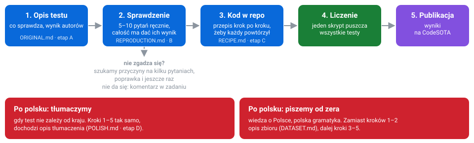

# Metodologia: wspólny rdzeń i typy testów

Repo mierzy każdy model, który da się pobrać z Hugging Face, nie tylko Slayera 1B. Każdy test ma część wspólną
(„Wspólny rdzeń”) i część zależną od typu („Typy testów”). Rdzeń mówi, co musi być prawdą i jak recenzent to sprawdza.
Tabela typów mówi, czym te reguły są dla danej metryki. Reguła, która do typu nie pasuje, ma w tabeli „N/A” z powodem
i z tym, co robisz zamiast niej. Ścieżki są względne wobec katalogu `research/`.

Ten sam benchmark liczony innym promptem, inną normalizacją albo inną agregacją daje inną liczbę. Dlatego najpierw
odtwarzasz oryginał, a wersja polska przenosi jego metodę (format, metrykę, agregację) na inny język i nie wymyśla
nowej.

## Etapy pracy



Każdy etap kończy się plikiem w `benchmarks/<name>/`, wzory są w
[`benchmarks/_template/`](benchmarks/_template/README.md). Benchmark bez oryginału (zbiór pisany od zera, held-out)
zamiast etapów A i B ma kartę zbioru. Każdy etap może iść osobnym PR. Kiedy benchmark jest skończony, mówi
[„Definicja „zrobione””](#definicja-zrobione) niżej.

## Definicja „zrobione”

**Benchmark jest zrobiony, gdy jest opisany, przygotowany i podpięty do przebiegu centralnego**
(`research/tools/przebieg_centralny.sh`). Jedno uruchomienie przebiegu na wynajętej karcie liczy wtedy wszystkie
benchmarki naraz, na Slayerze i modelach odniesienia. Autor PR niczego nie liczy na GPU. Stan każdego benchmarku:
[`STATUS.md`](STATUS.md).

PR do `main` (jeden albo kilka, po jednym na etap) zawiera katalog `research/benchmarks/<name>/` założony z
[`research/benchmarks/_template/`](benchmarks/_template/README.md), a w nim:

1. `ORIGINAL.md` (etap A) i `REPRODUCTION.md` (etap B) z wartością referencyjną, modelem kontrolnym i warunkiem
   odtworzenia ustalonymi przed liczeniem. Gdy żaden model nie ma opublikowanego wyniku: „bez kontroli” z listą
   przeszukanych miejsc ([„Bez kontroli”](#bez-kontroli)). Werdykt wpisujesz po przebiegu centralnym. Benchmark bez
   oryginału ma zamiast nich `DATASET.md`. Wersja polska leży w `research/benchmarks/<name>-pl/` i ma `POLISH.md`
   (etap D).
2. **Podpięcie do przebiegu** (etap C): wpis w `ZADANIA` (`research/common/zadania.py`) i w `KATALOGI`
   (`research/tools/przebieg_centralny.sh`). Benchmark z własnym kodem: przebieg woła jego komendę, a własna
   implementacja ma test zgodności `research/tests/test_<name>_zgodnosc.py`.
3. Test `research/tests/test_<name>.py` z próbką danych, bez sieci i bez wag. To, że wpis w `ZADANIA` wskazuje
   zbiór, pełną rewizję, split, metrykę decyzyjną, liczbę przykładów i zadanie lm-eval z karty, sprawdza
   `research/tests/test_zgodnosc_karty.py` (karta jest źródłem ustawień testu).
4. Wiersz testu w [`research/README.md`, „Benchmarki i typy”](README.md#benchmarki-i-typy) z typem, bazami i b według
   tabeli typów ([„Typy testów”](#typy-testów)).
5. `RECIPE.md` z komendą, którą przebieg liczy benchmark.
6. Komendy z sekcji [„Przed PR”](../CONTRIBUTING.md#przed-pr) zakończone kodem 0.
7. `Refs #N` zadania w opisie PR.

Wynik z n i SE, porównanie z modelem kontrolnym i werdykt powstają z przebiegu centralnego, opisanego w
[„Następna wersja Slayera”](#następna-wersja-slayera), i trafiają do katalogu benchmarku osobnym PR.

## Wspólny rdzeń

Obowiązuje każdy test. Gdzie treść reguły zależy od typu, reguła odsyła do kolumny tabeli typów.

1. **Protokół przed pomiarem.** Wiersz testu w [README, „Benchmarki i typy”](README.md#benchmarki-i-typy) podaje
   typ, a karta (`ORIGINAL.md`, `DATASET.md` albo `POLISH.md`) linkuje do niego i podaje metrykę
   decyzyjną, agregację, wiążący poziom werdyktu, MDE i progi, zanim policzysz wynik, który od nich zależy. Zmiana po
   pomiarze to nowy protokół; wynik policzony starym zostaje przy starym. *Recenzent:* `git log` pokazuje commit karty
   albo progu starszy niż commit wyniku.
2. **Przypięte rewizje.** Model i zbiór mają rewizję HF, kod ma commit, środowisko to `common/requirements.lock.txt`
   albo osobne środowisko zapisane w `RECIPE.md`. *Recenzent:* wpis `RECIPE.md` ma każdą rewizję albo „niezapisane”.
3. **n i SE przy każdym wyniku.** SE liczysz metodą z kolumny „SE” typu. *Recenzent:* liczba stoi w
   `results/LICZBY.json` razem z SE.
4. **Werdykt przy każdym porównaniu.** z = różnica / SE różnicy, parowane, gdy oba wyniki są na tych samych
   pytaniach. |z| ≥ 3 „pewne”, od 2 do 3 „prawdopodobne”, poniżej 2 „szum”, czyli pomiar nie rozstrzyga (nie znaczy,
   że różnicy nie ma). Wiąże werdykt z poziomu podanego w kolumnie „Wiążący werdykt” typu. Słowo werdyktu zawsze
   liczysz z surowego z. Tabela z więcej niż jednym porównaniem (podtesty, domeny, wiele testów naraz, wersja N z N−1)
   ma obok kolumnę „po Holmie: tak/nie” (p poprawione metodą Holma, progi p jak dla |z| = 2 i |z| = 3, rodzina
   to kontrasty jednej tabeli), a wniosek o całej tabeli opiera się na tej kolumnie. SE różnicy równe 0 daje z
   nieokreślone i werdykt „nierozstrzygalne”, tak jak liczy `tools/liczby.py`. *Recenzent:* bramka liczb sprawdza
   werdykt wobec z.
5. **Moc przed pomiarem.** Karta podaje MDE, czyli najmniejszą różnicę, którą test wykryje przy n, na którym liczysz:
   MDE ≈ (z_próg + 0,84) · SE różnicy parowanej, moc 80%. <!-- liczba-spoza-wynikow: kwantyl mocy 80% -->
   z_próg = 2 dla jednego porównania, a w tabeli m porównań pod Holmem kwantyl dla p = 0,0455 / m. <!-- liczba-spoza-wynikow: p dla |z| = 2 -->
   Dla m = 7 to około 2,7, czyli MDE ≈ 3,6 · SE. <!-- liczba-spoza-wynikow: kwantyl normalny dla p = 0,0065 -->
   SE różnicy bierzesz z wyników per pytanie pary mierzony model i model kontrolny, a bez nich przyjmujesz √2 · SE
   pojedynczego wyniku. Pole „Decyzja treningowa” podaje różnicę, która zmieniłaby decyzję, albo „nieustalona”. Test
   o MDE większym od tej różnicy do tej decyzji nie służy; przy „nieustalona” MDE jest informacyjne. Źródło:
   [Miller 2024, §5](https://arxiv.org/abs/2411.00640). *Recenzent:* przelicza MDE z SE podanego w karcie.
6. **Kontrola.** Model kontrolny liczy przebieg centralny tym samym kodem co mierzony model, a jego wynik odtwarza
   opublikowany (etap B). Bez opublikowanego wyniku kod przechodzi zgodność z kodem autorów („Bez kontroli”). Kontrola odróżnia działający
   kod od zepsutego: robi to, co mówi kolumna „Kontrola” typu. SE wyniku kontroli liczysz metodą typu, gdy źródło
   daje wyniki na poziomie jednostki tej metody (pytanie, dokument, klaster, podtest), a inaczej metodą A dla n
   źródła. *Recenzent:* `REPRODUCTION.md` albo `DATASET.md` ma wynik, b, różnicę w SE i werdykt.
7. **Przepis.** Każdy wynik ma wpis w `RECIPE.md` (sekcja „Przepis”). *Recenzent:* odtwarza co najmniej jeden wpis.
8. **Smoke test.** Przed pełnym przebiegiem czytasz ręcznie 5–10 przykładów: wyrenderowany prompt, opcje, cel,
   odpowiedź albo logprob modelu i dane wejściowe. W teście z podtestami albo klastrami bierzesz je z różnych
   podtestów. Wpis w `RECIPE.md` podaje ich id i to, co się zgadzało (wzór:
   [WinoGrande, „Smoke test przed przebiegiem”](benchmarks/winogrande/RECIPE.md#smoke-test-przed-przebiegiem)). *Recenzent:* otwiera jeden z podanych przykładów.
9. **Bramka liczb.** Każda liczba w raporcie `.md` pod `research/` stoi w `results/LICZBY.json` albo ma na końcu
   linii znacznik `<!-- liczba-spoza-wynikow: skąd jest liczba -->`, jedna linia na jeden wynik (wzór:
   `benchmarks/arc-easy/ORIGINAL.md`). Bramka sprawdza raporty, warunek odtworzenia z etapu B sprawdza kod; to dwie
   różne rzeczy. *Recenzent:* komendy z [„Przed PR”](../CONTRIBUTING.md#przed-pr) kończą się kodem 0.
10. **Czystość i kontaminacja.** Pytania testu nie trafiają do treningu, a karta ma pole „Kontaminacja” (sekcja
    „Czystość benchmarku”). *Recenzent:* przy wartości „sprawdzona” jest metoda.

## Typy testów

Test ma jeden typ bazowy i zero lub więcej modyfikatorów (`+proc`, `+warstwy`, `+klastry`, `+pl`). Modyfikator zmienia
tylko kolumny, w których nie stoi „typ bazowy”. Gdy dwa modyfikatory wypełniają tę samą kolumnę, metodę SE daje
`+klastry`, warunek `+pl` (SE większe niż w oryginale → kolumna informacyjna) nadal obowiązuje, a w kolumnie
„kontrola” stoją wszystkie sprawdzenia naraz (typu bazowego i modyfikatorów). **Klaster**
to pozycje wygenerowane z jednego szablonu albo jednej gramatyki z podmianą słów, dwa warianty jednego zdania (pary
bliźniacze) albo kilka pytań do tego samego tekstu w prompcie. **Warstwa** to podtest, po którym oryginał uśrednia
wynik, a który nie jest pojedynczym szablonem; dopóki karta nie pokaże, że podtest to jeden szablon, jest warstwą.
Typ każdego testu repo i Space podaje [README, „Benchmarki i typy”](README.md#benchmarki-i-typy).
Typ nowego testu wpisujesz tylko tam, a karta do tego wiersza linkuje; test, który nie pasuje do żadnego wiersza
tabeli typów, dostaje nowy wiersz w tym PR, a nie najbliższy istniejący.

| typ | przykłady | skala | baza losowa | stała odpowiedź | SE | wiążący werdykt | kontrola | test zgodności (etap C) |
|---|---|---|---|---|---|---|---|---|
| `mc`: wybór z k opcji, k stałe | HellaSwag, PIQA, BoolQ, WinoGrande | trafność 0–1 | 1/k | udział najczęstszej pozycji poprawnej opcji (lm-eval punktuje indeks) | A | jeden na test, po pytaniach | wynik > b + 2 SE | ≥ 99% zgodnych wyborów per pytanie |
| `mc-k`: wybór z k opcji, k różne w pytaniach | ARC (3–5 opcji) | trafność 0–1 | średnia 1/kᵢ po liczonych pytaniach | jak `mc` | A | jak `mc` | jak `mc` | jak `mc` |
| `poz`: poprawna opcja zawsze na tej samej pozycji | SciQ w lm-eval (zawsze ostatnia) | trafność 0–1 | 1/k | N/A: pełna, bo kod „zawsze ta pozycja” trafia każde pytanie; b = baza losowa, a sprawdzenie pozycji przechodzi do kontroli | A | jak `mc` | wynik > b + 2 SE w przebiegu oryginalnym i w przebiegu z opcjami przemieszanymi stałym seedem (seed w `RECIPE.md`); udział najczęstszej predykcji podajesz z przemieszanego, bez progu | jak `mc` |
| `para`: dwa (albo 2×2) zdania oceniane osobno | BLiMP, BLiMP Supplement, MultiBLiMP, EWoK | trafność 0–1 (rekord EWoK: 0, ½ albo 1) | 1/2 | N/A: poprawne zdanie stoi na stałej pozycji (pełna) albo stała preferencja daje 1/2 (EWoK); b = 1/2 | A | jak `mc`; pary z jednego paradygmatu albo szablonu: `+klastry` | wynik > b + 2 SE; przebieg z zamienioną kolejnością zdań w parze różni się od oryginalnego najwyżej o udział remisów (par o równym log-prawdopodobieństwie), który podajesz; para 2×2 bez pozycji (EWoK): zamiana N/A, bo stała preferencja daje dokładnie b | jak `mc` |
| `cloze`: jedno słowo, otwarty słownik | LAMBADA | trafność 0–1 | N/A: otwarty słownik, przyjmujesz 0 | udział najczęstszego słowa docelowego w splicie | A | jak `mc` | wynik > b + 2 SE | ≥ 99% zgodnych decyzji per fragment |
| `ppl`: perpleksja, BPB | WikiText-2, UncheatableEval | ciągła, niżej znaczy lepiej, nigdy w pkt | N/A: nie ma odpowiedzi do wyboru | N/A: nie ma stałej odpowiedzi; zamiast b porównanie z kolumny „kontrola” | B po dokumentach, metryka liczona od nowa agregacją oryginału (np. suma/suma) | jeden na test, po dokumentach | z oryginałem: odtworzenie opublikowanej wartości z progiem zapisanym przed pomiarem („Próg dla perpleksji i BPB”); bez oryginału: kontrola kolejności, czyli większy model tej samej rodziny ma BPB niższe o ≥ 2 SE (np. `EleutherAI/pythia-1b-v0` wobec `EleutherAI/pythia-160m-v0`, oba `step143000`), a przy zbiorze nieangielskim dodatkowo model znający język zbioru ma BPB niższe o ≥ 2 SE niż model bez niego | względna różnica NLL każdego dokumentu < 0,1% |
| `gen`: generacja, dokładne dopasowanie | GSM8K, MATH, NQ, TriviaQA, BBH | trafność 0–1 | N/A: brak opcji, przyjmujesz 0 | wyższy z wyników pustej odpowiedzi i najczęstszej złotej odpowiedzi splitu | A | jak `mc` | wynik > b + 2 SE | ≥ 99% zgodnych ocen per pytanie, dekodowanie zachłanne |
| `ifeval`: instrukcje sprawdzane regułami | IFEval | `prompt_level_strict_acc` 0–1 | N/A: brak opcji, przyjmujesz 0 | wynik pustej odpowiedzi; to jedyne b testu, także w kontroli i meta-ocenie | A | jak `mc` | wynik > b + 2 SE | ≥ 99% zgodnych ocen per prompt |
| `sedzia`: ocena modelem-sędzią | żaden test repo | N/A: repo ocenia deterministycznie, bez modelu-sędziego | N/A | N/A | N/A | N/A | N/A | N/A: test z sędzią wchodzi po decyzji zapisanej w issue, która wypełni ten wiersz |
| `f1-korpus`: klasyfikacja, F1 na całym zbiorze | DYK, PSC, CBD (OpenPL) | F1 0–1 | oczekiwane F1 losowej predykcji klas z równymi szansami, na etykietach splitu | F1 najlepszej stałej predykcji (np. zawsze klasa pozytywna), nie udział klasy | B po pytaniach (z `+klastry` po klastrach) | jeden na test | wynik > b + 2 SE | ≥ 99% zgodnych predykcji klasy |
| `ciagla`: średnia wartości ciągłej per pytanie | F1 tokenów (SQuAD2, DROP, CoQA, ReCoRD), Levenshtein (PolQA, PoQuAD) | 0–1 | N/A: generacja bez opcji, przyjmujesz 0 | wyższy z wyników pustej odpowiedzi i najczęstszej złotej odpowiedzi | A | jak `mc` | wynik > b + 2 SE; gdy pusta odpowiedź daje b, którego model wielkości mierzonego nie przekracza (SQuAD2: pytania bez odpowiedzi), b i kontrolę liczysz na podzbiorze z odpowiedzią (SQuAD2: HasAns, pusta odpowiedź daje tam 0), a wynik pełny stoi obok | wartość per pytanie równa do trzech miejsc po przecinku na ≥ 99% pytań |
| `masa`: znormalizowana masa prawdopodobieństwa poprawnych opcji | TruthfulQA MC2 | 0–1 | średni udział poprawnych opcji wśród opcji pytania | N/A: każda opcja jest oceniana osobno, więc nie ma odpowiedzi do powtarzania; b = baza losowa | A | jak `mc` | wynik > b + 2 SE; sprawdzenie pozycji N/A z tego samego powodu | wartość per pytanie równa do trzech miejsc po przecinku na ≥ 99% pytań |
| `mcc`: współczynnik Matthewsa | CoLA | −1…1, poziom losowy 0 | 0 | 0 (MCC stałej predykcji); b = 0 | B po pytaniach | jeden na test | wynik > 0 + 2 SE | ≥ 99% zgodnych predykcji klasy |
| `+proc`: wynik w procentach | MultiBLiMP (T04), SQuAD2 (T38) | dzielisz przez 100, dalej typ bazowy | typ bazowy | typ bazowy | typ bazowy | typ bazowy | typ bazowy | typ bazowy |
| `+warstwy`: średnia podtestów z wagami oryginału | BLiMP Supplement, UncheatableEval, MMLU, MATH, BBH | typ bazowy | w każdym podteście osobno, potem średnia z wagami oryginału | w każdym podteście osobno, potem średnia z wagami oryginału | W; bootstrap losuje wewnątrz podtestów | jeden na test z SE warstwowym; tabela podtestów informacyjnie | typ bazowy z SE warstwowym | typ bazowy w każdym podteście |
| `+klastry`: pozycje w klastrach (definicja nad tabelą) | BLiMP (paradygmaty), EWoK i EWoK-PL (szablony), WinoGrande i WSC273 (pary bliźniacze), BoolQ i DYK (pytania do jednego tekstu) | typ bazowy | typ bazowy | typ bazowy | K, a przy metryce korpusowej B po klastrach; tym SE liczysz też SNR, MDE i kontrolę | jeden na test, z SE klastrowanym; tabele per klaster i per poziom tematyczny (zjawisko, domena) informacyjnie, każda z Holmem | typ bazowy z SE klastrowanym | typ bazowy |
| `+pl`: wersja polska albo test polski | EWoK-PL, testy OpenPL (T22–T31), LLMzSzŁ | typ bazowy | typ bazowy, na polskim zbiorze | typ bazowy, na polskim zbiorze | typ bazowy; gdy SE jest większe niż w oryginale, karta podaje oba, a test jest w meta-ocenie kolumną informacyjną | typ bazowy | z opublikowanym wynikiem jak test z oryginałem (etap B); bez niego model znający polski > b + 2 SE, a przy `ppl` BPB niższe o ≥ 2 SE niż `EleutherAI/pythia-1b-v0` | kod wersji polskiej na danych oryginalnych daje wynik etapu B (D3) |

Pojęcia z tabeli:

- **b:** wyższa z dwóch baz, losowej i stałej odpowiedzi, w skali 0–1 (po `+proc`). Przy „N/A” w kolumnie stałej
  odpowiedzi b to baza losowa. Porównanie z bazą: gdy b to baza losowa, z = (wynik − b) / SE wyniku; gdy b to stała
  odpowiedź, porównanie jest parowane z wynikami per pytanie stałego predyktora, jak w rdzeniu (punkt 4).
- **Stała odpowiedź:** najlepszy wynik kodu, który zawsze zwraca to samo (pozycję, klasę, słowo, tekst), liczony
  metryką testu na liczonych pytaniach. Wartość jest dokładna ze splitu, nie zaokrąglona z abstraktu.
- **SE A (analityczne):** s / √n, gdzie s to odchylenie standardowe wyników per pytanie; dla wyników 0/1 to
  √(p(1−p)/n). Różnica parowana: s różnic per pytanie / √n; różnica niezależna: √(SE₁² + SE₂²). Gdy wszystkie wyniki
  per pytanie są równe (s = 0, np. trafność 0), liczysz √(p̃(1−p̃)/(n + 4)) przy p̃ = (x + 2)/(n + 4), gdzie x to suma
  wyników per pytanie (poprawka Agrestiego–Coulla:
  [przegląd](https://en.wikipedia.org/wiki/Binomial_proportion_confidence_interval#Agresti%E2%80%93Coull_interval)).
- **SE B (bootstrap):** 10 000 powtórzeń ze stałym seedem, jednostki losowane ze zwracaniem, metryka liczona od nowa;
  przy porównaniu te same indeksy dla obu modeli. SE B równe 0 (np. F1 = 0 albo F1 = 1 w każdym losowaniu) daje z
  nieokreślone i werdykt „nierozstrzygalne”, jak w rdzeniu.
- **SE K (klastrowane):** SE raportowanej średniej po pozycjach x̄, odporne na klastry:
  √(k/(k−1) · Σ_c (Σ_{i∈c} (xᵢ − x̄))²) / n, gdzie k to liczba klastrów, a n liczba pozycji
  ([Miller 2024, §2.2, wzór 4](https://arxiv.org/abs/2411.00640), z czynnikiem k/(k−1)); przy porównaniu ten sam wzór
  na różnicach per pozycja. Przy klastrach równej wielkości to sd średnich klastrów / √k. Werdykt z testu t przy
  df = k − 1, z progami p takimi jak dla |z| = 2 i |z| = 3; przy k < 3 werdykt „nierozstrzygalne”. Liczą to
  `se_k` i `klastrowe_wazone` w `tools/statystyka.py`, porównanie ze stałym predyktorem `wobec_stalej`, a kolumnę
  „po Holmie” `po_holmie`; nowe raporty nie liczą tego ręcznie. Metryka korpusowa (`f1-korpus`, `mcc`) z
  klastrami: SE B z bootstrapem losującym całe klastry. Bootstrap meta-oceny też losuje całe klastry.
- **SE W (warstwowe):** √(Σ wᵢ² SEᵢ²), wᵢ to wagi podtestów z oryginału (sumują się do 1), SEᵢ metodą typu bazowego.
- **Udział najczęstszej predykcji:** odsetek odpowiedzi modelu na tej samej opcji. Podajesz go przy każdym typie z
  opcjami (`mc`, `mc-k`, `poz`, `para`), bo małe modele często wybierają w kółko jedną opcję.

## A. Karta oryginału (ORIGINAL.md)

Przeczytaj pracę i kod autorów i wypełnij każde pole. Czego nie da się ustalić, wpisz jako „nieustalone” z listą
przeszukanych miejsc i tego, czego nie przeszukano. „Nieustalone” o zachowaniu lm-eval (prompt, tokenizacja, ocena)
wpisujesz dopiero po przeczytaniu kodu przypiętej wersji (sekcja „Wersja lm-eval”).

| pole | co wpisać |
|---|---|
| Co mierzy | umiejętność, jednym zdaniem, słowami autorów |
| Źródła | praca, repo autorów z commitem, karta zbioru na HF z rewizją |
| Dane | split i n w pracy; split i n, które liczy repo, ze źródłem (praca, karta zbioru albo zadanie lm-eval); licencja i to, czy test ma ukryte odpowiedzi |
| Typ testu | link do wiersza testu w [README, „Benchmarki i typy”](README.md#benchmarki-i-typy); typu nie powtarzasz w karcie |
| Format zadania i prompt | dokładny szablon z pracy albo kodu (separatory, spacje, etykiety), liczba przykładów w prompcie; gdy praca nie ma promptu modelu językowego, szablon implementacji lm-eval (sekcja „Wersja lm-eval”) z `target_delimiter` i pełnym tekstem jednej opcji |
| Ocena | metryka i sposób liczenia: normalizacja długości (znaki, bajty, tokeny) i tekstu odpowiedzi |
| Metryka decyzyjna | **jedna** metryka, po której porównujesz modele; pozostałe są pomocnicze |
| Agregacja i grupy | średnia po pytaniach czy po podtestach, wagi; poziomy grup i ten, który wiąże (kolumna „Wiążący werdykt”) |
| Bazy | baza losowa, stała odpowiedź i b według kolumn typu, dokładne wartości ze splitu |
| SNR | odchylenie standardowe opublikowanych wyników wszystkich modeli jednego źródła o rozmiarze od 400 mln do 3 mld parametrów, z końca ich treningu, poza mierzonym modelem i modelami odniesienia (gdy takich modeli jest mniej niż 3, wszystkich modeli źródła); źródło z największą liczbą takich modeli; SE jednego wyniku dla n pełnego splitu metodą z kolumny „SE”; iloraz; szum checkpointów (odchylenie standardowe 5 ostatnich checkpointów jednego modelu), gdy są opublikowane |
| MDE | dla panelu 200 i dla pełnego splitu (rdzeń, punkt 5) |
| Wyniki referencyjne | co najmniej jeden opublikowany wynik modelu, który da się pobrać, z datą odczytu; bez takiego wyniku „brak” i miejsca, w których szukano (etap B idzie wtedy jako „bez kontroli”) |
| Train policy | `eval_only` (domyślnie, żaden split nie trafia do treningu) albo `train_allowed` dla wymienionych splitów z numerem issue z decyzją |
| Decyzja treningowa | co oznacza słaby wynik i czego nie wolno z niego wnioskować; różnica w pkt, która zmieniłaby decyzję, albo „nieustalona” |
| Kontaminacja | „sprawdzona: metoda, odsetek pokrytych pytań”, „znana: źródło” albo „nieznana” |
| Znane rozbieżności | czym implementacje (np. lm-eval) różnią się od kodu autorów, znane błędy danych; katalog zadania lm-eval w obu wersjach (sekcja „Wersja lm-eval”); gdy implementacja mierzy co innego niż praca, wpisujesz to, co mierzy implementacja, a rozbieżność z polem `domain` Space zgłaszasz w zadaniu |

## B. Odtworzenie wyniku oryginalnym kodem (REPRODUCTION.md)

Wybierasz kod autorów, a bez niego implementację, którą wskazuje praca albo leaderboard z wynikiem referencyjnym
(często zadanie lm-eval z konkretnego commitu), i zapisujesz, dlaczego ją wybrałeś. Przed liczeniem `REPRODUCTION.md`
podaje model kontrolny, wartość referencyjną i warunek odtworzenia. Model kontrolny liczy przebieg centralny na tym
samym splicie, prompcie i rewizji, co wynik referencyjny; potem `REPRODUCTION.md` dostaje wynik z SE, n, różnicę i
werdykt, a `RECIPE.md` wpis przebiegu.

**Warunek odtworzenia:** |różnica| ≤ 2 pkt w skali metryki (0,02 przy skali 0–1 i przy MCC), a gdy 2 SE > 2 pkt,
|różnica| ≤ 2 SE. Typ `ppl` ma próg z sekcji niżej. Niespełniony warunek zatrzymuje pracę, bo ta sama różnica
siedziałaby w każdym następnym wyniku. Najpierw szukasz przyczyny na kilku pytaniach, porównując je z wynikami autorów.
Najczęściej to:

- inny prompt albo format odpowiedzi;
- inny podział na tokeny albo brak tokenu startu (BOS);
- inna metryka albo agregacja (np. `acc` zamiast `acc_norm`);
- inny split, podzbiór albo rewizja zbioru.

Po poprawce przebieg liczy jeszcze raz. Gdy przyczyny nie da się znaleźć, w komentarzu zadania wpisujesz, co
porównałeś i jaką różnicę dał przebieg.

### Próg dla perpleksji i BPB

Wspólnego progu jeszcze nie ma ([#41](https://github.com/slayerlabs/benchmarks-fabryka-ai/issues/41)). Do tego czasu
zapisujesz w `REPRODUCTION.md` własny próg z uzasadnieniem, zanim przebieg policzy wynik. Bez progu zapisanego przed
pomiarem werdykt etapu B brzmi „nierozstrzygalny”, nawet gdy liczby wyglądają na zgodne.

### Bez kontroli

Gdy żaden model z listy „Model kontrolny etapu B” nie ma opublikowanego wyniku, wpisujesz „bez kontroli” z miejscami,
w których szukałeś. Zamiast odtworzenia porównujesz kod autorów z kodem repo na tym samym modelu (np.
`EleutherAI/pythia-1b-v0` @ `step143000`) i tych samych pytaniach, w teście zgodności z sekcji C; obowiązuje próg z
kolumny „Test zgodności” typu. Gdy kodu autorów nie
da się uruchomić, wpisujesz powód, a zgodność sprawdza recenzent PR. Gdy repo woła ten sam kod co implementacja
referencyjna (np. zadanie lm-eval wprost), zgodność niczego nie sprawdza; wtedy wynik modelu kontrolnego policzony
tym kodem przechodzi kolumnę „Kontrola” typu, a bez takiego modelu werdykt etapu B brzmi „bez kontroli:
nierozstrzygnięte” i wynik nie idzie do tabeli CodeSOTA ani do meta-oceny. Niezgodny kod zatrzymuje pracę tak samo jak
niespełniony warunek odtworzenia. Brak opublikowanego wyniku nie zatrzymuje pracy.

## C. Kod w repo

Domyślnie repo woła kod z etapu B wprost albo przez cienką nakładkę, która tylko ładuje model i zapisuje wyniki per
pytanie, bez zmiany promptu i metryki. Slayer 1B ładuje się przez `common/slayer_model.py`, bo jego `config.json`
nie ma `model_type`; inne modele przez `AutoModelForCausalLM`.

Własna implementacja (np. klucz w `common/hipoteza_formatu.py`) wchodzi po teście zgodności:

- ten sam model i te same pytania co w etapie B;
- wynik w granicach 1 SE od wyniku oryginalnego kodu (te same pytania i model, więc ostrzej niż 2 SE odtworzenia);
- zgodność per pytanie z kolumny „Test zgodności” typu;
- gdy któryś z porównywanych modeli ma tokenizer doklejający BOS albo EOS, test obejmuje też taki model;
- test jako `tests/test_<name>_zgodnosc.py` na 10–20 pytaniach z wynikami oryginalnego kodu w pliku, bez sieci.

Dodatkowe sposoby liczenia (cloze, BPB poprawnej odpowiedzi, PMI, inny format promptu) stoją obok wyniku
oryginalnej metody w osobnej tabeli z nazwą metody i nigdy go nie zastępują. Kod trafia do `common/` dopiero wtedy,
gdy używa go więcej niż jeden benchmark.

## D. Wersja polska (POLISH.md)

Wersja polska to osobny katalog `benchmarks/<name>-pl/` z `POLISH.md` (wzór w
[`benchmarks/_template/POLISH.md`](benchmarks/_template/POLISH.md)) zamiast `ORIGINAL.md` i `REPRODUCTION.md`, z
własnym `RECIPE.md`, kodem i `results/`. `POLISH.md` wskazuje katalog oryginału z etapami A–C.

### D1. Przetłumaczyć czy napisać od zera?

Metoda przechodzi na polski zawsze, treść nie zawsze: pytanie o prawo USA po przetłumaczeniu dalej sprawdza wiedzę o
USA.

| typ treści | przykłady | co robisz |
|---|---|---|
| Niezależna od kraju i języka | GSM8K, MathQA, logika | tłumaczysz 1:1; zmieniasz waluty, imiona i jednostki, gdy brzmią obco |
| Wiedza uniwersalna | ARC, SciQ, OpenBookQA | tłumaczysz i sprawdzasz próbkę |
| Wiedza lokalna i kulturowa | części MMLU, TriviaQA, Social IQa | osoba z Polski pisze nowe pytania od zera |
| Zjawiska językowe | BLiMP, LAMBADA, WinoGrande, WSC | osoba z Polski pisze nowe przykłady na zjawiskach polszczyzny (przypadki, rodzaj, aspekt) |

Losujesz 50 przykładów i oznaczasz każdy typem z tabeli; podział i decyzja stoją w `POLISH.md`. Ponad 90% treści
niezależnej albo uniwersalnej: tłumaczysz. Ponad 10% lokalnej albo językowej: usuwasz ją z tłumaczenia, a gdy to
większość zbioru, cały zbiór piszesz od zera jako benchmark bez oryginału. Zbiór pisany od zera bierze z oryginału
tylko metodę: format, metrykę, agregację i liczbę przykładów, która daje SE nie gorsze niż w oryginale na wiążącym
poziomie. Testu kulturowego ani językowego nie tłumaczysz, nie parafrazujesz i nie szukasz „polskiego odpowiednika”
konkretnego pytania, bo pytania mają sprawdzać polski teren. Zacznij od testów do tłumaczenia; podział testów Space
jest w [BENCHMARKI_PL.md](BENCHMARKI_PL.md).

### D2. Mapowanie metody

Przy każdym elemencie wpisujesz „bez zmian” albo „zmiana: co i dlaczego”.

| element | zwykle | uwagi |
|---|---|---|
| Metryka, agregacja, liczba opcji, liczba przykładów w prompcie | bez zmian | zmiana tylko z zapisanym powodem |
| Normalizacja długości | po bajtach albo znakach, jak w oryginale | polska litera z ogonkiem to 2 bajty UTF-8, więc normalizacja po bajtach przesuwa się względem znaków |
| Prompt | tłumaczony szablon o tej samej strukturze | etykiety, separatory i spacje jak w oryginale |
| Dane | tłumaczenie albo nowe pytania | kto, jakim narzędziem, próbka min. 50 przykładów sprawdzona przez człowieka, lista usuniętych przykładów |
| Kontaminacja | sprawdzona dla nowego zbioru | szczególnie gdy źródło polskich danych jest w sieci |

### D3. Dwie kontrole przed pierwszym wynikiem

1. **Kod wersji polskiej na danych oryginalnych** daje wynik z etapu B według kolumny „Test zgodności” typu.
2. **Bazy i model, który zna polski:** kontrola z wiersza `+pl` tabeli typów. Model na poziomie bazy znaczy błąd w
   danych albo w prompcie, a nie słaby model.

## Benchmark bez oryginału: karta zbioru (DATASET.md)

Zbiór bez pracy i kodu autorów (polski test pisany od zera, held-out tekst) nie przechodzi etapów A i B. Ma kartę
zbioru (wzór w [`benchmarks/_template/DATASET.md`](benchmarks/_template/DATASET.md)) i kontrolę z wiersza `+pl` tabeli
typów; wynik kontroli na poziomie bazy zatrzymuje pracę. Test zgodności etapu C nie dotyczy, bo nie ma kodu autorów:
zamiast niego `tests/test_<name>.py` liczy metrykę na 10–20 przykładach jawnej próbki i porównuje ją z wynikami
sprawdzonymi ręcznie. Etap D i przepis zostają bez zmian.

| pole | co wpisać |
|---|---|
| Co mierzy | umiejętność jednym zdaniem; metoda przejęta od benchmarku, jeśli jest |
| Typ testu | link do wiersza testu w [README, „Benchmarki i typy”](README.md#benchmarki-i-typy) |
| Jak powstał | źródło tekstów, daty, narzędzia, kryteria doboru, licencja |
| Kto pisał i kto sprawdzał | nicki GitHub, co sprawdzał drugi człowiek i na ilu przykładach |
| Jawna próbka | około 10% zbioru w repo, ta sama dla wszystkich |
| Ukryta reszta | gdzie leży, kto ją trzyma, jak poprosić o przebieg |
| Jak liczyć | metryka decyzyjna, prompt, ocena (odpowiedź tekstowa: lista dopuszczalnych form, bez modelu-sędziego), agregacja, n i oczekiwane SE |
| Bazy, SNR, MDE, kontaminacja, train policy i decyzja treningowa | jak w karcie oryginału |

## Modele: kontrolny i odniesienia

### Model kontrolny etapu B

Model kontrolny to model, który da się pobrać, z opublikowanym wynikiem na tym benchmarku. Bierzesz **pierwszy z listy,
który ma taki wynik i przechodzi kontrolę z tabeli typów**:

1. **`EleutherAI/pythia-1b-v0` @ `step143000`**:
   [plik wyników 0-shot](https://github.com/EleutherAI/pythia/blob/main/evals/pythia-v0/pythia-1b/zero-shot/pythia-1b-0shot-global_step143000_eval_results_11-28-2022-15-14-35.json),
   policzony w 2022 r. starszym lm-eval (wersję lm-eval z tego pliku zapisujesz w `REPRODUCTION.md`). Plik ma tylko
   `arc_challenge`, `arc_easy`, `lambada_openai`, `logiqa`, `piqa`, `sciq`, `winogrande`, `wsc` (SuperGLUE WSC, nie
   WSC273), 67 zadań `blimp_*` i 57 zadań `hendrycksTest-*`.
2. **`utter-project/EuroLLM-1.7B`** tam, gdzie jego karta modelu podaje wynik.
3. **Opublikowany wynik dowolnego modelu, który da się pobrać,** z dowolnego publicznego źródła z rewizją i
   ustawieniami (prompt, liczba przykładów, metryka, wersja kodu), np. tabela w pracy autorów,
   [Open LLM Leaderboard](https://huggingface.co/spaces/open-llm-leaderboard/open_llm_leaderboard), praca modelu z
   otwartymi wagami albo katalog wyników w repo lm-eval.

Model z wynikiem, który nie przechodzi kontroli z tabeli typów (np. Pythia v0 przy poziomie losowym na ARC-Challenge
i LogiQA albo znany wynik 1B pod bazą większościową na BoolQ), pomijasz i bierzesz następny. Benchmark polski albo bez
oryginału bez opublikowanego wyniku ma kontrolę z wiersza `+pl`.

**Kontrola nie sprawdza ładowania Slayera.** Ładowanie sprawdzają testy kodu Slayera (`tests/test_lm_eval_slayer.py`,
`tests/test_slayer_kv_cache.py`) i kontrola sensu przebiegu, a w raporcie wynik, który podejrzany jest sam w sobie
(np. jedna opcja wybierana w prawie każdym pytaniu), oznaczasz do sprawdzenia. Wartość w Space nie jest ani kontrolą,
ani wzorcem: Space to przykład, który zostanie nadpisany wynikami repo. Wynik referencyjny, ani tutaj, ani w etapie
B, nie może pochodzić z kodu, który sprawdzasz.

### Pięć modeli odniesienia

Każdy benchmark porównuje mierzony model z pięcioma modelami, zawsze w tych rewizjach:

| model | rewizja | uwagi |
|---|---|---|
| `Qwen/Qwen3.5-0.8B-Base` | `dc7cdfe2ee4154fa7e30f5b51ca41bfa40174e68` | multimodalny; transformers z gałęzi main, commit przypięty w środowisku |
| `LiquidAI/LFM2.5-1.2B-Base` | `7453bca97ca1e67754c4035a4b4c584e1c9dd725` | ten sam co w Space |
| `speakleash/Bielik-1.5B-v3` | `4b25049621bf3952a1fc9314c89773102eda0333` | repo z bramką zgody na HF |
| `LiquidAI/LFM3-1.7B-Base` | `545fc8f4c7b5fa9f405105274cd29c4f8f44b526` | `trust_remote_code`, kod modelu z tej rewizji |
| `utter-project/EuroLLM-1.7B` | `c730cd9b616799ace3c65e927d63191446f59374` | |

Bielik wchodzi do przebiegu centralnego, gdy konto uruchamiające przebieg ma zaakceptowaną zgodę na jego warunki na HF;
do tego czasu przebieg liczy 4 modele odniesienia.

### Kto liczy które modele

Wszystkie modele liczy przebieg centralny tym samym kodem (sekcja „Następna wersja Slayera”): mierzony model, modele
odniesienia i model kontrolny benchmarku. Autor PR niczego nie liczy na GPU. Lista `MODELE` w
`tools/przebieg_centralny.sh` ma Slayera, modele odniesienia i pierwszy model kontrolny z listy,
`EleutherAI/pythia-1b-v0` @ `step143000` (commit `f3f1b6d5a78e32208be0866398d0b2d32c0e1ce0`). Werdykt etapu B z
dalszym modelem z listy czeka, aż ktoś dopisze go do `MODELE`.

## Przepis (RECIPE.md)

Każdy wynik, także przebieg kontrolny, ma wpis w `RECIPE.md` ([wzór](benchmarks/_template/RECIPE.md)), z którego ktoś
inny za dwa tygodnie odtworzy ten sam wynik. Wpis podaje:

- commit, na którym policzono wynik; PR z nowym wynikiem scalasz merge commitem, bo squash (repo go dopuszcza) usuwa
  hash gałęzi z historii `main`;
- środowisko: `common/requirements.lock.txt` z wersją transformers, albo osobne środowisko, gdy wynik liczy inna wersja
  lm-eval;
- rewizje modelu i zbioru, dokładną komendę, seed, precyzję, sprzęt i datę;
- smoke test (rdzeń, punkt 8) i plik z wynikiem.

Czego nie zapisano, wpisujesz jako „niezapisane”. Nie zgadujesz.

## Wersja lm-eval

Obowiązuje środowisko z `common/requirements.lock.txt` z lm-eval 0.4.9.1 (instalacja:
[README, „Przygotowanie (raz)”](README.md#przygotowanie-raz)). Definicje zadań (prompt, wybory, cel) przebieg
centralny bierze z katalogów zadań lm-eval
[`6d2abda4`](https://github.com/EleutherAI/lm-evaluation-harness/commit/6d2abda4fd171e68a8789330c4149e37c1ca0bda)
(wersja 0.4.8), przepisanych w `common/zadania.py` albo skopiowanych do `benchmarks/<name>/lm_eval_tasks/`, żeby
prompt nie zależał od zainstalowanej wersji. Dla benchmarku liczonego przez lm-eval karta mówi w „Znanych
rozbieżnościach”, czy katalog zadania (YAML, funkcje, pliki pomocnicze) jest w obu wersjach identyczny, z hashami blobów
obu wersji, i jaką rewizję zbioru zadanie ładuje. *Recenzent:* porównuje hashe (komenda w szablonie karty).

## Ustawienia przebiegu centralnego

Źródłem ustawień testu (zbiór i rewizja, split, metryka decyzyjna, liczba przykładów, zadanie lm-eval) jest karta
benchmarku, a wpis w `ZADANIA` musi się z nią zgadzać (`tests/test_zgodnosc_karty.py`). Wspólne dla wszystkich
zadań reguły `common/ewaluuj.py`:

- **Wejście.** Każde żądanie ma dokładnie jeden wiodący token BOS. Prompt z BOS plus budżet odpowiedzi (generacja:
  `max_gen_toks` z YAML-a, domyślnie 256 tokenów; MC: BOS, kontekst i najdłuższa kontynuacja liczone jako jeden tekst, tak jak w HFLM) mieści się w oknie modelu,
  najwyżej 4096 tokenów. Za długi prompt traci demonstracje od końca, a wynik zadania zapisuje w polu
  `demonstracje_skrocone`, ile pytań dostało mniej demonstracji. Pytań, opcji i odniesień nie przycinamy, więc prompt
  za długi bez demonstracji kończy zadanie błędem.
- **Batch 1** w każdym zadaniu: dopełnianie w batchu przesuwa logity float32 i wynik generacji zachłannej.
- **Panel 200.** Pytania panelu to pierwsze 200 dokumentów w kolejności rosnącego SHA-256 klucza
  `20261028|benchmark_id|podtest|id dokumentu` (podtest: nazwa zadania, gdy test nie jest grupą). W grupie z wagami (MMLU, MATH, BBH) każdy podtest dostaje najpierw
  min(2, N_i) pytań, a reszta trafia proporcjonalnie do N_i (`metryki.przydzial_grupy`). Brak podtestu grupy to błąd,
  nie pominięcie.
- **Seedy.** python 0, numpy 1234, torch 1234, fewshot 1234; wykrywanie języka w IFEval z seedem 0.

### Przykłady few-shot

Zadanie z przykładami w prompcie (`num_fewshot` > 0) bierze je z banku, nie z samplera lm-eval:

1. Kandydaci to dokumenty splitu few-shot z YAML-a (`fewshot_split`, a bez niego `training_split`).
2. Kolejność banku: rosnący SHA-256 klucza `20261028|benchmark_id|podtest|support|sha256(dokumentu jako JSON)`
   (`metryki.ranking_banku`). Słowo `support` oddziela tę kolejność od kolejności panelu.
3. Bank to pierwsze k dokumentów tej kolejności, których prompt różni się od promptu każdego ocenianego pytania.
   Każde pytanie dostaje te same przykłady w tej samej kolejności.
4. Gdy split few-shot jest splitem testowym (Belebele, T24), dokumenty banku nie wchodzą do oceny: przy pełnym splicie
   bank to pierwsze k dokumentów kolejności, a reszta jest oceniana; przy panelu najpierw losujesz panel z całego
   splitu, a bank bierzesz z dokumentów spoza niego.
5. Stałe przykłady zapisane w źródle (lista `samples` w YAML-u, np. BBH) zostają takie, jak je opublikowano.

Reguła daje te same przykłady w każdej wersji lm-eval i dla każdego modelu.

## Czystość benchmarku

- Pytania benchmarku nie trafiają do treningu żadnego modelu, także jako wzór „przykładów w podobnym stylu”. Kto
  składa dane treningowe, usuwa z nich teksty pokrywające się z benchmarkiem.
- Train policy stoi w karcie; dekontaminacja dotyczy każdego benchmarku, także `train_allowed`. Wynik na zbiorze,
  którego split był w treningu, oznaczasz w raporcie jako trenowany.
- Pole „Kontaminacja” ma jedną z trzech wartości: „sprawdzona: metoda, odsetek pokrytych pytań”, „znana: źródło” albo
  „nieznana”. Wynik na teście ze znaną kontaminacją u danego modelu oznaczasz w raporcie. Źródło:
  [HELM, Appendix G](https://arxiv.org/abs/2211.09110), [Llama 3, §5.1.4](https://arxiv.org/abs/2407.21783).

## Space i panel 200

Space wyświetla `results.json`; wynik wgrywa Arek po ścieżce „recenzja i przeliczenie” (`needs-recheck`), a wynik
różny od wartości, która już stoi w Space, nie zmienia jej bez takiego przeliczenia. Wartości w Space są przykładem, który
zostanie nadpisany wynikami repo; nie są wzorcem ustawień ani kontrolą. Panel 200 to informacja w formacie Space, nie
warunek żadnego etapu. Werdykt między modelami i wersjami liczysz na pełnym splicie. W teście z `+warstwy` albo
`+klastry` wartość Space jest średnią podtestów, a nie średnią 200 pytań, więc SE panelu liczysz metodą z kolumny
„SE” typu. Odstępstwa z terminem (np. testy liczone protokołem Space do konkretnej daty) stoją w issue swojego kamienia,
nie w tym dokumencie.

## Następna wersja Slayera

**Mierzony dziś model:** `SlayerLab/Slayer1B-1.07-checkpoints` @ `89630be756618acbb47a78fa5cafd4e4aa6f1a63`, plik
`ckpt_22327.pt`. Ta linia i wiersz Slayera w `MODELE` w `tools/przebieg_centralny.sh` (z `SLAYER_CKPT`) muszą się
zgadzać, pilnuje tego `tests/test_przebieg_centralny.py`. Krok 22327 to ostatni krok treningu 1.07 według karty
`SlayerLab/Slayer1B-1.07` („training complete at step 22327”); repo modelu nie ma jeszcze wag w safetensors. Wyniki
1.06 (`SlayerLab/Slayer1B-1.06` @ `ef81be58742544ad32e1afab38db011fec209609`) zostają w
`results/central-run/<benchmark>/slayer1b-1.06/`.

**Jedna komenda.** Nową wersję liczy przebieg centralny. Zmieniasz wiersz Slayera w `MODELE` na
`slayer1b-<wersja>|SlayerLab/Slayer1B-<wersja>|<rewizja>|slayer|lock` i linię wyżej. Gdy wersja ma na HF tylko
checkpointy trenera (`ckpt_N.pt`), wiersz ma loader `slayer-ckpt`, repo `SlayerLab/Slayer1B-<wersja>-checkpoints`, a
nazwę pliku `SLAYER_CKPT`: `licz` pobiera ten plik, konwertuje go `slayer-1b/wygaszanie/konwertuj.py` względem modelu
z `SLAYER_WZORZEC` (klucze, kształty, `config.json`, `tokenizer.json`) i liczy na wyniku. Konwersja zatrzymuje się,
gdy konfiguracja architektury w checkpoincie różni się od wzorca, gdy checkpoint nie ma `config` i gdy suma pliku
nie zgadza się z `SLAYER_CKPT_SHA256`.

**Krok po kroku (Slayer 1.07).** Maszyna to instancja vast.ai z kartą GPU i obrazem PyTorch 2.8.0 (`torch` z obrazu
wchodzi do obu środowisk).

1. **Konto HF.** Token HF musi mieć zaakceptowany dostęp do `ewok-core/ewok-core-1.0` (bez niego T53 kończy się
   `GatedRepoError`, pozostałe zadania liczą się dalej) i do `speakleash/Bielik-1.5B-v3` (bez niego Bielik zostaje
   pominięty z wpisem `POMINIETY` w logu). Dostęp zgłaszasz na stronie każdego repo, przed wynajęciem karty.
2. **Instancja.** Dysk co najmniej 60 GB. Szczyt Slayera to 17,5 GB (checkpoint 8,9 GB, wzorzec 1.06 4,3 GB, wynik
   konwersji 4,3 GB); pozostałe modele z `MODELE` to 16,2 GB (Qwen3.5 1,8 GB, LFM2.5 2,3 GB, Bielik 3,2 GB,
   LFM3 3,5 GB, EuroLLM 3,3 GB, Pythia 2,1 GB). Przy jednej karcie na dysku leży naraz jeden model, przy N kartach do N modeli; suma
   wszystkich to 33,7 GB. Resztę zajmują dwa środowiska i zbiory danych HF (rozmiaru dla 52 zadań nie mierzyliśmy).
3. **Kod i token** (w powłoce na instancji):

   ```bash
   git clone --depth 1 https://github.com/slayerlabs/benchmarks-fabryka-ai /workspace/repo
   cp -r /workspace/repo/research /workspace/kod
   cd /workspace/kod
   export HF_TOKEN=<token z kroku 1>
   ```

   Bezpiecznik czyta `CONTAINER_ID` i `CONTAINER_API_KEY`, które vast.ai daje każdej instancji (gdy sesja ssh ich nie
   ma, czyta je z `/proc/1/environ`); `przygotuj` sprawdza klucz komendą `bezpiecznik.py sprawdz` i bez niego
   kończy się błędem.
4. **Przygotowanie i liczenie:**

   ```bash
   bash tools/przebieg_centralny.sh przygotuj 172800   # środowiska lock i new, bezpiecznik, strażnik bezczynności
   bash tools/przebieg_centralny.sh licz "slayer1b-1.07"
   bash tools/przebieg_centralny.sh stan               # postęp; `ponow` powtarza zadania zakończone błędem
   ```

   `przygotuj <limit_s>` niszczy instancję po `<limit_s>` sekundach bez względu na stan. Czasu przebiegu 52 zadań na
   GPU nie mierzyliśmy: jedyny pomiar na RTX 4090 (`results/central-run/times_rtx4090.jsonl`) to 7 zadań, dla
   Slayera 1.06 razem 0,34 h, a nowe zadania mają zbiory wielokrotnie większe (MMLU, BBH, zadania z generacją).
   Dlatego limit to zabezpieczenie, nie prognoza: 172800 s (48 h) jest ustaleniem bez pomiaru. Instancję po
   końcu niszczy strażnik bezczynności: po 600 s (`STRAZNIK_OKNO`, ustawiasz przed `przygotuj`) bez `ewaluuj.py`,
   bez żywego znacznika pracy skryptu (`/workspace/stan/praca/`: pobieranie i konwersja wag, każde zadanie, także
   `ewok.py`) i z GPU poniżej 5% pakuje wyniki do `/workspace/wyjscie/wyniki.tgz` i niszczy instancję razem z dyskiem.
5. **Wyniki.** `licz` pobiera `ckpt_22327.pt`, sprawdza jego sumę, konwertuje go do
   `/workspace/modele/slayer1b-1.07/` i liczy 52 zadania do `/workspace/wyniki/<benchmark>/slayer1b-1.07/`, na
   końcu kontrola sensu. Po końcu `bash tools/przebieg_centralny.sh pakuj` i pobierasz `/workspace/wyniki.tgz`
   (np. `scp`) ZANIM strażnik zniszczy instancję. W repo rozpakowujesz go w `results/central-run/`. Pole `repo`
   w `results.json` to `SlayerLab/Slayer1B-1.07-checkpoints` @ `89630be…`, a `weights_sha256` to suma
   skonwertowanego `model.safetensors` (`d826b4a1…`).

Punkt odniesienia z CPU: `proba_cpu "slayer1b-1.07"` (`PROBA_N=2`, 4 wątki, Apple M5 Pro, 07.11.2026): 49 zadań
sprzed #154 w 1592 s (najdłuższe MMLU 319 s, MATH 192 s, IFEval 127 s, BBH 114 s), T51 i T52 razem 33 s, czyli 51
z 52 zadań w ok. 27 min. T53 nie był liczony na danych EWoK (token bez dostępu do `ewok-core-1.0`, `GatedRepoError`). Na
instancji `ZOSTAW_WAGI=1 bash tools/przebieg_centralny.sh proba_cpu "slayer1b-1.07"` przed `licz` sprawdza
ładowanie, a `licz` nie pobiera wag drugi raz.

`plan "slayer1b-<wersja>"` wypisuje komendy bez liczenia, także lokalnie (`K=$PWD WS=$(mktemp -d)`). `stan` pokazuje
postęp, `ponow` powtarza zadania zakończone błędem, a `licz` kończy się `tools/kontrola_sensu.py` (zadanie bez
wyniku, wynik równy 1, wynik pod bazą losową o ponad 5 pkt, perpleksja nieskończona). Przebieg liczy pełne zbiory.

**Gdzie trafiają wyniki.** `pakuj` tworzy `wyniki.tgz`; jego zawartość trafia do
`results/central-run/<benchmark>/<etykieta>/`: `results.json` w schemacie Space, `results_rozszerzone.json` i wyniki
per pytanie w `probki/`. Wyniki poprzednich wersji zostają w swoich katalogach. Przebieg nie pisze do `benchmarks/`.

**Benchmarki w przebiegu.** Przebieg liczy benchmarki z wpisem w `ZADANIA` w `common/zadania.py` i w `KATALOGI`
(test pilnuje, że to ta sama lista); aktualną listę wypisuje `bash tools/przebieg_centralny.sh katalogi`. Wpis w obu
listach dodaje autor w PR benchmarku (punkt 2 Definicji „zrobione”), a recenzent sprawdza go komendą `plan`. Sam wpis
nie robi benchmarku gotowym: potrzebne są wszystkie punkty Definicji. Benchmark z własnym kodem ma
w `ZADANIA` pole `kod` i stoi w `KOD` skryptu; przebieg woła wtedy `<kod> przebieg` z tymi samymi flagami co
`ewaluuj.py` (EWoK, T53). EWoK-PL nie ma wpisu w przebiegu; jego komenda stoi w `RECIPE.md`.

**Porównanie N z N−1.** Obie wersje są na tych samych pytaniach, więc różnica ma SE parowane i werdykt per test, bez
średniej po testach; tabela wielu testów ma kolumnę „po Holmie” (rdzeń, punkt 4). Zmianę uznajesz za
postęp, gdy ma tam „tak” i |różnica| przekracza 2 · √2 · σ, gdzie σ to szum checkpointów z karty (pole
SNR), a √2 bierze się z różnicy dwóch checkpointów. Karta bez szumu checkpointów daje werdykt z dopiskiem „szum
checkpointów nieustalony”, który nie idzie do decyzji treningowej. Uwzględnienie szumu checkpointów opiera się na
[Signal and Noise, §3.1](https://arxiv.org/abs/2508.13144); sam próg jest ustaleniem tego repo. Komendy, która liczy
tę tabelę, jeszcze nie ma (do zbudowania); `common/porownaj_checkpointy.py` wypisuje tylko pytania zmienione między
wersjami z testem McNemara, dla zadań z `trace` (dziś T02).

**Metryka ciągła do śledzenia.** Obok metryki decyzyjnej podajesz wynik ciągły per pytanie (prawdopodobieństwo
poprawnej opcji znormalizowane po opcjach albo BPB poprawnej odpowiedzi) z SE i werdyktem parowanym; metryka
decyzyjna i wynik do Space się nie zmieniają. Źródło: [DataDecide, §3.3](https://arxiv.org/abs/2504.11393).

**Bez wygaszania LR.** Wynik checkpointu przed wygaszaniem LR (dziś każda wersja Slayera) ma etykietę „bez wygaszania
LR”. Porównanie z modelem po pełnym treningu stoi obok porównania z Pythią-1B v0 przy tej samej liczbie tokenów: krok
Pythii to tokeny Slayera / 2 097 152, zaokrąglone do pełnego tysiąca (dla 1.06, krok 13848, to `step7000`). Wniosek, że
Slayer wypada słabiej od modelu X, wymaga tego porównania albo wygaszonej gałęzi. Źródło:
[OLMo 2, §4.1](https://arxiv.org/abs/2501.00656).

**Wczesny sygnał.** Kolumna informacyjna w [README, „Benchmarki i typy”](README.md#benchmarki-i-typy): „tak”, gdy na
opublikowanych checkpointach Pythii-1B v0 Spearman krok–wynik wynosi co najmniej 0,5, a wynik przy kroku 13000 leży
ponad b + 3 SE; bez danych „nieustalone”. Test bez wczesnego sygnału liczysz dalej; kolumna mówi tylko, że werdykt
„szum” między wersjami jest tam spodziewany. Źródło:
[FineTasks, „What Makes a Task Fine?”](https://huggingface.co/spaces/HuggingFaceFW/blogpost-fine-tasks).

**Kto ogłasza.** Zestawienie N z N−1 idzie do Space i do decyzji treningowej po ścieżce „recenzja i przeliczenie”
([CONTRIBUTING](../CONTRIBUTING.md#tablica)).

## Recenzja

Recenzję w dwóch krokach i trzy ścieżki sprawdzenia opisuje [CONTRIBUTING](../CONTRIBUTING.md#pr); PR z samą kartą
ma wariant „Sama karta” w [„Przed PR”](../CONTRIBUTING.md#przed-pr). Przeliczenie `needs-recheck` robi druga osoba od zera,
na innym sprzęcie (inne pole „Sprzęt” w `RECIPE.md`), i nie zagląda przy tym w liczby autora.

## Siła dowodu

Siła wymaganego dowodu rośnie z kosztem błędnej decyzji i kosztem jej odwrócenia. Minimum obowiązuje zawsze: liczba w
`results/LICZBY.json`, SE i werdykt. Decyzji taniej do cofnięcia (wybór narzędzia, wstępna eksploracja) wystarcza
jeden przebieg oznaczony jako wstępny. Decyzja droga albo wychodząca na zewnątrz (wynik do Space, porównanie z cudzym
wynikiem, start długiego treningu, zmiana protokołu) wymaga przeliczenia `needs-recheck`, kontroli i kilku przebiegów.
Gdy nie wiesz, do której grupy należy decyzja, traktuj ją jak drogą. Przy ocenie log-likelihood, która jest
deterministyczna, kilka przebiegów to kolejne checkpointy albo warianty promptu, a przy generacji z próbkowaniem K
próbek na pytanie i SE ze średnich per pytanie. Źródło: [Miller 2024, §3.1](https://arxiv.org/abs/2411.00640).

## Meta-ocena i leaderboard

Meta-ocena to jedna ocena modelu w każdym języku, liczona wyłącznie z wyników per pytanie z przebiegów repo. Skalę
i b każdego testu bierze z tabeli typów, a `ppl` i `sedzia` stoją poza średnią. Zasady pliku zestawu, doboru testów,
skali, SE i miejsca w rankingu: [LEADERBOARD.md](LEADERBOARD.md).

## Słowniczek

- **Space:** strona z wynikami Slayera 1B na HF,
  [SlayerLab/Slayer1B-Benchmarks](https://huggingface.co/spaces/SlayerLab/Slayer1B-Benchmarks). Wyświetla
  `results.json`. Dzisiejsze wartości to przykład, który zostanie nadpisany wynikami repo, a nie wzorzec ustawień ani
  kontrola.
- **T01–T50:** numer testu (38 angielskich, 12 polskich), nadany w Space; ustawienia testu stoją w karcie benchmarku i
  we wpisie `ZADANIA` w `common/zadania.py` (sekcja „Ustawienia przebiegu centralnego”). Benchmark spoza Space dostaje
  przy wpisie do przebiegu następny wolny numer (T51 ARC-Easy, T52 BLiMP Supplement, T53 EWoK).
- **Panel 200:** najwyżej 200 pytań testu wybranych po haszu SHA-256, tych samych dla wszystkich modeli (WikiText-2 w
  całości); reguła w sekcji „Ustawienia przebiegu centralnego”.
- **Metryka decyzyjna:** jedna metryka z karty, według której porównujesz modele.
- **acc, acc_norm:** trafność; model wybiera opcję o najwyższym log-prawdopodobieństwie, przy `acc_norm` dzielonym
  przez długość opcji w znakach albo bajtach.
- **cloze i litery:** w cloze model ocenia treść każdej odpowiedzi doklejoną do pytania; w literach ocenia samą
  literę A/B/C/D.
- **PMI:** log P(odpowiedź | pytanie) − log P(odpowiedź).
- **Perpleksja, BPB:** koszt tekstu z NLL, na token albo słowo (perpleksja) albo w bitach na bajt (BPB); niżej znaczy
  lepiej. BPB da się porównać między tokenizerami, perpleksję tylko przy tym samym tokenizerze albo na słowach.
- **SE i werdykt:** SE mówi, o ile wynik waha się od samego doboru pytań; werdykt z z (rdzeń, punkt 4).
- **SNR:** odchylenie standardowe wyników kilku modeli podzielone przez SE jednego wyniku (pole SNR karty). To inny
  iloraz niż SNR w [Signal and Noise](https://arxiv.org/abs/2508.13144), więc progów z tamtej pracy nie przenosisz.
- **MDE:** najmniejsza różnica, którą test wykryje przy danym n (rdzeń, punkt 5).

Pytania i potknięcia w dokumencie zgłaszasz na Discordzie ([CONTRIBUTING, „Kontakt”](../CONTRIBUTING.md#kontakt)).
