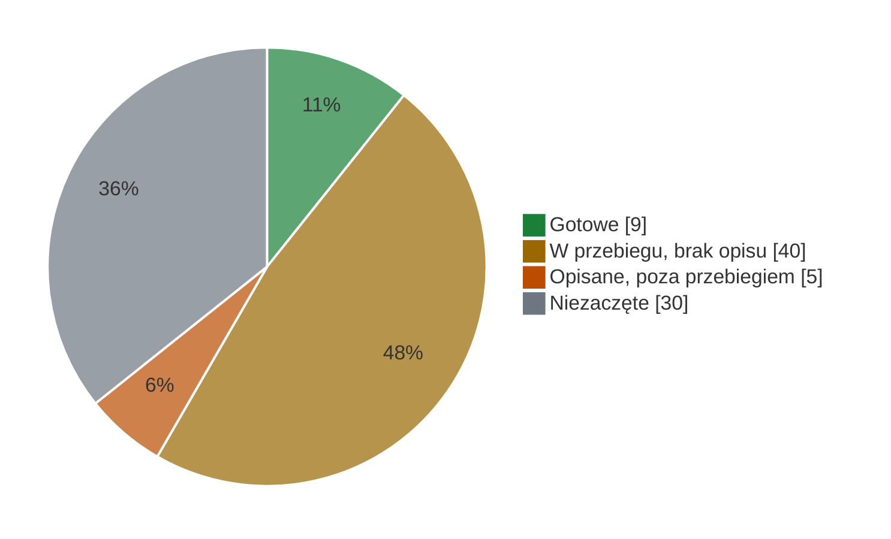

# Stan benchmarków

Stan na **4.11.2026**. Benchmark jest zrobiony, gdy jest **opisany, przygotowany i podpięty do przebiegu
centralnego** ([METODOLOGIA, „Definicja „zrobione””](METODOLOGIA.md#definicja-zrobione)). Wtedy jedno uruchomienie
`tools/przebieg_centralny.sh` na wynajętej karcie liczy wszystkie naraz. Zmieniasz stan benchmarku? Przestaw jego
wiersz w tym samym PR.

**A** karta `ORIGINAL.md` · **B** `REPRODUCTION.md` (kontrola albo „bez kontroli”) · **przebieg** wpis w `ZADANIA`
i `KATALOGI` · ✓ jest · ✗ brak

## ✅ Gotowe · 9

| benchmark | Space | A | B | przebieg | uwaga |
|---|---|---|---|---|---|
| [BLiMP](benchmarks/blimp/README.md) | T01 | ✓ | ✓ | ✓ | ⚠️ [do sprawdzenia](#do-sprawdzenia) |
| [ARC-Challenge](benchmarks/arc-challenge/REPRODUCTION.md) | T02 | ✓ | bez kontroli | ✓ | Slayer zgodny ze Space |
| [WikiText-2](benchmarks/wikitext-2/README.md) | T03 | ✓ | ✓ | ✓ | próg dla perpleksji: #41 |
| [MultiBLiMP PL](benchmarks/multiblimp-pl/README.md) | T04 | ✓ | bez kontroli | ✓ | ⚠️ możliwy przeciek (#36) |
| [PIQA](benchmarks/piqa/README.md) | T06 | ✓ | ✓ | ✓ | |
| [WinoGrande](benchmarks/winogrande/README.md) | T07 | ✓ | ✓ | ✓ | |
| [PubMedQA](benchmarks/pubmedqa/README.md) | T44 | ✓ | bez kontroli | ✓ | ⚠️ do sprawdzenia |
| [MedMCQA](benchmarks/medmcqa/README.md) | T45 | ✓ | bez kontroli | ✓ | ⚠️ do sprawdzenia |
| [Social IQa](benchmarks/social-iqa/README.md) | T46 | ✓ | bez kontroli | ✓ | |

## 🟡 W przebiegu, brak opisu · 40

Wpis w przebiegu jest. Brakuje karty (A) albo zapisu kontroli (B). Po zamknięciu karty automat zakłada zadanie B.

| brakuje | benchmarki |
|---|---|
| tylko B | [BoolQ](benchmarks/boolq/) T10 #26 · [HellaSwag](benchmarks/hellaswag/) T05 #24 · [LAMBADA](benchmarks/lambada/) T17 #32 · [OpenBookQA](benchmarks/openbookqa/) T08 #31 · [SciQ](benchmarks/sciq/) T09 #30 |
| tylko A | [WSC273](benchmarks/wsc273/) T14 #108 |
| A i B, angielskie | COPA T11 #105 · CB T12 #106 · WiC T13 #107 · RTE T15 #109 · ANLI T16 #110 · LogiQA T18 #19 (PR #139) · MathQA T19 #28 · PROST T20 #111 · SST-2 T21 #112 · MMLU T32 #123 · GSM8K T33 #124 · MATH T34 #125 (PR #141) · TruthfulQA T35 #126 · IFEval T36 #40 · SQuAD 2.0 T38 #128 · DROP T39 #129 · RACE T40 #130 · CoQA T41 #131 · NQ-Open T42 #132 · TriviaQA T43 #133 · BBH T47 #135 · PAWS T48 #136 · CoLA T49 #137 · ReCoRD T50 #138 |
| A i B, polskie | PolEmo 2.0 T22 #113 · 8TAGS T23 #114 · Belebele T24 #115 · DYK T25 #116 · PPC T26 #117 · PSC T27 #118 · CBD T28 #119 · NKJP-NER T29 #120 · PolQA T30 #121 · PoQuAD T31 #122 |

Każdy katalog ma `README.md` i `RECIPE.md` ze zbiorem, rewizją, splitem, metryką i licencją.

## 🟠 Opisane, poza przebiegiem · 5

| benchmark | A | B | czego brakuje | zadanie |
|---|---|---|---|---|
| [EWoK](benchmarks/ewok/README.md) | ✓ | ✓ | własny kod: wywołanie w przebiegu | |
| [EWoK-PL](benchmarks/ewok-pl/README.md) | `POLISH.md` | — | wywołanie w przebiegu; 10 z 11 domen, przegląd tłumaczenia | |
| [ARC-Easy](benchmarks/arc-easy/ORIGINAL.md) | ✓ | ✗ | B, wpis w przebiegu | #23 |
| [BLiMP Supplement](benchmarks/blimp-supplement/ORIGINAL.md) | ✓ | ✗ | B, wpis w przebiegu | #33 |
| [UncheatableEval](benchmarks/uncheatable-eval/ORIGINAL.md) | ✓ | ✗ | B, wpis w przebiegu | #35 |

## ⬜ Niezaczęte · 30

| co | benchmarki |
|---|---|
| Space | [LLMzSzŁ](benchmarks/llmzszl/README.md) T37 #127: Space nie publikuje promptu; kolumna informacyjna |
| held-out | NLL EN/PL/kod #22 · kod źródłowy #42 |
| [katalog CodeSOTA](https://beta.codesota.com/api/sub1b/benchmarks), bez issue | GPQA · GPQA Diamond · MMLU-Pro · IFBench · Multi-IF · MGSM · MMMLU · CaseReportBench · BFCL v3 · BFCL v4 · τ²-Bench Telecom · τ²-Bench Retail · GSM-Symbolic · SVAMP · AIME 2025 · HumanEval · HumanEval+ · MBPP · MBPP+ · LiveCodeBench · RULER · LongBench v2 · SimpleQA · WildBench · AlpacaEval 2.0 LC · MT-Bench · ARC-AGI-1 |

## ⚠️ Do sprawdzenia

Nie idzie do tabeli CodeSOTA, dopóki ktoś nie sprawdzi i nie przestawi wiersza.

| co | problem | co zrobić | gdzie |
|---|---|---|---|
| **BLiMP** | wszystkie 5 modeli [przebiegu](results/central-run/scores.png) około 80%, checkpointy Slayera prawie płasko | druga osoba liczy od zera; per paradygmat: czy któryś stoi na 50% albo 100%; czy checkpointy nie czytają tych samych wag | [BLIMP](benchmarks/blimp/results/BLIMP.md) · [CHECKPOINTS](benchmarks/blimp/results/CHECKPOINTS.md) |
| **MedMCQA** | Slayer wybiera „A” w 93% pytań; repo 0,316, Space 0,245 (z 2,27), a LFM2.5 zgadza się ze Space | sprawdzić ładowanie Slayera i format promptu w przebiegu | [REPRODUCTION](benchmarks/medmcqa/REPRODUCTION.md) | <!-- liczba-spoza-wynikow: results/central-run/medmcqa/slayer1b-1.06 i results.json Space T45 @ 2d3d73f -->
| **PubMedQA** | Slayer pod bazą większościową, żaden model nie wybiera `maybe` | sprawdzić prompt i mapowanie odpowiedzi | [REPRODUCTION](benchmarks/pubmedqa/REPRODUCTION.md) |
| **MultiBLiMP PL** | Slayer blisko 100% | sprawdzić, czy zbiór nie jest w danych treningowych | [REPRODUCTION](benchmarks/multiblimp-pl/REPRODUCTION.md) · #36 |
| **Belebele PL** | 5 pierwszych dokumentów testu jako przykłady (YAML OpenPL) | bank przykładów spoza testu | [README](benchmarks/belebele-pl/README.md) |
| **few-shot Space** | klucz hasha banku przykładów nieopublikowany; przyjęty `…\|support\|id` | potwierdzić u autora Space | `common/ewaluuj.py` |
| **WSC273** | kontrola spoza listy, panel ≠ pełny split | kontrola z listy METODOLOGII | [REPRODUCTION](benchmarks/wsc273/REPRODUCTION.md) |
| **EWoK-PL** | 1 domena z 11, tłumaczenie bez przeglądu | przegląd i reszta domen | [POLISH](benchmarks/ewok-pl/POLISH.md) |
| **katalog CodeSOTA** | statusy ≠ repo | ustalić, kto prowadzi katalog | [API](https://beta.codesota.com/api/sub1b/benchmarks) |
