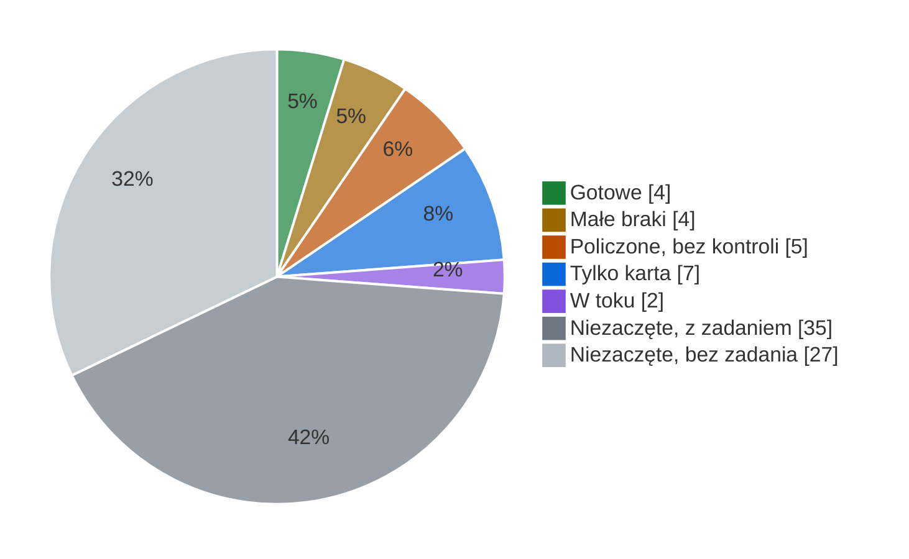

# Stan benchmarków

Stan na **4.11.2026**. Zmieniasz stan benchmarku? Przestaw jego wiersz w tym samym PR.

**A** karta `ORIGINAL.md` · **B** odtworzenie `REPRODUCTION.md` · **C** kod i test · **wynik** Slayera 1.06 ·
✓ jest · ~ z zastrzeżeniem · ✗ brak

Policzone ≠ gotowe: do tabeli wchodzi wynik ze sprawdzonym etapem B, czyli model kontrolny liczony tym samym kodem
zgadza się z opublikowanym wynikiem.

## ✅ Gotowe do tabeli CodeSOTA · 4

| benchmark | Space | A | B | C | wynik | uwaga |
|---|---|---|---|---|---|---|
| [BLiMP](benchmarks/blimp/README.md) | T01 | ✓ | ~ | ✓ | ✓ | ⚠️ [do sprawdzenia](#do-sprawdzenia) |
| [EWoK](benchmarks/ewok/README.md) | | ✓ | ✓ | ✓ | ✓ | |
| [WinoGrande](benchmarks/winogrande/README.md) | T07 | ✓ | ✓ | ✓ | ✓ | |
| [PIQA](benchmarks/piqa/README.md) | T06 | ✓ | ✓ | ✓ | ✓ | |

## 🟡 Małe braki · 4

| benchmark | Space | A | B | C | wynik | brakuje | zadanie |
|---|---|---|---|---|---|---|---|
| [EWoK-PL](benchmarks/ewok-pl/README.md) | | — | — | ✓ | ✓ | 10 z 11 domen, przegląd tłumaczenia | |
| [WSC273](benchmarks/wsc273/README.md) | T14 | ✗ | ~ | ✓ | ~ | karta, kontrola z listy | #108 #97 |
| [WikiText-2](benchmarks/wikitext-2/README.md) | T03 | ✓ | ~ | ✓ | ~ | próg dla perpleksji | #15 #41 |
| [ARC-Easy](benchmarks/arc-easy/ORIGINAL.md) | | ✓ | ✗ | ✗ | ✗ | odtworzenie, kod, wynik | #23 |

## 🟠 Policzone, bez kontroli · 5

Wynik Slayera 1.06 i czterech modeli odniesienia jest w
[przebiegu centralnym](results/central-run/README.md) (tam też BLiMP i WikiText-2). Brakuje etapu B, więc wynik nie
idzie jeszcze do tabeli.

Żaden model przebiegu nie ma opublikowanego wyniku 0-shot na tych zbiorach, więc kontrolę trzeba policzyć osobno.

| benchmark | Space | A | B | wynik | kontrola do policzenia | zadanie |
|---|---|---|---|---|---|---|
| [ARC-Challenge](benchmarks/arc-challenge/ORIGINAL.md) | T02 | ✓ | ✗ | [✓](results/central-run/arc-challenge) | `pythia-2.8b-v0`, GPU | #29 #49 |
| MultiBLiMP PL | T04 | ✗ | ✗ | [✓](results/central-run/multiblimp-pl) ⚠️ | Goldfish 125M (pol), wystarczy CPU ([arXiv 2504.02768](https://arxiv.org/abs/2504.02768)) | #104 |
| PubMedQA | T44 | ✗ | ✗ | [✓](results/central-run/pubmedqa) | TinyLlama-1.1B 3T, GPU | #20 #97 |
| MedMCQA | T45 | ✗ | ✗ | [✓](results/central-run/medmcqa) | Qwen1.5-7B, GPU | #134 |
| Social IQa | T46 | ✗ | ✗ | [✓](results/central-run/social-iqa) | brak opublikowanego wyniku | #17 #97 |

## 📄 Tylko karta · 7

Następny krok: etap B.

| benchmark | Space | zadanie |
|---|---|---|
| [BLiMP Supplement](benchmarks/blimp-supplement/ORIGINAL.md) | | #33 |
| [BoolQ](benchmarks/boolq/ORIGINAL.md) | T10 | #26 |
| [HellaSwag](benchmarks/hellaswag/ORIGINAL.md) | T05 | #24 |
| [LAMBADA](benchmarks/lambada/ORIGINAL.md) | T17 | #32 |
| [OpenBookQA](benchmarks/openbookqa/ORIGINAL.md) | T08 | #31 |
| [SciQ](benchmarks/sciq/ORIGINAL.md) | T09 | #30 |
| [UncheatableEval](benchmarks/uncheatable-eval/ORIGINAL.md) | | #35 |

## 🔨 W toku · 2

| benchmark | Space | PR | zadanie |
|---|---|---|---|
| LogiQA | T18 | #139 wynik wstępny | #19 #97 |
| MATH | T34 | #141 karta | #125 |

## ⬜ Niezaczęte · 62

**Z zadaniem (35)**

| co | zadania |
|---|---|
| karta, angielskie | COPA #105 · CommitmentBank #106 · WiC #107 · RTE #109 · ANLI #110 · PROST #111 · SST-2 #112 · MMLU #123 · GSM8K #124 · TruthfulQA #126 · SQuAD 2.0 #128 · DROP #129 · RACE #130 · CoQA #131 · NQ-Open #132 · TriviaQA #133 · BBH #135 · PAWS #136 · CoLA #137 · ReCoRD #138 |
| karta, polskie | PolEmo 2.0 #113 · 8TAGS #114 · Belebele #115 · DYK #116 · PPC #117 · PSC #118 · CBD #119 · NKJP-NER #120 · PolQA #121 · PoQuAD #122 · LLMzSzŁ #127 |
| Space bez wyniku | MathQA #28 · IFEval #40 |
| held-out | NLL EN/PL/kod #22 · kod źródłowy #42 |

**Bez zadania (27)**: z [katalogu CodeSOTA](https://beta.codesota.com/api/sub1b/benchmarks). Zanim zaczniesz, załóż
issue.

| grupa | benchmarki |
|---|---|
| liquid-reference | GPQA · GPQA Diamond · MMLU-Pro · IFBench · Multi-IF · MGSM · MMMLU · CaseReportBench · BFCL v3 · BFCL v4 · τ²-Bench Telecom · τ²-Bench Retail |
| math-reasoning | GSM-Symbolic · SVAMP · AIME 2025 |
| coding | HumanEval · HumanEval+ · MBPP · MBPP+ · LiveCodeBench |
| reading-context | RULER · LongBench v2 |
| trust-preference | SimpleQA · WildBench · AlpacaEval 2.0 LC · MT-Bench |
| reasoning | ARC-AGI-1 |

## ⚠️ Do sprawdzenia · 6

Nie idzie do tabeli, dopóki ktoś nie sprawdzi i nie przestawi wiersza.

| co | problem | co zrobić | gdzie |
|---|---|---|---|
| **BLiMP** | wszystkie 5 modeli [przebiegu](results/central-run/scores.png) około 80%, checkpointy Slayera prawie płasko | druga osoba liczy od zera; per paradygmat: czy któryś stoi na 50% albo 100%; czy checkpointy nie czytają tych samych wag | [BLIMP](benchmarks/blimp/results/BLIMP.md) · [CHECKPOINTS](benchmarks/blimp/results/CHECKPOINTS.md) |
| **MultiBLiMP PL** | Slayer blisko 100% | sprawdzić, czy zbiór nie jest w danych treningowych | [analiza](analyses/answer-format/README.md) · #104 #36 |
| **MedMCQA** | Slayer wybiera „A” w 93% pytań; repo 0,316, Space 0,245 (z 2,27), a LFM2.5 zgadza się ze Space | sprawdzić ładowanie Slayera i format promptu w przebiegu | [REPRODUCTION](benchmarks/medmcqa/REPRODUCTION.md) |
| **PubMedQA** | Slayer pod bazą większościową, żaden model nie wybiera `maybe` | sprawdzić prompt i mapowanie odpowiedzi | [REPRODUCTION](benchmarks/pubmedqa/REPRODUCTION.md) |
| **WSC273** | kontrola spoza listy, panel ≠ pełny split | kontrola z listy METODOLOGII | [REPRODUCTION](benchmarks/wsc273/REPRODUCTION.md) |
| **WikiText-2** | werdykt B nierozstrzygalny | próg dla perpleksji | #41 #15 |
| **EWoK-PL** | 1 domena z 11, tłumaczenie bez przeglądu | przegląd i reszta domen | [POLISH](benchmarks/ewok-pl/POLISH.md) |
| **katalog CodeSOTA** | statusy ≠ repo: ARC-Easy `full`, ARC-C · HellaSwag · OBQA · BoolQ `pilot`, GSM8K · HumanEval `adapter_ready`; BLiMP · EWoK · WinoGrande `planned` | ustalić, kto prowadzi katalog | [API](https://beta.codesota.com/api/sub1b/benchmarks) |
