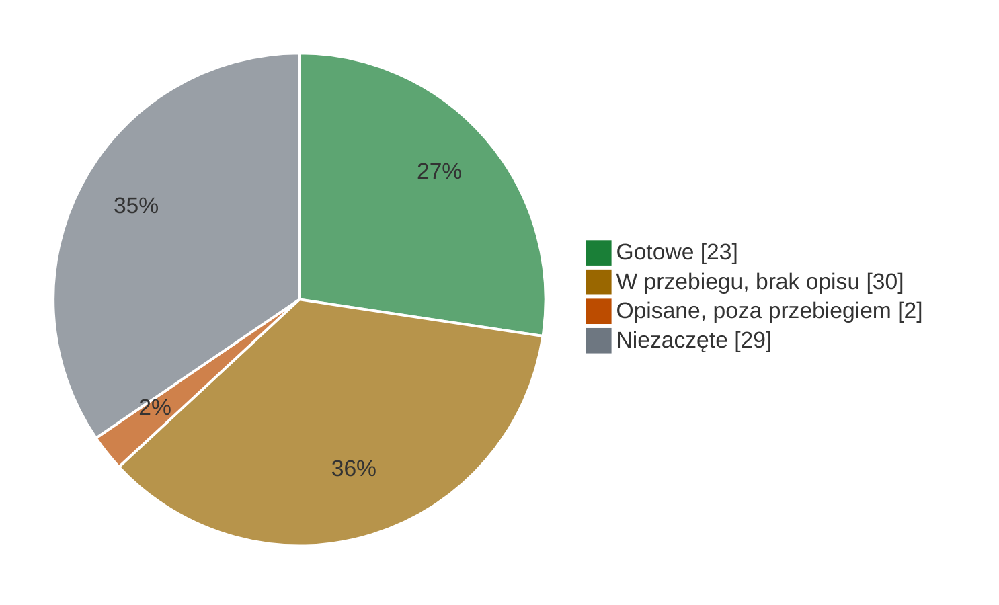

# Stan benchmarków

Stan na **16.11.2026**. Benchmark jest zrobiony, gdy jest **opisany, przygotowany i podpięty do przebiegu
centralnego** ([METODOLOGIA, „Definicja „zrobione””](METODOLOGIA.md#definicja-zrobione)). Wtedy jedno uruchomienie
`tools/przebieg_centralny.sh` na wynajętej karcie liczy wszystkie naraz. Zmieniasz stan benchmarku? Przestaw jego
wiersz w tym samym PR.

**A** karta `ORIGINAL.md` · **B** `REPRODUCTION.md` (kontrola albo „bez kontroli”) · **przebieg** wpis w `ZADANIA`
i `KATALOGI` · ✓ jest · ✗ brak

## ✅ Gotowe · 23

Każdy ma A, B, wpis w przebiegu, `RECIPE.md`, wiersz w [README, „Benchmarki i typy”](README.md#benchmarki-i-typy) i
test `tests/test_<name>.py`.

| benchmark | test | A | B | przebieg | uwaga |
|---|---|---|---|---|---|
| [BLiMP](benchmarks/blimp/README.md) | T01 | ✓ | ✓ | ✓ | sprawdzone 07.11, błędu nie ma ([REPRODUCTION](benchmarks/blimp/REPRODUCTION.md)) |
| [ARC-Challenge](benchmarks/arc-challenge/README.md) | T02 | ✓ | bez kontroli | ✓ | Slayer na poziomie bazy losowej |
| [WikiText-2](benchmarks/wikitext-2/README.md) | T03 | ✓ | bez kontroli | ✓ | próg dla perpleksji: #41 |
| [MultiBLiMP PL](benchmarks/multiblimp-pl/README.md) | T04 | ✓ | bez kontroli | ✓ | ⚠️ [do sprawdzenia](#do-sprawdzenia): możliwy przeciek (#36) |
| [HellaSwag](benchmarks/hellaswag/README.md) | T05 | ✓ | ✓ | ✓ | kontrolę (EuroLLM, spełniona) liczono 10-shot osobnym kodem poza przebiegiem; przebieg liczy T05 0-shot |
| [PIQA](benchmarks/piqa/README.md) | T06 | ✓ | ✓ | ✓ | |
| [WinoGrande](benchmarks/winogrande/README.md) | T07 | ✓ | ✓ | ✓ | |
| [WSC273](benchmarks/wsc273/README.md) | T14 | ✓ | bez kontroli | ✓ | ⚠️ [do sprawdzenia](#do-sprawdzenia): kontrola spoza listy |
| [LAMBADA](benchmarks/lambada/README.md) | T17 | ✓ | ✓ | ✓ | kontrola Pythia v0: spełniony, pełny przebieg 2026-11 |
| [MathQA](benchmarks/mathqa/README.md) | T19 | ✓ | bez kontroli | ✓ | Slayer na poziomie bazy większościowej |
| [PolEmo 2.0 (in-domain)](benchmarks/polemo2/README.md) | T22 | ✓ | kontrola `+pl` | ✓ | bez kandydata z opublikowanym wynikiem; model znający polski (Bielik-1.5B-v3, zapas EuroLLM-1.7B), werdykt po przebiegu centralnym (#166) |
| [8TAGS](benchmarks/8tags/README.md) | T23 | ✓ | kontrola `+pl` | ✓ | bez kandydata z opublikowanym wynikiem; model znający polski (Bielik-1.5B-v3, zapas EuroLLM-1.7B), werdykt po przebiegu centralnym (#167) |
| [Belebele](benchmarks/belebele-pl/README.md) | T24 | ✓ | kontrola `+pl` | ✓ | kontrola `+pl` (Bielik-1.5B-v3, porównanie parowane z b, SE K po fragmentach `link`), werdykt po przebiegu centralnym (#168) |
| [DYK](benchmarks/dyk/README.md) | T25 | ✓ | kontrola `+pl` | ✓ | kontrola `+pl` (model znający polski: F1 > b + 2 SE), werdykt po przebiegu centralnym (#169); F1 a skłonność do „Tak”: #157 |
| [PPC](benchmarks/ppc/README.md) | T26 | ✓ | kontrola `+pl` | ✓ | bez kandydata z opublikowanym wynikiem; model znający polski (Bielik-1.5B-v3; EuroLLM-1.7B odpada, 35,6 < b), werdykt po przebiegu centralnym (#170) | <!-- liczba-spoza-wynikow: eksport all_data.json z 2026-11-18, SHA-256 68cc602c56518b6127d463da5b2af3847ffaad203855b74d6ded050e80fb96ec -->
| [PSC](benchmarks/psc/README.md) | T27 | ✓ | kontrola `+pl` | ✓ | bez kandydata z opublikowanym wynikiem; model znający polski Bielik-11B-v3.1-Instruct (Bielik-1.5B-v3 i EuroLLM-1.7B pod b na leaderboardzie), bez zapasu, F1 parowane po klastrach `extract_text`, werdykt po przebiegu centralnym (#222) |
| [CBD](benchmarks/cbd/README.md) | T28 | ✓ | kontrola `+pl` | ✓ | bez kandydata z opublikowanym wynikiem; model znający polski (Bielik-1.5B-v3, bez zapasu: EuroLLM-1.7B pod b na leaderboardzie), makro-F1 parowane ze stałą „nieszkodliwa”, SE po klastrach `TEXT`, werdykt po przebiegu centralnym (#223) |
| [NKJP-NER (KLEJ)](benchmarks/klej-ner/README.md) | T29 | ✓ | kontrola `+pl` | ✓ | bez kandydata z opublikowanym wynikiem; model znający polski Bielik-11B-v3.1-Instruct, bez zapasu (Bielik-1.5B-v3 i EuroLLM-1.7B mają na leaderboardzie wynik pod b), werdykt po przebiegu centralnym (#224) |
| [PubMedQA](benchmarks/pubmedqa/README.md) | T44 | ✓ | bez kontroli | ✓ | Slayer pod b, prompt i mapowanie sprawdzone ([werdykt](benchmarks/pubmedqa/REPRODUCTION.md#werdykt-sprawdzenia)) |
| [MedMCQA](benchmarks/medmcqa/README.md) | T45 | ✓ | bez kontroli | ✓ | ⚠️ [do sprawdzenia](#do-sprawdzenia) |
| [Social IQa](benchmarks/social-iqa/README.md) | T46 | ✓ | bez kontroli | ✓ | Slayer nad b, pod czterema modelami odniesienia |
| [ARC-Easy](benchmarks/arc-easy/README.md) | T51 | ✓ | ✓ | ✓ | kontrola Pythia v0: spełniony, pełny przebieg 2026-11 |
| [EWoK](benchmarks/ewok/README.md) | T53 | ✓ | ✓ | ✓ własny kod | zbiór za bramką zgody na HF: token przebiegu musi mieć dostęp |

## 🟡 W przebiegu, brak opisu · 30

Wpis w przebiegu jest. Brakuje karty (A), zapisu kontroli (B) albo testu `tests/test_<name>.py`; w wierszu „tylko B”
test jest, w wierszu „B i test” jest karta A, w wierszach „A i B” brakuje też testu. Po zamknięciu karty automat zakłada zadanie B.

| brakuje | benchmarki |
|---|---|
| tylko B | [BoolQ](benchmarks/boolq/) T10 #26 · [OpenBookQA](benchmarks/openbookqa/) T08 #31 · [SciQ](benchmarks/sciq/) T09 #30 · [BLiMP Supplement](benchmarks/blimp-supplement/README.md) T52 #33 · [LogiQA](benchmarks/logiqa/README.md) T18 #19 · [LLMzSzŁ](benchmarks/llmzszl/ORIGINAL.md) T37 #127 (B „bez kontroli”, kontrola `+pl`; kolumna informacyjna) |
| B i test | [ANLI](benchmarks/anli-r3/ORIGINAL.md) T16 #110 · [IFEval](benchmarks/ifeval/ORIGINAL.md) T36 #40 · [SQuAD 2.0](benchmarks/squad2/ORIGINAL.md) T38 #128 · [DROP](benchmarks/drop/ORIGINAL.md) T39 #129 · [CoQA](benchmarks/coqa/ORIGINAL.md) T41 #131 · [BBH](benchmarks/bbh/ORIGINAL.md) T47 #135 · [PAWS](benchmarks/paws-en/ORIGINAL.md) T48 #136 |
| A i B, angielskie | CB T12 #106 · WiC T13 #107 · RTE T15 #109 · PROST T20 #111 · SST-2 T21 #112 · MMLU T32 #123 · GSM8K T33 #124 · MATH T34 #125 (PR #141) · TruthfulQA T35 #126 · RACE T40 #130 · NQ-Open T42 #132 · TriviaQA T43 #133 · CoLA T49 #137 · ReCoRD T50 #138 |
| A i B, polskie | PolQA T30 #121 · PoQuAD T31 #122 |

Każdy z tych katalogów ma `README.md` i `RECIPE.md` ze zbiorem, rewizją, splitem, metryką i licencją.

## 🟠 Opisane, poza przebiegiem · 2

| benchmark | A | B | czego brakuje | zadanie |
|---|---|---|---|---|
| [EWoK-PL](benchmarks/ewok-pl/README.md) | `POLISH.md` | — | wpis w przebiegu: polskie rekordy leżą w zipie poza repo, bez miejsca pobrania i rewizji, a `POLISH.md` nie podaje autora tłumaczenia ani przeglądu (pole „Dane”); przetłumaczona 1 domena z 11 | |
| [UncheatableEval](benchmarks/uncheatable-eval/ORIGINAL.md) | ✓ | ✗ | B i wpis w przebiegu: karta nie ustala tokenu startu (`bos_mode`) dla modeli przebiegu (wybiera go `bos_mode_finder.py` per model, karta podaje go tylko dla Qwen3-0.6B-Base i SmolLM2-1.7B), a etap B ma liczyć kodem autorów (okna 4000 tokenów, logity bf16), którego w repo nie ma | #35 |

## ⬜ Niezaczęte · 29

| co | benchmarki |
|---|---|
| held-out | NLL EN/PL/kod #22 · kod źródłowy #42 |
| [katalog CodeSOTA](https://beta.codesota.com/api/sub1b/benchmarks), bez issue | GPQA · GPQA Diamond · MMLU-Pro · IFBench · Multi-IF · MGSM · MMMLU · CaseReportBench · BFCL v3 · BFCL v4 · τ²-Bench Telecom · τ²-Bench Retail · GSM-Symbolic · SVAMP · AIME 2025 · HumanEval · HumanEval+ · MBPP · MBPP+ · LiveCodeBench · RULER · LongBench v2 · SimpleQA · WildBench · AlpacaEval 2.0 LC · MT-Bench · ARC-AGI-1 |

## ⚠️ Do sprawdzenia

Nie idzie do tabeli CodeSOTA, dopóki ktoś nie sprawdzi i nie przestawi wiersza.

| co | problem | co zrobić | gdzie |
|---|---|---|---|
| **MedMCQA** | sprawdzone 07.11: zachowanie modelu, nie kod. Prompt i opcje = lm-eval 0.4.9.1 `medmcqa`; w cloze ten sam załadowany Slayer wybiera A w 24,6% pytań (jak pozostałe modele), a w literach `A` w 93,3%, więc jego `acc` 0,316 to prawie stała odpowiedź (b 0,322); EuroLLM wybiera `B` w 62,9% | przy 1.07 czytać `acc` wobec b razem z udziałem najczęstszej litery; do CodeSOTA dopiero, gdy `acc` przejdzie b + 2 SE | [REPRODUCTION](benchmarks/medmcqa/REPRODUCTION.md) | <!-- liczba-spoza-wynikow: probki przebiegu centralnego T45 (space i cloze); b z benchmarks/medmcqa/ORIGINAL.md -->
| **MultiBLiMP PL** | Slayer 98,59%; sprawdzone 07.11: wynik nie idzie za długością zdań (97,9% na parach z dłuższym poprawnym zdaniem), równo na zjawiskach (98,1–98,9%); przeciek nierozstrzygnięty | skan nakładania zdań UD_Polish (PDB, LFG, PUD) na dane treningowe Slayera albo kontrola Goldfish 125M | [REPRODUCTION](benchmarks/multiblimp-pl/REPRODUCTION.md) · #36 | <!-- liczba-spoza-wynikow: probki przebiegu centralnego T04, slayer1b-1.06 -->
| **WSC273** | kontrola spoza listy, panel ≠ pełny split | kontrola z listy METODOLOGII | [REPRODUCTION](benchmarks/wsc273/REPRODUCTION.md) |
| **EWoK-PL** | przetłumaczona 1 domena z 11, tłumaczenie bez przeglądu | przegląd i pozostałe 10 domen | [POLISH](benchmarks/ewok-pl/POLISH.md) |
| **Bielik-1.5B-v3** | repo z bramką zgody na HF: wiersz Bielika w `MODELE` jest, ale przebieg liczy go tylko, gdy token HF ma dostęp, inaczej pomija z komunikatem (`dostep_hf`) | konto uruchamiające przebieg akceptuje warunki na HF | [METODOLOGIA](METODOLOGIA.md#pięć-modeli-odniesienia) · `tools/przebieg_centralny.sh` |
| **katalog CodeSOTA** | statusy ≠ repo | ustalić, kto prowadzi katalog | [API](https://beta.codesota.com/api/sub1b/benchmarks) |
