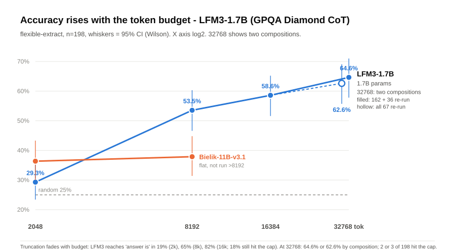

# GPQA Diamond (DRAFT, exploratory local run)

Graduate-level multiple-choice science questions (biology, physics, chemistry) written to be hard to look up.
The Diamond subset keeps the questions on which expert validators agreed and non-experts failed.

**Status: draft. The main row (Fabryka API, LFM3-1.7B card settings) is NOT computed here.** The numbers below
come from a local exploratory run on rented GPUs and do not close issue #302. See Deviations.

- Paper: [Rein et al. 2023, GPQA: A Graduate-Level Google-Proof Q&A Benchmark](https://arxiv.org/abs/2311.12022)
- Harness: [lm-evaluation-harness](https://github.com/EleutherAI/lm-evaluation-harness) v0.4.13, task
  `gpqa_diamond_cot_zeroshot` (task version 2.2). The repo pin elsewhere is 0.4.9.1 (see Deviations)
- Data: [Idavidrein/gpqa](https://huggingface.co/datasets/Idavidrein/gpqa), config `gpqa_diamond` @
  `83022cefff930aea54f654c0b282e74b9eeda5c6`, 198 questions (full Diamond). Gated: needs consent on Hugging Face
- Metric: `exact_match` with the `flexible-extract` filter (see Deviations for `strict-match`)
- Settings (our run): 0-shot chain of thought, chat template, greedy (`do_sample=false`, `temperature=0.0`),
  stop `</s>`, bf16, `max_gen_toks` 8192 (also 2048, 16384 and a composed 32768, see below), 1 trial
- Card settings (reference, LFM3-1.7B): temperature 0.6, top_p 0.95, reasoning on, output limited only by the
  context window (262144), served with vLLM in bf16. GPQA is not among the card's exceptions. CoT, number of
  shots and answer extraction method are not stated on the card
- Extra services: none

## Results

| model | how it runs | score | stderr | n | date |
|---|---|---|---|---|---|
| LFM3-1.7B card | Liquid AI model card, GPQA Diamond (settings above; not reproduced by us) | 63.37 | - | - | - |
| LFM3-1.7B (`lfm3-1.7b`) | local RTX A4000, lm-eval CoT greedy, 8192 tokens, batch 22 | 53.54 | 3.54 | 198 | 2026-11-19 |
| Bielik 11B v3.1 (`bielik-11b-v3.1`) | local RTX 5090, lm-eval CoT greedy, 8192 tokens, batch 1 | 37.88 | 3.45 | 198 | 2026-11-20 |
| LFM3-1.7B (`lfm3-1.7b-2048`) | local RTX 5090, lm-eval CoT greedy, 2048 tokens, batch 1 | 29.29 | 3.24 | 198 | 2026-11-19 |
| Bielik 11B v3.1 (`bielik-11b-v3.1-2048`) | local RTX 5090, lm-eval CoT greedy, 2048 tokens, batch 1 | 36.36 | 3.43 | 198 | 2026-11-19 |
| LFM3-1.7B (`lfm3-1.7b-16k`) | rented RTX 3090, lm-eval CoT greedy, 16384 tokens, batch 16 | 58.59 | 3.51 | 198 | 2026-11-21 |
| LFM3-1.7B (`lfm3-1.7b-32k`), composition A | composed: 162 items kept at their 16384 result + the 36 items truncated at 16384 re-scored @32768 (rented RTX 3090) | 64.65 | 3.40 | 198 | 2026-11-22 |
| LFM3-1.7B (`lfm3-1.7b-32k`), composition B | composed: the 67 re-run items all take their 32768 result, the other 131 keep their 16384 result (same re-run) | 62.63 | 3.44 | 198 | 2026-11-22 |
| Slayer 1B | not run | null | null | 198 | - |

Rows with a different setup are not interchangeable: compare models only through the paired tests below, never
across rows of different budget or hardware. The main row (Fabryka API, card settings) is not computed here.
The 2048, 8192 and 16384 runs each have files in `results/`. The 16384 run is a clean full-198 run (it replaces an
earlier two-budget projection of 59.09 that was never stored).

**The 32768 point is not a fresh full-198 run and has no single headline.** It is reported as two compositions,
A (64.65) and B (62.63), a 4-item difference. Both are built from the 16384 run plus one 32768 re-run of 67 items,
and the 32768 score is not read from either one alone. What the 67 items are:

- 36 items hit the cap at 16384 (`truncated_16384`). 32 of them were wrong at 16384 and 4 right.
- 31 items had concluded by 16384 (not truncated) but their response has no "answer is" phrase. 23 of them were
  correct and 8 wrong at 16384. The rule that selected the 67 (truncated at 16384 OR no "answer is") was written
  in the run brief before the re-run (`scripts/select_rerun_subset.py` reproduces it and the exact id list). No
  reason for adding the 31 was recorded; during the run they were expected to reproduce their 16384 result
  under greedy decoding.
- The 36 truncated items: 4 -> 16 correct at 32768, 12 fixed and 0 broken (Δ = +33.33 ± 7.97 points, z = 4.18, a
  descriptive number, see the subset rows below). 2 of the 36 (docs 63 and 131) still hit the cap at 32768.
- The 31 concluded items did not reproduce: 4 changed, all from correct to wrong (docs 23, 65, 87, 188), and doc
  147 (wrong both times) hit the cap at 32768 although it had concluded at 16384. The operator's run summary also
  records a different generation length for 19 of the 31 (that summary is not in the repo). All 4 changes go in
  one direction, which four changes cannot separate from noise (two-sided sign test p = 0.125); we assign no cause.
- Composition A takes the 32768 result only for the 36 truncated items (128/198, 2 items at the cap). Composition B
  takes it for all 67 (124/198, 3 items at the cap, the 4 changed items included). Neither composition was recorded
  in a committed note before the re-run, so this card does not present either as fixed in advance.



The curve reads left to right as the budget doubles (x axis is log2). The points are 2048, 8192, 16384 and 32768;
at 32768 both compositions are drawn (filled A, hollow B).

**Not like-for-like.** Composition A can only go up from the 16384 run by construction: it re-runs 36 items of which
32 were wrong and keeps everything else. The full-198 comparison of 16384 against composition A (+12 items,
Δ = +6.06 ± 1.70 points, z = 3.57) is therefore descriptive only and not read as a budget effect. The card
(63.37) samples at temperature 0.6, top_p 0.95 with reasoning on; our runs are greedy with a different composition,
so this is not a reproduction of the card. Against the card's point value (no card SE, so the uncertainty is
understated): composition A is +1.28 points (z = +0.38, within noise), composition B is -0.74 points (z = -0.22,
within noise). That is consistent with the card at a large budget, nothing stronger.

### Paired tests

Same 198 questions, paired difference per item, z = Δ / SE (the SE is the paired SE over the items). The reading
follows the repo convention |z| < 2 noise, 2-3 borderline, >= 3 clear. The six tests below use all 198 items and
form one family for the Holm correction (`tools/statystyka.py`, `po_holmie`).

| comparison | net (items) | Δ ± SE (points) | z | verdict | after Holm |
|---|---|---|---|---|---|
| LFM3 vs Bielik, 8192 (LFM3 on RTX A4000 batch 22, Bielik on RTX 5090 batch 1) | +31 for LFM3 | +15.66 ± 4.59 | z = 3.41 | clear | yes (borderline) |
| LFM3 vs Bielik, 8192, strict variant (correct only if "answer is" is present; same GPUs) | +27 for LFM3 | +13.64 ± 4.73 | z = 2.88 | borderline | yes (borderline) |
| LFM3 vs Bielik, 2048 (both on RTX 5090 batch 1) | -14 for LFM3 (Bielik +14) | -7.07 ± 4.67 | z = -1.51 | noise | no (noise) |
| LFM3, 2048 vs 8192 | +48 for 8192 | +24.24 ± 3.93 | z = 6.16 | clear | yes (clear) |
| Bielik, 2048 vs 8192 | +3 for 8192 | +1.52 ± 2.91 | z = 0.52 | noise | no (noise) |
| LFM3, 8192 vs 16384 (full 198) | +10 for 16384 | +5.05 ± 3.26 | z = 1.55 | noise | no (noise) |

The sign of the LFM3 vs Bielik comparison depends on the token budget, so it is a property of the budget as much as of
the models: LFM3 is +15.66 ± 4.59 points at 8192 (z = 3.41) and -7.07 ± 4.67 points at 2048 (z = -1.51, noise,
Bielik higher but within noise). The two 8192 cells also differ in GPU and batch size (A4000 batch 22 against
5090 batch 1). After the Holm correction over these six tests, 3 of 6 remain: the LFM3 vs Bielik 8192 comparison
drops from clear to borderline, the strict variant stays borderline, and the 2048 to 8192 budget effect for LFM3 stays clear.

Two further tests pick their items by outcome, so they sit outside the Holm family and are descriptive only. The
items are chosen because one arm ran out of budget, which makes that arm almost always wrong on them, so the gain is
biased upward and no verdict is attached:

| subset test | net (items) | Δ ± SE (points) | z | reading |
|---|---|---|---|---|
| LFM3, 8192 vs 16384 (the 74 items truncated at 8192) | +12 for 16384 | +16.22 ± 6.67 | z = 2.43 | descriptive only, selected subset |
| LFM3, 16384 vs 32768 (the 36 items truncated at 16384, composition A) | +12 for 32768 | +33.33 ± 7.97 | z = 4.18 | descriptive only, selected subset |

Reading the budget bump: on the full 198 the 8192 -> 16384 move is within noise (z = 1.55), and the point score
rises 53.54 -> 58.59. The gain sits in the items that were truncated at 8192 (the 74-item subset, descriptive), which
is where it would sit if the budget were all that changed. The 74 doc ids are in
`results/lfm3-1.7b-truncated-8192-ids.json` (the 8192 file has no `truncated_8192` flag). At 16384, 36 of 198 (18%)
still reach the cap, so 16384 is not the ceiling. After 32768, 2 of 198 (composition A) or 3 of 198 (composition B)
still reach the cap.

## Deviations

- **Not the API, not card settings.** We ran on rented GPUs (vast) with a local lm-eval, greedy decoding and a
  budget of 8192 tokens. The card uses an API-style setup: temperature 0.6, top_p 0.95, reasoning on, a budget up
  to the context window. These numbers are an exploratory variant and a cross-check, not figures to report under
  #302.
- **Token budget and truncation.** At 8192 tokens LFM3-1.7B is cut off: 74 of 198 outputs reach the limit
  (measured with the tokenizer on the pod), and 65.2% reach an "answer is" phrase. The card has an effectively
  unlimited budget, which probably explains part of the distance from the card: at 8192 our 53.54 sits 2.8 SE below
  the card's 63.37 (z = -2.8, using our run's SE 3.54); at 16384 the full run reaches 58.59, 1.4 SE below the card
  (z = -1.36). Budget sweep for LFM3: 2048 to 8192 adds 24.24 ± 3.93 points (z = 6.16); 8192 to 16384 adds
  5.05 ± 3.26 (z = 1.55, within noise on the full 198), with the gain concentrated in the items truncated at 8192.
  At 16384, 36 of 198 (18%) still reach the cap, so the budget is still biting. The 32768 point is two compositions
  of one 67-item re-run, 64.65 (A) and 62.63 (B), see Results for what the 67 items are and for the 31 that did not
  reproduce. Both are within noise of the card (z = +0.38 and z = -0.22), but the card samples at T = 0.6 and our
  runs are greedy, so that is consistency at a large budget, not a reproduction. Bielik barely moves with budget
  (+1.52 ± 2.91 points, z = 0.52, noise).
- **Harness version.** We used lm-eval 0.4.13 (from `pip freeze` on the pod; it was not saved in `results.json`),
  transformers 5.22.1, torch 2.8.0+cu128. The repo pin elsewhere is 0.4.9.1. Not reconciled.
- **Backend.** All runs use the lm-eval HuggingFace backend (`model: hf`, the `HFLM` class) on transformers in bf16
  with greedy decoding, confirmed in each run's `config.model`. No llama.cpp or GGUF, and no vLLM, was used for these
  GPQA numbers (the IFEval card's vLLM path is separate). So truncation is the HF generator reaching `max_gen_toks`,
  not a quantised-runtime artifact.
- **Hardware and batch differ between cells**: LFM3 8192 on RTX A4000 (batch 22), Bielik 8192 on RTX 5090
  (batch 1), LFM3 16384 on RTX 3090 (batch 16), both 2048 runs on RTX 5090 (batch 1). Greedy decoding is
  deterministic in theory, but bf16 with padding flips single tokens (a smoke test showed this). The 8192 comparison
  between the models mixes both GPUs and batch sizes; we did not run the two models on one GPU at one batch size, so
  the 15.66 ± 4.59 point difference at 8192 (z = 3.41) is not separated from that effect. The 2048 comparison has the
  same GPU and batch for both models.
- **`strict-match` is 0 for LFM3 and about 1% for Bielik, which we treat as a setup finding, not noise.** (On the
  saved 8192 samples we count 0 of 198 for LFM3 and 2 of 198 for Bielik.) We opened the samples. The `strict-match`
  filter only accepts the sentence "The answer is X" and returns `[invalid]` otherwise. LFM3 ends with
  `\boxed{D}` (doc 0), or with `**Answer:** ... Choice **(C)** ... \boxed{11}` (doc 1): there is no "The answer
  is", so strict gives `[invalid]` while `flexible-extract` pulls the letter out of the reasoning and scores 1.
  Bielik doc 0 ends with `Therefore, the correct answer is: \boxed{C}`, again `[invalid]` for strict, and
  `flexible-extract` returns `(C)`. Across the 198 Bielik items strict returns `[invalid]` on 186. Where strict
  does match (Bielik doc 1, "The answer is (B)."), the capture can be wrong or carry extra text, so the filter
  is fragile for chat models. So the zeros come from the models never using the exact 5-shot-style answer
  sentence in zero-shot CoT, not from a broken pipeline: `flexible-extract` is therefore the reported metric.
  The risk is that flexible-extract may also credit a letter that is not the model's final choice; the "answer
  is present" flag below lets a reader check that (157 of 198 for Bielik, 129 of 198 for LFM3 contain the phrase).
- **Slayer 1B is not run on GPQA.** Issue #302 asks for it. The score is `null` ("not run"); this is still open.
  No `results/slayer1b-*.json` exists; this item is still open.
- **Per-item files carry flags only.** GPQA is gated by Hugging Face consent, and the owner's rule is to
  publish per-item flags with no question text and no model output. `results/<model-id>.jsonl.gz` therefore holds
  only `doc_id`, `exact_match` (flexible-extract) and `answer_is_present` (the response contains "answer is").
  This differs from the IFEval card, which stores the model output. The 16384 file
  (`results/lfm3-1.7b-16k.jsonl.gz`) additionally carries a `truncated_16384` flag (the tokenizer pass was run on
  the pod); the 8192 and 2048 files do not, so a `truncated_8192` flag is not present. The 32768 files carry a
  `truncated_32768` flag the same way (threshold: generated tokens >= budget - 8, see `scripts/truncation_flags.py`).
  This deviation from METHODOLOGY.md needs agreement in #bench-team.
- **The published runs did not pin the dataset revision in lm-eval.** The stock task has no `revision`, and each
  run's `results.json` records `dataset_kwargs: null`. Per the run brief the dataset was pre-downloaded at
  `83022cef...` and loaded offline on the pod; that is not recorded by lm-eval itself. `run.sh` now pins the revision
  at run time (a `_pinned` task that includes the stock one) and checks it after the run.
- **`run.sh` and `scripts/` are not the code that produced the published files.** The published runs used a pod
  runner (`run16k.sh`) and pod-side scripts that are not in the repo; `run.sh` and `scripts/` were written afterwards
  from the same lm-eval command. What was checked: the three flag scripts below reproduce the published
  `.jsonl.gz` files record for record from the raw lm-eval samples (all four 2048 and 8192 files, the 16384 file and
  the 67-item re-run file, minus the `truncated_*` flag), `select_rerun_subset.py` reproduces the id list of the
  re-run byte for byte, and `compose_32k.py` reproduces `lfm3-1.7b-32k.jsonl.gz`. Not checked: `truncation_flags.py`
  against the real LFM3 tokenizer, and `run.sh` on a GPU (it is syntax-checked with `bash -n` only).

## Reproduce

```bash
export HF_TOKEN=hf_...          # consent to the gated Idavidrein/gpqa dataset required
bash run.sh lfm3-1.7b           # CUDA GPU, 8192 tokens, output in out/lfm3-1.7b-8192
bash run.sh bielik-11b-v3.1
MAX_GEN_TOKS=16384 bash run.sh lfm3-1.7b   # output in out/lfm3-1.7b-16384, the 8192 output is kept
bash run.sh lfm3-1.7b --limit 5 # smoke test
```

The per-item files and the 32768 composition are rebuilt from the raw lm-eval samples (which hold gated question
text and model output, so they stay local) with the scripts in `scripts/`, standard library only except step 2:

```bash
# 1. flags from a run's samples: doc_id, exact_match (flexible-extract), answer_is_present
python scripts/samples_to_flags.py out/lfm3-1.7b-16384/<model dir>/samples_*.jsonl results/lfm3-1.7b-16k.jsonl.gz
# 2. truncation flag (needs transformers and the LFM3 tokenizer)
python scripts/truncation_flags.py out/lfm3-1.7b-16384/<model dir>/samples_*.jsonl results/lfm3-1.7b-16k.jsonl.gz 16384 <path to LFM3 weights>
# 3. the re-run subset (truncated at 16384 or no "answer is"), then re-run only those items at 32768
python scripts/select_rerun_subset.py results/lfm3-1.7b-16k.jsonl.gz out/subset.json
SAMPLES_JSON=out/subset.json MAX_GEN_TOKS=32768 BATCH_SIZE=16 bash run.sh lfm3-1.7b
# flags for the re-run (steps 1 and 2 again, budget 32768), then compose
python scripts/compose_32k.py results/lfm3-1.7b-16k.jsonl.gz results/lfm3-1.7b-32k-subsetB.jsonl.gz results/lfm3-1.7b-32k.jsonl.gz
python scripts/compose_32k.py results/lfm3-1.7b-16k.jsonl.gz results/lfm3-1.7b-32k-subsetB.jsonl.gz /tmp/composition-B.jsonl.gz --all-rerun
```

This reproduces the exploratory local run only. The official path is the Fabryka API at the card settings.
