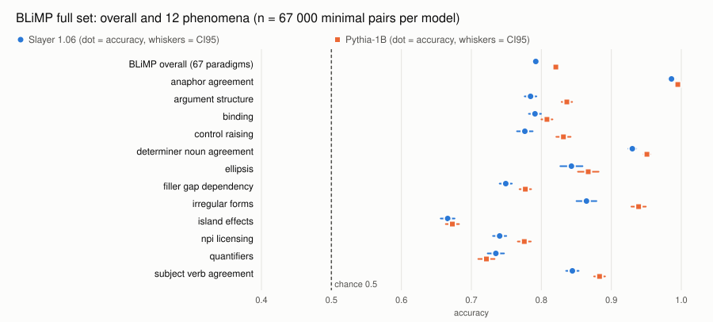
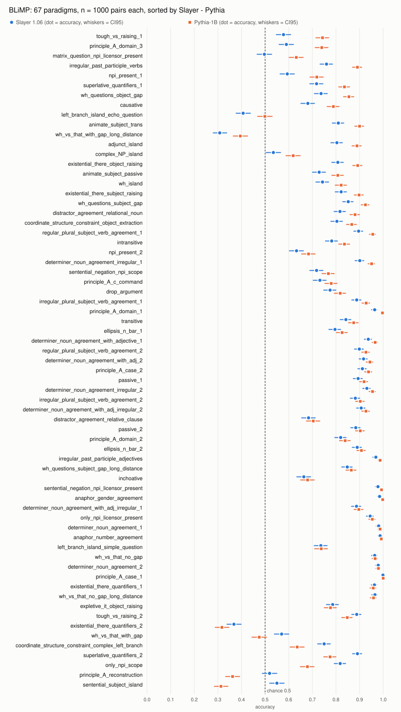

# BLiMP full set: Slayer 1.06 and Pythia-1B

Generated by `python benchmarki/blimp/blimp.py raport` from `wyniki/LICZBY.json`; do not edit by hand.
Protocol and thresholds (written before the measurement): [`THRESHOLDS.md`](THRESHOLDS.md).

**Slayer 1.06: 0.7921 (CI95 0.7892-0.7949), Pythia-1B: 0.8207 (CI95 0.8181-0.8233) on all 67000 minimal pairs.**

- **On these 67 000 pairs:** difference -2.87 pts, paired SE 0.16 pts, z = -18.11: certain. This says the gap is real for these pairs. This is the comparison THRESHOLDS.md fixed before the measurement.
- **Generalised to paradigms** (the 67 paradigms as clusters, since pairs of one paradigm share a template): SE 0.87 pts, t = -3.30, df = 66, p = 0.0016 from the t distribution: certain; bootstrap over paradigms CI95 -4.50 pts to -1.16 pts; Pythia ahead in 56 of 67 paradigms (exact sign test, p < 10^-7). Sensitivity: without the 2 paradigms with the largest gap t = -2.91, df = 64, p = 0.0049 (probable), so the paradigm-level verdict rests partly on a few paradigms. *[Added after the measurement: exploratory, not in THRESHOLDS.md.]*
- **Per token** (log-likelihood divided by the number of tokens, since the tokenizers differ): difference -3.09 pts, SE 0.17 pts, z = -17.76: certain. *[Added after the measurement: exploratory, not in THRESHOLDS.md.]*

THRESHOLDS.md fixed, before any result was seen: the pair-level comparison and its verdicts (overall, phenomena, paradigms), the Pythia control and the Space panel check. Everything marked *added after the measurement* was added after the results were seen, partly at reviewers' request: paradigms as clusters (read through the t distribution), the k < 3 rule, the Holm correction, per-token scores, the tokenization and same-words splits, and the random-panel analysis of the Space panel. Read those as exploratory. Verdict thresholds everywhere are those of THRESHOLDS.md: |z| >= 3 certain, 2-3 probable, < 2 noise; a t with df = k - 1 is held to the same two-sided p (<= 0.0027 certain, <= 0.0455 probable).

## Overall

| model | accuracy | n | SE | CI95 (bootstrap, stratified) | chance | majority |
|---|---:|---:|---:|---|---:|---|
| Slayer 1.06 | 0.7921 | 67000 | 0.0014 | 0.7892-0.7949 | 0.5 | n/a (gold always first by construction) |
| Pythia-1B | 0.8207 | 67000 | 0.0013 | 0.8181-0.8233 | 0.5 | n/a (gold always first by construction) |

## Control: Pythia-1B against the published value

Our Pythia-1B 0.8207 vs reference 0.8234: difference -0.27 pts, threshold +-2 points: **within**.
The reference is the mean of the 67 `blimp_*` values in the EleutherAI/pythia repo file `evals/pythia-v0/pythia-1b/zero-shot/pythia-1b-0shot-global_step143000_eval_results_11-28-2022-15-14-35.json`. It is the v0 model (weights before the Pythia re-train) scored by the old harness without the leading space; the v1 eval folders of that repo have no BLiMP and no other published BLiMP value for `EleutherAI/pythia-1b` was found. It is a sanity range, not an exact reference.

## Agreement with the Space (panel of 200)

Space T01, Slayer 1.06: 0.8408 (CI95 0.806-0.876, n = 200). Panel rebuilt by METHOD.md section 3 (2 per member, the remaining 66 slots by largest deficit, ties by member name, inside a member by SHA-256 of `20261028|blimp|<member>|<source id>`):

| source id in the hash | n | Slayer 1.06 | difference to Space | inside Space CI95 | Pythia-1B |
|---|---:|---:|---:|---|---:|
| `pair_id` | 200 | 0.7761 | -0.0647 | no | 0.8134 |
| SHA-256 of the canonical row | 200 | 0.8408 | 0.0000 | yes | 0.8706 |

**Verdict by THRESHOLDS.md: panel not identical (not reproduced).** The Space `source_id_digest` is not reproduced by any id/separator/order format we tried. METHOD.md section 3 names the document's native id as the source id; for BLiMP that is `pair_id`, and that panel gives a value outside the Space CI95.

The rest of this section: *[Added after the measurement: exploratory, not in THRESHOLDS.md.]*

The SHA-256-of-the-row panel was added as a second reading, not as the protocol. Its Slayer 1.06 value is the same as the Space value to all printed digits (difference 0.0000). Among random panels with the same per-member sizes drawn from Slayer's own per-pair results, a share of 0.0064 gives exactly this value (20 000 draws, seed 20261028); corrected for the two source-id readings we tried, 0.013. So the Space most likely hashes the canonical row and this is probably its panel; that is an inference from one value, not proof.

The panel is a lucky one for both models: only 3.3% of random panels give Slayer this value or higher, and 2.1% for Pythia. The full-set value 0.7921 lies outside the Space CI95. The Space CI95 is narrower than the spread of random panels of this allocation (ratio 1.49), so it understates the panel-to-panel uncertainty (inference: the Space bootstrap resamples the 200 chosen pairs, not the choice of pairs). Use the full set.

## 12 phenomena

Two verdicts per phenomenon. *Pairs* (fixed in THRESHOLDS.md): paired SE over the pairs of the phenomenon, verdict from |z| (is the gap real on these pairs); it applies at any number of paradigms. *Paradigms*: SE over the paradigm differences of the phenomenon, t = mean / SE with df = k - 1, verdict from the p of the t distribution (would it hold for other paradigms of the phenomenon); with fewer than 3 paradigms this column gives no verdict (undetermined). The paradigm columns: *[Added after the measurement: exploratory, not in THRESHOLDS.md.]*

| phenomenon | paradigms | n | Slayer 1.06 | Pythia-1B | difference | SE pairs | z pairs | verdict pairs | SE paradigms | t paradigms | df | p paradigms | verdict paradigms |
|---|---:|---:|---:|---:|---:|---:|---:|---|---:|---:|---:|---:|---|
| anaphor agreement | 2 | 2000 | 0.986 | 0.995 | -0.9 pts | 0.26 pts | z = -3.41 | certain | 0.40 pts | t = -2.25 | 1 | 0.2662 | undetermined (k < 3) |
| argument structure | 9 | 9000 | 0.785 | 0.836 | -5.2 pts | 0.42 pts | z = -12.22 | certain | 1.11 pts | t = -4.68 | 8 | 0.0016 | certain |
| binding | 7 | 7000 | 0.791 | 0.808 | -1.7 pts | 0.50 pts | z = -3.42 | certain | 3.43 pts | t = -0.50 | 6 | 0.6354 | noise |
| control raising | 5 | 5000 | 0.776 | 0.832 | -5.5 pts | 0.55 pts | z = -9.99 | certain | 3.64 pts | t = -1.52 | 4 | 0.2040 | noise |
| determiner noun agreement | 8 | 8000 | 0.930 | 0.951 | -2.1 pts | 0.29 pts | z = -7.11 | certain | 0.55 pts | t = -3.79 | 7 | 0.0068 | probable |
| ellipsis | 2 | 2000 | 0.843 | 0.867 | -2.4 pts | 0.90 pts | z = -2.68 | probable | 0.60 pts | t = -4.00 | 1 | 0.1560 | undetermined (k < 3) |
| filler gap dependency | 7 | 7000 | 0.749 | 0.777 | -2.8 pts | 0.50 pts | z = -5.56 | certain | 2.70 pts | t = -1.04 | 6 | 0.3402 | noise |
| irregular forms | 2 | 2000 | 0.865 | 0.939 | -7.4 pts | 0.73 pts | z = -10.14 | certain | 5.65 pts | t = -1.32 | 1 | 0.4131 | undetermined (k < 3) |
| island effects | 8 | 8000 | 0.666 | 0.673 | -0.7 pts | 0.58 pts | z = -1.17 | noise | 4.26 pts | t = -0.16 | 7 | 0.8787 | noise |
| npi licensing | 7 | 7000 | 0.740 | 0.776 | -3.5 pts | 0.56 pts | z = -6.26 | certain | 3.45 pts | t = -1.02 | 6 | 0.3474 | noise |
| quantifiers | 4 | 4000 | 0.735 | 0.721 | 1.4 pts | 0.71 pts | z = 1.89 | noise | 4.94 pts | t = 0.27 | 3 | 0.8023 | noise |
| subject verb agreement | 6 | 6000 | 0.844 | 0.883 | -3.9 pts | 0.51 pts | z = -7.64 | certain | 0.79 pts | t = -4.91 | 5 | 0.0044 | probable |



## 67 paradigms

n = 1000 pairs per paradigm and model. On pairs: Slayer ahead 7 certain, 1 probable; Pythia ahead 34 certain, 7 probable; noise 18. With 67 comparisons a Holm correction (family-wise 5%) keeps 37 differences; the 'certain' rows marked `certain, not Holm` (npi_present_2, regular_plural_subject_verb_agreement_2, determiner_noun_agreement_irregular_2, sentential_negation_npi_licensor_present) do not survive it. Holm, per token and same tokenization: *[Added after the measurement: exploratory, not in THRESHOLDS.md.]*

The order of the gaps depends on the measure: Spearman rank correlation between the summed and the per-token differences is 0.77. 1 of the 7 certain Slayer advantages reverses per token: tough_vs_raising_2 (4.0 pts summed, -9.2 pts per token). Another example: tough_vs_raising_1 is -16.5 pts summed, -2.2 pts per token, and -14.1 pts on the pairs where both tokenizers give the same token difference between good and bad sentence. Read the ranking as 'where the gap is large under summed log-likelihood', not as a ranking of syntactic weaknesses.

| paradigm | Slayer 1.06 | Pythia-1B | difference | SE | z | verdict | per token | same tokenization (n) |
|---|---:|---:|---:|---:|---:|---|---:|---|
| tough_vs_raising_1 | 0.578 | 0.743 | -16.5 pts | 1.36 pts | z = -12.10 | certain | -2.2 pts | -14.1 pts (745) |
| principle_A_domain_3 | 0.590 | 0.740 | -15.0 pts | 2.05 pts | z = -7.32 | certain | -14.8 pts | -14.9 pts (998) |
| matrix_question_npi_licensor_present | 0.497 | 0.632 | -13.5 pts | 1.93 pts | z = -6.99 | certain | -9.2 pts | -10.9 pts (928) |
| irregular_past_participle_verbs | 0.760 | 0.891 | -13.1 pts | 1.33 pts | z = -9.87 | certain | -3.8 pts | -10.7 pts (816) |
| npi_present_1 | 0.594 | 0.719 | -12.5 pts | 1.67 pts | z = -7.50 | certain | -12.5 pts | -12.5 pts (1000) |
| superlative_quantifiers_1 | 0.718 | 0.836 | -11.8 pts | 1.70 pts | z = -6.92 | certain | -11.8 pts | -11.8 pts (1000) |
| wh_questions_object_gap | 0.737 | 0.855 | -11.8 pts | 1.52 pts | z = -7.74 | certain | -11.8 pts | -11.8 pts (1000) |
| causative | 0.681 | 0.789 | -10.8 pts | 1.59 pts | z = -6.80 | certain | -10.3 pts | -9.8 pts (543) |
| left_branch_island_echo_question | 0.407 | 0.499 | -9.2 pts | 1.83 pts | z = -5.03 | certain | -6.1 pts | -9.2 pts (995) |
| animate_subject_trans | 0.810 | 0.900 | -9.0 pts | 1.19 pts | z = -7.55 | certain | -0.6 pts | -5.6 pts (449) |
| wh_vs_that_with_gap_long_distance | 0.308 | 0.395 | -8.7 pts | 1.67 pts | z = -5.22 | certain | -8.7 pts | -8.7 pts (1000) |
| adjunct_island | 0.804 | 0.889 | -8.5 pts | 1.36 pts | z = -6.27 | certain | -8.5 pts | -8.5 pts (1000) |
| complex_NP_island | 0.535 | 0.619 | -8.4 pts | 1.79 pts | z = -4.69 | certain | -8.4 pts | -8.4 pts (1000) |
| existential_there_object_raising | 0.808 | 0.892 | -8.4 pts | 1.28 pts | z = -6.54 | certain | -5.6 pts | -7.4 pts (556) |
| animate_subject_passive | 0.729 | 0.808 | -7.9 pts | 1.28 pts | z = -6.19 | certain | -8.9 pts | -7.4 pts (557) |
| wh_island | 0.743 | 0.822 | -7.9 pts | 1.50 pts | z = -5.27 | certain | -7.9 pts | -7.9 pts (1000) |
| existential_there_subject_raising | 0.822 | 0.898 | -7.6 pts | 1.15 pts | z = -6.61 | certain | -15.3 pts | -10.2 pts (706) |
| wh_questions_subject_gap | 0.852 | 0.925 | -7.3 pts | 1.22 pts | z = -5.96 | certain | -7.3 pts | -7.3 pts (1000) |
| distractor_agreement_relational_noun | 0.817 | 0.881 | -6.4 pts | 1.36 pts | z = -4.72 | certain | -6.8 pts | -6.1 pts (901) |
| coordinate_structure_constraint_object_extraction | 0.804 | 0.867 | -6.3 pts | 1.32 pts | z = -4.76 | certain | -6.3 pts | -6.3 pts (1000) |
| regular_plural_subject_verb_agreement_1 | 0.896 | 0.956 | -6.0 pts | 1.03 pts | z = -5.81 | certain | -5.8 pts | -3.9 pts (773) |
| intransitive | 0.782 | 0.836 | -5.4 pts | 1.37 pts | z = -3.95 | certain | -3.5 pts | -2.1 pts (481) |
| npi_present_2 | 0.633 | 0.684 | -5.1 pts | 1.65 pts | z = -3.09 | certain, not Holm | -5.1 pts | -5.1 pts (1000) |
| determiner_noun_agreement_irregular_1 | 0.901 | 0.951 | -5.0 pts | 0.98 pts | z = -5.11 | certain | -4.7 pts | -3.1 pts (753) |
| sentential_negation_npi_scope | 0.718 | 0.768 | -5.0 pts | 1.51 pts | z = -3.31 | certain | -5.0 pts | -5.0 pts (1000) |
| principle_A_c_command | 0.732 | 0.780 | -4.8 pts | 1.40 pts | z = -3.43 | certain | -4.8 pts | -4.8 pts (1000) |
| drop_argument | 0.775 | 0.818 | -4.3 pts | 1.27 pts | z = -3.39 | certain | -15.7 pts | -3.0 pts (567) |
| irregular_plural_subject_verb_agreement_1 | 0.888 | 0.928 | -4.0 pts | 1.13 pts | z = -3.53 | certain | -2.7 pts | -2.9 pts (859) |
| principle_A_domain_1 | 0.964 | 0.997 | -3.3 pts | 0.58 pts | z = -5.66 | certain | -3.3 pts | -3.3 pts (1000) |
| transitive | 0.842 | 0.875 | -3.3 pts | 1.26 pts | z = -2.62 | probable | -8.5 pts | -0.9 pts (434) |
| ellipsis_n_bar_1 | 0.796 | 0.826 | -3.0 pts | 1.49 pts | z = -2.02 | probable | -3.0 pts | -3.0 pts (1000) |
| determiner_noun_agreement_with_adjective_1 | 0.937 | 0.966 | -2.9 pts | 0.72 pts | z = -4.01 | certain | -3.6 pts | -2.5 pts (767) |
| regular_plural_subject_verb_agreement_2 | 0.899 | 0.927 | -2.8 pts | 0.92 pts | z = -3.03 | certain, not Holm | -5.9 pts | -2.2 pts (713) |
| determiner_noun_agreement_with_adj_2 | 0.917 | 0.944 | -2.7 pts | 0.91 pts | z = -2.98 | probable | -2.7 pts | -2.7 pts (1000) |
| principle_A_case_2 | 0.912 | 0.938 | -2.6 pts | 1.06 pts | z = -2.46 | probable | -3.7 pts | -2.0 pts (613) |
| passive_1 | 0.894 | 0.919 | -2.5 pts | 0.99 pts | z = -2.52 | probable | -6.6 pts | -1.8 pts (381) |
| determiner_noun_agreement_irregular_2 | 0.931 | 0.955 | -2.4 pts | 0.77 pts | z = -3.11 | certain, not Holm | -2.4 pts | -2.4 pts (1000) |
| irregular_plural_subject_verb_agreement_2 | 0.882 | 0.903 | -2.1 pts | 1.10 pts | z = -1.91 | noise | -3.2 pts | -2.8 pts (822) |
| determiner_noun_agreement_with_adj_irregular_2 | 0.907 | 0.927 | -2.0 pts | 1.01 pts | z = -1.98 | noise | -2.0 pts | -2.0 pts (1000) |
| distractor_agreement_relative_clause | 0.684 | 0.704 | -2.0 pts | 1.75 pts | z = -1.14 | noise | -2.0 pts | -3.4 pts (847) |
| passive_2 | 0.884 | 0.903 | -1.9 pts | 0.92 pts | z = -2.06 | probable | -9.8 pts | -1.6 pts (374) |
| principle_A_domain_2 | 0.820 | 0.839 | -1.9 pts | 1.37 pts | z = -1.38 | noise | -1.9 pts | -1.9 pts (1000) |
| ellipsis_n_bar_2 | 0.890 | 0.908 | -1.8 pts | 1.00 pts | z = -1.80 | noise | -1.2 pts | -1.2 pts (566) |
| irregular_past_participle_adjectives | 0.969 | 0.987 | -1.8 pts | 0.63 pts | z = -2.86 | probable | -8.9 pts | -2.2 pts (808) |
| wh_questions_subject_gap_long_distance | 0.848 | 0.865 | -1.7 pts | 1.37 pts | z = -1.24 | noise | -1.7 pts | -1.7 pts (1000) |
| inchoative | 0.664 | 0.680 | -1.6 pts | 1.46 pts | z = -1.09 | noise | -1.3 pts | -4.4 pts (544) |
| sentential_negation_npi_licensor_present | 0.978 | 0.993 | -1.5 pts | 0.48 pts | z = -3.14 | certain, not Holm | -0.6 pts | -1.5 pts (1000) |
| anaphor_gender_agreement | 0.985 | 0.998 | -1.3 pts | 0.39 pts | z = -3.37 | certain | -1.3 pts | -1.3 pts (1000) |
| determiner_noun_agreement_with_adj_irregular_1 | 0.887 | 0.897 | -1.0 pts | 1.05 pts | z = -0.95 | noise | 0.4 pts | -1.7 pts (862) |
| only_npi_licensor_present | 0.945 | 0.954 | -0.9 pts | 0.94 pts | z = -0.95 | noise | -0.9 pts | -0.9 pts (1000) |
| determiner_noun_agreement_1 | 0.981 | 0.987 | -0.6 pts | 0.49 pts | z = -1.23 | noise | -4.3 pts | 0.0 pts (773) |
| anaphor_number_agreement | 0.987 | 0.992 | -0.5 pts | 0.36 pts | z = -1.39 | noise | -0.5 pts | -0.5 pts (1000) |
| left_branch_island_simple_question | 0.736 | 0.738 | -0.2 pts | 1.54 pts | z = -0.13 | noise | -0.2 pts | -0.2 pts (1000) |
| wh_vs_that_no_gap | 0.964 | 0.966 | -0.2 pts | 0.74 pts | z = -0.27 | noise | -0.2 pts | -0.2 pts (1000) |
| determiner_noun_agreement_2 | 0.979 | 0.980 | -0.1 pts | 0.52 pts | z = -0.19 | noise | -0.1 pts | -0.1 pts (1000) |
| principle_A_case_1 | 0.999 | 1.000 | -0.1 pts | 0.10 pts | z = -1.00 | noise | -0.1 pts | -0.1 pts (1000) |
| existential_there_quantifiers_1 | 0.963 | 0.958 | 0.5 pts | 0.41 pts | z = 1.21 | noise | 0.5 pts | 0.5 pts (1000) |
| wh_vs_that_no_gap_long_distance | 0.965 | 0.959 | 0.6 pts | 0.79 pts | z = 0.76 | noise | 0.6 pts | 0.6 pts (1000) |
| expletive_it_object_raising | 0.786 | 0.777 | 0.9 pts | 1.20 pts | z = 0.75 | noise | 4.0 pts | -1.0 pts (514) |
| tough_vs_raising_2 | 0.888 | 0.848 | 4.0 pts | 1.16 pts | z = 3.45 | certain | -9.2 pts | 4.5 pts (711) |
| existential_there_quantifiers_2 | 0.368 | 0.317 | 5.1 pts | 1.79 pts | z = 2.85 | probable | 5.1 pts | 5.1 pts (1000) |
| wh_vs_that_with_gap | 0.570 | 0.475 | 9.5 pts | 1.66 pts | z = 5.72 | certain | 9.5 pts | 9.5 pts (1000) |
| coordinate_structure_constraint_complex_left_branch | 0.750 | 0.636 | 11.4 pts | 1.60 pts | z = 7.14 | certain | 11.4 pts | 11.4 pts (1000) |
| superlative_quantifiers_2 | 0.891 | 0.775 | 11.6 pts | 1.36 pts | z = 8.53 | certain | 11.6 pts | 11.6 pts (1000) |
| only_npi_scope | 0.818 | 0.679 | 13.9 pts | 1.67 pts | z = 8.31 | certain | 13.6 pts | 13.1 pts (973) |
| principle_A_reconstruction | 0.519 | 0.362 | 15.7 pts | 1.66 pts | z = 9.44 | certain | 15.7 pts | 15.7 pts (1000) |
| sentential_subject_island | 0.550 | 0.313 | 23.7 pts | 2.04 pts | z = 11.63 | certain | 23.7 pts | 23.7 pts (1000) |



## What the gap measures: tokenizer and vocabulary

*[Added after the measurement: exploratory, not in THRESHOLDS.md.]*

- Slayer's tokenizer cuts these English sentences into 1.18x as many tokens as Pythia's.
- Accuracy depends on the token-length difference within a pair. On the 57329 pairs where both tokenizers give the same token difference between good and bad sentence the gap is -2.39 pts (SE 0.17 pts, z = -13.95); on the 9671 other pairs -5.69 pts (SE 0.41 pts, z = -13.87). About 0.48 pts of the overall gap goes with the tokenizer difference.
- **Same words, different word order.** A pair is on the word-order side when its good and bad sentence have the same multiset of words. The main reading in the code (`blimp_analiza.WORKI`, `bez_interpunkcji`): lower case, every character other than a letter, digit, `_`, `'` or whitespace removed, split on whitespace. The 7 pairs with identical good and bad sentences are on neither side; a paradigm with pairs of both kinds is counted on both sides.
- **The verdict for the word-order pairs depends on that definition** (table): from Pythia probably better (raw text split on whitespace, z = -2.53) to Slayer probably better (words and punctuation as separate tokens, z = 2.32). So there is no finding for word-order pairs, neither a gap nor its absence. Stable under all three readings is only that Pythia's advantage lies in the pairs that differ in a word or its form: z from -18.12 to -23.18, over paradigms t from -3.51 to -5.43. This is a correlation over paradigm types, not a controlled experiment.

| reading of 'same words' | pairs | n | paradigms | difference | SE | z | verdict pairs | mean over paradigms | t over paradigms | df | p | verdict over paradigms |
|---|---|---:|---:|---:|---:|---:|---|---:|---:|---:|---:|---|
| lower case, punctuation removed (main) | same words, order differs | 13156 | 14 | 0.52 pts | 0.47 pts | 1.09 | noise | 0.41 pts | 0.13 | 13 | 0.8994 | noise |
| lower case, punctuation removed (main) | differ in a word or form | 53837 | 54 | -3.69 pts | 0.16 pts | -23.18 | certain | -3.70 pts | -5.43 | 53 | 0.0000 | certain |
| raw text split on whitespace | same words, order differs | 2920 | 4 | -2.57 pts | 1.02 pts | -2.53 | probable | -4.28 pts | -0.76 | 3 | 0.5030 | noise |
| raw text split on whitespace | differ in a word or form | 64073 | 65 | -2.88 pts | 0.16 pts | -18.12 | certain | -3.02 pts | -3.51 | 64 | 0.0008 | certain |
| words and punctuation as separate tokens | same words, order differs | 9064 | 10 | 1.29 pts | 0.56 pts | 2.32 | probable | 0.92 pts | 0.24 | 9 | 0.8164 | noise |
| words and punctuation as separate tokens | differ in a word or form | 57929 | 59 | -3.52 pts | 0.16 pts | -21.85 | certain | -3.67 pts | -4.89 | 58 | 0.0000 | certain |

- The BLiMP flag `lexically_identical` does not mark this split: 9 of its 20 paradigms have pairs with different word forms (e.g. sketch / sketches in determiner_noun_agreement_1), so the split is made on the words of each pair.

## Deviations from METHOD.md and limits

- **Batch and device:** METHOD.md runs batch 1; we ran batch 64 with right padding on Apple MPS (causal attention, so padding does not reach scored tokens). MPS and CPU log-likelihoods differ by float noise, so only pairs whose two sentences score almost the same can flip: 11 for Slayer and 10 for Pythia (of 67 000) are closer than that noise, which bounds the effect. Our CPU re-run of 300 pairs per model flipped none; an independent CPU check of 52 pairs flipped one per model.
- **Slayer forward is a re-implementation** (`slayer_model.py`), not the harness forward. The METHOD.md runtime calibration (bitwise-equal logits, per-token difference bound) was not done. Against the official `load_slayer.py` model from the HF repo (CPU, batch 1) on the 400 sentences of the sha256 panel: mean |difference| 0.00018 and max 0.00052-0.00058 in summed log-likelihood per sentence, 0 pairs changed their outcome in any of the 8 runs. The max is given as a range because it is float32 rounding and moves in its second digit with the number of CPU threads, with whether the unscored last token is fed, and with summing the token log-probs in float32 or float64 (the runs and versions are in `kontrola_forward.json`, written by `benchmarki/blimp/kontrola_forward.py`). The independent check's max, which differed from our earlier single value, is reproduced to all digits by one of these runs (all CPU threads, last token fed, float64 sum).
- 7 pairs of the dataset have identical good and bad sentences (passive_1, principle_A_case_2). lm-eval scores them as a tie, which counts as correct; we decide them from the text the same way, so batch noise cannot turn them into errors.
- Contamination is not scanned here (no access to the Slayer training corpus). The Space flags BLiMP for Slayer 1.06 with hits on 3 of its 200 panel pairs; Pythia's Pile was not scanned either.
- Pythia-1B uses the lm-eval HFLM pair encoding (the empty context is the tokenizer's BOS, else EOS; for Pythia both are `<|endoftext|>`); Slayer one BOS `<|endoftext|>` as in the Space METHOD.md: the 'exactly one unscored prefix token' rule.

## How to reproduce

```bash
# data: nyu-mll/blimp @ 877fba0801ffb7cbd8c39c1ff314a46f053f6036 (67 parquet files) in BLIMP_DIR or the HF cache
BLIMP_DIR=<snapshot> python wspolne/hipoteza_formatu.py licz --model <slayer-1.06 dir> --zadania blimp \
  --wyjscie <out>/1.06 --device mps --batch 64
BLIMP_DIR=<snapshot> python wspolne/hipoteza_formatu.py licz --model <pythia-1b dir> --zadania blimp \
  --wyjscie <out>/pythia-1b --device mps --batch 64
# official-forward check (benchmarki/blimp/wyniki/kontrola_forward.json); needs the HF repo files incl. weights
huggingface-cli download SlayerLab/Slayer1B-1.06 --revision ef81be58742544ad32e1afab38db011fec209609 --local-dir <slayer-1.06 dir>
BLIMP_DIR=<snapshot> python benchmarki/blimp/kontrola_forward.py --model <slayer-1.06 dir> \
  --wyniki <out>/1.06/blimp.jsonl --watki 1,6 --sumy float32,float64
BLIMP_DIR=<snapshot> python benchmarki/blimp/blimp.py zbierz --wyniki <out>
python narzedzia/liczby.py && python benchmarki/blimp/blimp.py raport && python narzedzia/sprawdz_raporty.py
```

Per-pair log-likelihoods (ids and numbers only, no sentences): `benchmarki/blimp/wyniki/<model>/blimp.jsonl.gz`;
without weights, `BLIMP_DIR=<snapshot> python benchmarki/blimp/blimp.py zbierz --wyniki benchmarki/blimp/wyniki` rebuilds `blimp.json` from them.
