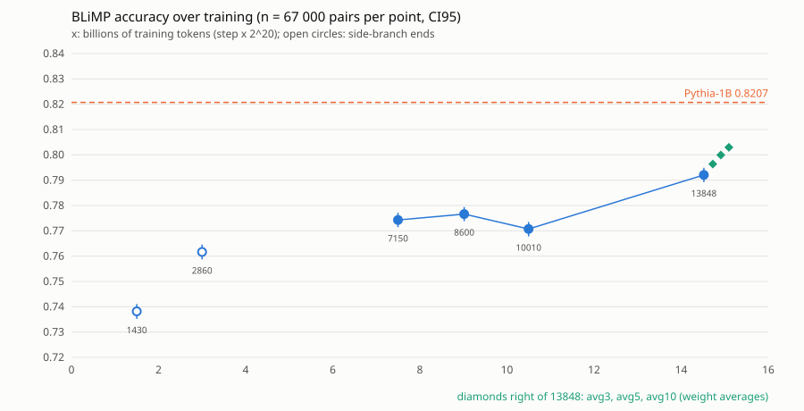

# BLiMP: Slayer 1.06 i Pythia-1B na pełnym zbiorze

> Praca idzie według [`METODOLOGIA.md`](../../METODOLOGIA.md): etap A to karta oryginału (`ORIGINAL.md`), etap B to
> odtworzenie opublikowanego wyniku kodem autorów (`REPRODUCTION.md`), etap D to wersja polska tą samą metodą.
> Pojęcia (Space, T01–T50, panel 200, SE, werdykt): [słowniczek](../../METODOLOGIA.md#słowniczek).

BLiMP (Warstadt i in. 2020) sprawdza gramatykę angielską na 67 paradygmatach x 1000 par minimalnych: para jest
trafiona, gdy model daje zdaniu poprawnemu wyższe log-prawdopodobieństwo. Poziom losowy to 0,5. Space liczy ten
test (T01) na panelu 200 par; tutaj oba modele liczone są na wszystkich 67 000.

- Karta oryginału (etap A): [`ORIGINAL.md`](ORIGINAL.md)
- Odtworzenie (etap B lm-eval na Pythii-1B v0, bez kodu autorów): [`REPRODUCTION.md`](REPRODUCTION.md)
- Przepis (commity, modele, komendy, sprzęt): [`RECIPE.md`](RECIPE.md)
- Pełny raport ze wszystkimi tabelami (generowany, nie edytować; po angielsku): [`results/BLIMP.md`](results/BLIMP.md)
- Progi zapisane przed pomiarem: [`THRESHOLDS.md`](THRESHOLDS.md)
- BLiMP po checkpointach treningu i uśrednianie wag: raport [`results/CHECKPOINTS.md`](results/CHECKPOINTS.md)
  (generowany, po angielsku), progi zapisane przed pomiarem
  [`results/CHECKPOINTS_THRESHOLDS.md`](results/CHECKPOINTS_THRESHOLDS.md)

## Wyniki

| model | trafność | n | SE | CI95 (bootstrap, warstwowy) |
|---|---:|---:|---:|---|
| Slayer 1.06 | 0,7921 | 67000 | 0,0014 | 0,7892-0,7949 |
| Pythia-1B | 0,8207 | 67000 | 0,0013 | 0,8181-0,8233 |
| Pythia-1B v0 (model kontrolny) | 0,8244 | 67000 | 0,0013 | 0,8218-0,8269 |

„Pythia-1B” bez dopisku to wagi v1 (`EleutherAI/pythia-1b`), model porównawczy tego raportu. Kontrolą kodu oceny
jest v0 (sekcja „Kontrola” niżej).

Slayer 1.06 to checkpoint z ok. 1/8 planowanego treningu, bez wygaszania LR (według autora modelu, stan z
01.11.2026), a Pythia-1B jest po pełnym treningu. Różnice niżej porównują ten checkpoint z gotowym modelem, nie dwa
przepisy treningu.

Slayer 1.06 minus Pythia-1B, trzy odczyty. Wiąże odczyt po paradygmatach: BLiMP to typ `para +klastry` z
[`METODOLOGIA.md`](../../METODOLOGIA.md) (klastry to paradygmaty, SE K, t przy df = k − 1). Odczyt w parach
ustalił `THRESHOLDS.md` przed pomiarem; od przyjęcia metodologii to informacja o tych parach, nie werdykt.

| odczyt | różnica | SE | test | werdykt | rola | ustalone przed pomiarem |
|---|---:|---:|---|---|---|---|
| paradygmaty jako klastry (k = 67, df = 66) | -2,87 pkt | 0,87 pkt | t = -3,30, p = 0,0016 | pewne | wiążący | nie |
| te 67 000 par (w parach) | -2,87 pkt | 0,16 pkt | z = -18,11 | pewne | informacja | tak |
| na token (log-prawdopodobieństwo / liczba tokenów) | -3,09 pkt | 0,17 pkt | z = -17,76 | pewne | eksploracyjne | nie |

- Wiążący werdykt: Pythia-1B ma przewagę po paradygmatach z werdyktem pewnym (t = -3,30), ma przewagę w 56 z 67
  paradygmatów, ale bez 2 paradygmatów o największej różnicy werdykt spada do prawdopodobnego (t = -2,91,
  p = 0,0049), więc opiera się częściowo na kilku paradygmatach. Na samych parach przewaga też jest pewna
  (z = -18,11).
- Tokenizery się różnią (Slayer tnie te zdania na 1,18x tyle tokenów); na token różnica zostaje pewna
  (z = -17,76).

### Zjawiska po poprawce Holma

Wniosek o tabeli 12 zjawisk opiera się na kolumnie po Holmie (rodzina to wiersze jednej tabeli, osobno na każdym
poziomie). Po paradygmatach (wiążąco; do rodziny wchodzi 9 zjawisk z k >= 3, pozostałe 3 są nierozstrzygalne)
żadne zjawisko nie jest pewne po Holmie. Prawdopodobne są dwa, oba na korzyść Pythii-1B: argument structure
i subject verb agreement. Bez poprawki pewne było argument structure (t = -4,68). Determiner noun agreement bez
poprawki jest prawdopodobne (t = -3,79), a po Holmie to szum:

| zjawisko | paradygmaty | Slayer 1.06 | Pythia-1B | różnica | SE w parach | z w parach | t po paradygmatach | werdykt pary / paradygmaty | p Holma po paradygmatach | werdykt po Holmie (paradygmaty) |
|---|---:|---:|---:|---:|---:|---:|---:|---|---:|---|
| argument structure | 9 | 0,785 | 0,836 | -5,2 pkt | 0,42 pkt | z = -12,22 | t = -4,68 | pewne / pewne | 0,0143 | prawdopodobne |
| determiner noun agreement | 8 | 0,930 | 0,951 | -2,1 pkt | 0,29 pkt | z = -7,11 | t = -3,79 | pewne / prawdopodobne | 0,0475 | szum |
| subject verb agreement | 6 | 0,844 | 0,883 | -3,9 pkt | 0,51 pkt | z = -7,64 | t = -4,91 | pewne / prawdopodobne | 0,0353 | prawdopodobne |

W parach (informacja o tych parach) po Holmie z 12 zjawisk pewnych jest 7, prawdopodobne są 3 (anaphor agreement,
binding, elipsa), a szum to 2 (efekty wysp i kwantyfikatory). Zjawiska pewne na parach bez poprawki Holma, które po paradygmatach
są szumem albo nierozstrzygalne (anaphor agreement, binding, control raising, determiner noun agreement, filler
gap dependency, irregular forms, npi licensing), mają różnicę pokazaną tylko dla tych par, nie dla innych
paradygmatów zjawiska. Pełna tabela z obiema kolumnami Holma: [`results/BLIMP.md`](results/BLIMP.md), sekcja
„12 phenomena”.

Per paradygmat (n = 1000 każdy; porównanie wewnątrz jednego paradygmatu to odczyt w parach): Slayer prowadzi z werdyktem pewnym w 7, Pythia w 34, szum w 18;
poprawka Holma zostawia 37 różnic. Największe pewne różnice na korzyść Slayera to sentential_subject_island
(23,7 pkt, z = 11,63) i principle_A_reconstruction (15,7 pkt, z = 9,44); na korzyść Pythii tough_vs_raising_1
(-16,5 pkt, z = -12,10) i principle_A_domain_3 (-15,0 pkt, z = -7,32). Kolejność zależy od miary (korelacja
Spearmana 0,77 między różnicami sumowanymi a liczonymi na token), patrz pełny raport.

Kolejność paradygmatów zależy też od wag Pythii. Wobec v0 Slayer prowadzi z werdyktem pewnym w 6 paradygmatach,
Pythia w 35, a ogółem Slayer minus v0 to -3,23 pkt (SE 0,16 pkt, z = -20,51). Po poprawce Holma (67 paradygmatów,
5% na całą rodzinę) zostaje wobec v0 Slayer 5 i Pythia 34. Pewne i istotne po Holmie wobec obu wag, z tym samym znakiem,
są 3 przewagi Slayera: sentential_subject_island (25,3 pkt, z = 13,27), principle_A_reconstruction (12,2 pkt,
z = 7,20) i only_npi_scope (15,4 pkt, z = 8,65). tough_vs_raising_2 jest wobec v0 pewne (z = 3,08), ale nie
przechodzi Holma. superlative_quantifiers_2, coordinate_structure_constraint_complex_left_branch i wh_vs_that_with_gap
wobec v0 to szum. O tych czterech nie ma więc wniosku. Z przewag Pythii zostaje 23, w tym tough_vs_raising_1
(-15,6 pkt, z = -11,03) i principle_A_domain_3 (-12,9 pkt, z = -6,14). Twierdzenie o paradygmacie trzyma się tylko
wtedy, gdy trzyma się wobec obu wag; tabela: [`results/BLIMP.md`](results/BLIMP.md), sekcja „Against the control
model Pythia-1B v0”.

Przewaga Pythii leży w parach, które różnią się słowem albo jego formą: z od -18,12 do -23,18 (pewne) we
wszystkich trzech odczytach „tych samych słów”. Odczyt to sposób rozstrzygania, czy zdanie poprawne i błędne
składają się z tych samych słów (tylko w innej kolejności): małe litery bez interpunkcji, surowy tekst dzielony na
spacjach albo słowa i interpunkcja jako osobne jednostki; szczegóły w [`results/BLIMP.md`](results/BLIMP.md),
sekcja o tokenizerze i słownictwie („tokenizer and vocabulary”). Dla par z tymi samymi słowami w innej kolejności werdykt zmienia
znak razem z definicją (z od -2,53 do 2,32), więc tam nie ma wniosku (eksploracyjnie).

### Panel Space 200 par a pełny zbiór

Wartość Space dla Slayera 1.06 to 0,8408 (CI95 0,806-0,876, n = 200). Space wybiera 200 par
po haszu SHA-256 z identyfikatorem pary w środku ([`METHOD.md`](https://huggingface.co/spaces/SlayerLab/Slayer1B-Benchmarks/blob/main/METHOD.md),
sekcja 3), ale nie mówi dokładnie, jaki to identyfikator. Panel odbudowany z identyfikatorem `pair_id` (pole
identyfikatora pary w zbiorze BLiMP, odczyt z protokołu) daje 0,7761, poza CI95 Space: panel nie odtworzony. Panel
odbudowany z haszem całego wiersza zbioru zapisanego w ustalonej postaci („hasz kanonicznego wiersza”) daje dokładnie
0,8408, więc to prawdopodobnie panel Space (wniosek z jednej wartości). Szczegóły: [`results/BLIMP.md`](results/BLIMP.md),
sekcja „Agreement with the Space (panel of 200)”. To panel szczęśliwy: tylko 3,3% losowych
paneli o tym samym podziale daje Slayerowi tę wartość albo wyższą. Wartość z pełnego zbioru 0,7921 leży poza
CI95 Space. Używaj pełnego zbioru.

### Kontrola: Pythia-1B v0, lm-eval i wartość opublikowana

Na `EleutherAI/pythia-1b-v0` @ `step143000` lm-eval 0.4.9.1 daje 0,8244, nasz kod 0,8244, a opublikowana wartość to
0,8234: lm-eval różni się o 0,10 pkt, w granicach +-2 pkt. Nasz kod podejmuje tę samą decyzję co lm-eval w 66998 z
67000 par Pythii v0 (dwie różne leżą w granicach szumu liczb zmiennoprzecinkowych: jedna to remis tylko w lm-eval,
druga to zmiana znaku minimalnego marginesu) i w 67000 z 67000 par Slayera 1.06. Dla Slayera ta zgodność
nie sprawdza forwardu: lm-eval liczy go przez `common/slayer_lm.py`, czyli tym samym `slayer_model.Slayer` i tą samą
regułą jednego BOS co nasz kod. Niezależne są tam tylko liczenie wyniku w HFLM i obiekt tokenizera. Forward wobec
oficjalnego kodu sprawdzają osobno `kontrola_forward.py` (0 z 200 par zmienionych) i
`tests/test_lm_eval_slayer.py::test_forward_matches_official_reference`. Protokół zapisany przed
przebiegiem: [`LM_EVAL_PROTOCOL.md`](LM_EVAL_PROTOCOL.md), szczegóły: [`REPRODUCTION.md`](REPRODUCTION.md). Wagi v1
dają 0,8207 wobec tej samej wartości opublikowanej; to tylko informacja, bo wartość dotyczy v0.

## Po checkpointach treningu i uśrednianie wag

Te same 67 000 par na checkpointach trenera Slayera i na średnich wag z ostatnich checkpointów 1.06. Pełne tabele,
kontrole i odchylenia od protokołu: [`results/CHECKPOINTS.md`](results/CHECKPOINTS.md).

Werdykt wiąże odczyt po 67 paradygmatach (t przy df = 66); kolumny „po Holmie” liczą poprawkę Holma na 6 wierszach
tej tabeli, osobno dla paradygmatów i dla par. Wszystkie checkpointy zostają po Holmie z werdyktem pewnym poniżej
Pythii-1B.

| krok | bieg końcowy | trafność | SE | Slayer minus Pythia-1B | t po paradygmatach (df = 66) | werdykt po paradygmatach | po Holmie (paradygmaty) | SE par | z par | werdykt par | po Holmie (pary) |
|---:|---|---:|---:|---:|---:|---|---|---:|---:|---|---|
| 1430 | nie | 0,7382 | 0,0015 | -8,26 pkt | t = -8,27 | pewne | tak (pewne) | 0,17 pkt | z = -48,76 | pewne | tak (pewne) |
| 2860 | nie | 0,7616 | 0,0015 | -5,91 pkt | t = -6,35 | pewne | tak (pewne) | 0,17 pkt | z = -35,80 | pewne | tak (pewne) |
| 7150 | tak | 0,7743 | 0,0015 | -4,64 pkt | t = -5,07 | pewne | tak (pewne) | 0,16 pkt | z = -28,77 | pewne | tak (pewne) |
| 8600 | tak | 0,7766 | 0,0015 | -4,41 pkt | t = -5,29 | pewne | tak (pewne) | 0,16 pkt | z = -27,46 | pewne | tak (pewne) |
| 10010 | tak | 0,7707 | 0,0015 | -5,00 pkt | t = -5,73 | pewne | tak (pewne) | 0,16 pkt | z = -30,88 | pewne | tak (pewne) |
| 13848 | tak | 0,7921 | 0,0014 | -2,87 pkt | t = -3,30 | pewne | tak (pewne) | 0,16 pkt | z = -18,11 | pewne | tak (pewne) |

- Pytanie 1 (czy różnica do Pythii-1B maleje w biegu końcowym). Czy luka maleje z tokenami: nierozstrzygnięte
  (z SE z reszt wokół prostej nachylenie to szum, p = 0,18). Reguła z protokołu jest spełniona (nachylenie po krokach 7150, 8600, 10010 i 13848 to 0,26 pkt na mld tokenów,
  SE 0,02 pkt, z = 12,55; po 67 paradygmatach t = 3,34), ale cały wzrost leży w odcinku po wznowieniu biegu.
- Cały wzrost leży między 10010 a 13848: 2,14 pkt, po 67 paradygmatach t = 3,86 (pewne), po Holmie na 6 zmianach
  między checkpointami nadal pewne (p = 0,0016); na parach z = 15,00 (pewne). Zmiana 7150 → 13848 (1,78 pkt,
  t = 3,18, pewne bez poprawki) po Holmie jest tylko prawdopodobna (p = 0,0112).
  Między 7150 a 10010 zmiana to -0,36 pkt, na tych parach z = -2,50 (prawdopodobne), ale po paradygmatach
  t = -0,77 (szum), a bez kroku 13848 nachylenie wynosi -0,12 pkt na mld tokenów, na parach z = -2,38
  (prawdopodobne), po paradygmatach t = -0,76 (szum). Spadku przed 13848 nie wykazano poza tymi parami.
- W przedziale 10010-13848 bieg wznowiono na innym sprzęcie, a z SE liczonym z rozrzutu czterech checkpointów wokół prostej
  (0,13 pkt) nachylenie to szum (p = 0,18). Trendu nie da się więc oddzielić od skoku między checkpointami.
- Pytanie 2 (uśrednianie wag zamiast wygaszania LR): potwierdzone na avg3 i avg5. Zmiana straty na held-out wobec 1.06
  to -0,0290 nat (SE 0,0005, z = -63,54) dla avg3 i -0,0381 nat (SE 0,0007, z = -57,68) dla avg5, czyli 0,575 i
  0,756 zysku z wygaszania. Średnia z 10 checkpointów (avg10, dodana po odczycie BLiMP avg3 i avg5) wobec ramienia
  wygaszonego: 0,0028 nat, SE 0,0023, z = 1,23 (szum). To nie znaczy, że avg10 zyskuje tyle co wygaszanie: na
  komponentach danych różnice mają przeciwne znaki i się znoszą (avg10 niżej na web, legal i en, wyżej na core;
  tabela w [`results/CHECKPOINTS.md`](results/CHECKPOINTS.md)). SE w tym punkcie traktuje okna held-out jako
  niezależne; sąsiednie okna są skorelowane, więc SE jest za małe, a werdykty avgK wobec wygaszania za mocne.
- Uśrednianie podnosi też BLiMP na tych parach wobec kroku 13848: avg3 0,7964 (0,43 pkt, SE 0,08 pkt, z = 5,15, pewne), avg5
  0,8000 (0,79 pkt, SE 0,09 pkt, z = 8,62, pewne), avg10 0,8030 (1,09 pkt, SE 0,10 pkt, z = 10,81, pewne).
  Po 67 paradygmatach (wiążąco): avg3 t = 1,69 (szum), avg5 t = 2,82 (prawdopodobne), avg10 t = 3,53 (pewne);
  poprawka Holma na trzech średnich nie zmienia tych werdyktów. Poza tymi parami wzrost dla avg3 nie jest
  wykazany. Protokół nie przewidywał zmiany BLiMP, więc to obserwacja, nie teza.
- Pulpit treningu liczy BLiMP innym protokołem: 76,1 przy kroku 13848 wobec 79,2 na pełnym BLiMP dla 1.06, więc tych liczb nie porównuje się wprost. <!-- liczba-spoza-wynikow: 76,1 to eval/blimp_acc pulpitu https://track.fabryka.ai/run/f056bb5c-f1da-56d5-9776-cc33063f10a5 przy kroku 13848; 79,2 to 0,7921 z tabeli wyżej w procentach -->

## Ograniczenia

- Batch 64 na Apple MPS zamiast batch 1: tylko 11 (Slayer) i 10 (Pythia) z 67 000 par ma oba zdania bliżej
  siebie niż szum liczb zmiennoprzecinkowych między CPU a MPS.
- Forward Slayera to ponowna implementacja; wobec oficjalnego forwardu 0 z 200 par zmieniło wynik.
- Kontaminacja nie skanowana (brak dostępu do korpusu treningowego Slayera; Pile dla Pythii też nie skanowany).

## Co dodaje metodologia

Lista tego, czego ta praca jeszcze nie spełnia według [`METODOLOGIA.md`](../../METODOLOGIA.md); każdy punkt to osobne
zadanie do wzięcia.

- [ ] Pięć modeli odniesienia (`Qwen/Qwen3.5-0.8B-Base`, `LiquidAI/LFM2.5-1.2B-Base`,
      `speakleash/Bielik-1.5B-v3`, `LiquidAI/LFM3-1.7B-Base`, `utter-project/EuroLLM-1.7B`) na pełnym zbiorze.
- [ ] Brakujące pola przepisu: dokładny sprzęt (chip), wersja Pythona w głównym przebiegu, sha256 plików zbioru,
      transformers przypięty do commitu.
- [ ] Kalibracja forwardu Slayera z [`METHOD.md`](https://huggingface.co/spaces/SlayerLab/Slayer1B-Benchmarks/blob/main/METHOD.md) (logity równe bit w bit), nie zrobiona.
- [ ] Skan kontaminacji dla obu modeli.
- [ ] Wersja polska (etap D): BLiMP to test zjawisk językowych, więc osoba z Polski pisze nowe pary od
      zera na zjawiskach polszczyzny, bez tłumaczenia i parafrazy angielskich par.
