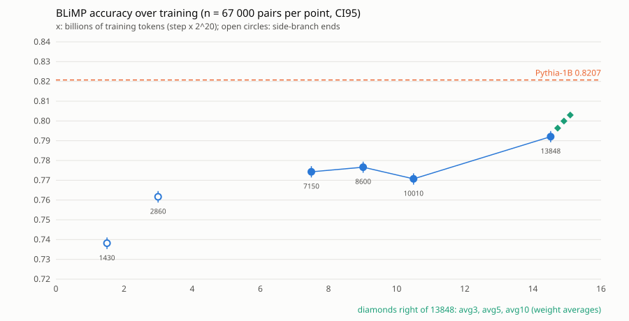

# BLiMP over training checkpoints and weight averaging: Slayer 1B

Generated by `python benchmarks/blimp/checkpoints.py raport` from `results/LICZBY.json`; do not edit by hand.
Protocol and thresholds (written and committed before the measurement): [`CHECKPOINTS_THRESHOLDS.md`](CHECKPOINTS_THRESHOLDS.md). Scoring as [`BLIMP.md`](BLIMP.md).

## Question 1: does the gap to Pythia-1B shrink over the final run?

**What the data show: step 13848 is closer to Pythia-1B than 10010, 2.14 pts (z = 15.00, t = 3.86), and than 7150, 1.78 pts (z = 12.03, t = 3.18). Between 7150 and 10010 the gap does not shrink: -0.36 pts (z = -2.50, t = -0.77). The rise falls in the only interval that contains a restart of the run, and a trend cannot be told apart from the swings between checkpoints.** Step 10010 is a local dip: from 8600 the change is 1.55 pts (z = 10.81, t = 3.07).

**Protocol rule: met (CONFIRMED on pair and paradigm SE at fixed checkpoints). Shrinking of the gap with tokens: not determined** - the rule does not include checkpoint-to-checkpoint noise (SE from residuals 0.13 pts, p = 0.18) and the rise sits in the restart interval.

The protocol rule (slope over 7150, 8600, 10010, 13848 > 0, certain or probable in both SEs): slope 0.26 pts per billion tokens, pair-bootstrap SE 0.02 pts, CI95 0.22 pts to 0.30 pts, z = 12.55 (certain); over the 67 paradigms t = 3.34, df = 66, p = 0.0014 (certain). Gap at 13848: -2.87 pts, SE 0.16 pts.

Caveat (robustness checks added after the measurement, not protocol rules):

- Without 13848 (slope over 7150, 8600, 10010): -0.12 pts per billion tokens, z = -2.38 (probable), t = -0.76 (noise).
- SE from the residuals of the four checkpoint accuracies around the line: 0.13 pts, t = 2.03, df = 2, p = 0.18 (noise). The pair-bootstrap SE measures only the sampling noise of the pairs at fixed checkpoints, not how much a checkpoint moves away from the line.
- Between 10010 and 13848 the run was restarted on other hardware; the run's public note says: "4x L40S to 10080 (10020+ a replica); 8x L40S from 10090, adopted at 10010". The rise falls in this interval, so it cannot be attributed to the extra tokens alone. Next step that would separate a jump from a trend: BLiMP of step 11450 (8x L40S, after the restart). The same note says that packs 4-7 of the training data (used from v1.04 on) exclude leak-scan documents; which packs each interval saw is not checked here.
- In short: without step 13848 the slope does not rise; with the SE from the residuals of the checkpoint accuracies around the line, the trend cannot be told apart from the swings between checkpoints.

Refutation condition (protocol): the pair-level CI95 of the slope contains 0 or lies below 0. No extrapolation of the slope is reported: four points with this caveat give no basis for one.

## Question 2: weight averaging vs LR annealing

**Protocol verdict on avg3 and avg5 (amendment 1): CONFIRMED**, the held-out loss gain of averaging is at least half the gain of annealing (avg3 -0.0290 nat, SE 0.0005, z = -63.54, share 0.575; avg5 -0.0381 nat, SE 0.0007, z = -57.68, share 0.756).

Reading: on the held-out loss, the mean of the last 10 checkpoints gains about as much as the 150-step annealing: avg10 - annealed arm = 0.0028 nat, SE 0.0023, z = 1.23 (noise); annealed - constant-LR arm = -0.0470 nat. The gain is spread differently over the data components (table below), and BLiMP of the annealed model, as well as avg10 on the other tests of the annealing run, are not measured, so this is a statement about the held-out loss only, not that averaging replaces annealing.

## Controls

- Device: Slayer 1.06 on CUDA (step 13848, converted trainer checkpoint) vs the MPS run of BLIMP.md: 0 of 67 000 pairs change outcome (limit 30: pass), max |log-likelihood difference| 1.5e-04.
- Same model on two GPU types (k13848, A100 vs L40S): 0 pairs change outcome (limit 30: pass).
- Same model on two GPU types (k13848, A100 vs RTX4090): 0 pairs change outcome (limit 30: pass).
- Same model on two GPU types (k13848, L40S vs RTX4090): 0 pairs change outcome (limit 30: pass).
- Same model on two GPU types (avg3, A100 vs L40S): 0 pairs change outcome (limit 30: pass).
- Same model on two GPU types (avg3, A100 vs RTX4090): 0 pairs change outcome (limit 30: pass).
- Same model on two GPU types (avg3, L40S vs RTX4090): 0 pairs change outcome (limit 30: pass).
- Conversion: `ckpt_13848.pt` vs the published Slayer 1.06 weights, max |difference| = 0.
- Every downloaded checkpoint matches the SHA-256 (LFS id) of the HF listing: yes.
- avg3: built from steps 13750, 13800, 13848 (read from the checkpoint files by `average_weights.py`); as the protocol prescribes: yes; every one of those checkpoints passed the SHA check: yes; `model.safetensors` SHA-256 `ab33fc8d9e88d592...`. Source: logi/srednie.jsonl of the RTX 4090, L40S and A100 instances (same SHA-256 on all three).
- avg5: built from steps 13650, 13700, 13750, 13800, 13848 (read from the checkpoint files by `average_weights.py`); as the protocol prescribes: yes; every one of those checkpoints passed the SHA check: yes; `model.safetensors` SHA-256 `54a816d2cb1bfd4d...`. Source: stdout of srednia_wag.py on the RTX 4090 instance, 2026-10-31 ~14:02 UTC, copied from the session transcript (the instance file was not written: the command did not tee to logi/srednie.jsonl).
- avg10: built from steps 13400, 13450, 13500, 13550, 13600, 13650, 13700, 13750, 13800, 13848 (read from the checkpoint files by `average_weights.py`); as the protocol prescribes: yes; every one of those checkpoints passed the SHA check: yes; `model.safetensors` SHA-256 `6ce13fc64c89183b...`. Source: stdout of srednia_wag.py on the RTX 4090 instance, 2026-10-31 ~14:12 UTC, copied from the session transcript (the instance file was not written: the command did not tee to logi/srednie.jsonl).
- Controls that block a verdict when they fail or are missing: all passed.

## Accuracy per checkpoint

Overall accuracy over 67 paradigms (n = 67 000 pairs), SE stratified by paradigm, bootstrap CI95. Gap = checkpoint - Pythia-1B (0.8207) on the same pairs, paired SE. Chance = 0.5. Points of side branches (1430, 2860) are not on the final run.

| checkpoint | repo | final run | bn tokens | accuracy | SE | CI95 | gap to Pythia | SE | z | verdict |
|---:|---|---|---:|---:|---:|---|---:|---:|---:|---|
| 1430 | v1.00 | no | 1.50 | 0.7382 | 0.0015 | 0.7352-0.7411 | -8.26 pts | 0.17 pts | z = -48.76 | certain |
| 2860 | v1.01 | no | 3.00 | 0.7616 | 0.0015 | 0.7587-0.7646 | -5.91 pts | 0.17 pts | z = -35.80 | certain |
| 7150 | v1.03 | yes | 7.50 | 0.7743 | 0.0015 | 0.7714-0.7771 | -4.64 pts | 0.16 pts | z = -28.77 | certain |
| 8600 | v1.04 | yes | 9.02 | 0.7766 | 0.0015 | 0.7738-0.7794 | -4.41 pts | 0.16 pts | z = -27.46 | certain |
| 10010 | v1.04 | yes | 10.50 | 0.7707 | 0.0015 | 0.7678-0.7735 | -5.00 pts | 0.16 pts | z = -30.88 | certain |
| 13848 | v1.06 | yes | 14.52 | 0.7921 | 0.0014 | 0.7892-0.7949 | -2.87 pts | 0.16 pts | z = -18.11 | certain |



## Changes between checkpoints of the final run

Later - earlier on the same pairs, every pair of the four points. Pairs: paired SE stratified by paradigm, verdict from |z|. Paradigms: t over the 67 paradigm differences, df = 66, verdict from p.

| from | to | difference | SE pairs | z pairs | verdict pairs | t paradigms | p paradigms | verdict paradigms |
|---:|---:|---:|---:|---:|---|---:|---:|---|
| 7150 | 8600 | 0.23 pts | 0.14 pts | z = 1.66 | noise | t = 0.54 | 0.5902 | noise |
| 7150 | 10010 | -0.36 pts | 0.14 pts | z = -2.50 | probable | t = -0.77 | 0.4435 | noise |
| 7150 | 13848 | 1.78 pts | 0.15 pts | z = 12.03 | certain | t = 3.18 | 0.0022 | certain |
| 8600 | 10010 | -0.59 pts | 0.14 pts | z = -4.28 | certain | t = -1.34 | 0.1854 | noise |
| 8600 | 13848 | 1.55 pts | 0.14 pts | z = 10.81 | certain | t = 3.07 | 0.0031 | probable |
| 10010 | 13848 | 2.14 pts | 0.14 pts | z = 15.00 | certain | t = 3.86 | 0.0003 | certain |

Where the 10010 -> 13848 change sits: five paradigms carry 1.06 pts of the 2.14 pts (each paradigm weighs 1/67): left branch island echo question 0.23 pts, superlative quantifiers 2 0.22 pts, left branch island simple question 0.21 pts, existential there quantifiers 2 0.20 pts, coordinate structure constraint complex left branch 0.19 pts. Without them the change is 1.08 pts.

## Which phenomena grow (slope over the final run)

Slope per billion tokens of the phenomenon's accuracy. Pairs: pair-bootstrap SE, z, Holm over 12 phenomena at the 'probable' level (p <= 0.0455). Paradigms: t over the phenomenon's paradigm slopes, df = k - 1; fewer than 3 paradigms: undetermined. 'Grows' = slope > 0, Holm-significant on pairs and certain or probable on paradigms. The caveat of question 1 applies to every row.

| phenomenon | paradigms | slope | SE pairs | z pairs | verdict pairs | Holm | t paradigms | df | verdict paradigms | grows (protocol rule) |
|---|---:|---:|---:|---:|---|---|---:|---:|---|---|
| anaphor agreement | 2 | 0.11 pts | 0.05 pts | z = 2.43 | probable | no | t = 0.90 | 1 | undetermined | no |
| argument structure | 9 | 0.30 pts | 0.06 pts | z = 5.47 | certain | yes | t = 4.60 | 8 | certain | yes |
| binding | 7 | 0.41 pts | 0.06 pts | z = 6.50 | certain | yes | t = 1.01 | 6 | noise | no |
| control raising | 5 | 0.02 pts | 0.07 pts | z = 0.26 | noise | no | t = 0.25 | 4 | noise | no |
| determiner noun agreement | 8 | 0.02 pts | 0.04 pts | z = 0.43 | noise | no | t = 0.22 | 7 | noise | no |
| ellipsis | 2 | -0.05 pts | 0.11 pts | z = -0.46 | noise | no | t = -0.35 | 1 | undetermined | no |
| filler gap dependency | 7 | 0.07 pts | 0.06 pts | z = 1.07 | noise | no | t = 0.44 | 6 | noise | no |
| irregular forms | 2 | -0.13 pts | 0.10 pts | z = -1.28 | noise | no | t = -0.42 | 1 | undetermined | no |
| island effects | 8 | 0.90 pts | 0.07 pts | z = 12.36 | certain | yes | t = 2.40 | 7 | noise | no |
| npi licensing | 7 | 0.16 pts | 0.07 pts | z = 2.43 | probable | no | t = 0.76 | 6 | noise | no |
| quantifiers | 4 | 0.50 pts | 0.09 pts | z = 5.67 | certain | yes | t = 1.44 | 3 | noise | no |
| subject verb agreement | 6 | 0.10 pts | 0.07 pts | z = 1.50 | noise | no | t = 1.33 | 5 | noise | no |

argument structure grows by the protocol rule, but with the SE from the residuals of its checkpoint accuracies the slope is noise (t = 2.09, df = 2, p = 0.17), and the largest change between adjacent points is 7150 -> 8600: 1.91 pts (v1.03 -> v1.04).

## Whole curve (descriptive)

OLS on ln(tokens) over all 6 points, side branches included (no lineage, so no verdict on the run): 1.98 pts per unit of ln D, pair-bootstrap SE 0.07 pts, z = 29.03; over the 67 paradigms t = 5.72, df = 66, p = 0.0000 (certain). Points of side branches and of the final run differ in more than tokens, so this is context, not a scaling law.

## Weight averaging vs Slayer 1.06

Uniform mean of the last K trainer checkpoints of the Slayer 1.06 run (constant LR 6e-4), BLiMP paired against the CUDA run of step 13848 (= Slayer 1.06). The protocol expected no BLiMP change; a certain difference is reported, not claimed.

| model | K | steps | accuracy | difference | SE pairs | z pairs | verdict pairs | t paradigms | verdict paradigms |
|---|---:|---|---:|---:|---:|---:|---|---:|---|
| avg3 | 3 | 13750-13848 | 0.7964 | 0.43 pts | 0.08 pts | z = 5.15 | certain | t = 1.69 | noise |
| avg5 | 5 | 13650-13848 | 0.8000 | 0.79 pts | 0.09 pts | z = 8.62 | certain | t = 2.82 | probable |
| avg10 (amendment 2: measured after avg3/avg5 BLiMP was read; not a protocol result) | 10 | 13400-13848 | 0.8030 | 1.09 pts | 0.10 pts | z = 10.81 | certain | t = 3.53 | certain |

Per phenomenon (protocol question 2): average - Slayer 1.06 on the same pairs, paired SE, Holm over 12 phenomena x 3 averages at the 'probable' level. Holm-significant: 17 of 36, of them 2 decreases (quantifiers in avg5, quantifiers in avg10). Averaging does not move BLiMP evenly: some phenomena fall while the overall accuracy rises. Paradigms: t over the phenomenon's paradigm differences, df = k - 1; fewer than 3 paradigms: undetermined.

| phenomenon | average | paradigms | difference | SE pairs | z pairs | verdict pairs | Holm | t paradigms | verdict paradigms |
|---|---|---:|---:|---:|---:|---|---|---:|---|
| anaphor agreement | avg3 | 2 | -0.25 pts | 0.18 pts | z = -1.39 | noise | no | t = -5.00 | undetermined |
| anaphor agreement | avg5 | 2 | -0.35 pts | 0.18 pts | z = -1.94 | noise | no | t = -7.00 | undetermined |
| anaphor agreement | avg10 (amendment 2: measured after avg3/avg5 BLiMP was read; not a protocol result) | 2 | -0.05 pts | 0.23 pts | z = -0.22 | noise | no | t = -0.33 | undetermined |
| argument structure | avg3 | 9 | 0.59 pts | 0.22 pts | z = 2.62 | probable | no | t = 1.55 | noise |
| argument structure | avg5 | 9 | 0.87 pts | 0.25 pts | z = 3.49 | certain | yes | t = 1.94 | noise |
| argument structure | avg10 (amendment 2: measured after avg3/avg5 BLiMP was read; not a protocol result) | 9 | 1.09 pts | 0.28 pts | z = 3.92 | certain | yes | t = 2.17 | noise |
| binding | avg3 | 7 | 1.43 pts | 0.27 pts | z = 5.29 | certain | yes | t = 2.18 | noise |
| binding | avg5 | 7 | 1.54 pts | 0.30 pts | z = 5.22 | certain | yes | t = 1.52 | noise |
| binding | avg10 (amendment 2: measured after avg3/avg5 BLiMP was read; not a protocol result) | 7 | 1.59 pts | 0.32 pts | z = 4.94 | certain | yes | t = 1.42 | noise |
| control raising | avg3 | 5 | 0.14 pts | 0.30 pts | z = 0.47 | noise | no | t = 0.28 | noise |
| control raising | avg5 | 5 | 0.62 pts | 0.33 pts | z = 1.89 | noise | no | t = 0.93 | noise |
| control raising | avg10 (amendment 2: measured after avg3/avg5 BLiMP was read; not a protocol result) | 5 | 0.66 pts | 0.36 pts | z = 1.84 | noise | no | t = 0.98 | noise |
| determiner noun agreement | avg3 | 8 | 0.89 pts | 0.16 pts | z = 5.61 | certain | yes | t = 3.30 | probable |
| determiner noun agreement | avg5 | 8 | 1.23 pts | 0.18 pts | z = 6.66 | certain | yes | t = 4.52 | probable |
| determiner noun agreement | avg10 (amendment 2: measured after avg3/avg5 BLiMP was read; not a protocol result) | 8 | 1.43 pts | 0.20 pts | z = 6.96 | certain | yes | t = 4.00 | probable |
| ellipsis | avg3 | 2 | 1.55 pts | 0.42 pts | z = 3.65 | certain | yes | t = 1.15 | undetermined |
| ellipsis | avg5 | 2 | 2.10 pts | 0.47 pts | z = 4.46 | certain | yes | t = 1.24 | undetermined |
| ellipsis | avg10 (amendment 2: measured after avg3/avg5 BLiMP was read; not a protocol result) | 2 | 1.20 pts | 0.53 pts | z = 2.25 | probable | no | t = 1.00 | undetermined |
| filler gap dependency | avg3 | 7 | 1.29 pts | 0.27 pts | z = 4.71 | certain | yes | t = 1.65 | noise |
| filler gap dependency | avg5 | 7 | 1.64 pts | 0.29 pts | z = 5.59 | certain | yes | t = 2.09 | noise |
| filler gap dependency | avg10 (amendment 2: measured after avg3/avg5 BLiMP was read; not a protocol result) | 7 | 2.09 pts | 0.31 pts | z = 6.65 | certain | yes | t = 2.60 | probable |
| irregular forms | avg3 | 2 | 0.00 pts | 0.48 pts | z = 0.00 | noise | no | t = 0.00 | undetermined |
| irregular forms | avg5 | 2 | 0.80 pts | 0.51 pts | z = 1.57 | noise | no | t = 0.50 | undetermined |
| irregular forms | avg10 (amendment 2: measured after avg3/avg5 BLiMP was read; not a protocol result) | 2 | 1.25 pts | 0.58 pts | z = 2.16 | probable | no | t = 0.71 | undetermined |
| island effects | avg3 | 8 | -0.44 pts | 0.30 pts | z = -1.47 | noise | no | t = -0.43 | noise |
| island effects | avg5 | 8 | 0.97 pts | 0.33 pts | z = 2.96 | probable | no | t = 0.89 | noise |
| island effects | avg10 (amendment 2: measured after avg3/avg5 BLiMP was read; not a protocol result) | 8 | 1.79 pts | 0.37 pts | z = 4.88 | certain | yes | t = 1.46 | noise |
| npi licensing | avg3 | 7 | -0.09 pts | 0.29 pts | z = -0.30 | noise | no | t = -0.13 | noise |
| npi licensing | avg5 | 7 | 0.14 pts | 0.30 pts | z = 0.47 | noise | no | t = 0.24 | noise |
| npi licensing | avg10 (amendment 2: measured after avg3/avg5 BLiMP was read; not a protocol result) | 7 | 0.64 pts | 0.33 pts | z = 1.93 | noise | no | t = 0.61 | noise |
| quantifiers | avg3 | 4 | -1.05 pts | 0.35 pts | z = -2.97 | probable | no | t = -0.37 | noise |
| quantifiers | avg5 | 4 | -1.65 pts | 0.39 pts | z = -4.23 | certain | yes | t = -0.57 | noise |
| quantifiers | avg10 (amendment 2: measured after avg3/avg5 BLiMP was read; not a protocol result) | 4 | -2.25 pts | 0.43 pts | z = -5.20 | certain | yes | t = -0.82 | noise |
| subject verb agreement | avg3 | 6 | 0.42 pts | 0.28 pts | z = 1.46 | noise | no | t = 0.70 | noise |
| subject verb agreement | avg5 | 6 | 0.43 pts | 0.31 pts | z = 1.42 | noise | no | t = 0.72 | noise |
| subject verb agreement | avg10 (amendment 2: measured after avg3/avg5 BLiMP was read; not a protocol result) | 6 | 1.38 pts | 0.33 pts | z = 4.15 | certain | yes | t = 2.06 | noise |

Held-out loss (nat/token, 1027 windows of 4096 tokens of the annealing run, `slayer-1b/wygaszanie/heldout.py`). Control: our Slayer 1.06 loss 2.33104 vs 2.33104 in the annealing run (pass); `val.bin` identical by SHA-256: yes. References read from `slayer-1b/wygaszanie/wyniki/heldout_*.json` on the same windows: annealed arm A - Slayer 1.06 = -0.0504 nat, A - constant-LR arm B = -0.0470 nat.

| model | loss | difference to Slayer 1.06 | SE (paired windows) | z | verdict | share of A - Slayer 1.06 | share of A - B | helps (protocol) | difference to A | SE | z | verdict |
|---|---:|---:|---:|---:|---|---:|---:|---|---:|---:|---:|---|
| avg3 | 2.30205 | -0.02899 | 0.00046 | z = -63.54 | certain | 0.575 | 0.617 | yes | 0.02140 | 0.00240 | z = 8.90 | certain |
| avg5 | 2.29295 | -0.03810 | 0.00066 | z = -57.68 | certain | 0.756 | 0.811 | yes | 0.01230 | 0.00239 | z = 5.15 | certain |
| avg10 | 2.28343 | -0.04761 | 0.00102 | z = -46.78 | certain | 0.945 | 1.014 | yes | 0.00278 | 0.00227 | z = 1.23 | noise |

Per data component (mean over the component's windows of model - Slayer 1.06, nat/token):

| component | windows | annealed A | constant-LR B | avg3 | avg5 | avg10 |
|---|---:|---:|---:|---:|---:|---:|
| web | 646 | -0.0178 | 0.0367 | -0.0269 | -0.0349 | -0.0399 |
| core | 195 | -0.1965 | -0.1762 | -0.0363 | -0.0487 | -0.0732 |
| legal | 84 | -0.0163 | 0.0209 | -0.0252 | -0.0337 | -0.0405 |
| en | 102 | -0.0057 | 0.0523 | -0.0315 | -0.0415 | -0.0531 |

The share is difference / (A - Slayer 1.06); the protocol rule is share >= 0.5 with |z| >= 3. Bits per token = nat / ln 2 (field `roznica_bity_na_token`); bits per byte are not reported because the byte length of the held-out windows was not saved.

## Deviations and limits

- Scope cut (protocol amendment 1, before any accuracy was read): the curve uses the checkpoints whose BLiMP run had finished at that moment. Runs stopped part-way, read from the instance logs `results/checkpoints/points_*.log`: 5720 on A100 at 35840 of 67000 pairs (53.5%), 11450 on L40S at 18240 of 67000 pairs (27.2%); 12870 was not downloaded. None of them is reported. The primary slope stands on four points (7150, 8600, 10010, 13848).
- The held-out windows come from pack-07 (web) and the shared files (core, legal, en) of the training dataset; which of these documents the training run had already seen is not known (`slayer-1b/wygaszanie/PROGI.md`), so part of the held-out loss may be measured on seen text, for averages and annealing alike.
- avg10 (protocol amendment 2): the decision to build it was taken at 14:10 UTC, after the BLiMP results of avg3 and avg5 against Slayer 1.06 had been read (both certain on pairs) and before any held-out loss was computed. Its thresholds are the ones of the protocol. The question 2 verdict rests on avg3 and avg5.
- The question 1 verdict follows the protocol rule; the caveat above comes from checks chosen after the results were seen (verification of task #52) and is reported as such.
- A certain slope or difference is not its cause. For the averages, an obvious alternative reading is that averaging acts like a short LR decay (smaller effective step noise), which is what annealing does too.
- Batch 64 with right padding on CUDA in float32 with TF32 off (protocol of BLIMP.md: batch 64 on MPS).
- All checkpoints were scored on CUDA GPUs (vast.ai), Pythia-1B on Apple MPS (BLIMP.md). The device control above bounds the effect on the gap.
- Tokens per step are taken as 2^20 for every version (batch 256 x block 4096); the checkpoints do not record it.
- 1430 and 2860 are ends of side branches (the next version restarted from an earlier step), so they are not points of the final run and are kept out of the primary slope.
- Weight averages are built from trainer checkpoints in float64 and stored in float32; no other change to the model. The composition of avg5 and avg10 comes from the stdout of `average_weights.py` copied from the session transcript, because those two runs did not write the instance log.
- Contamination is not scanned (no access to the training corpus).

## How to reproduce

The commands that were run, with the paths of the current layout (code in `/workspace/kod` = `research/`; the run itself used the older layout `research/slayer-1b`, see `RECIPE.md`; each instance first ran `przygotuj` with a time limit for its own safety destroy):

```bash
# L40S: calibration job, then curve points (11450 stopped by the scope cut, 12870 never reached)
bash benchmarks/blimp/checkpoints_instance.sh przygotuj 9000 && bash benchmarks/blimp/checkpoints_instance.sh kalibracja
bash benchmarks/blimp/checkpoints_instance.sh punkty "1.03:7150 1.04:8600 1.04:10010 1.04:11450 1.05:12870"
# A100: calibration job, then curve points (5720 stopped by the scope cut)
bash benchmarks/blimp/checkpoints_instance.sh przygotuj 9000 && bash benchmarks/blimp/checkpoints_instance.sh kalibracja
bash benchmarks/blimp/checkpoints_instance.sh punkty "1.00:1430 1.01:2860 1.02:5720"
# RTX 4090: calibration job (k13848, avg3); the 'srednie' stage was started and stopped by the scope cut,
# then avg5, held-out and avg10 by hand:
bash benchmarks/blimp/checkpoints_instance.sh przygotuj 8000 && bash benchmarks/blimp/checkpoints_instance.sh kalibracja
source benchmarks/blimp/checkpoints_instance.sh _funkcje
python benchmarks/blimp/average_weights.py --wzor /workspace/m106 --wyjscie /workspace --zapisz 5 \
  /workspace/ckpt/ckpt_{13848,13800,13750,13700,13650}.pt
blimp avg5 /workspace/avg5
bash benchmarks/blimp/checkpoints_instance.sh heldout "m106 avg3 avg5"
python benchmarks/blimp/download_checkpoint.py SlayerLab/Slayer1B-1.06-checkpoints 13400 /workspace/ckpt --log /workspace/czasy.jsonl
python benchmarks/blimp/average_weights.py --wzor /workspace/m106 --wyjscie /workspace --zapisz 10 \
  /workspace/ckpt/ckpt_{13848,13800,13750,13700,13650,13600,13550,13500,13450,13400}.pt
blimp avg10 /workspace/avg10
python slayer-1b/wygaszanie/heldout.py --model /workspace/avg10 --dane /workspace/dane --wyjscie /workspace/wyniki/heldout_avg10.json
# locally: per-pair files in benchmarks/blimp/results/checkpoints/<label>.jsonl.gz, held-out losses heldout_<model>.json
BLIMP_DIR=<snapshot> python benchmarks/blimp/checkpoints.py zbierz [--gpu <dir with <gpu>/<label>.jsonl.gz>]
python tools/liczby.py && python benchmarks/blimp/checkpoints.py raport && python tools/sprawdz_raporty.py
```
