# Pełny przebieg 2026-11-09: Slayer 1B 1.00–1.08 i modele odniesienia

<!-- Plik wygenerowany przez tools/ewaluacja/raport.py. Nie edytuj ręcznie: zmień generator albo dane. -->

17 modeli × 15 testów z listy `GOTOWE` (`tools/przebieg_centralny.sh`), pełne splity, runner `tools/ewaluacja/ewaluacja.py licz --zadania gotowe` na fabryce @ `fe82b632`. Karta: NVIDIA GeForce RTX 5090, 32607 MiB, 615.71.09 (4 karty, jedna kolejka modeli na kartę). Protokół jak w przebiegu centralnym: float32, batch 1, jeden BOS, limit 4096 tokenów dla WikiText. Wyjątek: Bielik-11B w bfloat16, bo w float32 nie mieści się na karcie; EWoK liczy tylko float32, więc Bielik-11B go nie ma.

## Spis

- [Weryfikacja](#weryfikacja)
- [Wszystkie wyniki](#wszystkie-wyniki)
- [Slayer 1B: wersje 1.00–1.08](#slayer-1b-wersje-100108)
- [Leaderboard per test](#leaderboard-per-test)
- [Do sprawdzenia i niepoliczone](#do-sprawdzenia-i-niepoliczone)
- [Pliki i odtworzenie](#pliki-i-odtworzenie)

## Weryfikacja

- Każdy plik wyników ma sumę sha256 w `manifest.jsonl` (pole `pliki`); paczka z próbkami przeszła ją w całości przed rozpakowaniem tutaj.
- Każda wartość została przeliczona od nowa z zapisanych logprobów per pytanie (te same reguły co `common/metryki.py` i `benchmarks/ewok/ewok.py`): wszystkie pary zgodne co do bitu.
- Wspólne pary z `results/central-run` (przebieg centralny fabryki): 28 z 32 identycznych do 4 miejsc po przecinku. Różne tylko: LFM2.5-1.2B-Base (sekcja [Do sprawdzenia](#do-sprawdzenia-i-niepoliczone)).
- Kontrole etapu B z `tools/ewaluacja/kontrole.json` (Pythia-1B v0: PIQA, WinoGrande, LAMBADA, ARC-Easy, BLiMP) dały tu te same wartości co lokalny przebieg kontrolny w `tools/ewaluacja/wyniki_kontrolne/`.

## Wszystkie wyniki

Ułamek poprawnych odpowiedzi (WikiText: byte perplexity, niżej = lepiej). MultiBLiMP-PL zapisuje wynik w procentach; tu jest ułamkiem. Kursywa: wynik do sprawdzenia, poza leaderboardami.

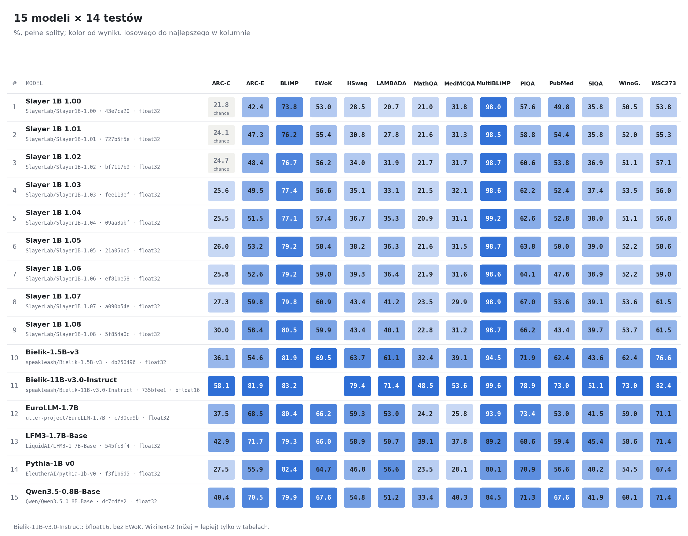

| test | Slayer 1B 1.00 | Slayer 1B 1.01 | Slayer 1B 1.02 | Slayer 1B 1.03 | Slayer 1B 1.04 | Slayer 1B 1.05 | Slayer 1B 1.06 | Slayer 1B 1.07 | Slayer 1B 1.08 | Bielik-1.5B-v3 | Bielik-11B-v3.0-Instruct | EuroLLM-1.7B | LFM2.5-1.2B-Base | LFM3-1.7B (Instruct) | LFM3-1.7B-Base | Pythia-1B v0 | Qwen3.5-0.8B-Base |
|---|---:|---:|---:|---:|---:|---:|---:|---:|---:|---:|---:|---:|---:|---:|---:|---:|---:|
| ARC-Challenge | 0,2176 | 0,2415 | 0,2466 | 0,2560 | 0,2551 | 0,2602 | 0,2577 | 0,2730 | 0,3003 | 0,3609 | 0,5811 | 0,3746 | *0,2517* | *0,2628* | 0,4292 | 0,2747 | 0,4044 |
| ARC-Easy | 0,4242 | 0,4735 | 0,4836 | 0,4945 | 0,5147 | 0,5316 | 0,5261 | 0,5981 | 0,5838 | 0,5459 | 0,8186 | 0,6852 | *0,4289* | *0,4032* | 0,7172 | 0,5585 | 0,7054 |
| BLiMP | 0,7382 | 0,7616 | 0,7665 | 0,7743 | 0,7707 | 0,7915 | 0,7921 | 0,7982 | 0,8047 | 0,8191 | 0,8318 | 0,8036 | *0,7860* | *0,7730* | 0,7930 | 0,8244 | 0,7986 |
| EWoK | 0,5296 | 0,5541 | 0,5620 | 0,5658 | 0,5738 | 0,5841 | 0,5897 | 0,6089 | 0,5990 | 0,6946 | – | 0,6621 | *0,6129* | *0,6159* | 0,6596 | 0,6471 | 0,6757 |
| HellaSwag | 0,2846 | 0,3077 | 0,3398 | 0,3507 | 0,3674 | 0,3823 | 0,3931 | 0,4337 | 0,4341 | 0,6372 | 0,7940 | 0,5927 | *0,3623* | *0,5370* | 0,5891 | 0,4679 | 0,5482 |
| LAMBADA (OpenAI) | 0,2073 | 0,2779 | 0,3190 | 0,3307 | 0,3532 | 0,3627 | 0,3644 | 0,4122 | 0,4013 | 0,6107 | 0,7140 | 0,5302 | *0,1302* | *0,4056* | 0,5069 | 0,5657 | 0,5119 |
| MathQA | 0,2104 | 0,2157 | 0,2171 | 0,2154 | 0,2087 | 0,2161 | 0,2188 | 0,2345 | 0,2281 | 0,3240 | 0,4848 | 0,2422 | *0,2429* | *0,2432* | 0,3906 | 0,2352 | 0,3337 |
| MedMCQA | 0,3180 | 0,3132 | 0,3175 | 0,3206 | 0,3108 | 0,3153 | 0,3160 | 0,2991 | 0,3122 | 0,3913 | 0,5357 | 0,2582 | *0,2611* | *0,2972* | 0,3782 | 0,2811 | 0,4026 |
| MultiBLiMP-PL | 0,9798 | 0,9850 | 0,9869 | 0,9856 | 0,9924 | 0,9875 | 0,9859 | 0,9887 | 0,9875 | 0,9447 | 0,9957 | 0,9386 | *0,8295* | *0,8035* | 0,8915 | 0,8013 | 0,8450 |
| PIQA | 0,5762 | 0,5876 | 0,6055 | 0,6219 | 0,6257 | 0,6382 | 0,6415 | 0,6697 | 0,6621 | 0,7187 | 0,7889 | 0,7345 | *0,5816* | *0,5936* | 0,6855 | 0,7095 | 0,7133 |
| PubMedQA | 0,4980 | 0,5440 | 0,5380 | 0,5240 | 0,5280 | 0,5000 | 0,4760 | 0,5360 | 0,4340 | 0,6240 | 0,7300 | 0,5300 | *0,5680* | *0,6400* | 0,5940 | 0,5660 | 0,6760 |
| Social IQa | 0,3577 | 0,3582 | 0,3690 | 0,3741 | 0,3797 | 0,3905 | 0,3895 | 0,3910 | 0,3966 | 0,4360 | 0,5113 | 0,4150 | *0,3398* | *0,4371* | 0,4545 | 0,4023 | 0,4186 |
| WikiText-2 | 2,071 | 1,959 | 1,917 | 1,899 | 1,870 | 1,851 | 1,846 | 1,782 | 1,780 | 1,674 | 1,566 | 1,608 | *1,735* | *1,724* | 1,616 | 2,423 | 1,717 |
| WinoGrande | 0,5051 | 0,5201 | 0,5107 | 0,5351 | 0,5114 | 0,5225 | 0,5217 | 0,5359 | 0,5367 | 0,6235 | 0,7301 | 0,5904 | *0,5107* | *0,5541* | 0,5856 | 0,5446 | 0,6006 |
| WSC273 | 0,5385 | 0,5531 | 0,5714 | 0,5604 | 0,5604 | 0,5861 | 0,5897 | 0,6154 | 0,6154 | 0,7656 | 0,8242 | 0,7106 | *0,5018* | *0,6447* | 0,7143 | 0,6740 | 0,7143 |

## Slayer 1B: wersje 1.00–1.08

Wszystkie wersje mają tę samą architekturę i tokenizer; rewizje HF w `manifest.jsonl`. 1.07 to wagi z HF (sha256 checkpointu zgodne z `SLAYER_CKPT_SHA256`), 1.08 to rewizja z publikacji w toku.

| test | 1.00 | 1.01 | 1.02 | 1.03 | 1.04 | 1.05 | 1.06 | 1.07 | 1.08 |
|---|---:|---:|---:|---:|---:|---:|---:|---:|---:|
| ARC-Challenge | 0,2176 | 0,2415 | 0,2466 | 0,2560 | 0,2551 | 0,2602 | 0,2577 | 0,2730 | 0,3003 |
| ARC-Easy | 0,4242 | 0,4735 | 0,4836 | 0,4945 | 0,5147 | 0,5316 | 0,5261 | 0,5981 | 0,5838 |
| BLiMP | 0,7382 | 0,7616 | 0,7665 | 0,7743 | 0,7707 | 0,7915 | 0,7921 | 0,7982 | 0,8047 |
| EWoK | 0,5296 | 0,5541 | 0,5620 | 0,5658 | 0,5738 | 0,5841 | 0,5897 | 0,6089 | 0,5990 |
| HellaSwag | 0,2846 | 0,3077 | 0,3398 | 0,3507 | 0,3674 | 0,3823 | 0,3931 | 0,4337 | 0,4341 |
| LAMBADA (OpenAI) | 0,2073 | 0,2779 | 0,3190 | 0,3307 | 0,3532 | 0,3627 | 0,3644 | 0,4122 | 0,4013 |
| MathQA | 0,2104 | 0,2157 | 0,2171 | 0,2154 | 0,2087 | 0,2161 | 0,2188 | 0,2345 | 0,2281 |
| MedMCQA | 0,3180 | 0,3132 | 0,3175 | 0,3206 | 0,3108 | 0,3153 | 0,3160 | 0,2991 | 0,3122 |
| MultiBLiMP-PL | 0,9798 | 0,9850 | 0,9869 | 0,9856 | 0,9924 | 0,9875 | 0,9859 | 0,9887 | 0,9875 |
| PIQA | 0,5762 | 0,5876 | 0,6055 | 0,6219 | 0,6257 | 0,6382 | 0,6415 | 0,6697 | 0,6621 |
| PubMedQA | 0,4980 | 0,5440 | 0,5380 | 0,5240 | 0,5280 | 0,5000 | 0,4760 | 0,5360 | 0,4340 |
| Social IQa | 0,3577 | 0,3582 | 0,3690 | 0,3741 | 0,3797 | 0,3905 | 0,3895 | 0,3910 | 0,3966 |
| WikiText-2 | 2,071 | 1,959 | 1,917 | 1,899 | 1,870 | 1,851 | 1,846 | 1,782 | 1,780 |
| WinoGrande | 0,5051 | 0,5201 | 0,5107 | 0,5351 | 0,5114 | 0,5225 | 0,5217 | 0,5359 | 0,5367 |
| WSC273 | 0,5385 | 0,5531 | 0,5714 | 0,5604 | 0,5604 | 0,5861 | 0,5897 | 0,6154 | 0,6154 |

### Pierwsza → ostatnia wersja (15 porównań, Holm w tej rodzinie)

Δ = nowsza − starsza na tych samych pytaniach. SE parowane po pytaniach (z) albo po klastrach testu (t, df = k − 1): BLiMP po paradygmatach, WinoGrande po parach zdań, WSC273 po schematach, EWoK po szablonach. WikiText: Δ w byte perplexity, SE i t na bits per byte z dokumentem jako klastrem. Werdykt: |z| ≥ 3 pewne, 2–3 prawdopodobne, < 2 szum (t przez p przy tym samym progu).

| test | wersje | Δ | SE Δ | statystyka | werdykt | po Holmie |
|---|---|---:|---:|---|---|---|
| ARC-Challenge | 1.00 → 1.08 | 0,0828 | 0,0124 | z = 6,68 | pewne | tak (pewne) |
| ARC-Easy | 1.00 → 1.08 | 0,1595 | 0,0107 | z = 14,93 | pewne | tak (pewne) |
| BLiMP | 1.00 → 1.08 | 0,0666 | 0,0096 | t = 6,92, df = 66 | pewne | tak (pewne) |
| EWoK | 1.00 → 1.08 | 0,0694 | 0,0093 | t = 7,43, df = 842 | pewne | tak (pewne) |
| HellaSwag | 1.00 → 1.08 | 0,1495 | 0,0043 | z = 34,39 | pewne | tak (pewne) |
| LAMBADA (OpenAI) | 1.00 → 1.08 | 0,1941 | 0,0068 | z = 28,58 | pewne | tak (pewne) |
| MathQA | 1.00 → 1.08 | 0,0178 | 0,0075 | z = 2,37 | prawdopodobne | nie (szum) |
| MedMCQA | 1.00 → 1.08 | −0,0057 | 0,0027 | z = −2,14 | prawdopodobne | nie (szum) |
| MultiBLiMP-PL | 1.00 → 1.08 | 0,0076 | 0,0026 | z = 2,89 | prawdopodobne | tak (prawdopodobne) |
| PIQA | 1.00 → 1.08 | 0,0860 | 0,0104 | z = 8,30 | pewne | tak (pewne) |
| PubMedQA | 1.00 → 1.08 | −0,0640 | 0,0314 | z = −2,04 | prawdopodobne | nie (szum) |
| Social IQa | 1.00 → 1.08 | 0,0389 | 0,0087 | z = 4,48 | pewne | tak (pewne) |
| WikiText-2 | 1.00 → 1.08 | −0,290 | 0,0036 bpb | t = −60,23, df = 61 | pewne | tak (pewne) |
| WinoGrande | 1.00 → 1.08 | 0,0316 | 0,0170 | t = 1,86, df = 982 | szum | nie (szum) |
| WSC273 | 1.00 → 1.08 | 0,0769 | 0,0283 | t = 2,72, df = 134 | prawdopodobne | tak (prawdopodobne) |

### Kolejne wersje (120 porównań, Holm w tej rodzinie)

| test | wersje | Δ | SE Δ | statystyka | werdykt | po Holmie |
|---|---|---:|---:|---|---|---|
| ARC-Challenge | 1.00 → 1.01 | 0,0239 | 0,0096 | z = 2,48 | prawdopodobne | nie (szum) |
| ARC-Challenge | 1.01 → 1.02 | 0,0051 | 0,0090 | z = 0,57 | szum | nie (szum) |
| ARC-Challenge | 1.02 → 1.03 | 0,0094 | 0,0088 | z = 1,06 | szum | nie (szum) |
| ARC-Challenge | 1.03 → 1.04 | −0,0009 | 0,0096 | z = −0,09 | szum | nie (szum) |
| ARC-Challenge | 1.04 → 1.05 | 0,0051 | 0,0086 | z = 0,59 | szum | nie (szum) |
| ARC-Challenge | 1.05 → 1.06 | −0,0026 | 0,0089 | z = −0,29 | szum | nie (szum) |
| ARC-Challenge | 1.06 → 1.07 | 0,0154 | 0,0104 | z = 1,47 | szum | nie (szum) |
| ARC-Challenge | 1.07 → 1.08 | 0,0273 | 0,0096 | z = 2,84 | prawdopodobne | nie (szum) |
| ARC-Easy | 1.00 → 1.01 | 0,0492 | 0,0086 | z = 5,71 | pewne | tak (pewne) |
| ARC-Easy | 1.01 → 1.02 | 0,0101 | 0,0087 | z = 1,17 | szum | nie (szum) |
| ARC-Easy | 1.02 → 1.03 | 0,0109 | 0,0085 | z = 1,29 | szum | nie (szum) |
| ARC-Easy | 1.03 → 1.04 | 0,0202 | 0,0087 | z = 2,32 | prawdopodobne | nie (szum) |
| ARC-Easy | 1.04 → 1.05 | 0,0168 | 0,0083 | z = 2,03 | prawdopodobne | nie (szum) |
| ARC-Easy | 1.05 → 1.06 | −0,0055 | 0,0075 | z = −0,73 | szum | nie (szum) |
| ARC-Easy | 1.06 → 1.07 | 0,0720 | 0,0087 | z = 8,30 | pewne | tak (pewne) |
| ARC-Easy | 1.07 → 1.08 | −0,0143 | 0,0069 | z = −2,07 | prawdopodobne | nie (szum) |
| BLiMP | 1.00 → 1.01 | 0,0235 | 0,0072 | t = 3,24, df = 66 | pewne | nie (szum) |
| BLiMP | 1.01 → 1.02 | 0,0049 | 0,0071 | t = 0,69, df = 66 | szum | nie (szum) |
| BLiMP | 1.02 → 1.03 | 0,0078 | 0,0074 | t = 1,04, df = 66 | szum | nie (szum) |
| BLiMP | 1.03 → 1.04 | −0,0036 | 0,0046 | t = −0,77, df = 66 | szum | nie (szum) |
| BLiMP | 1.04 → 1.05 | 0,0208 | 0,0053 | t = 3,95, df = 66 | pewne | tak (prawdopodobne) |
| BLiMP | 1.05 → 1.06 | 0,0005 | 0,0041 | t = 0,13, df = 66 | szum | nie (szum) |
| BLiMP | 1.06 → 1.07 | 0,0062 | 0,0050 | t = 1,23, df = 66 | szum | nie (szum) |
| BLiMP | 1.07 → 1.08 | 0,0065 | 0,0032 | t = 2,04, df = 66 | szum | nie (szum) |
| EWoK | 1.00 → 1.01 | 0,0245 | 0,0062 | t = 3,96, df = 842 | pewne | tak (prawdopodobne) |
| EWoK | 1.01 → 1.02 | 0,0079 | 0,0064 | t = 1,22, df = 842 | szum | nie (szum) |
| EWoK | 1.02 → 1.03 | 0,0039 | 0,0055 | t = 0,71, df = 842 | szum | nie (szum) |
| EWoK | 1.03 → 1.04 | 0,0080 | 0,0058 | t = 1,38, df = 842 | szum | nie (szum) |
| EWoK | 1.04 → 1.05 | 0,0103 | 0,0053 | t = 1,94, df = 842 | szum | nie (szum) |
| EWoK | 1.05 → 1.06 | 0,0056 | 0,0049 | t = 1,14, df = 842 | szum | nie (szum) |
| EWoK | 1.06 → 1.07 | 0,0192 | 0,0066 | t = 2,92, df = 842 | prawdopodobne | nie (szum) |
| EWoK | 1.07 → 1.08 | −0,0099 | 0,0053 | t = −1,89, df = 842 | szum | nie (szum) |
| HellaSwag | 1.00 → 1.01 | 0,0231 | 0,0030 | z = 7,59 | pewne | tak (pewne) |
| HellaSwag | 1.01 → 1.02 | 0,0321 | 0,0031 | z = 10,36 | pewne | tak (pewne) |
| HellaSwag | 1.02 → 1.03 | 0,0110 | 0,0030 | z = 3,70 | pewne | tak (prawdopodobne) |
| HellaSwag | 1.03 → 1.04 | 0,0166 | 0,0031 | z = 5,43 | pewne | tak (pewne) |
| HellaSwag | 1.04 → 1.05 | 0,0149 | 0,0029 | z = 5,11 | pewne | tak (pewne) |
| HellaSwag | 1.05 → 1.06 | 0,0109 | 0,0027 | z = 4,00 | pewne | tak (prawdopodobne) |
| HellaSwag | 1.06 → 1.07 | 0,0405 | 0,0032 | z = 12,78 | pewne | tak (pewne) |
| HellaSwag | 1.07 → 1.08 | 0,0004 | 0,0025 | z = 0,16 | szum | nie (szum) |
| LAMBADA (OpenAI) | 1.00 → 1.01 | 0,0706 | 0,0052 | z = 13,56 | pewne | tak (pewne) |
| LAMBADA (OpenAI) | 1.01 → 1.02 | 0,0411 | 0,0054 | z = 7,57 | pewne | tak (pewne) |
| LAMBADA (OpenAI) | 1.02 → 1.03 | 0,0116 | 0,0053 | z = 2,18 | prawdopodobne | nie (szum) |
| LAMBADA (OpenAI) | 1.03 → 1.04 | 0,0225 | 0,0055 | z = 4,12 | pewne | tak (prawdopodobne) |
| LAMBADA (OpenAI) | 1.04 → 1.05 | 0,0095 | 0,0053 | z = 1,78 | szum | nie (szum) |
| LAMBADA (OpenAI) | 1.05 → 1.06 | 0,0017 | 0,0052 | z = 0,34 | szum | nie (szum) |
| LAMBADA (OpenAI) | 1.06 → 1.07 | 0,0477 | 0,0058 | z = 8,19 | pewne | tak (pewne) |
| LAMBADA (OpenAI) | 1.07 → 1.08 | −0,0109 | 0,0048 | z = −2,25 | prawdopodobne | nie (szum) |
| MathQA | 1.00 → 1.01 | 0,0054 | 0,0062 | z = 0,87 | szum | nie (szum) |
| MathQA | 1.01 → 1.02 | 0,0013 | 0,0060 | z = 0,22 | szum | nie (szum) |
| MathQA | 1.02 → 1.03 | −0,0017 | 0,0060 | z = −0,28 | szum | nie (szum) |
| MathQA | 1.03 → 1.04 | −0,0067 | 0,0060 | z = −1,12 | szum | nie (szum) |
| MathQA | 1.04 → 1.05 | 0,0074 | 0,0057 | z = 1,30 | szum | nie (szum) |
| MathQA | 1.05 → 1.06 | 0,0027 | 0,0056 | z = 0,47 | szum | nie (szum) |
| MathQA | 1.06 → 1.07 | 0,0157 | 0,0071 | z = 2,22 | prawdopodobne | nie (szum) |
| MathQA | 1.07 → 1.08 | −0,0064 | 0,0061 | z = −1,05 | szum | nie (szum) |
| MedMCQA | 1.00 → 1.01 | −0,0048 | 0,0027 | z = −1,78 | szum | nie (szum) |
| MedMCQA | 1.01 → 1.02 | 0,0043 | 0,0027 | z = 1,60 | szum | nie (szum) |
| MedMCQA | 1.02 → 1.03 | 0,0031 | 0,0019 | z = 1,61 | szum | nie (szum) |
| MedMCQA | 1.03 → 1.04 | −0,0098 | 0,0030 | z = −3,28 | pewne | nie (szum) |
| MedMCQA | 1.04 → 1.05 | 0,0045 | 0,0028 | z = 1,64 | szum | nie (szum) |
| MedMCQA | 1.05 → 1.06 | 0,0007 | 0,0026 | z = 0,28 | szum | nie (szum) |
| MedMCQA | 1.06 → 1.07 | −0,0170 | 0,0054 | z = −3,14 | pewne | nie (szum) |
| MedMCQA | 1.07 → 1.08 | 0,0131 | 0,0050 | z = 2,61 | prawdopodobne | nie (szum) |
| MultiBLiMP-PL | 1.00 → 1.01 | 0,0052 | 0,0023 | z = 2,21 | prawdopodobne | nie (szum) |
| MultiBLiMP-PL | 1.01 → 1.02 | 0,0018 | 0,0025 | z = 0,73 | szum | nie (szum) |
| MultiBLiMP-PL | 1.02 → 1.03 | −0,0012 | 0,0021 | z = −0,58 | szum | nie (szum) |
| MultiBLiMP-PL | 1.03 → 1.04 | 0,0067 | 0,0020 | z = 3,32 | pewne | nie (szum) |
| MultiBLiMP-PL | 1.04 → 1.05 | −0,0049 | 0,0021 | z = −2,36 | prawdopodobne | nie (szum) |
| MultiBLiMP-PL | 1.05 → 1.06 | −0,0015 | 0,0021 | z = −0,75 | szum | nie (szum) |
| MultiBLiMP-PL | 1.06 → 1.07 | 0,0028 | 0,0021 | z = 1,31 | szum | nie (szum) |
| MultiBLiMP-PL | 1.07 → 1.08 | −0,0012 | 0,0019 | z = −0,65 | szum | nie (szum) |
| PIQA | 1.00 → 1.01 | 0,0114 | 0,0087 | z = 1,31 | szum | nie (szum) |
| PIQA | 1.01 → 1.02 | 0,0180 | 0,0084 | z = 2,14 | prawdopodobne | nie (szum) |
| PIQA | 1.02 → 1.03 | 0,0163 | 0,0081 | z = 2,02 | prawdopodobne | nie (szum) |
| PIQA | 1.03 → 1.04 | 0,0038 | 0,0081 | z = 0,47 | szum | nie (szum) |
| PIQA | 1.04 → 1.05 | 0,0125 | 0,0078 | z = 1,60 | szum | nie (szum) |
| PIQA | 1.05 → 1.06 | 0,0033 | 0,0071 | z = 0,46 | szum | nie (szum) |
| PIQA | 1.06 → 1.07 | 0,0283 | 0,0079 | z = 3,58 | pewne | tak (prawdopodobne) |
| PIQA | 1.07 → 1.08 | −0,0076 | 0,0066 | z = −1,16 | szum | nie (szum) |
| PubMedQA | 1.00 → 1.01 | 0,0460 | 0,0192 | z = 2,40 | prawdopodobne | nie (szum) |
| PubMedQA | 1.01 → 1.02 | −0,0060 | 0,0151 | z = −0,40 | szum | nie (szum) |
| PubMedQA | 1.02 → 1.03 | −0,0140 | 0,0166 | z = −0,84 | szum | nie (szum) |
| PubMedQA | 1.03 → 1.04 | 0,0040 | 0,0237 | z = 0,17 | szum | nie (szum) |
| PubMedQA | 1.04 → 1.05 | −0,0280 | 0,0192 | z = −1,46 | szum | nie (szum) |
| PubMedQA | 1.05 → 1.06 | −0,0240 | 0,0181 | z = −1,33 | szum | nie (szum) |
| PubMedQA | 1.06 → 1.07 | 0,0600 | 0,0245 | z = 2,45 | prawdopodobne | nie (szum) |
| PubMedQA | 1.07 → 1.08 | −0,1020 | 0,0221 | z = −4,62 | pewne | tak (pewne) |
| Social IQa | 1.00 → 1.01 | 0,0005 | 0,0070 | z = 0,07 | szum | nie (szum) |
| Social IQa | 1.01 → 1.02 | 0,0107 | 0,0067 | z = 1,61 | szum | nie (szum) |
| Social IQa | 1.02 → 1.03 | 0,0051 | 0,0068 | z = 0,75 | szum | nie (szum) |
| Social IQa | 1.03 → 1.04 | 0,0056 | 0,0070 | z = 0,80 | szum | nie (szum) |
| Social IQa | 1.04 → 1.05 | 0,0107 | 0,0067 | z = 1,61 | szum | nie (szum) |
| Social IQa | 1.05 → 1.06 | −0,0010 | 0,0061 | z = −0,17 | szum | nie (szum) |
| Social IQa | 1.06 → 1.07 | 0,0015 | 0,0069 | z = 0,22 | szum | nie (szum) |
| Social IQa | 1.07 → 1.08 | 0,0056 | 0,0061 | z = 0,92 | szum | nie (szum) |
| WikiText-2 | 1.00 → 1.01 | −0,111 | 0,0014 bpb | t = −55,54, df = 61 | pewne | tak (pewne) |
| WikiText-2 | 1.01 → 1.02 | −0,042 | 0,0013 bpb | t = −24,94, df = 61 | pewne | tak (pewne) |
| WikiText-2 | 1.02 → 1.03 | −0,018 | 0,0007 bpb | t = −18,56, df = 61 | pewne | tak (pewne) |
| WikiText-2 | 1.03 → 1.04 | −0,028 | 0,0008 bpb | t = −27,17, df = 61 | pewne | tak (pewne) |
| WikiText-2 | 1.04 → 1.05 | −0,019 | 0,0006 bpb | t = −24,78, df = 61 | pewne | tak (pewne) |
| WikiText-2 | 1.05 → 1.06 | −0,005 | 0,0005 bpb | t = −7,98, df = 61 | pewne | tak (pewne) |
| WikiText-2 | 1.06 → 1.07 | −0,065 | 0,0014 bpb | t = −37,62, df = 61 | pewne | tak (pewne) |
| WikiText-2 | 1.07 → 1.08 | −0,001 | 0,0008 bpb | t = −1,48, df = 61 | szum | nie (szum) |
| WinoGrande | 1.00 → 1.01 | 0,0150 | 0,0156 | t = 0,96, df = 982 | szum | nie (szum) |
| WinoGrande | 1.01 → 1.02 | −0,0095 | 0,0149 | t = −0,64, df = 982 | szum | nie (szum) |
| WinoGrande | 1.02 → 1.03 | 0,0245 | 0,0139 | t = 1,76, df = 982 | szum | nie (szum) |
| WinoGrande | 1.03 → 1.04 | −0,0237 | 0,0138 | t = −1,72, df = 982 | szum | nie (szum) |
| WinoGrande | 1.04 → 1.05 | 0,0110 | 0,0134 | t = 0,83, df = 982 | szum | nie (szum) |
| WinoGrande | 1.05 → 1.06 | −0,0008 | 0,0122 | t = −0,06, df = 982 | szum | nie (szum) |
| WinoGrande | 1.06 → 1.07 | 0,0142 | 0,0131 | t = 1,08, df = 982 | szum | nie (szum) |
| WinoGrande | 1.07 → 1.08 | 0,0008 | 0,0116 | t = 0,07, df = 982 | szum | nie (szum) |
| WSC273 | 1.00 → 1.01 | 0,0147 | 0,0270 | t = 0,54, df = 134 | szum | nie (szum) |
| WSC273 | 1.01 → 1.02 | 0,0183 | 0,0287 | t = 0,64, df = 134 | szum | nie (szum) |
| WSC273 | 1.02 → 1.03 | −0,0110 | 0,0230 | t = −0,48, df = 134 | szum | nie (szum) |
| WSC273 | 1.03 → 1.04 | 0,0000 | 0,0265 | t = 0,00, df = 134 | szum | nie (szum) |
| WSC273 | 1.04 → 1.05 | 0,0256 | 0,0262 | t = 0,98, df = 134 | szum | nie (szum) |
| WSC273 | 1.05 → 1.06 | 0,0037 | 0,0252 | t = 0,15, df = 134 | szum | nie (szum) |
| WSC273 | 1.06 → 1.07 | 0,0256 | 0,0197 | t = 1,30, df = 134 | szum | nie (szum) |
| WSC273 | 1.07 → 1.08 | 0,0000 | 0,0201 | t = 0,00, df = 134 | szum | nie (szum) |

## Leaderboard per test

Kolejność po wartości. Miejsce w tabeli nie mówi, czy różnica do sąsiada wychodzi poza szum: to mówią SE i CI95 (porównania parowane są tylko dla wersji Slayera). Bez modeli z sekcji „Do sprawdzenia”.

### ARC-Challenge

acc_norm; `T02`, n = 1172, wynik losowy 0,2502.

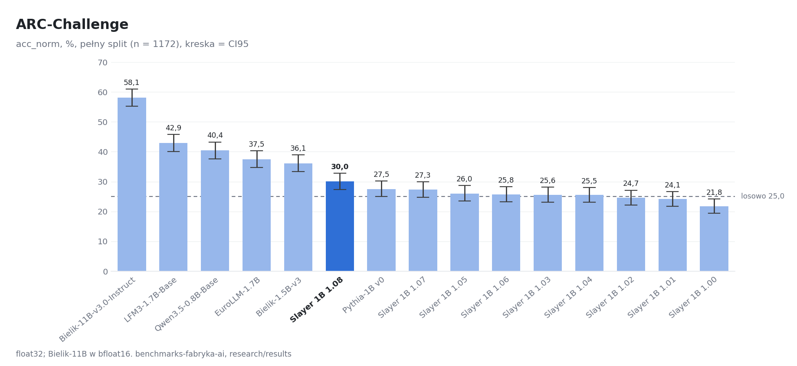

| # | model | wartość | SE | CI95 | dtype | wyniki |
|---:|---|---:|---:|---|---|---|
| 1 | Bielik-11B-v3.0-Instruct | 0,5811 | 0,0144 | 0,5529 – 0,6101 | bfloat16 | [arc-challenge/bielik-11b-v3-instruct](arc-challenge/bielik-11b-v3-instruct/results_rozszerzone.json) |
| 2 | LFM3-1.7B-Base | 0,4292 | 0,0145 | 0,4010 – 0,4582 | float32 | [arc-challenge/lfm3-1.7b-base](arc-challenge/lfm3-1.7b-base/results_rozszerzone.json) |
| 3 | Qwen3.5-0.8B-Base | 0,4044 | 0,0143 | 0,3763 – 0,4326 | float32 | [arc-challenge/qwen3.5-0.8b-base](arc-challenge/qwen3.5-0.8b-base/results_rozszerzone.json) |
| 4 | EuroLLM-1.7B | 0,3746 | 0,0141 | 0,3473 – 0,4027 | float32 | [arc-challenge/eurollm-1.7b](arc-challenge/eurollm-1.7b/results_rozszerzone.json) |
| 5 | Bielik-1.5B-v3 | 0,3609 | 0,0140 | 0,3336 – 0,3891 | float32 | [arc-challenge/bielik-1.5b-v3](arc-challenge/bielik-1.5b-v3/results_rozszerzone.json) |
| 6 | Slayer 1B 1.08 | 0,3003 | 0,0134 | 0,2739 – 0,3276 | float32 | [arc-challenge/slayer1b-1.08](arc-challenge/slayer1b-1.08/results_rozszerzone.json) |
| 7 | Pythia-1B v0 | 0,2747 | 0,0130 | 0,2500 – 0,3020 | float32 | [arc-challenge/pythia-1b-v0](arc-challenge/pythia-1b-v0/results_rozszerzone.json) |
| 8 | Slayer 1B 1.07 | 0,2730 | 0,0130 | 0,2474 – 0,2995 | float32 | [arc-challenge/slayer1b-1.07-hf](arc-challenge/slayer1b-1.07-hf/results_rozszerzone.json) |
| 9 | Slayer 1B 1.05 | 0,2602 | 0,0128 | 0,2355 – 0,2867 | float32 | [arc-challenge/slayer1b-1.05](arc-challenge/slayer1b-1.05/results_rozszerzone.json) |
| 10 | Slayer 1B 1.06 | 0,2577 | 0,0128 | 0,2329 – 0,2833 | float32 | [arc-challenge/slayer1b-1.06](arc-challenge/slayer1b-1.06/results_rozszerzone.json) |
| 11 | Slayer 1B 1.03 | 0,2560 | 0,0128 | 0,2312 – 0,2816 | float32 | [arc-challenge/slayer1b-1.03](arc-challenge/slayer1b-1.03/results_rozszerzone.json) |
| 12 | Slayer 1B 1.04 | 0,2551 | 0,0127 | 0,2304 – 0,2807 | float32 | [arc-challenge/slayer1b-1.04](arc-challenge/slayer1b-1.04/results_rozszerzone.json) |
| 13 | Slayer 1B 1.02 | 0,2466 | 0,0126 | 0,2218 – 0,2713 | float32 | [arc-challenge/slayer1b-1.02](arc-challenge/slayer1b-1.02/results_rozszerzone.json) |
| 14 | Slayer 1B 1.01 | 0,2415 | 0,0125 | 0,2167 – 0,2662 | float32 | [arc-challenge/slayer1b-1.01](arc-challenge/slayer1b-1.01/results_rozszerzone.json) |
| 15 | Slayer 1B 1.00 | 0,2176 | 0,0121 | 0,1945 – 0,2415 | float32 | [arc-challenge/slayer1b-1.00](arc-challenge/slayer1b-1.00/results_rozszerzone.json) |

### ARC-Easy

acc; `T51`, n = 2376, wynik losowy 0,2502.

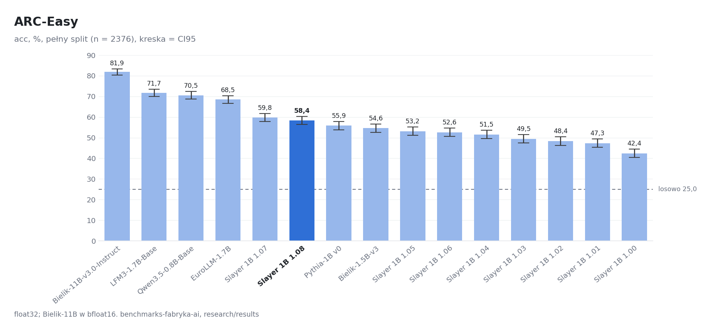

| # | model | wartość | SE | CI95 | dtype | wyniki |
|---:|---|---:|---:|---|---|---|
| 1 | Bielik-11B-v3.0-Instruct | 0,8186 | 0,0079 | 0,8030 – 0,8338 | bfloat16 | [arc-easy/bielik-11b-v3-instruct](arc-easy/bielik-11b-v3-instruct/results_rozszerzone.json) |
| 2 | LFM3-1.7B-Base | 0,7172 | 0,0092 | 0,6991 – 0,7353 | float32 | [arc-easy/lfm3-1.7b-base](arc-easy/lfm3-1.7b-base/results_rozszerzone.json) |
| 3 | Qwen3.5-0.8B-Base | 0,7054 | 0,0094 | 0,6869 – 0,7235 | float32 | [arc-easy/qwen3.5-0.8b-base](arc-easy/qwen3.5-0.8b-base/results_rozszerzone.json) |
| 4 | EuroLLM-1.7B | 0,6852 | 0,0095 | 0,6667 – 0,7037 | float32 | [arc-easy/eurollm-1.7b](arc-easy/eurollm-1.7b/results_rozszerzone.json) |
| 5 | Slayer 1B 1.07 | 0,5981 | 0,0101 | 0,5787 – 0,6174 | float32 | [arc-easy/slayer1b-1.07-hf](arc-easy/slayer1b-1.07-hf/results_rozszerzone.json) |
| 6 | Slayer 1B 1.08 | 0,5838 | 0,0101 | 0,5640 – 0,6031 | float32 | [arc-easy/slayer1b-1.08](arc-easy/slayer1b-1.08/results_rozszerzone.json) |
| 7 | Pythia-1B v0 | 0,5585 | 0,0102 | 0,5383 – 0,5787 | float32 | [arc-easy/pythia-1b-v0](arc-easy/pythia-1b-v0/results_rozszerzone.json) |
| 8 | Bielik-1.5B-v3 | 0,5459 | 0,0102 | 0,5261 – 0,5661 | float32 | [arc-easy/bielik-1.5b-v3](arc-easy/bielik-1.5b-v3/results_rozszerzone.json) |
| 9 | Slayer 1B 1.05 | 0,5316 | 0,0102 | 0,5118 – 0,5522 | float32 | [arc-easy/slayer1b-1.05](arc-easy/slayer1b-1.05/results_rozszerzone.json) |
| 10 | Slayer 1B 1.06 | 0,5261 | 0,0102 | 0,5059 – 0,5463 | float32 | [arc-easy/slayer1b-1.06](arc-easy/slayer1b-1.06/results_rozszerzone.json) |
| 11 | Slayer 1B 1.04 | 0,5147 | 0,0103 | 0,4949 – 0,5354 | float32 | [arc-easy/slayer1b-1.04](arc-easy/slayer1b-1.04/results_rozszerzone.json) |
| 12 | Slayer 1B 1.03 | 0,4945 | 0,0103 | 0,4743 – 0,5143 | float32 | [arc-easy/slayer1b-1.03](arc-easy/slayer1b-1.03/results_rozszerzone.json) |
| 13 | Slayer 1B 1.02 | 0,4836 | 0,0103 | 0,4630 – 0,5038 | float32 | [arc-easy/slayer1b-1.02](arc-easy/slayer1b-1.02/results_rozszerzone.json) |
| 14 | Slayer 1B 1.01 | 0,4735 | 0,0102 | 0,4533 – 0,4933 | float32 | [arc-easy/slayer1b-1.01](arc-easy/slayer1b-1.01/results_rozszerzone.json) |
| 15 | Slayer 1B 1.00 | 0,4242 | 0,0101 | 0,4040 – 0,4440 | float32 | [arc-easy/slayer1b-1.00](arc-easy/slayer1b-1.00/results_rozszerzone.json) |

### BLiMP

acc, SE po 67 paradygmatach; `T01`, n = 67000, wynik losowy 0,5000.

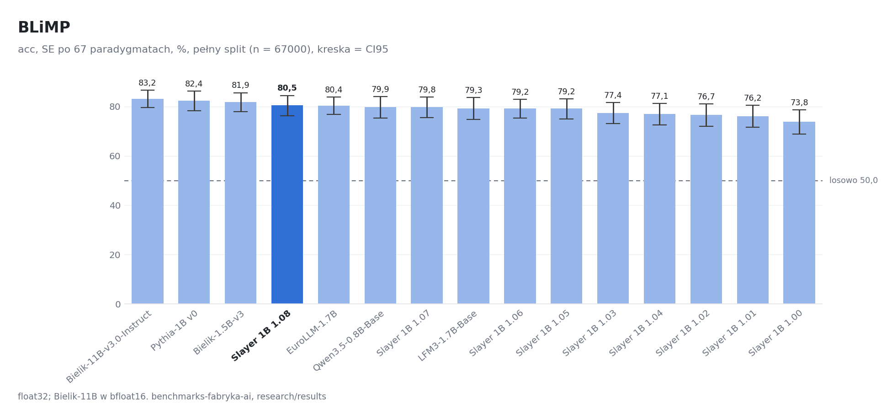

| # | model | wartość | SE | CI95 | dtype | wyniki |
|---:|---|---:|---:|---|---|---|
| 1 | Bielik-11B-v3.0-Instruct | 0,8318 | 0,0178 | 0,7966 – 0,8658 | bfloat16 | [blimp/bielik-11b-v3-instruct](blimp/bielik-11b-v3-instruct/results_rozszerzone.json) |
| 2 | Pythia-1B v0 | 0,8244 | 0,0208 | 0,7827 – 0,8627 | float32 | [blimp/pythia-1b-v0](blimp/pythia-1b-v0/results_rozszerzone.json) |
| 3 | Bielik-1.5B-v3 | 0,8191 | 0,0201 | 0,7797 – 0,8563 | float32 | [blimp/bielik-1.5b-v3](blimp/bielik-1.5b-v3/results_rozszerzone.json) |
| 4 | Slayer 1B 1.08 | 0,8047 | 0,0213 | 0,7619 – 0,8449 | float32 | [blimp/slayer1b-1.08](blimp/slayer1b-1.08/results_rozszerzone.json) |
| 5 | EuroLLM-1.7B | 0,8036 | 0,0182 | 0,7679 – 0,8383 | float32 | [blimp/eurollm-1.7b](blimp/eurollm-1.7b/results_rozszerzone.json) |
| 6 | Qwen3.5-0.8B-Base | 0,7986 | 0,0223 | 0,7541 – 0,8408 | float32 | [blimp/qwen3.5-0.8b-base](blimp/qwen3.5-0.8b-base/results_rozszerzone.json) |
| 7 | Slayer 1B 1.07 | 0,7982 | 0,0212 | 0,7554 – 0,8384 | float32 | [blimp/slayer1b-1.07-hf](blimp/slayer1b-1.07-hf/results_rozszerzone.json) |
| 8 | LFM3-1.7B-Base | 0,7930 | 0,0230 | 0,7478 – 0,8361 | float32 | [blimp/lfm3-1.7b-base](blimp/lfm3-1.7b-base/results_rozszerzone.json) |
| 9 | Slayer 1B 1.06 | 0,7921 | 0,0197 | 0,7530 – 0,8297 | float32 | [blimp/slayer1b-1.06](blimp/slayer1b-1.06/results_rozszerzone.json) |
| 10 | Slayer 1B 1.05 | 0,7915 | 0,0212 | 0,7493 – 0,8318 | float32 | [blimp/slayer1b-1.05](blimp/slayer1b-1.05/results_rozszerzone.json) |
| 11 | Slayer 1B 1.03 | 0,7743 | 0,0220 | 0,7305 – 0,8165 | float32 | [blimp/slayer1b-1.03](blimp/slayer1b-1.03/results_rozszerzone.json) |
| 12 | Slayer 1B 1.04 | 0,7707 | 0,0225 | 0,7261 – 0,8132 | float32 | [blimp/slayer1b-1.04](blimp/slayer1b-1.04/results_rozszerzone.json) |
| 13 | Slayer 1B 1.02 | 0,7665 | 0,0231 | 0,7202 – 0,8108 | float32 | [blimp/slayer1b-1.02](blimp/slayer1b-1.02/results_rozszerzone.json) |
| 14 | Slayer 1B 1.01 | 0,7616 | 0,0231 | 0,7159 – 0,8054 | float32 | [blimp/slayer1b-1.01](blimp/slayer1b-1.01/results_rozszerzone.json) |
| 15 | Slayer 1B 1.00 | 0,7382 | 0,0256 | 0,6876 – 0,7866 | float32 | [blimp/slayer1b-1.00](blimp/slayer1b-1.00/results_rozszerzone.json) |

### EWoK

trafność par kontekst × cel, SE po szablonach; `T53`, n = 4374, wynik losowy 0,5000.

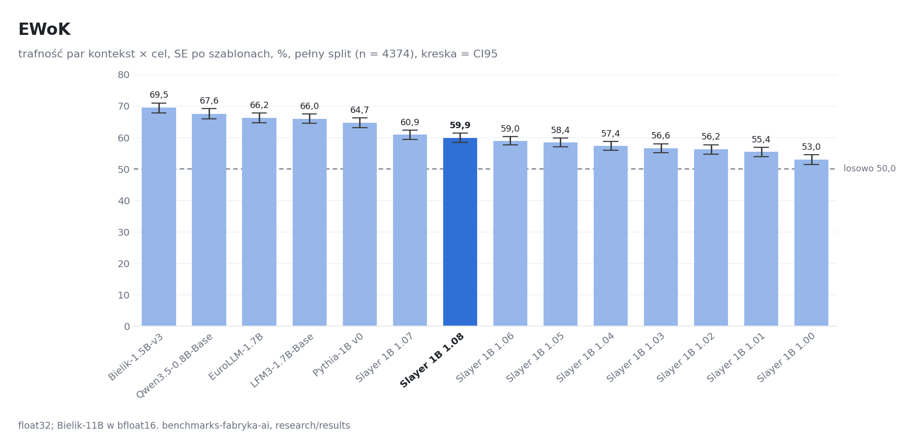

| # | model | wartość | SE | CI95 | dtype | wyniki |
|---:|---|---:|---:|---|---|---|
| 1 | Bielik-1.5B-v3 | 0,6946 | 0,0080 | 0,6787 – 0,7101 | float32 | [ewok/bielik-1.5b-v3](ewok/bielik-1.5b-v3/results_rozszerzone.json) |
| 2 | Qwen3.5-0.8B-Base | 0,6757 | 0,0083 | 0,6596 – 0,6921 | float32 | [ewok/qwen3.5-0.8b-base](ewok/qwen3.5-0.8b-base/results_rozszerzone.json) |
| 3 | EuroLLM-1.7B | 0,6621 | 0,0080 | 0,6463 – 0,6778 | float32 | [ewok/eurollm-1.7b](ewok/eurollm-1.7b/results_rozszerzone.json) |
| 4 | LFM3-1.7B-Base | 0,6596 | 0,0077 | 0,6449 – 0,6747 | float32 | [ewok/lfm3-1.7b-base](ewok/lfm3-1.7b-base/results_rozszerzone.json) |
| 5 | Pythia-1B v0 | 0,6471 | 0,0080 | 0,6314 – 0,6630 | float32 | [ewok/pythia-1b-v0](ewok/pythia-1b-v0/results_rozszerzone.json) |
| 6 | Slayer 1B 1.07 | 0,6089 | 0,0074 | 0,5944 – 0,6235 | float32 | [ewok/slayer1b-1.07-hf](ewok/slayer1b-1.07-hf/results_rozszerzone.json) |
| 7 | Slayer 1B 1.08 | 0,5990 | 0,0075 | 0,5842 – 0,6136 | float32 | [ewok/slayer1b-1.08](ewok/slayer1b-1.08/results_rozszerzone.json) |
| 8 | Slayer 1B 1.06 | 0,5897 | 0,0071 | 0,5758 – 0,6036 | float32 | [ewok/slayer1b-1.06](ewok/slayer1b-1.06/results_rozszerzone.json) |
| 9 | Slayer 1B 1.05 | 0,5841 | 0,0072 | 0,5702 – 0,5985 | float32 | [ewok/slayer1b-1.05](ewok/slayer1b-1.05/results_rozszerzone.json) |
| 10 | Slayer 1B 1.04 | 0,5738 | 0,0071 | 0,5599 – 0,5880 | float32 | [ewok/slayer1b-1.04](ewok/slayer1b-1.04/results_rozszerzone.json) |
| 11 | Slayer 1B 1.03 | 0,5658 | 0,0075 | 0,5508 – 0,5804 | float32 | [ewok/slayer1b-1.03](ewok/slayer1b-1.03/results_rozszerzone.json) |
| 12 | Slayer 1B 1.02 | 0,5620 | 0,0077 | 0,5469 – 0,5771 | float32 | [ewok/slayer1b-1.02](ewok/slayer1b-1.02/results_rozszerzone.json) |
| 13 | Slayer 1B 1.01 | 0,5541 | 0,0077 | 0,5390 – 0,5691 | float32 | [ewok/slayer1b-1.01](ewok/slayer1b-1.01/results_rozszerzone.json) |
| 14 | Slayer 1B 1.00 | 0,5296 | 0,0076 | 0,5146 – 0,5448 | float32 | [ewok/slayer1b-1.00](ewok/slayer1b-1.00/results_rozszerzone.json) |

### HellaSwag

acc_norm; `T05`, n = 10042, wynik losowy 0,2500.

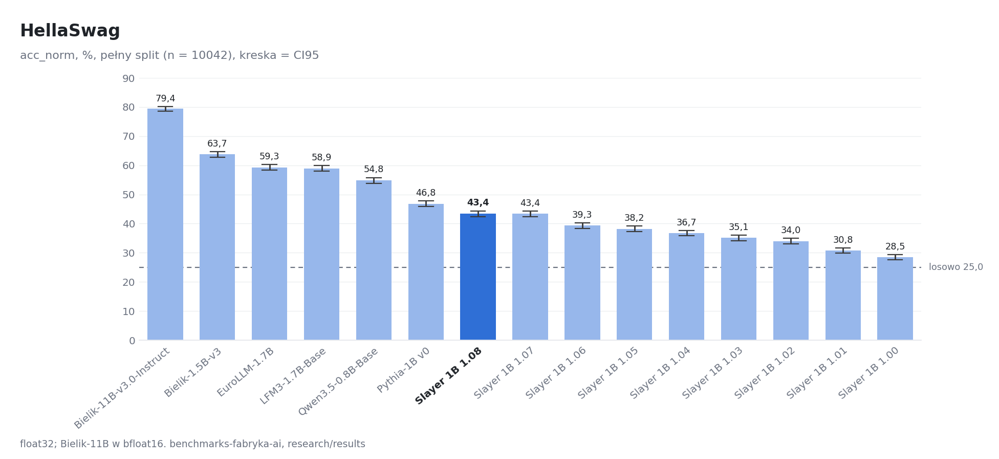

| # | model | wartość | SE | CI95 | dtype | wyniki |
|---:|---|---:|---:|---|---|---|
| 1 | Bielik-11B-v3.0-Instruct | 0,7940 | 0,0040 | 0,7860 – 0,8018 | bfloat16 | [hellaswag/bielik-11b-v3-instruct](hellaswag/bielik-11b-v3-instruct/results_rozszerzone.json) |
| 2 | Bielik-1.5B-v3 | 0,6372 | 0,0048 | 0,6280 – 0,6467 | float32 | [hellaswag/bielik-1.5b-v3](hellaswag/bielik-1.5b-v3/results_rozszerzone.json) |
| 3 | EuroLLM-1.7B | 0,5927 | 0,0049 | 0,5833 – 0,6023 | float32 | [hellaswag/eurollm-1.7b](hellaswag/eurollm-1.7b/results_rozszerzone.json) |
| 4 | LFM3-1.7B-Base | 0,5891 | 0,0049 | 0,5797 – 0,5989 | float32 | [hellaswag/lfm3-1.7b-base](hellaswag/lfm3-1.7b-base/results_rozszerzone.json) |
| 5 | Qwen3.5-0.8B-Base | 0,5482 | 0,0050 | 0,5386 – 0,5581 | float32 | [hellaswag/qwen3.5-0.8b-base](hellaswag/qwen3.5-0.8b-base/results_rozszerzone.json) |
| 6 | Pythia-1B v0 | 0,4679 | 0,0050 | 0,4582 – 0,4777 | float32 | [hellaswag/pythia-1b-v0](hellaswag/pythia-1b-v0/results_rozszerzone.json) |
| 7 | Slayer 1B 1.08 | 0,4341 | 0,0049 | 0,4244 – 0,4437 | float32 | [hellaswag/slayer1b-1.08](hellaswag/slayer1b-1.08/results_rozszerzone.json) |
| 8 | Slayer 1B 1.07 | 0,4337 | 0,0049 | 0,4240 – 0,4433 | float32 | [hellaswag/slayer1b-1.07-hf](hellaswag/slayer1b-1.07-hf/results_rozszerzone.json) |
| 9 | Slayer 1B 1.06 | 0,3931 | 0,0049 | 0,3836 – 0,4030 | float32 | [hellaswag/slayer1b-1.06](hellaswag/slayer1b-1.06/results_rozszerzone.json) |
| 10 | Slayer 1B 1.05 | 0,3823 | 0,0048 | 0,3727 – 0,3919 | float32 | [hellaswag/slayer1b-1.05](hellaswag/slayer1b-1.05/results_rozszerzone.json) |
| 11 | Slayer 1B 1.04 | 0,3674 | 0,0048 | 0,3580 – 0,3767 | float32 | [hellaswag/slayer1b-1.04](hellaswag/slayer1b-1.04/results_rozszerzone.json) |
| 12 | Slayer 1B 1.03 | 0,3507 | 0,0048 | 0,3414 – 0,3603 | float32 | [hellaswag/slayer1b-1.03](hellaswag/slayer1b-1.03/results_rozszerzone.json) |
| 13 | Slayer 1B 1.02 | 0,3398 | 0,0047 | 0,3304 – 0,3492 | float32 | [hellaswag/slayer1b-1.02](hellaswag/slayer1b-1.02/results_rozszerzone.json) |
| 14 | Slayer 1B 1.01 | 0,3077 | 0,0046 | 0,2989 – 0,3168 | float32 | [hellaswag/slayer1b-1.01](hellaswag/slayer1b-1.01/results_rozszerzone.json) |
| 15 | Slayer 1B 1.00 | 0,2846 | 0,0045 | 0,2758 – 0,2936 | float32 | [hellaswag/slayer1b-1.00](hellaswag/slayer1b-1.00/results_rozszerzone.json) |

### LAMBADA (OpenAI)

acc, greedy ostatniego słowa; `T17`, n = 5153.

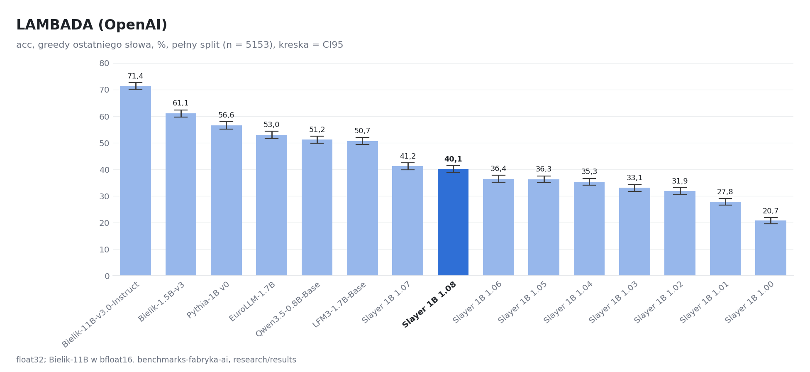

| # | model | wartość | SE | CI95 | dtype | wyniki |
|---:|---|---:|---:|---|---|---|
| 1 | Bielik-11B-v3.0-Instruct | 0,7140 | 0,0063 | 0,7015 – 0,7264 | bfloat16 | [lambada/bielik-11b-v3-instruct](lambada/bielik-11b-v3-instruct/results_rozszerzone.json) |
| 2 | Bielik-1.5B-v3 | 0,6107 | 0,0068 | 0,5975 – 0,6241 | float32 | [lambada/bielik-1.5b-v3](lambada/bielik-1.5b-v3/results_rozszerzone.json) |
| 3 | Pythia-1B v0 | 0,5657 | 0,0069 | 0,5519 – 0,5791 | float32 | [lambada/pythia-1b-v0](lambada/pythia-1b-v0/results_rozszerzone.json) |
| 4 | EuroLLM-1.7B | 0,5302 | 0,0070 | 0,5164 – 0,5436 | float32 | [lambada/eurollm-1.7b](lambada/eurollm-1.7b/results_rozszerzone.json) |
| 5 | Qwen3.5-0.8B-Base | 0,5119 | 0,0070 | 0,4984 – 0,5255 | float32 | [lambada/qwen3.5-0.8b-base](lambada/qwen3.5-0.8b-base/results_rozszerzone.json) |
| 6 | LFM3-1.7B-Base | 0,5069 | 0,0070 | 0,4933 – 0,5207 | float32 | [lambada/lfm3-1.7b-base](lambada/lfm3-1.7b-base/results_rozszerzone.json) |
| 7 | Slayer 1B 1.07 | 0,4122 | 0,0069 | 0,3984 – 0,4254 | float32 | [lambada/slayer1b-1.07-hf](lambada/slayer1b-1.07-hf/results_rozszerzone.json) |
| 8 | Slayer 1B 1.08 | 0,4013 | 0,0068 | 0,3879 – 0,4145 | float32 | [lambada/slayer1b-1.08](lambada/slayer1b-1.08/results_rozszerzone.json) |
| 9 | Slayer 1B 1.06 | 0,3644 | 0,0067 | 0,3511 – 0,3775 | float32 | [lambada/slayer1b-1.06](lambada/slayer1b-1.06/results_rozszerzone.json) |
| 10 | Slayer 1B 1.05 | 0,3627 | 0,0067 | 0,3495 – 0,3757 | float32 | [lambada/slayer1b-1.05](lambada/slayer1b-1.05/results_rozszerzone.json) |
| 11 | Slayer 1B 1.04 | 0,3532 | 0,0067 | 0,3400 – 0,3662 | float32 | [lambada/slayer1b-1.04](lambada/slayer1b-1.04/results_rozszerzone.json) |
| 12 | Slayer 1B 1.03 | 0,3307 | 0,0066 | 0,3179 – 0,3435 | float32 | [lambada/slayer1b-1.03](lambada/slayer1b-1.03/results_rozszerzone.json) |
| 13 | Slayer 1B 1.02 | 0,3190 | 0,0065 | 0,3062 – 0,3317 | float32 | [lambada/slayer1b-1.02](lambada/slayer1b-1.02/results_rozszerzone.json) |
| 14 | Slayer 1B 1.01 | 0,2779 | 0,0062 | 0,2655 – 0,2903 | float32 | [lambada/slayer1b-1.01](lambada/slayer1b-1.01/results_rozszerzone.json) |
| 15 | Slayer 1B 1.00 | 0,2073 | 0,0056 | 0,1958 – 0,2185 | float32 | [lambada/slayer1b-1.00](lambada/slayer1b-1.00/results_rozszerzone.json) |

### MathQA

acc_norm; `T19`, n = 2985, wynik losowy 0,2000.

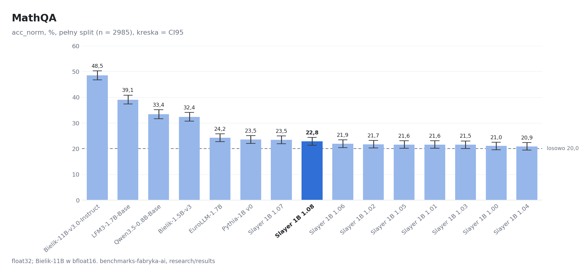

| # | model | wartość | SE | CI95 | dtype | wyniki |
|---:|---|---:|---:|---|---|---|
| 1 | Bielik-11B-v3.0-Instruct | 0,4848 | 0,0091 | 0,4670 – 0,5025 | bfloat16 | [mathqa/bielik-11b-v3-instruct](mathqa/bielik-11b-v3-instruct/results_rozszerzone.json) |
| 2 | LFM3-1.7B-Base | 0,3906 | 0,0089 | 0,3735 – 0,4084 | float32 | [mathqa/lfm3-1.7b-base](mathqa/lfm3-1.7b-base/results_rozszerzone.json) |
| 3 | Qwen3.5-0.8B-Base | 0,3337 | 0,0086 | 0,3169 – 0,3511 | float32 | [mathqa/qwen3.5-0.8b-base](mathqa/qwen3.5-0.8b-base/results_rozszerzone.json) |
| 4 | Bielik-1.5B-v3 | 0,3240 | 0,0086 | 0,3075 – 0,3407 | float32 | [mathqa/bielik-1.5b-v3](mathqa/bielik-1.5b-v3/results_rozszerzone.json) |
| 5 | EuroLLM-1.7B | 0,2422 | 0,0078 | 0,2271 – 0,2580 | float32 | [mathqa/eurollm-1.7b](mathqa/eurollm-1.7b/results_rozszerzone.json) |
| 6 | Pythia-1B v0 | 0,2352 | 0,0078 | 0,2204 – 0,2503 | float32 | [mathqa/pythia-1b-v0](mathqa/pythia-1b-v0/results_rozszerzone.json) |
| 7 | Slayer 1B 1.07 | 0,2345 | 0,0078 | 0,2194 – 0,2499 | float32 | [mathqa/slayer1b-1.07-hf](mathqa/slayer1b-1.07-hf/results_rozszerzone.json) |
| 8 | Slayer 1B 1.08 | 0,2281 | 0,0077 | 0,2134 – 0,2432 | float32 | [mathqa/slayer1b-1.08](mathqa/slayer1b-1.08/results_rozszerzone.json) |
| 9 | Slayer 1B 1.06 | 0,2188 | 0,0076 | 0,2037 – 0,2338 | float32 | [mathqa/slayer1b-1.06](mathqa/slayer1b-1.06/results_rozszerzone.json) |
| 10 | Slayer 1B 1.02 | 0,2171 | 0,0075 | 0,2027 – 0,2318 | float32 | [mathqa/slayer1b-1.02](mathqa/slayer1b-1.02/results_rozszerzone.json) |
| 11 | Slayer 1B 1.05 | 0,2161 | 0,0075 | 0,2017 – 0,2308 | float32 | [mathqa/slayer1b-1.05](mathqa/slayer1b-1.05/results_rozszerzone.json) |
| 12 | Slayer 1B 1.01 | 0,2157 | 0,0075 | 0,2010 – 0,2305 | float32 | [mathqa/slayer1b-1.01](mathqa/slayer1b-1.01/results_rozszerzone.json) |
| 13 | Slayer 1B 1.03 | 0,2154 | 0,0075 | 0,2007 – 0,2302 | float32 | [mathqa/slayer1b-1.03](mathqa/slayer1b-1.03/results_rozszerzone.json) |
| 14 | Slayer 1B 1.00 | 0,2104 | 0,0075 | 0,1956 – 0,2251 | float32 | [mathqa/slayer1b-1.00](mathqa/slayer1b-1.00/results_rozszerzone.json) |
| 15 | Slayer 1B 1.04 | 0,2087 | 0,0074 | 0,1940 – 0,2235 | float32 | [mathqa/slayer1b-1.04](mathqa/slayer1b-1.04/results_rozszerzone.json) |

### MedMCQA

acc; `T45`, n = 4183, wynik losowy 0,2500.

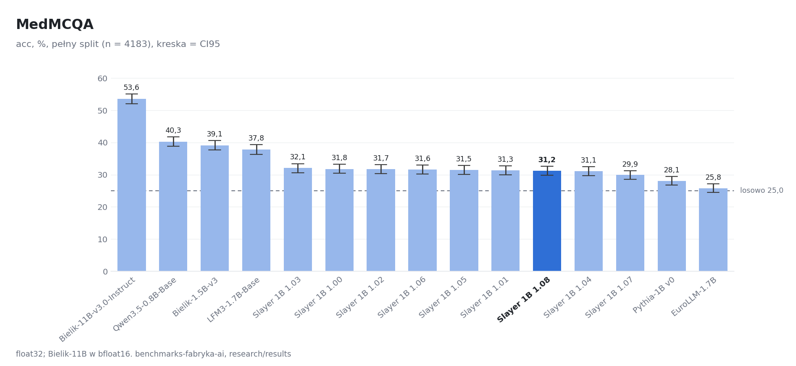

| # | model | wartość | SE | CI95 | dtype | wyniki |
|---:|---|---:|---:|---|---|---|
| 1 | Bielik-11B-v3.0-Instruct | 0,5357 | 0,0077 | 0,5209 – 0,5508 | bfloat16 | [medmcqa/bielik-11b-v3-instruct](medmcqa/bielik-11b-v3-instruct/results_rozszerzone.json) |
| 2 | Qwen3.5-0.8B-Base | 0,4026 | 0,0076 | 0,3880 – 0,4176 | float32 | [medmcqa/qwen3.5-0.8b-base](medmcqa/qwen3.5-0.8b-base/results_rozszerzone.json) |
| 3 | Bielik-1.5B-v3 | 0,3913 | 0,0075 | 0,3765 – 0,4062 | float32 | [medmcqa/bielik-1.5b-v3](medmcqa/bielik-1.5b-v3/results_rozszerzone.json) |
| 4 | LFM3-1.7B-Base | 0,3782 | 0,0075 | 0,3636 – 0,3930 | float32 | [medmcqa/lfm3-1.7b-base](medmcqa/lfm3-1.7b-base/results_rozszerzone.json) |
| 5 | Slayer 1B 1.03 | 0,3206 | 0,0072 | 0,3065 – 0,3344 | float32 | [medmcqa/slayer1b-1.03](medmcqa/slayer1b-1.03/results_rozszerzone.json) |
| 6 | Slayer 1B 1.00 | 0,3180 | 0,0072 | 0,3041 – 0,3321 | float32 | [medmcqa/slayer1b-1.00](medmcqa/slayer1b-1.00/results_rozszerzone.json) |
| 7 | Slayer 1B 1.02 | 0,3175 | 0,0072 | 0,3034 – 0,3313 | float32 | [medmcqa/slayer1b-1.02](medmcqa/slayer1b-1.02/results_rozszerzone.json) |
| 8 | Slayer 1B 1.06 | 0,3160 | 0,0072 | 0,3019 – 0,3299 | float32 | [medmcqa/slayer1b-1.06](medmcqa/slayer1b-1.06/results_rozszerzone.json) |
| 9 | Slayer 1B 1.05 | 0,3153 | 0,0072 | 0,3015 – 0,3292 | float32 | [medmcqa/slayer1b-1.05](medmcqa/slayer1b-1.05/results_rozszerzone.json) |
| 10 | Slayer 1B 1.01 | 0,3132 | 0,0072 | 0,2991 – 0,3270 | float32 | [medmcqa/slayer1b-1.01](medmcqa/slayer1b-1.01/results_rozszerzone.json) |
| 11 | Slayer 1B 1.08 | 0,3122 | 0,0072 | 0,2984 – 0,3261 | float32 | [medmcqa/slayer1b-1.08](medmcqa/slayer1b-1.08/results_rozszerzone.json) |
| 12 | Slayer 1B 1.04 | 0,3108 | 0,0072 | 0,2967 – 0,3246 | float32 | [medmcqa/slayer1b-1.04](medmcqa/slayer1b-1.04/results_rozszerzone.json) |
| 13 | Slayer 1B 1.07 | 0,2991 | 0,0071 | 0,2854 – 0,3125 | float32 | [medmcqa/slayer1b-1.07-hf](medmcqa/slayer1b-1.07-hf/results_rozszerzone.json) |
| 14 | Pythia-1B v0 | 0,2811 | 0,0070 | 0,2678 – 0,2948 | float32 | [medmcqa/pythia-1b-v0](medmcqa/pythia-1b-v0/results_rozszerzone.json) |
| 15 | EuroLLM-1.7B | 0,2582 | 0,0068 | 0,2450 – 0,2713 | float32 | [medmcqa/eurollm-1.7b](medmcqa/eurollm-1.7b/results_rozszerzone.json) |

### MultiBLiMP-PL

acc; `T04`, n = 3272, wynik losowy 0,5000.

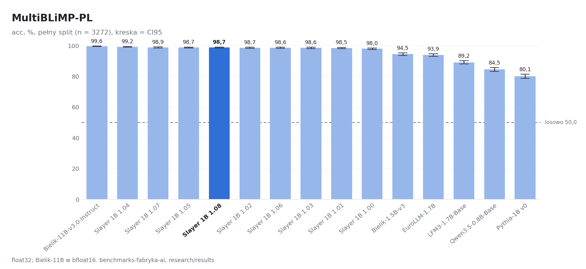

| # | model | wartość | SE | CI95 | dtype | wyniki |
|---:|---|---:|---:|---|---|---|
| 1 | Bielik-11B-v3.0-Instruct | 0,9957 | 0,0011 | 0,9933 – 0,9979 | bfloat16 | [multiblimp-pl/bielik-11b-v3-instruct](multiblimp-pl/bielik-11b-v3-instruct/results_rozszerzone.json) |
| 2 | Slayer 1B 1.04 | 0,9924 | 0,0015 | 0,9893 – 0,9951 | float32 | [multiblimp-pl/slayer1b-1.04](multiblimp-pl/slayer1b-1.04/results_rozszerzone.json) |
| 3 | Slayer 1B 1.07 | 0,9887 | 0,0018 | 0,9850 – 0,9921 | float32 | [multiblimp-pl/slayer1b-1.07-hf](multiblimp-pl/slayer1b-1.07-hf/results_rozszerzone.json) |
| 4 | Slayer 1B 1.05 | 0,9875 | 0,0019 | 0,9835 – 0,9911 | float32 | [multiblimp-pl/slayer1b-1.05](multiblimp-pl/slayer1b-1.05/results_rozszerzone.json) |
| 5 | Slayer 1B 1.08 | 0,9875 | 0,0019 | 0,9835 – 0,9911 | float32 | [multiblimp-pl/slayer1b-1.08](multiblimp-pl/slayer1b-1.08/results_rozszerzone.json) |
| 6 | Slayer 1B 1.02 | 0,9869 | 0,0020 | 0,9829 – 0,9905 | float32 | [multiblimp-pl/slayer1b-1.02](multiblimp-pl/slayer1b-1.02/results_rozszerzone.json) |
| 7 | Slayer 1B 1.06 | 0,9859 | 0,0021 | 0,9817 – 0,9899 | float32 | [multiblimp-pl/slayer1b-1.06](multiblimp-pl/slayer1b-1.06/results_rozszerzone.json) |
| 8 | Slayer 1B 1.03 | 0,9856 | 0,0021 | 0,9814 – 0,9896 | float32 | [multiblimp-pl/slayer1b-1.03](multiblimp-pl/slayer1b-1.03/results_rozszerzone.json) |
| 9 | Slayer 1B 1.01 | 0,9850 | 0,0021 | 0,9807 – 0,9890 | float32 | [multiblimp-pl/slayer1b-1.01](multiblimp-pl/slayer1b-1.01/results_rozszerzone.json) |
| 10 | Slayer 1B 1.00 | 0,9798 | 0,0025 | 0,9746 – 0,9847 | float32 | [multiblimp-pl/slayer1b-1.00](multiblimp-pl/slayer1b-1.00/results_rozszerzone.json) |
| 11 | Bielik-1.5B-v3 | 0,9447 | 0,0040 | 0,9364 – 0,9526 | float32 | [multiblimp-pl/bielik-1.5b-v3](multiblimp-pl/bielik-1.5b-v3/results_rozszerzone.json) |
| 12 | EuroLLM-1.7B | 0,9386 | 0,0042 | 0,9303 – 0,9468 | float32 | [multiblimp-pl/eurollm-1.7b](multiblimp-pl/eurollm-1.7b/results_rozszerzone.json) |
| 13 | LFM3-1.7B-Base | 0,8915 | 0,0054 | 0,8808 – 0,9022 | float32 | [multiblimp-pl/lfm3-1.7b-base](multiblimp-pl/lfm3-1.7b-base/results_rozszerzone.json) |
| 14 | Qwen3.5-0.8B-Base | 0,8450 | 0,0063 | 0,8325 – 0,8576 | float32 | [multiblimp-pl/qwen3.5-0.8b-base](multiblimp-pl/qwen3.5-0.8b-base/results_rozszerzone.json) |
| 15 | Pythia-1B v0 | 0,8013 | 0,0070 | 0,7873 – 0,8148 | float32 | [multiblimp-pl/pythia-1b-v0](multiblimp-pl/pythia-1b-v0/results_rozszerzone.json) |

### PIQA

acc_norm; `T06`, n = 1838, wynik losowy 0,5000.

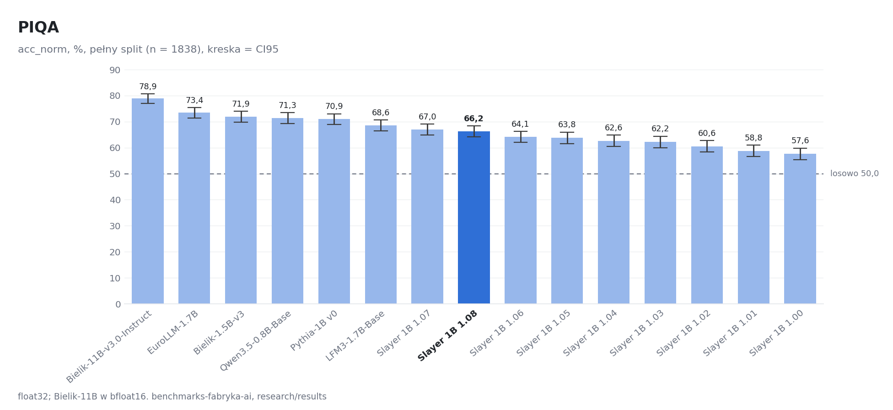

| # | model | wartość | SE | CI95 | dtype | wyniki |
|---:|---|---:|---:|---|---|---|
| 1 | Bielik-11B-v3.0-Instruct | 0,7889 | 0,0095 | 0,7704 – 0,8074 | bfloat16 | [piqa/bielik-11b-v3-instruct](piqa/bielik-11b-v3-instruct/results_rozszerzone.json) |
| 2 | EuroLLM-1.7B | 0,7345 | 0,0103 | 0,7138 – 0,7541 | float32 | [piqa/eurollm-1.7b](piqa/eurollm-1.7b/results_rozszerzone.json) |
| 3 | Bielik-1.5B-v3 | 0,7187 | 0,0105 | 0,6980 – 0,7394 | float32 | [piqa/bielik-1.5b-v3](piqa/bielik-1.5b-v3/results_rozszerzone.json) |
| 4 | Qwen3.5-0.8B-Base | 0,7133 | 0,0106 | 0,6926 – 0,7339 | float32 | [piqa/qwen3.5-0.8b-base](piqa/qwen3.5-0.8b-base/results_rozszerzone.json) |
| 5 | Pythia-1B v0 | 0,7095 | 0,0106 | 0,6882 – 0,7301 | float32 | [piqa/pythia-1b-v0](piqa/pythia-1b-v0/results_rozszerzone.json) |
| 6 | LFM3-1.7B-Base | 0,6855 | 0,0108 | 0,6643 – 0,7067 | float32 | [piqa/lfm3-1.7b-base](piqa/lfm3-1.7b-base/results_rozszerzone.json) |
| 7 | Slayer 1B 1.07 | 0,6697 | 0,0110 | 0,6485 – 0,6910 | float32 | [piqa/slayer1b-1.07-hf](piqa/slayer1b-1.07-hf/results_rozszerzone.json) |
| 8 | Slayer 1B 1.08 | 0,6621 | 0,0110 | 0,6409 – 0,6839 | float32 | [piqa/slayer1b-1.08](piqa/slayer1b-1.08/results_rozszerzone.json) |
| 9 | Slayer 1B 1.06 | 0,6415 | 0,0112 | 0,6197 – 0,6632 | float32 | [piqa/slayer1b-1.06](piqa/slayer1b-1.06/results_rozszerzone.json) |
| 10 | Slayer 1B 1.05 | 0,6382 | 0,0112 | 0,6159 – 0,6600 | float32 | [piqa/slayer1b-1.05](piqa/slayer1b-1.05/results_rozszerzone.json) |
| 11 | Slayer 1B 1.04 | 0,6257 | 0,0113 | 0,6039 – 0,6480 | float32 | [piqa/slayer1b-1.04](piqa/slayer1b-1.04/results_rozszerzone.json) |
| 12 | Slayer 1B 1.03 | 0,6219 | 0,0113 | 0,6001 – 0,6442 | float32 | [piqa/slayer1b-1.03](piqa/slayer1b-1.03/results_rozszerzone.json) |
| 13 | Slayer 1B 1.02 | 0,6055 | 0,0114 | 0,5838 – 0,6279 | float32 | [piqa/slayer1b-1.02](piqa/slayer1b-1.02/results_rozszerzone.json) |
| 14 | Slayer 1B 1.01 | 0,5876 | 0,0115 | 0,5653 – 0,6099 | float32 | [piqa/slayer1b-1.01](piqa/slayer1b-1.01/results_rozszerzone.json) |
| 15 | Slayer 1B 1.00 | 0,5762 | 0,0115 | 0,5539 – 0,5985 | float32 | [piqa/slayer1b-1.00](piqa/slayer1b-1.00/results_rozszerzone.json) |

### PubMedQA

acc; `T44`, n = 500, wynik losowy 0,3333.

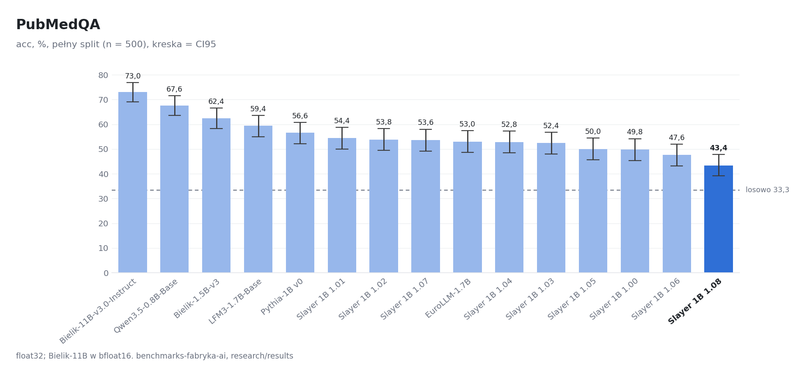

| # | model | wartość | SE | CI95 | dtype | wyniki |
|---:|---|---:|---:|---|---|---|
| 1 | Bielik-11B-v3.0-Instruct | 0,7300 | 0,0199 | 0,6900 – 0,7680 | bfloat16 | [pubmedqa/bielik-11b-v3-instruct](pubmedqa/bielik-11b-v3-instruct/results_rozszerzone.json) |
| 2 | Qwen3.5-0.8B-Base | 0,6760 | 0,0210 | 0,6360 – 0,7160 | float32 | [pubmedqa/qwen3.5-0.8b-base](pubmedqa/qwen3.5-0.8b-base/results_rozszerzone.json) |
| 3 | Bielik-1.5B-v3 | 0,6240 | 0,0217 | 0,5820 – 0,6660 | float32 | [pubmedqa/bielik-1.5b-v3](pubmedqa/bielik-1.5b-v3/results_rozszerzone.json) |
| 4 | LFM3-1.7B-Base | 0,5940 | 0,0220 | 0,5500 – 0,6360 | float32 | [pubmedqa/lfm3-1.7b-base](pubmedqa/lfm3-1.7b-base/results_rozszerzone.json) |
| 5 | Pythia-1B v0 | 0,5660 | 0,0222 | 0,5220 – 0,6080 | float32 | [pubmedqa/pythia-1b-v0](pubmedqa/pythia-1b-v0/results_rozszerzone.json) |
| 6 | Slayer 1B 1.01 | 0,5440 | 0,0223 | 0,5000 – 0,5880 | float32 | [pubmedqa/slayer1b-1.01](pubmedqa/slayer1b-1.01/results_rozszerzone.json) |
| 7 | Slayer 1B 1.02 | 0,5380 | 0,0223 | 0,4940 – 0,5820 | float32 | [pubmedqa/slayer1b-1.02](pubmedqa/slayer1b-1.02/results_rozszerzone.json) |
| 8 | Slayer 1B 1.07 | 0,5360 | 0,0223 | 0,4920 – 0,5800 | float32 | [pubmedqa/slayer1b-1.07-hf](pubmedqa/slayer1b-1.07-hf/results_rozszerzone.json) |
| 9 | EuroLLM-1.7B | 0,5300 | 0,0223 | 0,4860 – 0,5740 | float32 | [pubmedqa/eurollm-1.7b](pubmedqa/eurollm-1.7b/results_rozszerzone.json) |
| 10 | Slayer 1B 1.04 | 0,5280 | 0,0223 | 0,4840 – 0,5720 | float32 | [pubmedqa/slayer1b-1.04](pubmedqa/slayer1b-1.04/results_rozszerzone.json) |
| 11 | Slayer 1B 1.03 | 0,5240 | 0,0224 | 0,4800 – 0,5680 | float32 | [pubmedqa/slayer1b-1.03](pubmedqa/slayer1b-1.03/results_rozszerzone.json) |
| 12 | Slayer 1B 1.05 | 0,5000 | 0,0224 | 0,4560 – 0,5440 | float32 | [pubmedqa/slayer1b-1.05](pubmedqa/slayer1b-1.05/results_rozszerzone.json) |
| 13 | Slayer 1B 1.00 | 0,4980 | 0,0224 | 0,4540 – 0,5420 | float32 | [pubmedqa/slayer1b-1.00](pubmedqa/slayer1b-1.00/results_rozszerzone.json) |
| 14 | Slayer 1B 1.06 | 0,4760 | 0,0224 | 0,4320 – 0,5200 | float32 | [pubmedqa/slayer1b-1.06](pubmedqa/slayer1b-1.06/results_rozszerzone.json) |
| 15 | Slayer 1B 1.08 | 0,4340 | 0,0222 | 0,3920 – 0,4780 | float32 | [pubmedqa/slayer1b-1.08](pubmedqa/slayer1b-1.08/results_rozszerzone.json) |

### Social IQa

acc; `T46`, n = 1954, wynik losowy 0,3333.

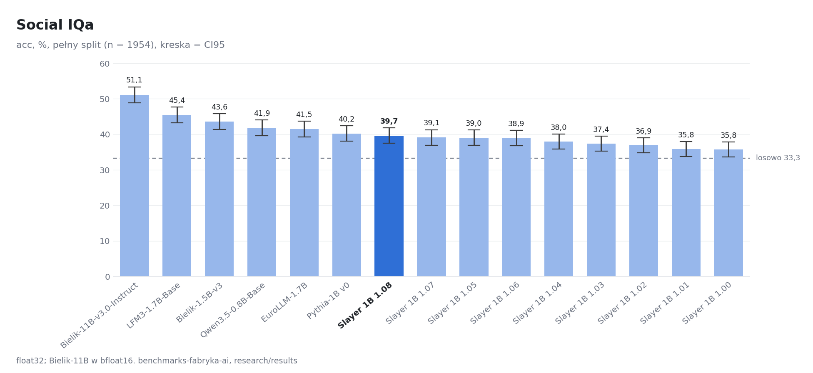

| # | model | wartość | SE | CI95 | dtype | wyniki |
|---:|---|---:|---:|---|---|---|
| 1 | Bielik-11B-v3.0-Instruct | 0,5113 | 0,0113 | 0,4893 – 0,5338 | bfloat16 | [social-iqa/bielik-11b-v3-instruct](social-iqa/bielik-11b-v3-instruct/results_rozszerzone.json) |
| 2 | LFM3-1.7B-Base | 0,4545 | 0,0113 | 0,4324 – 0,4770 | float32 | [social-iqa/lfm3-1.7b-base](social-iqa/lfm3-1.7b-base/results_rozszerzone.json) |
| 3 | Bielik-1.5B-v3 | 0,4360 | 0,0112 | 0,4135 – 0,4585 | float32 | [social-iqa/bielik-1.5b-v3](social-iqa/bielik-1.5b-v3/results_rozszerzone.json) |
| 4 | Qwen3.5-0.8B-Base | 0,4186 | 0,0112 | 0,3966 – 0,4406 | float32 | [social-iqa/qwen3.5-0.8b-base](social-iqa/qwen3.5-0.8b-base/results_rozszerzone.json) |
| 5 | EuroLLM-1.7B | 0,4150 | 0,0111 | 0,3930 – 0,4371 | float32 | [social-iqa/eurollm-1.7b](social-iqa/eurollm-1.7b/results_rozszerzone.json) |
| 6 | Pythia-1B v0 | 0,4023 | 0,0111 | 0,3808 – 0,4237 | float32 | [social-iqa/pythia-1b-v0](social-iqa/pythia-1b-v0/results_rozszerzone.json) |
| 7 | Slayer 1B 1.08 | 0,3966 | 0,0111 | 0,3751 – 0,4186 | float32 | [social-iqa/slayer1b-1.08](social-iqa/slayer1b-1.08/results_rozszerzone.json) |
| 8 | Slayer 1B 1.07 | 0,3910 | 0,0110 | 0,3695 – 0,4130 | float32 | [social-iqa/slayer1b-1.07-hf](social-iqa/slayer1b-1.07-hf/results_rozszerzone.json) |
| 9 | Slayer 1B 1.05 | 0,3905 | 0,0110 | 0,3690 – 0,4125 | float32 | [social-iqa/slayer1b-1.05](social-iqa/slayer1b-1.05/results_rozszerzone.json) |
| 10 | Slayer 1B 1.06 | 0,3895 | 0,0110 | 0,3680 – 0,4115 | float32 | [social-iqa/slayer1b-1.06](social-iqa/slayer1b-1.06/results_rozszerzone.json) |
| 11 | Slayer 1B 1.04 | 0,3797 | 0,0110 | 0,3582 – 0,4007 | float32 | [social-iqa/slayer1b-1.04](social-iqa/slayer1b-1.04/results_rozszerzone.json) |
| 12 | Slayer 1B 1.03 | 0,3741 | 0,0109 | 0,3526 – 0,3951 | float32 | [social-iqa/slayer1b-1.03](social-iqa/slayer1b-1.03/results_rozszerzone.json) |
| 13 | Slayer 1B 1.02 | 0,3690 | 0,0109 | 0,3475 – 0,3905 | float32 | [social-iqa/slayer1b-1.02](social-iqa/slayer1b-1.02/results_rozszerzone.json) |
| 14 | Slayer 1B 1.01 | 0,3582 | 0,0108 | 0,3373 – 0,3792 | float32 | [social-iqa/slayer1b-1.01](social-iqa/slayer1b-1.01/results_rozszerzone.json) |
| 15 | Slayer 1B 1.00 | 0,3577 | 0,0108 | 0,3367 – 0,3787 | float32 | [social-iqa/slayer1b-1.00](social-iqa/slayer1b-1.00/results_rozszerzone.json) |

### WikiText-2

byte perplexity, niżej = lepiej; `T03`, n = 62.

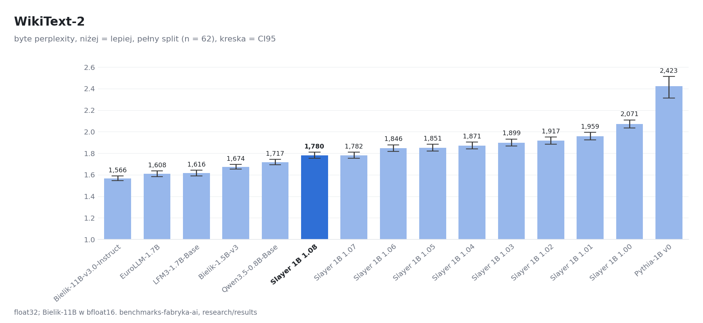

| # | model | wartość | SE | CI95 | dtype | wyniki |
|---:|---|---:|---:|---|---|---|
| 1 | Bielik-11B-v3.0-Instruct | 1,566 | 0,0110 | 1,545 – 1,588 | bfloat16 | [wikitext-2/bielik-11b-v3-instruct](wikitext-2/bielik-11b-v3-instruct/results_rozszerzone.json) |
| 2 | EuroLLM-1.7B | 1,608 | 0,0137 | 1,582 – 1,635 | float32 | [wikitext-2/eurollm-1.7b](wikitext-2/eurollm-1.7b/results_rozszerzone.json) |
| 3 | LFM3-1.7B-Base | 1,616 | 0,0142 | 1,588 – 1,644 | float32 | [wikitext-2/lfm3-1.7b-base](wikitext-2/lfm3-1.7b-base/results_rozszerzone.json) |
| 4 | Bielik-1.5B-v3 | 1,674 | 0,0109 | 1,653 – 1,695 | float32 | [wikitext-2/bielik-1.5b-v3](wikitext-2/bielik-1.5b-v3/results_rozszerzone.json) |
| 5 | Qwen3.5-0.8B-Base | 1,717 | 0,0130 | 1,692 – 1,743 | float32 | [wikitext-2/qwen3.5-0.8b-base](wikitext-2/qwen3.5-0.8b-base/results_rozszerzone.json) |
| 6 | Slayer 1B 1.08 | 1,780 | 0,0149 | 1,752 – 1,810 | float32 | [wikitext-2/slayer1b-1.08](wikitext-2/slayer1b-1.08/results_rozszerzone.json) |
| 7 | Slayer 1B 1.07 | 1,782 | 0,0147 | 1,754 – 1,811 | float32 | [wikitext-2/slayer1b-1.07-hf](wikitext-2/slayer1b-1.07-hf/results_rozszerzone.json) |
| 8 | Slayer 1B 1.06 | 1,846 | 0,0162 | 1,816 – 1,879 | float32 | [wikitext-2/slayer1b-1.06](wikitext-2/slayer1b-1.06/results_rozszerzone.json) |
| 9 | Slayer 1B 1.05 | 1,851 | 0,0161 | 1,821 – 1,884 | float32 | [wikitext-2/slayer1b-1.05](wikitext-2/slayer1b-1.05/results_rozszerzone.json) |
| 10 | Slayer 1B 1.04 | 1,870 | 0,0163 | 1,840 – 1,903 | float32 | [wikitext-2/slayer1b-1.04](wikitext-2/slayer1b-1.04/results_rozszerzone.json) |
| 11 | Slayer 1B 1.03 | 1,899 | 0,0168 | 1,867 – 1,932 | float32 | [wikitext-2/slayer1b-1.03](wikitext-2/slayer1b-1.03/results_rozszerzone.json) |
| 12 | Slayer 1B 1.02 | 1,917 | 0,0168 | 1,885 – 1,951 | float32 | [wikitext-2/slayer1b-1.02](wikitext-2/slayer1b-1.02/results_rozszerzone.json) |
| 13 | Slayer 1B 1.01 | 1,959 | 0,0178 | 1,926 – 1,995 | float32 | [wikitext-2/slayer1b-1.01](wikitext-2/slayer1b-1.01/results_rozszerzone.json) |
| 14 | Slayer 1B 1.00 | 2,071 | 0,0194 | 2,034 – 2,110 | float32 | [wikitext-2/slayer1b-1.00](wikitext-2/slayer1b-1.00/results_rozszerzone.json) |
| 15 | Pythia-1B v0 | 2,423 | 0,0514 | 2,311 – 2,513 | float32 | [wikitext-2/pythia-1b-v0](wikitext-2/pythia-1b-v0/results_rozszerzone.json) |

### WinoGrande

acc, SE po parach zdań; `T07`, n = 1267, wynik losowy 0,5000.

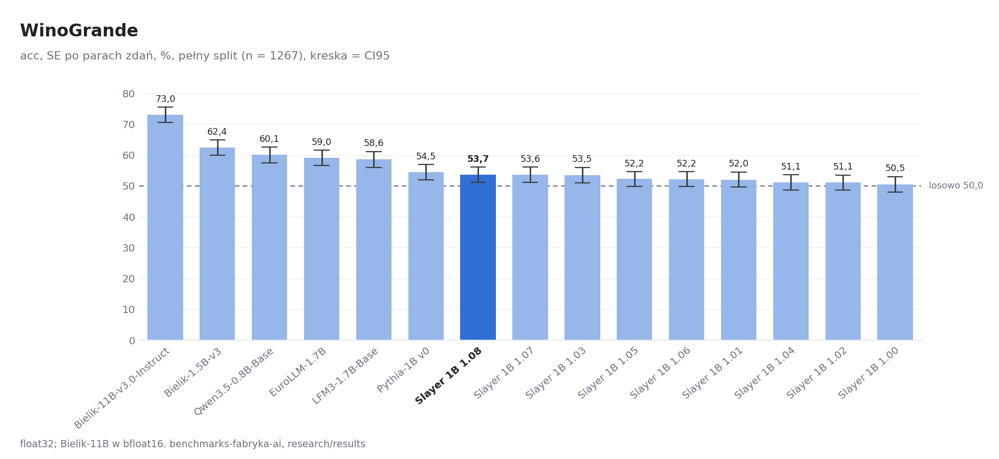

| # | model | wartość | SE | CI95 | dtype | wyniki |
|---:|---|---:|---:|---|---|---|
| 1 | Bielik-11B-v3.0-Instruct | 0,7301 | 0,0124 | 0,7063 – 0,7546 | bfloat16 | [winogrande/bielik-11b-v3-instruct](winogrande/bielik-11b-v3-instruct/results_rozszerzone.json) |
| 2 | Bielik-1.5B-v3 | 0,6235 | 0,0129 | 0,5987 – 0,6491 | float32 | [winogrande/bielik-1.5b-v3](winogrande/bielik-1.5b-v3/results_rozszerzone.json) |
| 3 | Qwen3.5-0.8B-Base | 0,6006 | 0,0129 | 0,5751 – 0,6255 | float32 | [winogrande/qwen3.5-0.8b-base](winogrande/qwen3.5-0.8b-base/results_rozszerzone.json) |
| 4 | EuroLLM-1.7B | 0,5904 | 0,0127 | 0,5658 – 0,6154 | float32 | [winogrande/eurollm-1.7b](winogrande/eurollm-1.7b/results_rozszerzone.json) |
| 5 | LFM3-1.7B-Base | 0,5856 | 0,0132 | 0,5595 – 0,6116 | float32 | [winogrande/lfm3-1.7b-base](winogrande/lfm3-1.7b-base/results_rozszerzone.json) |
| 6 | Pythia-1B v0 | 0,5446 | 0,0125 | 0,5196 – 0,5697 | float32 | [winogrande/pythia-1b-v0](winogrande/pythia-1b-v0/results_rozszerzone.json) |
| 7 | Slayer 1B 1.08 | 0,5367 | 0,0127 | 0,5113 – 0,5612 | float32 | [winogrande/slayer1b-1.08](winogrande/slayer1b-1.08/results_rozszerzone.json) |
| 8 | Slayer 1B 1.07 | 0,5359 | 0,0129 | 0,5107 – 0,5614 | float32 | [winogrande/slayer1b-1.07-hf](winogrande/slayer1b-1.07-hf/results_rozszerzone.json) |
| 9 | Slayer 1B 1.03 | 0,5351 | 0,0129 | 0,5096 – 0,5602 | float32 | [winogrande/slayer1b-1.03](winogrande/slayer1b-1.03/results_rozszerzone.json) |
| 10 | Slayer 1B 1.05 | 0,5225 | 0,0124 | 0,4980 – 0,5468 | float32 | [winogrande/slayer1b-1.05](winogrande/slayer1b-1.05/results_rozszerzone.json) |
| 11 | Slayer 1B 1.06 | 0,5217 | 0,0122 | 0,4976 – 0,5457 | float32 | [winogrande/slayer1b-1.06](winogrande/slayer1b-1.06/results_rozszerzone.json) |
| 12 | Slayer 1B 1.01 | 0,5201 | 0,0126 | 0,4957 – 0,5452 | float32 | [winogrande/slayer1b-1.01](winogrande/slayer1b-1.01/results_rozszerzone.json) |
| 13 | Slayer 1B 1.04 | 0,5114 | 0,0128 | 0,4860 – 0,5368 | float32 | [winogrande/slayer1b-1.04](winogrande/slayer1b-1.04/results_rozszerzone.json) |
| 14 | Slayer 1B 1.02 | 0,5107 | 0,0125 | 0,4865 – 0,5353 | float32 | [winogrande/slayer1b-1.02](winogrande/slayer1b-1.02/results_rozszerzone.json) |
| 15 | Slayer 1B 1.00 | 0,5051 | 0,0127 | 0,4801 – 0,5303 | float32 | [winogrande/slayer1b-1.00](winogrande/slayer1b-1.00/results_rozszerzone.json) |

### WSC273

acc, SE po schematach; `T14`, n = 273, wynik losowy 0,5000.

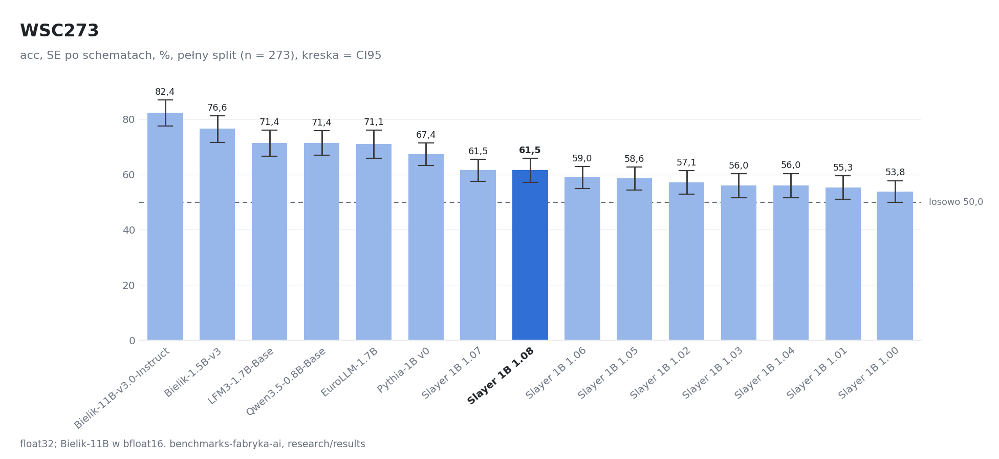

| # | model | wartość | SE | CI95 | dtype | wyniki |
|---:|---|---:|---:|---|---|---|
| 1 | Bielik-11B-v3.0-Instruct | 0,8242 | 0,0244 | 0,7757 – 0,8704 | bfloat16 | [wsc273/bielik-11b-v3-instruct](wsc273/bielik-11b-v3-instruct/results_rozszerzone.json) |
| 2 | Bielik-1.5B-v3 | 0,7656 | 0,0243 | 0,7159 – 0,8118 | float32 | [wsc273/bielik-1.5b-v3](wsc273/bielik-1.5b-v3/results_rozszerzone.json) |
| 3 | LFM3-1.7B-Base | 0,7143 | 0,0242 | 0,6666 – 0,7610 | float32 | [wsc273/lfm3-1.7b-base](wsc273/lfm3-1.7b-base/results_rozszerzone.json) |
| 4 | Qwen3.5-0.8B-Base | 0,7143 | 0,0233 | 0,6691 – 0,7591 | float32 | [wsc273/qwen3.5-0.8b-base](wsc273/qwen3.5-0.8b-base/results_rozszerzone.json) |
| 5 | EuroLLM-1.7B | 0,7106 | 0,0263 | 0,6593 – 0,7609 | float32 | [wsc273/eurollm-1.7b](wsc273/eurollm-1.7b/results_rozszerzone.json) |
| 6 | Pythia-1B v0 | 0,6740 | 0,0211 | 0,6327 – 0,7143 | float32 | [wsc273/pythia-1b-v0](wsc273/pythia-1b-v0/results_rozszerzone.json) |
| 7 | Slayer 1B 1.07 | 0,6154 | 0,0206 | 0,5745 – 0,6556 | float32 | [wsc273/slayer1b-1.07-hf](wsc273/slayer1b-1.07-hf/results_rozszerzone.json) |
| 8 | Slayer 1B 1.08 | 0,6154 | 0,0221 | 0,5720 – 0,6593 | float32 | [wsc273/slayer1b-1.08](wsc273/slayer1b-1.08/results_rozszerzone.json) |
| 9 | Slayer 1B 1.06 | 0,5897 | 0,0201 | 0,5498 – 0,6287 | float32 | [wsc273/slayer1b-1.06](wsc273/slayer1b-1.06/results_rozszerzone.json) |
| 10 | Slayer 1B 1.05 | 0,5861 | 0,0222 | 0,5435 – 0,6277 | float32 | [wsc273/slayer1b-1.05](wsc273/slayer1b-1.05/results_rozszerzone.json) |
| 11 | Slayer 1B 1.02 | 0,5714 | 0,0219 | 0,5290 – 0,6140 | float32 | [wsc273/slayer1b-1.02](wsc273/slayer1b-1.02/results_rozszerzone.json) |
| 12 | Slayer 1B 1.03 | 0,5604 | 0,0218 | 0,5166 – 0,6036 | float32 | [wsc273/slayer1b-1.03](wsc273/slayer1b-1.03/results_rozszerzone.json) |
| 13 | Slayer 1B 1.04 | 0,5604 | 0,0225 | 0,5166 – 0,6037 | float32 | [wsc273/slayer1b-1.04](wsc273/slayer1b-1.04/results_rozszerzone.json) |
| 14 | Slayer 1B 1.01 | 0,5531 | 0,0210 | 0,5110 – 0,5949 | float32 | [wsc273/slayer1b-1.01](wsc273/slayer1b-1.01/results_rozszerzone.json) |
| 15 | Slayer 1B 1.00 | 0,5385 | 0,0204 | 0,5000 – 0,5778 | float32 | [wsc273/slayer1b-1.00](wsc273/slayer1b-1.00/results_rozszerzone.json) |

## Do sprawdzenia i niepoliczone

- **LFM2.5-1.2B-Base**: liczony w env lock (transformers 4.57.6, lm_eval 0.4.9.1); przebieg centralny liczył go w env new (lm_eval 0.4.13) i ma inne wyniki we wszystkich testach z kontekstem, a identyczne w BLiMP i MultiBLiMP-PL (bez kontekstu); w testach z PMI kontekst obniża logprob poprawnej odpowiedzi (HellaSwag, PIQA), więc kontekst jest przetwarzany źle; do powtórki w env new.
- **LFM3-1.7B (Instruct)**: model instruct liczony na surowym tekście, bez chat template; w PIQA kontekst obniża logprob poprawnej odpowiedzi, w ARC prawie nic nie wnosi; brak wyniku odniesienia, więc nie wiadomo, czy to cecha modelu, czy błąd przebiegu.
- **Bielik-11B-v3-Base**: tokenizer: add_prefix_space=true w tokenizer_config wymusza budowę slow tokenizera, a repo nie ma tokenizer.model (transformers 4.57.6).
- **Bielik-11B-v3.0-Instruct**: ewok.py liczy tylko float32.

Różnice wobec `results/central-run` (ten sam model, rewizja i sha256 wag; tam lm_eval 0.4.13, tu 0.4.9.1):

| test | model | tu | central-run |
|---|---|---:|---:|
| ARC-Challenge | LFM2.5-1.2B-Base | 0,2517 | 0,5094 |
| MedMCQA | LFM2.5-1.2B-Base | 0,2611 | 0,4059 |
| PubMedQA | LFM2.5-1.2B-Base | 0,5680 | 0,6380 |
| Social IQa | LFM2.5-1.2B-Base | 0,3398 | 0,4284 |

## Pliki i odtworzenie

| plik | zawartość |
|---|---|
| `<test>/<model>/results.json` | wynik w schemacie Space (obserwacja, protokół, provenance) |
| `<test>/<model>/results_rozszerzone.json` | to samo + metryki dodatkowe, SE, CI95, bazy, wersja lm_eval, dtype |
| `<test>/<model>/scores-history-wiersz.csv` | wiersz w formacie scores-history.csv |
| `manifest.jsonl` | jedna linia na parę model × test: repo, rewizja, env, dtype, komenda, czas, karta, sha256 wag, runnera i każdego pliku |
| `srodowisko.json` | commit fabryki, karta, wersje i `pip freeze` środowisk `lock` i `new` |
| `czasy.jsonl` | start, koniec i czas każdej pary oraz pobierania wag |
| `przeglad.jsonl` | flaga każdego wyniku (`ok`, `do_sprawdzenia`, `niepoliczone`) z uwagami |
| `progresja.json` | porównania parowane wersji Slayera z tabel wyżej |
| `charts/` | wykresy PNG z wartości tego pliku |

Próbki per pytanie (logprob każdej odpowiedzi, prompt, hash dokumentu) i logi par są w paczce `eksport_glowny_pelny.tgz` (sha256 `c91c940b8843a102399f1bc1052d564728781df85071f3701660ea5ccecd4317`), poza repo, bo skompresowane mają kilkaset MB.

Odtworzenie jednej pary (komenda z `manifest.jsonl`, pole `komenda`, albo przez runner):

```bash
python tools/ewaluacja/ewaluacja.py --wyniki wyniki licz slayer1b-1.06 --zadania T02 --pobierz
```

Cały przebieg: te same kolejki co tutaj, jedna na kartę (`CUDA_VISIBLE_DEVICES`), `--zadania gotowe --pobierz --usun-wagi`, potem `ewaluacja.py eksport`. Ten plik i wykresy: `python tools/ewaluacja/raport.py` (opis w nagłówku skryptu).
