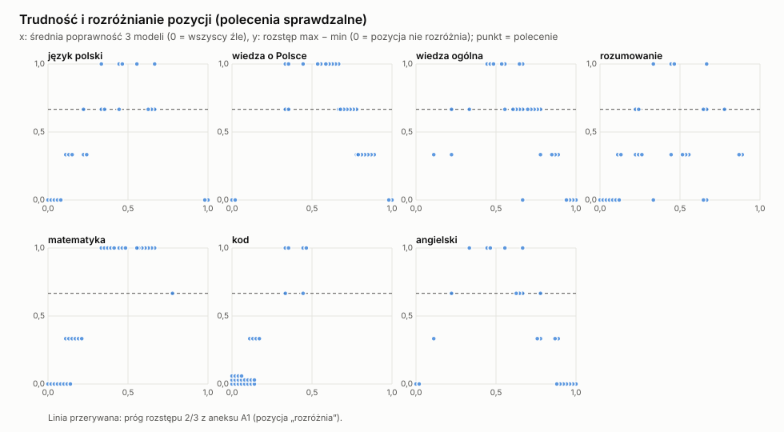
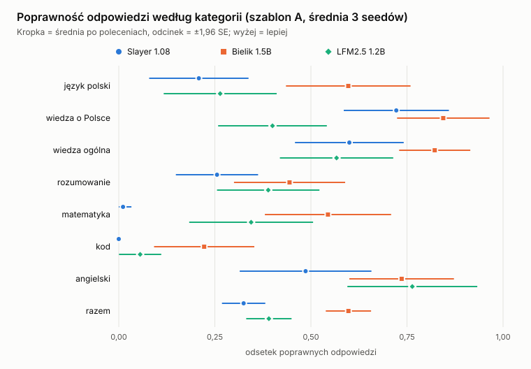
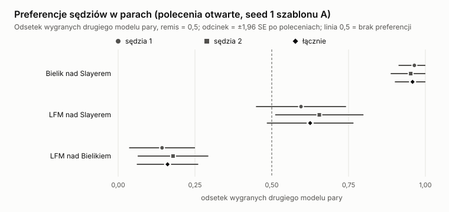

# Slayer 1.08 w rozmowie: swobodna generacja i prawdopodobieństwo odpowiedzi wobec Bielika 1.5B i LFM2.5 1.2B

Plik generuje `code/paper.py` z `wyniki/LICZBY.json` (ten z kolei `code/analiza.py` z surowych wyników); nie edytuj go ręcznie. Protokół: `PROTOKOL.md` (commit `99bfeab`), aneks `PROTOKOL_ANEKS.md` (commit `3ad7739`), oba zapisane przed odczytem metryk. Pomiar 12.11.2026, jeden przebieg, wynik wstępny w rozumieniu METODOLOGII („Siła dowodu”): przed użyciem na zewnątrz potrzebuje przeliczenia `needs-recheck`.

## Streszczenie

Na 240 nowych poleceniach po polsku i angielsku Slayer 1.08 odpowiada poprawnie rzadziej niż Bielik 1.5B (łącznie 0,325 wobec 0,598, różnica −0,273 (SE 0,029, z = −9,53, pewne)), najmocniej w matematyce i języku polskim, i przypisuje wzorcowym odpowiedziom mniejsze prawdopodobieństwo (wyższe BPB) we wszystkich 8 kategoriach. Wobec LFM2.5 wynik łączny jest nierozstrzygnięty (poprawność −0,066 (SE 0,032, z = −2,08, prawdopodobne), ale po klastrach kategorii t = −0,87, df = 6, szum, a w szablonie B różnica −0,217), a stoją różnice w kategoriach: Slayer ma niższe BPB polskiego tekstu i więcej trafień w wiedzy o Polsce, a mniej w matematyce; powtórzeń, przecieków znaczników i braku naturalnego końca odpowiedzi z pilota ten pomiar nie potwierdził.

## 1. Pytania i hipotezy

Pytania z protokołu (sekcja 1): **P1** w których kategoriach Slayer 1.08 (S) różni się od Bielika 1.5B (B) i LFM2.5 1.2B (L) w poprawności swobodnej generacji i w prawdopodobieństwie wzorcowej odpowiedzi; **P2** czy S ma swoiste wady generacji (brak końca, powtórzenia, przecieki znaczników); **P3** co z tego wynika dla danych do dalszego treningu (interpretacja, oznaczona jako taka).

Hipotezy pochodzą z pilota (45 poleceń, jedna próbka, bez protokołu, poza repo); pilot jest tylko źródłem hipotez, jego liczb tu nie używam. Pełne brzmienie i reguła werdyktu: `PROTOKOL.md`, sekcja 1. Skrót:

| id | twierdzenie | metryka | kategorie |
|---|---|---|---|
| H1.1, H1.2 | S kończy odpowiedź naturalnie rzadziej niż B i L | odsetek naturalnych końców | 8 |
| H1.3, H1.4 | po zakończonej odpowiedzi z „\n” S daje EOS niższe prawdopodobieństwo niż B i L | log10 p(EOS) | 6 |
| H2.1, H2.2 | S powtarza się częściej niż B i L | rep3 (powtórzone 3-gramy) | kategorie z poleceniami otwartymi |
| H3.1, H3.2 | S wie mniej niż B: niższa poprawność, wyższe BPB | poprawność, BPB | pl_wiedza, wiedza_ogolna |
| H4.1–H4.4 | S słabszy niż B i L w matematyce i rozumowaniu | poprawność, BPB | matematyka, rozumowanie |
| H5.1, H5.2 | S rzadziej pisze kod przechodzący testy niż B i L | poprawność | kod |
| H6.1 | BPB polszczyzny S nie jest wyższe od B o więcej niż margines (równoważność) | BPB | pl_jezyk, tekst_techniczny |
| H6.2 | BPB polszczyzny S niższe niż L | BPB | pl_jezyk, pl_wiedza, tekst_techniczny |
| H7 | S przecieka znacznikami rozumowania (`<think>` i podobne) | odsetek przecieków | łącznie |
| H8 | L pisze matematykę w formacie GSM8K częściej niż S i B | odsetek formatu | matematyka |
| H9.1, H9.2 | sędziowie wolą B od S i L od S | odsetek wygranych | 42 polecenia otwarte |
| H10 | angielski: BPB S wyższe niż L | BPB | angielski |

Reguła werdyktu (protokół, sekcja 1): różnica parowana po poleceniach, SE = sd/√n po poleceniach, z = różnica/SE; |z| od 3 „pewne”, od 2 do 3 „prawdopodobne”, poniżej 2 „szum”. Poprawka Holma w rodzinie hipoteza × para × metryka po kategoriach, m = wszystkie kategorie z metryką, także te z SE = 0 (poprawione w rundzie poprawek 1: pierwsza wersja liczyła m bez nich). Teza jest potwierdzona, gdy znak się zgadza i po Holmie jest co najmniej „prawdopodobna”, obalona przy znaku przeciwnym i tej samej sile, w pozostałych przypadkach nierozstrzygnięta. Wynik pod progiem nie znaczy „brak różnicy”.

## 2. Metoda

**Zestaw.** 240 poleceń, 8 kategorii po 30, napisanych od zera przez model Claude według `dane/SPEC.md`; tylko do oceny, nie do treningu. Typy: krótka odpowiedź, korekta zdania, liczba, funkcja Pythona z ukrytymi testami (198 poleceń sprawdzalnych automatycznie) i 42 polecenia otwarte (pisanie, tekst techniczny), oceniane przez sędziów. Skład: `PROTOKOL.md`, sekcja 2; wszystkie polecenia z odpowiedziami: [`ROZMOWY.md`](ROZMOWY.md).

**Modele.** Wszystkie w float32 na Mac M5 Pro (MPS), torch 2.15.0, transformers 5.2.2:

| model | repozytorium HF | rewizja | uwaga |
|---|---|---|---|
| Slayer 1.08 (S) | SlayerLab/Slayer1B-1.08 | `ea0945b1` | checkpoint w toku treningu serii; forward `common/slayer_model.py` |
| Bielik 1.5B (B) | speakleash/Bielik-1.5B-v3 | `4b250496` | po pełnym treningu |
| LFM2.5 1.2B (L) | LiquidAI/LFM2.5-1.2B-Base | `7453bca9` | po pełnym treningu |

Wagi leżą poza repo, ich sha256 jest w nagłówku każdego surowego pliku (`wyniki/surowe/*.jsonl.gz`).

**Prompt i dekodowanie.** Few-shot z 3 przykładami tej samej kategorii. Szablon A (główny) „Polecenie: / Odpowiedź:” (angielski „Task: / Answer:”), szablon B (kontrola) „### Zadanie / ### Rozwiązanie”. W szablonie A trzy próbki (temperatura 0,7, top-p 0,9, seedy 1–3) i greedy, w szablonie B greedy. <!-- liczba-spoza-wynikow: stała protokołu -->
Odpowiedź kończy się na tokenie końca dokumentu (EOS), na znaczniku następnego polecenia albo na limicie tokenów.

**Metryki** (`code/ocena.py`, protokół sekcja 4): (a) poprawność automatyczna, wartość polecenia = średnia 3 próbek; (b) BPB wzorca = −Σ log p(tokenów wzorca | prompt) / (ln 2 · bajty UTF-8), na bajt, bo tokenizery są różne; (c) naturalny koniec przed limitem tokenów i (c2) sonda EOS: log10 p(EOS) po tekście „Pytanie: … Odpowiedź: <wzorzec>\n” bez przykładów; (d) rep3 = udział 3-gramów słów powtórzonych w tej samej odpowiedzi; (e) ślepa ocena parami przez dwóch sędziów (osobne agenty Claude), A / B / remis. Metryka (c) liczy jako naturalny koniec także pustą odpowiedź zakończoną EOS; wariant bez pustych podaję w sekcji 5. „Pusta odpowiedź” w całym tekście znaczy: brak treści po obcięciu białych znaków (metryka opisowa, eksploracyjna).

**Statystyka.** Różnice parowane po poleceniach (te same polecenia dla wszystkich modeli), SE po poleceniach (próbki jednego polecenia uśrednione przed różnicą), z, werdykt i Holm jak w sekcji 1. Bootstrap po poleceniach jako kontrola wrażliwości (10 000 losowań, seed 20261112). <!-- liczba-spoza-wynikow: stała protokołu -->
Protokół wiąże werdykt z z. Wrażliwość (eksploracyjna, po pomiarze): z rozkładem t o df = n − 1 zamiast z słabnie surowy werdykt w 3 z 54 wierszy tabeli hipotez, werdykt po Holmie zmienia się w 1, a stan tezy w 0.

**Moc (MDE).** Najmniejsza różnica wykrywalna z mocą 80% pod Holmem przy 8 kategoriach to (z_Holm + z_moc) · SE, z_Holm = 2,765, z_moc = 0,842, SE z danych. Różnica mniejsza od MDE w danej kategorii mogła istnieć i nie zostać wykryta:

| kategoria | MDE poprawności S−B | S−L | B−L | MDE BPB S−B | S−L | B−L |
|---|---|---|---|---|---|---|
| język polski | 0,268 | 0,258 | 0,251 | 0,230 | 0,373 | 0,442 |
| wiedza o Polsce | 0,273 | 0,302 | 0,323 | 0,081 | 0,421 | 0,447 |
| wiedza ogólna | 0,266 | 0,348 | 0,309 | 0,170 | 0,275 | 0,222 |
| rozumowanie | 0,221 | 0,242 | 0,265 | 0,114 | 0,193 | 0,186 |
| matematyka | 0,297 | 0,288 | 0,297 | 0,091 | 0,086 | 0,075 |
| kod (Python) | 0,240 | 0,101 | 0,198 | 0,063 | 0,056 | 0,071 |
| angielski | 0,253 | 0,295 | 0,298 | 0,406 | 0,380 | 0,246 |
| tekst techniczny | — | — | — | 0,030 | 0,042 | 0,035 |

Poprawność w jednej kategorii (n = 24 albo 30) wykrywa tylko różnice rzędu kilkunastu do kilkudziesięciu punktów procentowych; BPB jest dokładniejsze o rząd wielkości. Dlatego w wiedzy i rozumowaniu BPB jest główną metryką, a „szum” w poprawności nie przeczy wynikowi BPB.

## 3. Kontrola narzędzia i skażenia

**Narzędzie.** Tym samym kodem log p, który liczy BPB, policzyłam dla Slayera 1.08 `ARC-Challenge` (n = 1172) i `OpenBookQA` (n = 500) z promptami karty modelu. Wynik: acc 0,271331 i acc_norm 0,300341 wobec 0,271331 i 0,300341 w `EVALUATION.json`; `OpenBookQA` acc 0,230 i acc_norm 0,348, identycznie jak referencja. Warunek odtworzenia (różnica do 0,02) spełniony dla wszystkich czterech wartości. <!-- liczba-spoza-wynikow: próg etapu B -->
Dla Bielika i LFM opublikowanych liczb w tym ustawieniu nie ma; ich ścieżkę sprawdza test spójności log p z pełnym forwardem i próba dymna (greedy w batchu 4 wobec batchu 1: 0 różnic na 10 pozycjach każdego modelu). To test spójności, nie odtworzenie cudzej liczby.
Po pomiarze (runda poprawek 1, eksploracyjnie) powtórzyłam porównanie greedy batch 4 wobec batch 1 dla Bielik 1.5B na 32 pozycjach z pełnym limitem tokenów (`code/batch_vs_1.py`): 0 różnych odpowiedzi.

**Testy kodu pomiaru** (`code/test_rozmowy.py`, bez wag): scorer log p na atrapie, BOS z tokenizera dla ścieżki Slayera i ścieżki transformers, zbiory EOS z protokołu z nazwami tokenów, seed wiersza z numerem pozycji, odcięcie top-p, tolerancja oceny liczby, Holm z m = wszystkie kategorie. Testy BOS, EOS, seeda, top-p, tolerancji i Holma dopisałam w rundzie poprawek 1, bo pierwsza wersja testów przechodziła na zielono przy mutacjach tych miejsc; każdą mutację sprawdziłam (wynik w podsumowaniu rundy, sekcja 10).

**Skażenie.** Wspólne 13-gramy słów (polecenie + wzorzec + testy) z `GSM8K`, `ARC`, `OpenBookQA`, `HumanEval`, `MBPP`: 0 trafień na 240 poleceń. Przy 8-gramach 4 trafienia w dwóch pozycjach (`kod-15`, `kod-28`), wyłącznie ciągi liczb i liter z danych testów, nie treść. Skan nie łapie tłumaczeń ani parafraz, a krótkie polecenia (rozumowanie) mają mniej niż 13 słów, więc wynik 0 nie wyklucza skażenia treścią.

## 4. Jakość pytań

**A1. Trudność i rozróżnianie** (aneks A1). Polecenie rozróżnia modele, gdy rozstęp średnich poprawności trzech modeli wynosi co najmniej 2/3. Polecenia, na których wszyscy zawsze mylą się albo zawsze trafiają, nic nie mówią o różnicach:

| kategoria | n | rozróżnia | nie rozróżnia | zawsze dobrze | zawsze źle |
|---|---|---|---|---|---|
| język polski | 24 | 12 | 5 | 2 | 5 |
| wiedza o Polsce | 30 | 19 | 7 | 2 | 2 |
| wiedza ogólna | 30 | 19 | 7 | 4 | 0 |
| rozumowanie | 30 | 9 | 14 | 0 | 7 |
| matematyka | 30 | 16 | 6 | 0 | 8 |
| kod (Python) | 30 | 6 | 4 | 0 | 20 |
| angielski | 24 | 10 | 5 | 7 | 2 |

Kod jest najsłabiej zbudowaną kategorią: 20 z 30 poleceń żaden model nie rozwiązał ani razu, więc kategoria mierzy głównie, czy model pisze jakikolwiek działający kod. W rozumowaniu 14 z 30 poleceń nie rozróżnia modeli. Mapa wszystkich pozycji:



**A2. Rzetelność.** SNR = wariancja między modelami / wariancja między seedami (dla BPB: między szablonami A i B). Zgodność seedów = średnia korelacja Pearsona wyników 0/1 między parami seedów:

| kategoria | SNR poprawności | SNR BPB (wobec szablonu) | zgodność seedów S | B | L |
|---|---|---|---|---|---|
| język polski | 10,0 | 5,2 | 0,42 | 0,49 | 0,52 |
| wiedza o Polsce | 18,6 | 4,3 | 0,58 | 0,74 | 0,45 |
| wiedza ogólna | 4,2 | 0,3 | 0,46 | 0,18 | 0,51 |
| rozumowanie | 1,5 | 4,3 | 0,17 | 0,48 | 0,35 |
| matematyka | 32,7 | 342,9 | nieokreślona | 0,75 | 0,81 |
| kod (Python) | 6,4 | 109745,6 | nieokreślona | 0,62 | 0,47 |
| angielski | 13,5 | 1,3 | 0,57 | 0,36 | 0,93 |
| tekst techniczny | — | 9232,8 | — | — | — |

W wiedzy ogólnej SNR BPB wynosi 0,3: zmiana szablonu przesuwa średnie BPB bardziej, niż różnią się modele, więc różnice BPB w tej kategorii zależą od szablonu (werdykty niżej podaję razem ze znakiem w szablonie B). W rozumowaniu SNR poprawności wynosi 1,5, czyli różnice modeli ledwo wychodzą ponad zmienność seedów.

**A3. Trafność zewnętrzna** (opisowa, 3 modele). Ranking naszej metryki wobec testów przebiegu centralnego `results/full-run-2026-11/` (tau Kendalla przy 3 modelach przyjmuje tylko 4 wartości):

| kategoria | test centralny | S | B | L | tau Kendalla | zgodne znaki par (z 3) |
|---|---|---|---|---|---|---|
| język polski | `multiblimp-pl` | 98,7 | 94,5 | 82,9 | −0,333 | 1 |
| wiedza o Polsce | NOT RUN (brak testu dla trzech modeli) | — | — | — | — | — |
| wiedza ogólna | `arc-easy` | 0,584 | 0,546 | 0,429 | 0,333 | 2 |
| wiedza ogólna | `arc-challenge` | 0,300 | 0,361 | 0,252 | 1,000 | 3 |
| rozumowanie | `winogrande` | 0,537 | 0,624 | 0,511 | 0,333 | 2 |
| rozumowanie | `wsc273` | 0,615 | 0,766 | 0,502 | 0,333 | 2 |
| matematyka | `mathqa` | 0,228 | 0,324 | 0,243 | 1,000 | 3 |
| kod (Python) | NOT RUN (brak testu dla trzech modeli) | — | — | — | — | — |
| angielski | `blimp` | 0,805 | 0,819 | 0,786 | −0,333 | 1 |
| angielski | `lambada` | 0,401 | 0,611 | 0,130 | −0,333 | 1 |
| tekst techniczny | NOT RUN (brak testu dla trzech modeli) | — | — | — | — | — |

Zgodność jest słaba poza matematyką i `arc-challenge`. W języku polskim kierunek jest odwrotny: w teście par minimalnych Slayer ma najwyższy wynik, a w naszej generacji najniższy. Test par minimalnych mierzy, który z dwóch gotowych zdań model uważa za bardziej prawdopodobny, a nasze polecenia każą samemu wyprodukować formę; to różne umiejętności, więc rozbieżność nie unieważnia żadnego z wyników, ale zakazuje przenosić wniosek z jednego na drugi.

**A4. Kontrola wzorców.** Osobny agent bez dostępu do wyników sprawdził 20 losowych pozycji (10% sprawdzalnych): 20 wzorców poprawnych, 0 błędnych, 0 niejednoznacznych; górna granica 95% odsetka błędnych wzorców w całym zestawie (Clopper-Pearson) to 0,168. Wskazał 6 reguł oceny, które mogą odrzucić poprawną albo przyjąć błędną odpowiedź: `pl_jezyk-13`, `pl_wiedza-27`, `wiedza_ogolna-08`, `wiedza_ogolna-20`, `wiedza_ogolna-04`, `kod-26`.

**Wrażliwość na te reguły (eksploracyjna).** Ocena wszystkich odpowiedzi trzech modeli z poprawionymi 6 regułami zmienia 0 ocen, więc wynik główny (reguły protokołu bez zmian) i wynik wrażliwości są identyczne; żaden werdykt nie zależy od tych reguł.

**Audyt oceny automatycznej.** Próbę 63 ocen automatycznych (3 na komórkę model × kategoria sprawdzalna, losowanie `random.Random(20261113)`, plik `dane/audyt_proba.jsonl`) oceniłam ręcznie z powodem każdej oceny (`dane/audyt_oceny.jsonl`). Zgodność z oceną automatyczną 1,000: 0 fałszywych trafień, 0 fałszywych odrzuceń. Górna granica 95% odsetka błędów oceny (Clopper-Pearson) to 0,057, poniżej progu 10% ze zlecenia, więc żaden werdykt kategorii nie jest oznaczony jako zależny od błędu oceny. Audyt nie był ślepy: znałam ocenę automatyczną i sama pisałam reguły (ograniczenia, sekcja 9). <!-- liczba-spoza-wynikow: próg 10% ze zlecenia -->

## 5. Wyniki per kategoria

Średnia po poleceniach, w nawiasie SE. Poprawność: odsetek poprawnych (średnia 3 próbek szablonu A), wyżej lepiej. BPB: bity na bajt wzorca w szablonie A, niżej lepiej.

| kategoria | poprawność S | B | L | BPB S | B | L |
|---|---|---|---|---|---|---|
| język polski | 0,208 (0,066) | 0,597 (0,083) | 0,264 (0,075) | 0,496 (0,087) | 0,298 (0,068) | 0,844 (0,171) |
| wiedza o Polsce | 0,722 (0,070) | 0,844 (0,061) | 0,400 (0,072) | 0,195 (0,038) | 0,102 (0,029) | 0,651 (0,126) |
| wiedza ogólna | 0,600 (0,072) | 0,822 (0,047) | 0,567 (0,075) | 0,361 (0,061) | 0,146 (0,041) | 0,369 (0,064) |
| rozumowanie | 0,256 (0,055) | 0,444 (0,074) | 0,389 (0,068) | 0,533 (0,087) | 0,419 (0,082) | 0,592 (0,108) |
| matematyka | 0,011 (0,011) | 0,544 (0,084) | 0,344 (0,082) | 0,733 (0,037) | 0,333 (0,030) | 0,493 (0,038) |
| kod (Python) | 0,000 (0,000) | 0,222 (0,067) | 0,056 (0,028) | 0,292 (0,026) | 0,099 (0,011) | 0,175 (0,028) |
| angielski | 0,486 (0,087) | 0,736 (0,069) | 0,764 (0,086) | 0,797 (0,171) | 0,398 (0,080) | 0,390 (0,098) |
| tekst techniczny | — | — | — | 0,703 (0,019) | 0,586 (0,016) | 0,858 (0,021) |
| razem | 0,325 (0,029) | 0,598 (0,030) | 0,391 (0,030) | 0,514 (0,031) | 0,298 (0,021) | 0,547 (0,036) |




**Tokenizery.** BPB jest liczone na bajt, ale modele dzielą tekst inaczej; obok NLL na token i bajty na token (łącznie, szablon A):

| model | NLL na token | bajty na token |
|---|---|---|
| Slayer 1.08 | 1,370 (0,084) | 3,997 (0,103) |
| Bielik 1.5B | 0,780 (0,061) | 3,750 (0,127) |
| LFM2.5 1.2B | 1,069 (0,069) | 3,148 (0,083) |


**Koniec odpowiedzi, powtórzenia, puste odpowiedzi.**

| kategoria | naturalny koniec S | B | L | rep3 S | B | L | pusta odpowiedź S | B | L |
|---|---|---|---|---|---|---|---|---|---|
| język polski | 0,944 (0,023) | 1,000 (0,000) | 0,956 (0,021) | 0,058 (0,055) | 0,007 (0,006) | 0,000 (0,000) | 0,000 (0,000) | 0,000 (0,000) | 0,011 (0,011) |
| wiedza o Polsce | 1,000 (0,000) | 1,000 (0,000) | 1,000 (0,000) | — | — | — | 0,000 (0,000) | 0,000 (0,000) | 0,000 (0,000) |
| wiedza ogólna | 1,000 (0,000) | 1,000 (0,000) | 0,989 (0,011) | — | — | — | 0,000 (0,000) | 0,000 (0,000) | 0,000 (0,000) |
| rozumowanie | 1,000 (0,000) | 1,000 (0,000) | 0,989 (0,011) | — | — | — | 0,000 (0,000) | 0,000 (0,000) | 0,000 (0,000) |
| matematyka | 0,989 (0,011) | 1,000 (0,000) | 1,000 (0,000) | — | — | — | 0,000 (0,000) | 0,000 (0,000) | 0,000 (0,000) |
| kod (Python) | 0,989 (0,011) | 0,778 (0,065) | 0,967 (0,025) | — | — | — | 0,000 (0,000) | 0,000 (0,000) | 0,478 (0,050) |
| angielski | 1,000 (0,000) | 1,000 (0,000) | 1,000 (0,000) | 0,040 (0,025) | 0,005 (0,002) | 0,005 (0,003) | 0,000 (0,000) | 0,089 (0,032) | 0,000 (0,000) |
| tekst techniczny | 0,989 (0,011) | 0,967 (0,025) | 0,889 (0,033) | 0,047 (0,010) | 0,037 (0,011) | 0,083 (0,014) | 0,000 (0,000) | 0,011 (0,011) | 0,000 (0,000) |
| razem | 0,989 (0,004) | 0,968 (0,010) | 0,974 (0,006) | 0,048 (0,011) | 0,028 (0,008) | 0,060 (0,011) | 0,000 (0,000) | 0,013 (0,005) | 0,061 (0,012) |


Prawie wszystkie odpowiedzi kończą się przed limitem tokenów, bo szablon daje modelom znacznik następnego polecenia, który zatrzymuje generację. Wyjątek to kod Bielika (naturalny koniec 0,778): długie funkcje dochodzą do limitu. Odsetek pustych odpowiedzi LFM w kodzie to 0,478: pierwszym tokenem jest `<|im_end|>` (id 7), który protokół liczy jako EOS LFM. Sonda eksploracyjna (`code/sonda_eos_kod.py`, 30 poleceń) daje medianę p tego tokenu na starcie odpowiedzi 0,36. Wynik LFM w kodzie zależy więc od definicji EOS; zostaje według protokołu.

**Wrażliwość metryki (c) na puste odpowiedzi** (eksploracyjna, po pomiarze). Ta sama reguła werdyktu i Holm (m = 8), ale pusta odpowiedź nie liczy się jako naturalny koniec. Naturalny koniec LFM w kodzie spada z 0,967 do 0,489:

| teza | para | kategoria | różnica | SE | z | werdykt | p Holma | werdykt po Holmie | stan tezy |
|---|---|---|---|---|---|---|---|---|---|
| H1.1 | S−B | język polski | −0,056 | 0,023 | −2,41 | prawdopodobne | 0,0962 | szum | nierozstrzygnięta |
| H1.1 | S−B | matematyka | −0,011 | 0,011 | −1,00 | szum | 1,0000 | szum | nierozstrzygnięta |
| H1.1 | S−B | kod (Python) | 0,211 | 0,061 | 3,47 | pewne | 0,0041 | prawdopodobne | obalona |
| H1.1 | S−B | angielski | 0,089 | 0,032 | 2,80 | prawdopodobne | 0,0353 | prawdopodobne | obalona |
| H1.1 | S−B | tekst techniczny | 0,033 | 0,019 | 1,80 | szum | 0,3632 | szum | nierozstrzygnięta |
| H1.2 | S−L | język polski | 0,000 | 0,036 | 0,00 | szum | 1,0000 | szum | nierozstrzygnięta |
| H1.2 | S−L | wiedza ogólna | 0,011 | 0,011 | 1,00 | szum | 1,0000 | szum | nierozstrzygnięta |
| H1.2 | S−L | rozumowanie | 0,011 | 0,011 | 1,00 | szum | 1,0000 | szum | nierozstrzygnięta |
| H1.2 | S−L | matematyka | −0,011 | 0,011 | −1,00 | szum | 1,0000 | szum | nierozstrzygnięta |
| H1.2 | S−L | kod (Python) | 0,500 | 0,050 | 10,02 | pewne | 0,0000 | pewne | obalona |
| H1.2 | S−L | tekst techniczny | 0,100 | 0,033 | 3,07 | pewne | 0,0149 | prawdopodobne | obalona |

Kategorie z SE = 0 (te same końce u obu modeli) pominęłam w tabeli, ale liczą się do m Holma. Przy tej definicji teza H1.2 jest obalona także w kodzie: S kończy odpowiedź z treścią częściej niż L. Wniosek dla H1 się nie odwraca: S nie kończy rzadziej niż B ani L w żadnej kategorii. Wiersz H1.1 w angielskim (obalona) to artefakt szablonu: 7 z 8 pustych odpowiedzi B w angielskim to „\n\nTask:”, czyli zatrzymanie na znaczniku szablonu.

**Sonda EOS a znak nowej linii** (eksploracyjna, po pomiarze). W 144 poleceniach krótkich polskich kategorii dopisanie „\n” po wzorcu zmienia log10 p(EOS) średnio o −1,99 (SE 0,08) u S, −0,45 (SE 0,06) u B i −1,54 (SE 0,05) u L.

**Rozbicie p(EOS) na tokeny** (runda poprawek 2, `code/sonda_tokeny.py`, ten sam tekst sondy, p każdego tokenu zbioru EOS osobno, `wyniki/surowe/sonda_tokeny_*.jsonl.gz`). Udział `<|im_end|>` w p(EOS) bez „\n”: Bielik w angielskim mediana 0,993, średnia 0,976; w polskich kategoriach mediana 0,113; LFM w polskich kategoriach mediana 0,481, w angielskim 0,478. Sonda bez „\n” liczona tylko tokenem końca dokumentu (S `<|endoftext|>` id 0, B `</s>`, L `<|endoftext|>`), Holm m = 6:

| kategoria | para | różnica log10 p | SE | z | werdykt | p Holma | werdykt po Holmie |
|---|---|---|---|---|---|---|---|
| język polski | S−B | −0,76 | 0,07 | −10,51 | pewne | 0,0000 | pewne |
| język polski | S−L | −0,66 | 0,08 | −8,53 | pewne | 0,0000 | pewne |
| wiedza o Polsce | S−B | −0,08 | 0,07 | −1,21 | szum | 0,2251 | szum |
| wiedza o Polsce | S−L | −0,49 | 0,06 | −7,99 | pewne | 0,0000 | pewne |
| wiedza ogólna | S−B | −0,44 | 0,11 | −3,92 | pewne | 0,0004 | pewne |
| wiedza ogólna | S−L | −0,80 | 0,10 | −7,99 | pewne | 0,0000 | pewne |
| rozumowanie | S−B | −1,05 | 0,17 | −6,33 | pewne | 0,0000 | pewne |
| rozumowanie | S−L | −0,99 | 0,12 | −8,15 | pewne | 0,0000 | pewne |
| matematyka | S−B | −0,51 | 0,16 | −3,14 | pewne | 0,0051 | prawdopodobne |
| matematyka | S−L | −0,86 | 0,15 | −5,93 | pewne | 0,0000 | pewne |
| angielski | S−B | 0,27 | 0,17 | 1,62 | szum | 0,2123 | szum |
| angielski | S−L | 0,33 | 0,30 | 1,10 | szum | 0,2700 | szum |

Nowa linia i token czatu `<|im_end|>` wyjaśniają dużą część różnic H1.3–H1.4, ale nie całą. Bez „\n” i tylko z tokenem końca dokumentu S nadal daje niższe p końca dokumentu niż B w języku polskim, wiedzy ogólnej, rozumowaniu i matematyce oraz niż L we wszystkich pięciu kategoriach polskich (tabela). W wiedzy o Polsce wobec B i w angielskim wobec obu modeli różnica to szum. W generacji ze znacznikiem szablonu S kończy odpowiedzi równie często jak B i L (wyżej), więc słabsza teza dotyczy prawdopodobieństwa końca dokumentu, nie obserwowanej wady generacji.

**Język polski a ostatni przykład few-shot** (eksploracyjna, po pomiarze). Ostatni przykład w tej kategorii to polecenie otwarte (list), a część próbek zaczyna się od nowej linii (część z nich kopiuje formę listu, wskazanie obalającego). Próbek zaczynających się od „\n” na 90 sprawdzalnych: S 21, B 3, L 0. Bez wszystkich tych próbek (średnia z pozostałych seedów, liczba poleceń z próbkami obu modeli: 23) różnica poprawności S−B wynosi −0,399 (SE 0,082, z = −4,88, pewne), więc wynik języka polskiego nie wynika z tego artefaktu.

**S−L łącznie** (eksploracyjna, po pomiarze). Różnica poprawności łącznie −0,066 (SE 0,032, z = −2,08, prawdopodobne) nie wytrzymuje sprawdzeń: po klastrach 7 kategorii t = −0,87, df = 6, szum; znak ujemny w 5 z 7 kategorii; usunięcie jednego polecenia daje najmniejsze |z| 1,94; greedy w szablonie B daje −0,217 (z = −5,14, pewne). Wynik łączny S−L jest nierozstrzygnięty i zależy od szablonu. Po usunięciu 3 poleceń najmocniej ciągnących średnią: wiedza o Polsce 0,247 (z = 3,06, pewne), matematyka −0,259 (z = −3,40, pewne), angielski −0,175 (z = −2,59, prawdopodobne).

**Mapa różnic par (eksploracyjna poza wierszami z tabeli hipotez).** Poprawność, różnica X−Y, Holm w rodzinie para × metryka po kategoriach:

| kategoria | para | różnica | SE | z | werdykt | p Holma | werdykt po Holmie |
|---|---|---|---|---|---|---|---|
| język polski | S−B | −0,389 | 0,074 | −5,24 | pewne | 0,0000 | pewne |
| język polski | S−L | −0,056 | 0,071 | −0,78 | szum | 0,8732 | szum |
| język polski | B−L | 0,333 | 0,070 | 4,80 | pewne | 0,0000 | pewne |
| wiedza o Polsce | S−B | −0,122 | 0,076 | −1,61 | szum | 0,1068 | szum |
| wiedza o Polsce | S−L | 0,322 | 0,084 | 3,85 | pewne | 0,0007 | pewne |
| wiedza o Polsce | B−L | 0,444 | 0,089 | 4,97 | pewne | 0,0000 | pewne |
| wiedza ogólna | S−B | −0,222 | 0,074 | −3,01 | pewne | 0,0061 | prawdopodobne |
| wiedza ogólna | S−L | 0,033 | 0,096 | 0,35 | szum | 0,8732 | szum |
| wiedza ogólna | B−L | 0,256 | 0,086 | 2,99 | prawdopodobne | 0,0117 | prawdopodobne |
| rozumowanie | S−B | −0,189 | 0,061 | −3,08 | pewne | 0,0061 | prawdopodobne |
| rozumowanie | S−L | −0,133 | 0,067 | −1,99 | szum | 0,1870 | szum |
| rozumowanie | B−L | 0,056 | 0,073 | 0,76 | szum | 0,8980 | szum |
| matematyka | S−B | −0,533 | 0,082 | −6,47 | pewne | 0,0000 | pewne |
| matematyka | S−L | −0,333 | 0,080 | −4,17 | pewne | 0,0002 | pewne |
| matematyka | B−L | 0,200 | 0,082 | 2,43 | prawdopodobne | 0,0458 | szum |
| kod (Python) | S−B | −0,222 | 0,067 | −3,34 | pewne | 0,0034 | prawdopodobne |
| kod (Python) | S−L | −0,056 | 0,028 | −1,98 | szum | 0,1870 | szum |
| kod (Python) | B−L | 0,167 | 0,055 | 3,04 | pewne | 0,0117 | prawdopodobne |
| angielski | S−B | −0,250 | 0,070 | −3,56 | pewne | 0,0019 | pewne |
| angielski | S−L | −0,278 | 0,082 | −3,39 | pewne | 0,0035 | prawdopodobne |
| angielski | B−L | −0,028 | 0,083 | −0,34 | szum | 0,8980 | szum |

BPB, różnica X−Y (ujemna = X przypisuje wzorcowi wyższe prawdopodobieństwo):

| kategoria | para | różnica | SE | z | werdykt | p Holma | werdykt po Holmie |
|---|---|---|---|---|---|---|---|
| język polski | S−B | 0,197 | 0,064 | 3,09 | pewne | 0,0020 | pewne |
| język polski | S−L | −0,349 | 0,103 | −3,38 | pewne | 0,0022 | pewne |
| język polski | B−L | −0,546 | 0,122 | −4,46 | pewne | 0,0000 | pewne |
| wiedza o Polsce | S−B | 0,093 | 0,022 | 4,14 | pewne | 0,0001 | pewne |
| wiedza o Polsce | S−L | −0,455 | 0,117 | −3,90 | pewne | 0,0005 | pewne |
| wiedza o Polsce | B−L | −0,548 | 0,124 | −4,43 | pewne | 0,0000 | pewne |
| wiedza ogólna | S−B | 0,215 | 0,047 | 4,56 | pewne | 0,0000 | pewne |
| wiedza ogólna | S−L | −0,009 | 0,076 | −0,11 | szum | 0,9108 | szum |
| wiedza ogólna | B−L | −0,224 | 0,062 | −3,63 | pewne | 0,0008 | pewne |
| rozumowanie | S−B | 0,114 | 0,032 | 3,62 | pewne | 0,0009 | pewne |
| rozumowanie | S−L | −0,058 | 0,053 | −1,09 | szum | 0,5486 | szum |
| rozumowanie | B−L | −0,173 | 0,052 | −3,35 | pewne | 0,0016 | pewne |
| matematyka | S−B | 0,400 | 0,025 | 15,80 | pewne | 0,0000 | pewne |
| matematyka | S−L | 0,241 | 0,024 | 10,06 | pewne | 0,0000 | pewne |
| matematyka | B−L | −0,159 | 0,021 | −7,66 | pewne | 0,0000 | pewne |
| kod (Python) | S−B | 0,192 | 0,018 | 10,95 | pewne | 0,0000 | pewne |
| kod (Python) | S−L | 0,116 | 0,015 | 7,55 | pewne | 0,0000 | pewne |
| kod (Python) | B−L | −0,076 | 0,020 | −3,89 | pewne | 0,0004 | pewne |
| angielski | S−B | 0,399 | 0,113 | 3,55 | pewne | 0,0009 | pewne |
| angielski | S−L | 0,407 | 0,105 | 3,86 | pewne | 0,0005 | pewne |
| angielski | B−L | 0,007 | 0,068 | 0,11 | szum | 0,9130 | szum |
| tekst techniczny | S−B | 0,117 | 0,008 | 14,04 | pewne | 0,0000 | pewne |
| tekst techniczny | S−L | −0,155 | 0,012 | −13,32 | pewne | 0,0000 | pewne |
| tekst techniczny | B−L | −0,272 | 0,010 | −28,17 | pewne | 0,0000 | pewne |

**Ocena sędziów** (42 polecenia otwarte × 3 pary = 126 par, odpowiedź seed 1 szablonu A, strony i kolejność losowane, klucz poza paczką).

**Pochodzenie ocen.** Pliki ocen leżą w `wyniki/sedziowie/` (sha256 w `wyniki/SHA256SUMS` i w `LICZBY.json`, pole `wejscia`). Sędzia 2 zapisał swoje werdykty skryptem `zapisz_oceny.py`, który sam napisał (zgłosił to w raporcie). Atestacja orkiestratora: sha256 obu plików ocen (`6cad0ed9…` i `4ef3cb7a…`) zgadzają się z tymi, które sędziowie podali w swoich raportach (sprawdzone `shasum` 12.11.2026). Niezależnego odtworzenia ocen nie było.

Zgodność dwóch sędziów: kappa Cohena 0,859, zgodność surowa 0,929 (po przełożeniu stron na tożsamość modeli). Sędzia 2 dostał pary w odwrotnej kolejności. Skłonność do strony A (odsetek wyborów A wśród werdyktów bez remisu):

| sędzia | A | B | remis | odsetek A | SE | z | werdykt |
|---|---|---|---|---|---|---|---|
| sędzia 1 | 56 | 67 | 3 | 0,455 | 0,045 | −0,99 | szum |
| sędzia 2 | 58 | 66 | 2 | 0,468 | 0,045 | −0,72 | szum |

Żaden sędzia nie wybiera strony A wyraźnie częściej niż B. Ponownej oceny z zamienionymi stronami nie było (NOT RUN), więc jedynym sprawdzeniem kolejności jest odwrócona kolejność par u sędziego 2.

W 2 parach jedna z odpowiedzi była pusta po obcięciu białych znaków; instrukcja nie mówiła, jak je oceniać (ograniczenia, sekcja 9).

Odsetek wygranych drugiego modelu pary (remis = 0,5), osobno dla każdego sędziego i łącznie; z wobec 0,5 (brak preferencji). Zamiast modelu Bradleya-Terry'ego podaję odsetek wygranych z SE po poleceniach (protokół, metryka (e)):

| para | zakres | sędzia | n | odsetek wygranych | SE | z | werdykt |
|---|---|---|---|---|---|---|---|
| B nad S | razem | sędzia 1 | 42 | 0,964 | 0,026 | 17,61 | pewne |
| B nad S | razem | sędzia 2 | 42 | 0,952 | 0,033 | 13,60 | pewne |
| B nad S | razem | łącznie | 42 | 0,958 | 0,029 | 15,58 | pewne |
| B nad S | język polski | sędzia 1 | 6 | 1,000 | 0,000 | — | nierozstrzygalne |
| B nad S | język polski | sędzia 2 | 6 | 1,000 | 0,000 | — | nierozstrzygalne |
| B nad S | język polski | łącznie | 6 | 1,000 | 0,000 | — | nierozstrzygalne |
| B nad S | angielski | sędzia 1 | 6 | 1,000 | 0,000 | — | nierozstrzygalne |
| B nad S | angielski | sędzia 2 | 6 | 1,000 | 0,000 | — | nierozstrzygalne |
| B nad S | angielski | łącznie | 6 | 1,000 | 0,000 | — | nierozstrzygalne |
| B nad S | tekst techniczny | sędzia 1 | 30 | 0,950 | 0,037 | 12,24 | pewne |
| B nad S | tekst techniczny | sędzia 2 | 30 | 0,933 | 0,046 | 9,36 | pewne |
| B nad S | tekst techniczny | łącznie | 30 | 0,942 | 0,041 | 10,78 | pewne |
| L nad S | razem | sędzia 1 | 42 | 0,595 | 0,075 | 1,27 | szum |
| L nad S | razem | sędzia 2 | 42 | 0,655 | 0,073 | 2,11 | prawdopodobne |
| L nad S | razem | łącznie | 42 | 0,625 | 0,072 | 1,74 | szum |
| L nad S | język polski | sędzia 1 | 6 | 0,500 | 0,224 | 0,00 | szum |
| L nad S | język polski | sędzia 2 | 6 | 0,500 | 0,224 | 0,00 | szum |
| L nad S | język polski | łącznie | 6 | 0,500 | 0,224 | 0,00 | szum |
| L nad S | angielski | sędzia 1 | 6 | 0,833 | 0,167 | 2,00 | prawdopodobne |
| L nad S | angielski | sędzia 2 | 6 | 1,000 | 0,000 | — | nierozstrzygalne |
| L nad S | angielski | łącznie | 6 | 0,917 | 0,083 | 5,00 | pewne |
| L nad S | tekst techniczny | sędzia 1 | 30 | 0,567 | 0,089 | 0,75 | szum |
| L nad S | tekst techniczny | sędzia 2 | 30 | 0,617 | 0,089 | 1,32 | szum |
| L nad S | tekst techniczny | łącznie | 30 | 0,592 | 0,087 | 1,06 | szum |
| L nad B | razem | sędzia 1 | 42 | 0,143 | 0,055 | −6,54 | pewne |
| L nad B | razem | sędzia 2 | 42 | 0,179 | 0,059 | −5,49 | pewne |
| L nad B | razem | łącznie | 42 | 0,161 | 0,051 | −6,65 | pewne |
| L nad B | język polski | sędzia 1 | 6 | 0,000 | 0,000 | — | nierozstrzygalne |
| L nad B | język polski | sędzia 2 | 6 | 0,000 | 0,000 | — | nierozstrzygalne |
| L nad B | język polski | łącznie | 6 | 0,000 | 0,000 | — | nierozstrzygalne |
| L nad B | angielski | sędzia 1 | 6 | 0,333 | 0,211 | −0,79 | szum |
| L nad B | angielski | sędzia 2 | 6 | 0,167 | 0,167 | −2,00 | prawdopodobne |
| L nad B | angielski | łącznie | 6 | 0,250 | 0,171 | −1,46 | szum |
| L nad B | tekst techniczny | sędzia 1 | 30 | 0,133 | 0,063 | −5,81 | pewne |
| L nad B | tekst techniczny | sędzia 2 | 30 | 0,217 | 0,075 | −3,80 | pewne |
| L nad B | tekst techniczny | łącznie | 30 | 0,175 | 0,062 | −5,20 | pewne |

Wiersze per kategoria są opisowe (n od 6 do 30); potwierdzające są tylko wiersze „razem, łącznie” dla H9.



## 6. Werdykty hipotez

Każde porównanie osobno, Holm w rodzinie jednej hipotezy (kategorie). „Znak w greedy / B”: czy różnica ma ten sam znak w greedy szablonu A i w szablonie B (wtórne, protokół sekcja 5).

| teza | para | kategoria | różnica | SE | z | werdykt | p Holma | werdykt po Holmie | stan tezy | znak w greedy / B |
|---|---|---|---|---|---|---|---|---|---|---|
| H1.1 | S−B | język polski | −0,056 | 0,023 | −2,41 | prawdopodobne | 0,1122 | szum | nierozstrzygnięta | tak |
| H1.1 | S−B | wiedza o Polsce | 0,000 | 0,000 | — | nierozstrzygalne | — | nierozstrzygalne | nierozstrzygnięta | tak |
| H1.1 | S−B | wiedza ogólna | 0,000 | 0,000 | — | nierozstrzygalne | — | nierozstrzygalne | nierozstrzygnięta | tak |
| H1.1 | S−B | rozumowanie | 0,000 | 0,000 | — | nierozstrzygalne | — | nierozstrzygalne | nierozstrzygnięta | tak |
| H1.1 | S−B | matematyka | −0,011 | 0,011 | −1,00 | szum | 1,0000 | szum | nierozstrzygnięta | nie |
| H1.1 | S−B | kod (Python) | 0,211 | 0,061 | 3,47 | pewne | 0,0041 | prawdopodobne | obalona | tak |
| H1.1 | S−B | angielski | 0,000 | 0,000 | — | nierozstrzygalne | — | nierozstrzygalne | nierozstrzygnięta | tak |
| H1.1 | S−B | tekst techniczny | 0,022 | 0,015 | 1,44 | szum | 0,9005 | szum | nierozstrzygnięta | nie |
| H1.2 | S−L | język polski | −0,011 | 0,034 | −0,33 | szum | 1,0000 | szum | nierozstrzygnięta | tak |
| H1.2 | S−L | wiedza o Polsce | 0,000 | 0,000 | — | nierozstrzygalne | — | nierozstrzygalne | nierozstrzygnięta | tak |
| H1.2 | S−L | wiedza ogólna | 0,011 | 0,011 | 1,00 | szum | 1,0000 | szum | nierozstrzygnięta | nie |
| H1.2 | S−L | rozumowanie | 0,011 | 0,011 | 1,00 | szum | 1,0000 | szum | nierozstrzygnięta | nie |
| H1.2 | S−L | matematyka | −0,011 | 0,011 | −1,00 | szum | 1,0000 | szum | nierozstrzygnięta | nie |
| H1.2 | S−L | kod (Python) | 0,022 | 0,027 | 0,81 | szum | 1,0000 | szum | nierozstrzygnięta | nie |
| H1.2 | S−L | angielski | 0,000 | 0,000 | — | nierozstrzygalne | — | nierozstrzygalne | nierozstrzygnięta | tak |
| H1.2 | S−L | tekst techniczny | 0,100 | 0,033 | 3,07 | pewne | 0,0170 | prawdopodobne | obalona | tak |
| H1.3 | S−B | język polski | −2,485 | 0,116 | −21,42 | pewne | 0,0000 | pewne | potwierdzona | — |
| H1.3 | S−B | wiedza o Polsce | −2,016 | 0,115 | −17,47 | pewne | 0,0000 | pewne | potwierdzona | — |
| H1.3 | S−B | wiedza ogólna | −2,077 | 0,103 | −20,26 | pewne | 0,0000 | pewne | potwierdzona | — |
| H1.3 | S−B | rozumowanie | −2,129 | 0,100 | −21,20 | pewne | 0,0000 | pewne | potwierdzona | — |
| H1.3 | S−B | matematyka | −2,283 | 0,081 | −28,18 | pewne | 0,0000 | pewne | potwierdzona | — |
| H1.3 | S−B | angielski | 0,179 | 0,093 | 1,93 | szum | 0,0541 | szum | nierozstrzygnięta | — |
| H1.4 | S−L | język polski | −1,617 | 0,106 | −15,31 | pewne | 0,0000 | pewne | potwierdzona | — |
| H1.4 | S−L | wiedza o Polsce | −1,627 | 0,153 | −10,63 | pewne | 0,0000 | pewne | potwierdzona | — |
| H1.4 | S−L | wiedza ogólna | −2,019 | 0,135 | −14,96 | pewne | 0,0000 | pewne | potwierdzona | — |
| H1.4 | S−L | rozumowanie | −1,160 | 0,098 | −11,84 | pewne | 0,0000 | pewne | potwierdzona | — |
| H1.4 | S−L | matematyka | −1,275 | 0,093 | −13,75 | pewne | 0,0000 | pewne | potwierdzona | — |
| H1.4 | S−L | angielski | −1,141 | 0,169 | −6,76 | pewne | 0,0000 | pewne | potwierdzona | — |
| H2.1 | S−B | język polski | 0,051 | 0,056 | 0,90 | szum | 0,7350 | szum | nierozstrzygnięta | tak |
| H2.1 | S−B | angielski | 0,035 | 0,025 | 1,42 | szum | 0,4708 | szum | nierozstrzygnięta | tak |
| H2.1 | S−B | tekst techniczny | 0,010 | 0,015 | 0,70 | szum | 0,7350 | szum | nierozstrzygnięta | tak |
| H2.2 | S−L | język polski | 0,058 | 0,055 | 1,06 | szum | 0,3137 | szum | nierozstrzygnięta | tak |
| H2.2 | S−L | angielski | 0,035 | 0,025 | 1,42 | szum | 0,3137 | szum | nierozstrzygnięta | tak |
| H2.2 | S−L | tekst techniczny | −0,036 | 0,016 | −2,30 | prawdopodobne | 0,0639 | szum | nierozstrzygnięta | tak |
| H3.1 | S−B | wiedza o Polsce | −0,122 | 0,076 | −1,61 | szum | 0,1068 | szum | nierozstrzygnięta | tak/tak |
| H3.1 | S−B | wiedza ogólna | −0,222 | 0,074 | −3,01 | pewne | 0,0052 | prawdopodobne | potwierdzona | tak/tak |
| H3.2 | S−B | wiedza o Polsce | 0,093 | 0,022 | 4,14 | pewne | 0,0000 | pewne | potwierdzona | tak |
| H3.2 | S−B | wiedza ogólna | 0,215 | 0,047 | 4,56 | pewne | 0,0000 | pewne | potwierdzona | tak |
| H4.1 | S−B | matematyka | −0,533 | 0,082 | −6,47 | pewne | 0,0000 | pewne | potwierdzona | tak/tak |
| H4.1 | S−B | rozumowanie | −0,189 | 0,061 | −3,08 | pewne | 0,0020 | pewne | potwierdzona | tak/tak |
| H4.2 | S−L | matematyka | −0,333 | 0,080 | −4,17 | pewne | 0,0001 | pewne | potwierdzona | tak/tak |
| H4.2 | S−L | rozumowanie | −0,133 | 0,067 | −1,99 | szum | 0,0467 | szum | nierozstrzygnięta | tak/tak |
| H4.3 | S−B | matematyka | 0,400 | 0,025 | 15,80 | pewne | 0,0000 | pewne | potwierdzona | tak |
| H4.3 | S−B | rozumowanie | 0,114 | 0,032 | 3,62 | pewne | 0,0003 | pewne | potwierdzona | tak |
| H4.4 | S−L | matematyka | 0,241 | 0,024 | 10,06 | pewne | 0,0000 | pewne | potwierdzona | tak |
| H4.4 | S−L | rozumowanie | −0,058 | 0,053 | −1,09 | szum | 0,2743 | szum | nierozstrzygnięta | nie |
| H5.1 | S−B | kod (Python) | −0,222 | 0,067 | −3,34 | pewne | 0,0008 | pewne | potwierdzona | tak/tak |
| H5.2 | S−L | kod (Python) | −0,056 | 0,028 | −1,98 | szum | 0,0477 | szum | nierozstrzygnięta | tak/tak |
| H6.2 | S−L | język polski | −0,349 | 0,103 | −3,38 | pewne | 0,0007 | pewne | potwierdzona | tak |
| H6.2 | S−L | wiedza o Polsce | −0,455 | 0,117 | −3,90 | pewne | 0,0002 | pewne | potwierdzona | tak |
| H6.2 | S−L | tekst techniczny | −0,155 | 0,012 | −13,32 | pewne | 0,0000 | pewne | potwierdzona | tak |
| H8.1 | L−S | matematyka | 0,000 | 0,000 | — | nierozstrzygalne | — | nierozstrzygalne | nierozstrzygnięta | — |
| H8.2 | L−B | matematyka | 0,000 | 0,000 | — | nierozstrzygalne | — | nierozstrzygalne | nierozstrzygnięta | — |
| H10 | S−L | angielski | 0,407 | 0,105 | 3,86 | pewne | 0,0001 | pewne | potwierdzona | tak |

H6.1 (równoważność, bez Holma): teza potwierdzona, gdy górna granica bootstrapowego CI95 różnicy S−B jest poniżej marginesu 0,05 bit/bajt, obalona, gdy dolna granica jest powyżej. <!-- liczba-spoza-wynikow: stała protokołu -->

| kategoria | różnica S−B | SE | z | werdykt | CI95 bootstrap | stan tezy |
|---|---|---|---|---|---|---|
| język polski | 0,197 | 0,064 | 3,09 | pewne | [0,085; 0,333] | obalona |
| tekst techniczny | 0,117 | 0,008 | 14,04 | pewne | [0,102; 0,134] | obalona |

**H7 (przecieki):** żadna z 240 × 4 odpowiedzi szablonu A (3 próbki i greedy) żadnego modelu nie zawiera `<think>` ani znaczników czatu; teza nierozstrzygnięta. Przeciek z pilota się nie powtórzył; możliwe wyjaśnienie to inny format promptu w pilocie (nie sprawdzone).

**H8 (format GSM8K):** w matematyce żaden model nie użył `<<a=b>>` ani `#### n`; teza nierozstrzygnięta (SE = 0). Polskie polecenia i przykłady few-shot w innym formacie mogły ten nawyk LFM wyłączyć.

| teza | porównanie | n | odsetek wygranych | SE | z | werdykt | stan tezy |
|---|---|---|---|---|---|---|---|
| H9.1 | B nad S | 42 | 0,958 | 0,029 | 15,58 | pewne | potwierdzona |
| H9.2 | L nad S | 42 | 0,625 | 0,072 | 1,74 | szum | nierozstrzygnięta |

**Wyjaśnienia zastępcze, teza po tezie.**

- **H1.1–H1.2 (koniec).** W żadnej kategorii S nie kończy rzadziej niż B ani L po Holmie, bo znacznik następnego polecenia zatrzymuje generację każdego modelu. W kodzie S kończy częściej niż B, różnica 0,211 (SE 0,061, z = 3,47, pewne; po Holmie: prawdopodobne), a w tekście technicznym częściej niż L, 0,100 (SE 0,033, z = 3,07, pewne; po Holmie: prawdopodobne); w tych kategoriach teza jest obalona. Zastępcze wyjaśnienie dla kodu: odpowiedzi B są dłuższe (średnio 345,5 bajtów wobec 226,3 u S) i częściej dochodzą do limitu, a limit liczony w tokenach różnych tokenizerów daje różną długość w bajtach. Metryka nie mierzy więc umiejętności zakończenia bez podpowiedzi szablonu.
  W wariancie (c) bez pustych odpowiedzi teza H1.1 jest obalona także w angielskim (sekcja 5). To artefakt szablonu: 7 z 8 pustych odpowiedzi B w angielskim to od razu „\n\nTask:”, czyli zatrzymanie na znaczniku następnego polecenia.
- **H1.3–H1.4 (sonda EOS).** Po wzorcowej odpowiedzi zakończonej „\n” S daje EOS niższe prawdopodobieństwo: w matematyce log10 p różni się od B o −2,283 (SE 0,081, z = −28,18, pewne; po Holmie: pewne), od L o −1,275 (SE 0,093, z = −13,75, pewne; po Holmie: pewne); teza potwierdzona w 5 z 6 kategorii wobec B i w 6 z 6 wobec L. Nowa linia i token czatu wyjaśniają dużą część różnicy, ale nie całą: u S log10 p spada po „\n” średnio o −1,99, u B o −0,45, a bez „\n” i tylko z tokenem końca dokumentu S−B w matematyce wynosi −0,509 (SE 0,162, z = −3,14, pewne; po Holmie: prawdopodobne) (sekcja 5). Stoi słabsza teza: niższe p końca dokumentu u S w części kategorii polskich; w generacji S kończy odpowiedzi równie często jak B i L. Zastępcze wyjaśnienie: inna konwencja nowej linii przed końcem dokumentu w danych S; to hipoteza bez sprawdzenia w danych.
- **H2.1–H2.2 (powtórzenia).** Wszystkie różnice rep3 to szum po Holmie; teza nierozstrzygnięta. Powtórzenia z pilota mogły wynikać z dłuższych odpowiedzi bez znacznika stopu.
- **H3.1–H3.2 (wiedza).** Wiedza ogólna: poprawność S−B −0,222 (SE 0,074, z = −3,01, pewne; po Holmie: prawdopodobne); BPB wiedzy o Polsce S−B 0,093 (SE 0,022, z = 4,14, pewne; po Holmie: pewne). Zastępcze wyjaśnienia: B ma 1,5 mld parametrów wobec ok. 1 mld i jest po pełnym treningu na korpusie z dużym udziałem polskiego, a 1.08 jest checkpointem w toku. Wzorce w stylu Claude obniżają BPB modelu, który widział podobne teksty. <!-- liczba-spoza-wynikow: liczba parametrów z kart modeli -->
- **H4.1–H4.4 (matematyka i rozumowanie).** Matematyka: poprawność S−B −0,533 (SE 0,082, z = −6,47, pewne; po Holmie: pewne), S−L −0,333 (SE 0,080, z = −4,17, pewne; po Holmie: pewne); odsetek poprawnych rozwiązań S to 0,011. Zastępcze wyjaśnienia: B i L mogły trenować na zadaniach tekstowych z rozwiązaniami krok po kroku (L w pilocie pisał w formacie GSM8K), więc różnica mówi o obecności takich danych, nie o „zdolności rozumowania”. Rozumowanie S−L w poprawności to szum po Holmie, a SNR tej kategorii jest niski (sekcja 4).
- **H5.1–H5.2 (kod).** S−B −0,222 (SE 0,067, z = −3,34, pewne; po Holmie: pewne); S−L −0,056 (SE 0,028, z = −1,98, szum; po Holmie: szum). S nie napisał ani jednej funkcji przechodzącej testy. Porównanie z L jest skażone pustymi odpowiedziami LFM (`<|im_end|>` jako EOS, sekcja 5): przy innej definicji EOS wynik L mógłby być wyższy (regeneracja NOT RUN).
- **H6.1, H6.2, H10 (język danych).** Polszczyzna S wobec B: BPB wyższe o więcej niż margines w obu kategoriach (H6.1 obalona). Wobec L: BPB S niższe, w tekście technicznym −0,155 (SE 0,012, z = −13,32, pewne; po Holmie: pewne), w języku polskim −0,349 (SE 0,103, z = −3,38, pewne; po Holmie: pewne); angielski S−L 0,407 (SE 0,105, z = 3,86, pewne; po Holmie: pewne). Oczywiste wyjaśnienie to skład danych: S ma ok. 17,5% angielskiego, L jest głównie angielski, B polski. Te wyniki opisują proporcje języków w treningu, nie jakość modelu. <!-- liczba-spoza-wynikow: udział angielskiego z notatki lab-modeli -->
- **H9 (sędziowie).** B nad S: odsetek 0,958 (SE 0,029, z = 15,58, pewne), potwierdzona. L nad S: odsetek 0,625 (SE 0,072, z = 1,74, szum), nierozstrzygnięta. Zastępcze wyjaśnienie: sędziowie to modele Claude, a wzorce i kryteria też pisał Claude, więc mogą premiować styl, nie treść; kappa 0,859 mówi tylko, że dwaj sędziowie tej samej rodziny się zgadzają.

## 7. Przykładowe rozmowy

Reguła wyboru: po jednym poleceniu na kategorię, `random.Random(20261114).sample(posortowane id kategorii, 1)`, odpowiedź seed 1 szablonu A każdego modelu, dosłownie. Wszystkie polecenia: [`ROZMOWY.md`](ROZMOWY.md).

**język polski, `pl_jezyk-03`.** Polecenie: Podaj narzędnik liczby pojedynczej rzeczownika „mama” (z kim? z czym?).

Wzorzec: mamą

Slayer 1.08 (ocena: poprawna):

```text
 z mamą
```

Bielik 1.5B (ocena: niepoprawna):

```text
mama z córką
```

LFM2.5 1.2B (ocena: niepoprawna):

```text
 Mam, a ja zrobimy mu podarować 5 pyłków.
```

**wiedza o Polsce, `pl_wiedza-08`.** Polecenie: W którym roku odbył się chrzest Mieszka I?

Wzorzec: 966

Slayer 1.08 (ocena: poprawna):

```text
 966
```

Bielik 1.5B (ocena: poprawna):

```text
966
```

LFM2.5 1.2B (ocena: niepoprawna):

```text
 1583
```

**wiedza ogólna, `wiedza_ogolna-18`.** Polecenie: Który europejski kraj na mapie ma kształt buta?

Wzorzec: Włochy

Slayer 1.08 (ocena: niepoprawna):

```text
 Szwajcaria
```

Bielik 1.5B (ocena: poprawna):

```text
Włochy
```

LFM2.5 1.2B (ocena: niepoprawna):

```text
 Bułgaria
```

**rozumowanie, `rozumowanie-19`.** Polecenie: Jeśli sklep jest otwarty, to świeci się szyld. Jeśli świeci się szyld, to na parkingu jest jasno. Sklep jest otwarty. Czy na parkingu jest jasno? Odpowiedz „tak” albo „nie”.

Wzorzec: Tak

Slayer 1.08 (ocena: poprawna):

```text
 Tak
```

Bielik 1.5B (ocena: poprawna):

```text
Tak
```

LFM2.5 1.2B (ocena: niepoprawna):

```text
 Nie
```

**matematyka, `matematyka-30`.** Polecenie: Paweł wychodzi z domu o 7:35. Na przystanek idzie 12 minut, na autobus czeka 8 minut, a jazda do pracy trwa 34 minuty. Ile minut przed 9:00 dotrze do pracy?

Wzorzec: Cała droga trwa 12 + 8 + 34 = 54 minuty, więc Paweł dotrze o 8:29, czyli 31 minut przed 9:00. Wynik: 31

Slayer 1.08 (ocena: niepoprawna):

```text
 8. Wynik: 8
```

Bielik 1.5B (ocena: niepoprawna):

```text
O 9:00 jest 60 minut. Wychodzi o 7:35, więc musi się spóźnić 60 − 7:35 = 25 minut. Wynik: 25
```

LFM2.5 1.2B (ocena: niepoprawna):

```text
 Dotrze do pracy 7:35 + 12 + 8 + 34 = 71 minut. Wynik: 71
```

**kod (Python), `kod-16`.** Polecenie: Napisz funkcję, która skraca serie powtarzających się znaków w napisie.
```python
def kompresuj(napis):
    """Skraca serie powtarzających się znaków: „aaabcc” → „a3bc2” (liczbę dopisuje tylko dla serii dłuższych niż 1)."""
```

Wzorzec:

```python
```python
def kompresuj(napis):
    """Skraca serie powtarzających się znaków: „aaabcc” → „a3bc2” (liczbę dopisuje tylko dla serii dłuższych niż 1)."""
    wynik = ""
    i = 0
    while i < len(napis):
        j = i
        while j < len(napis) and napis[j] == napis[i]:
            j += 1
        wynik += napis[i] + (str(j - i) if j - i > 1 else "")
        i = j
    return wynik
```
```

Slayer 1.08 (ocena: niepoprawna):

```text

` ` `python
def kompresuj(napis):
    """Skraca serie powtarzających się znaków: „aaabcc” → „a3bc2” (liczbę dopisuje tylko dla serii dłuższych niż 1)."""
```

Bielik 1.5B (ocena: niepoprawna):

```text

` ` `python
def kompresuj(napis):
    """Skraca serie powtarzających się znaków: „aaabcc” → „a3bc2” (liczbę dopisuje tylko dla serii dłuższych niż 1)."""
    if not napis:
        return ''
    prev, count = napis[0], 1
    for char in napis[1:]:
        if char == prev:
            count += 1
        else:
            yield prev * count
            count = 1
            prev = char
    yield prev * count
` ` `
```

LFM2.5 1.2B (ocena: niepoprawna):

```text
(pusta odpowiedź)
```

**angielski, `angielski-17`.** Polecenie: Correct the mistake in the sentence and write the whole sentence: She don't like coffee.

Wzorzec: She doesn't like coffee.

Slayer 1.08 (ocena: poprawna):

```text
 She doesn't like coffee.
```

Bielik 1.5B (ocena: poprawna):

```text
She doesn't like coffee.
```

LFM2.5 1.2B (ocena: poprawna):

```text
 She doesn't like coffee.
```

**tekst techniczny, `tekst_techniczny-25`.** Polecenie: Wyjaśnij, jak powstaje oporność bakterii na antybiotyki i dlaczego nie należy stosować antybiotyków przy przeziębieniu wywołanym przez wirusy.

Wzorzec: W dużej populacji bakterii zdarzają się mutacje, a część bakterii może też przejąć od innych geny oporności, na przykład na plazmidach. Antybiotyk zabija lub hamuje wzrost bakterii wrażliwych, a nieliczne oporne przeżywają i mnożą się dalej. To dobór naturalny: po kolejnych kontaktach z lekiem w populacji przeważają szczepy, na które antybiotyk przestaje działać. Proces przyspieszają nadużywanie antybiotyków, przerywanie kuracji przed czasem i stosowanie ich w hodowli zwierząt. Antybiotyki działają na struktury i procesy typowe dla bakterii, takie jak ściana komórkowa czy bakteryjne rybosomy. Wirusy ich nie mają, bo namnażają się wewnątrz komórek gospodarza, więc antybiotyk nie skraca przeziębienia. Przyjęty bez potrzeby naraża za to na działania niepożądane i wywiera presję selekcyjną na bakterie żyjące w organizmie, sprzyjając oporności.

Slayer 1.08 (ocena: bez oceny automatycznej):

```text

Bakterie rozmnażają się, wykorzystując do tego energię. Mogą to robić w różny sposób, na przykład wytwarzając ATP z węgla i tlenu. Przeprowadzają też reakcje zwane fotosyntezą. Na przykład wytwarzają ATP z dwutlenku węgla i wody, która zostaje pochłonięta przez liście. W rezultacie bakterie uzyskują energię, która w naturalny sposób niszczy wirusy. Wirusy nie mogą zostać zniszczone przez antybiotyki.
```

Bielik 1.5B (ocena: bez oceny automatycznej):

```text

Bakterie rozwijają oporność na antybiotyki poprzez mutacje genetyczne. Antybiotyki nie zabijają bakterii, tylko ich komórki, które są wrażliwe na leki. Antybiotyki nie działają na wirusy, które nie mają ściany komórkowej, nie mogą się więc na nią nachodzić. Dlatego antybiotyki nie mogą być stosowane przy przeziębieniu wywołanym przez wirusy.
```

LFM2.5 1.2B (ocena: bez oceny automatycznej):

```text
 Oporność bakterii na antybiotyki powstaje, gdy w organizmie ludzkim bakterie wytwarzają enzymy, które rozkładają antybiotyki. Proces ten zwalnia antybiotyki, pozwalając bakteriom na rozmnażanie się i przeżywanie. Zmniejszając antybiotyki w organizmie ludzkim, antybiotyki pozostają skuteczne i są w stanie zabić bakterie. Jednak niektóre bakterie ewoluują i rozwijają oporność na antybiotyki, gdy antybiotyki są stosowane. Zmniejszając antybiotyki w organizmie ludzkim, antybiotyki pozostają skuteczne i są w stanie zabić bakterie.
```

## 8. Dane do treningu i nowe testy (interpretacja)

Każda propozycja wskazuje lukę, którą ma wypełnić, i siłę dowodu tej luki. Licencje źródeł nie były sprawdzane w tym badaniu i są oznaczone „do sprawdzenia”. Wzorców i poleceń tego zestawu nie wolno używać do treningu (warunki Anthropic dla treści Claude).

1. **Polskie zadania tekstowe z rozwiązaniem krok po kroku i jawnym wynikiem.** Luka: matematyka, poprawność S−B −0,533 (SE 0,082, z = −6,47, pewne; po Holmie: pewne), BPB S−B 0,400 (SE 0,025, z = 15,80, pewne; po Holmie: pewne). Siła: wysoka dla istnienia różnicy, niska dla przyczyny (zastępcze wyjaśnienia w sekcji 6). Źródło: zbiory zadań szkolnych na otwartej licencji albo tłumaczenia zbiorów angielskich; licencja do sprawdzenia dla każdego zbioru.
2. **Kod Pythona z testami (funkcja + test).** Luka: kod, S−B −0,222 (SE 0,067, z = −3,34, pewne; po Holmie: prawdopodobne), S bez ani jednej funkcji przechodzącej testy. Siła: średnia, bo 20 z 30 poleceń nie rozwiązał żaden model i kategoria rozróżnia głównie poziom zera. Źródło: kod z otwartych repozytoriów z licencją pozwalającą na trening; licencja do sprawdzenia per plik.
3. **Ćwiczenia z odmiany i poprawiania polskich zdań w formie polecenie → odpowiedź.** Luka: język polski, poprawność S−B −0,389 (SE 0,074, z = −5,24, pewne; po Holmie: pewne), mimo że w teście par minimalnych S ma wynik najwyższy z trzech (sekcja 4, A3). S rozpoznaje poprawną formę, ale jej nie produkuje na polecenie. Siła: średnia (24 polecenia). Źródło: materiały dydaktyczne i słowniki fleksyjne; licencja do sprawdzenia.
4. **Do sprawdzenia, nie do zbierania: konwencja „\n” przed EOS w danych S.** Hipoteza bez dowodu: sonda EOS różni się głównie po dopisaniu nowej linii (sekcja 5), a w generacji S kończy odpowiedzi normalnie. Sprawdzić w potoku danych, czy dokumenty S kończą się EOS bezpośrednio po tekście czy po „\n”; danych pod ten punkt nie proponuję, dopóki to sprawdzenie i test nr 2 niżej czegoś nie pokażą.
5. **Wiedza o Polsce w tekście encyklopedycznym.** Luka: BPB wiedzy o Polsce i wiedzy ogólnej wyższe niż B (H3.2, 0,093 (SE 0,022, z = 4,14, pewne; po Holmie: pewne)). Siła: średnia, bo wzorce są w stylu Claude, a B jest po pełnym treningu. Źródło: polska Wikipedia i podobne; licencja do sprawdzenia dla wersji zrzutu.

Nowe testy (każdy zamyka lukę pomiaru, nie modelu):

1. **Matematyka i kod po polsku z n ≥ 100 na kategorię**, bo MDE poprawności przy n = 30 wynosi kilkanaście do kilkudziesięciu punktów (sekcja 2), a kod ma za dużo pozycji „zawsze źle”: zadania stopniowane od jednego kroku.
2. **Koniec odpowiedzi bez znacznika stopu w szablonie**: generacja 0-shot z limitem, mierzony EOS, bo obecna metryka (c) nie odróżnia modeli (sekcja 6, H1.1).
3. **Ocena sędziów z zamienionymi stronami** tych samych 126 par, żeby zmierzyć wpływ pozycji wprost.
4. **Kod LFM z EOS bez `<|im_end|>`**: regeneracja 30 poleceń kodu, żeby rozdzielić umiejętność od definicji EOS.
5. **Polecenia napisane przez człowieka** (choćby 30), żeby zmierzyć, ile różnic BPB wynika ze stylu Claude we wzorcach.

## 9. Ograniczenia

- **Checkpoint w toku.** 1.08 to krok serii, która trenuje się dalej; Bielik i LFM są po pełnym treningu. Wnioski dotyczą checkpointu 1.08.
- **Udział języków i rozmiar.** Każda różnica w polszczyźnie i angielskim ma wyjaśnienie w składzie danych; B ma więcej parametrów.
- **Tokenizery.** BPB na bajt usuwa najprostszy efekt, ale limit tokenów daje różne długości odpowiedzi w bajtach.
- **Claude jako autor i sędzia.** Polecenia, wzorce, kryteria i obaj sędziowie to Claude; audyt robiłam ja (też Claude), znając ocenę automatyczną i reguły, więc audyt nie był ślepy.
- **Niejasności zgłoszone przez sędziów.** Instrukcja sędziego nie rozstrzygała trzech sytuacji: (1) pusta odpowiedź wobec odpowiedzi słabej, (2) błąd faktów wobec odpowiedzi ogólnikowej bez błędu, (3) odpowiedź nie na temat wobec drugiej słabej. Sędziowie rozstrzygali je sami, niezależnie od siebie; te pary mogą przesuwać odsetki wygranych w obie strony, a ich liczby per sędzia nie mierzyłam.
- **LFM i EOS.** Wynik LFM w kodzie zależy od tego, że `<|im_end|>` (id 7) jest w zbiorze EOS z protokołu.
- **Szablon.** W wiedzy ogólnej zmiana szablonu przesuwa BPB bardziej niż różnice modeli (sekcja 4, A2).
- **Mały n i jeden przebieg.** 24–30 poleceń na kategorię, 42 polecenia otwarte; brak przeliczenia na innym sprzęcie.
- **Trafność zewnętrzna** jest słaba poza matematyką (sekcja 4, A3); wyników nie wolno przenosić na testy wyboru opcji ani odwrotnie.

## 10. Odstępstwa od protokołu i rzeczy niewykonane

Odstępstwa:

- Trzy procesy modeli równolegle (po jednym na model) zamiast jednej kolejki, decyzja orkiestratora w trakcie przebiegu Slayera; najniższa wolna pamięć 25%, powrotu do kolejki nie było (`wyniki/przebieg.json`). Wynik modelu nie zależy od procesu obok (osobne procesy i generatory seedów).
- Batch 4 w generacji (zapisany w protokole jako świadome odstępstwo); greedy batch 4 wobec batch 1: 0 różnic na 10 pozycjach każdego modelu w próbie dymnej, a dla Bielika także po pomiarze (sekcja 3).
- Audyt oceny automatycznej: 63 oceny zamiast 60, żeby każda z 21 komórek model × kategoria miała po 3.
- Wrażliwość na 6 reguł oceny i sonda EOS kodu LFM dodane po pomiarze: eksploracyjne.
- Odsetek wygranych z SE zamiast modelu Bradleya-Terry'ego (protokół przewidywał odsetek wygranych).
- Runda poprawek 1 (po pomiarze): Holm liczony z m = wszystkie kategorie z metryką, jak w protokole (pierwsza wersja pomijała kategorie z SE = 0 i zawyżała część werdyktów po Holmie, np. H1.1 w kodzie); „pusta odpowiedź” ujednolicona do definicji z obcięciem białych znaków. Wszystkie analizy dodane w tej rundzie (wariant (c) bez pustych, t zamiast z, S−L łącznie, sonda EOS bez „\n”, język polski bez próbek od nowej linii, batch Bielika) są eksploracyjne.

Mutacje kodu pomiaru (rundy poprawek 1 i 2, `code/mutacje.py`): każda mutacja wprowadzona osobno, potem `code/test_rozmowy.py`; zapalone 11 z 11 nierównoważnych. Test bez wag modeli kończy się kodem 2 (NIEPEŁNE), nie 0, i nie liczy się jako zapalenie mutacji:

- Slayer bez BOS: test czerwony
- Slayer z BOS = 1: test czerwony
- transformers z add_special_tokens=False: test czerwony
- EOS LFM bez 7: test czerwony
- top-p odcina po skumulowanym p z tokenem: test czerwony
- top-p 0,95 zamiast 0,9: test czerwony
- seed bez numeru pozycji: test czerwony
- tolerancja liczby 0,5: test czerwony
- Holm wyłączony: test czerwony
- M11: pusta = 0 bajtów: test czerwony
- Holm bez kroku monotonii: test czerwony
- top-p >= zamiast >: test ZIELONY (niewykryta); prawie równoważna: różnica tylko przy skumulowanym p == top_p

NOT RUN:

- A3 dla wiedzy o Polsce, kodu i tekstu technicznego: brak testu dla wszystkich trzech modeli w przebiegu centralnym.
- Ocena sędziów z zamienionymi stronami (wpływ pozycji mierzony tylko odsetkiem wyborów A i odwrotną kolejnością par u sędziego 2).
- Niezależne odtworzenie ocen sędziów (pochodzenie poświadcza tylko zgodność sha256, sekcja 5).
- Regeneracja kodu LFM bez `<|im_end|>` w zbiorze EOS.
- Przeliczenie `needs-recheck` na innym sprzęcie.

## 11. Pliki i odtworzenie

- `code/analiza.py` → `wyniki/LICZBY.json` (wejścia z sha256 w polu `wejscia`); `code/paper.py` → ten plik; `code/rozmowy.py` → `ROZMOWY.md`; `code/wykresy.py` → `charts/*.svg`.
- `code/test_niezalezny.py`: przelicza średnie BPB z surowych log p, poprawność i z z ocen pozycji, bez importu kodu analizy, i porównuje z `LICZBY.json`.
- Surowe wyniki: `wyniki/surowe/*.jsonl.gz`; oceny sędziów i klucz par: `wyniki/sedziowie/`; oceny kontroli wzorców: `wyniki/kontrola_wzorcow_oceny.jsonl`; sha256 wszystkich w `wyniki/SHA256SUMS`.
