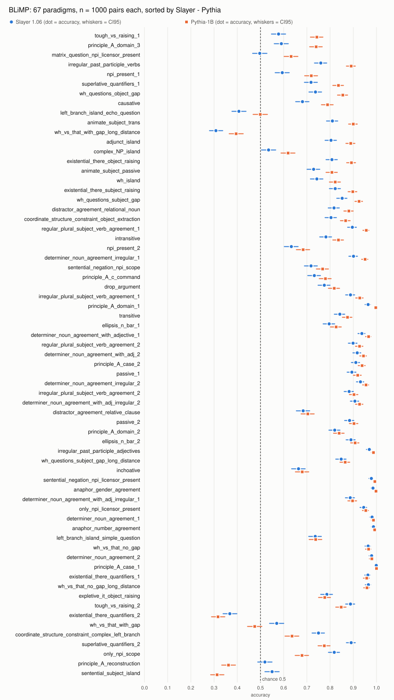

# BLiMP full set: Slayer 1.06 and Pythia-1B

Generated by `python slayer_eval/blimp.py raport` from `wyniki/LICZBY.json`; do not edit by hand.
Protocol and thresholds (written before the measurement): [`THRESHOLDS.md`](THRESHOLDS.md).

**Slayer 1.06: 0.7920 (CI95 0.7891-0.7949), Pythia-1B: 0.8207 (CI95 0.8181-0.8233) on all 67000 minimal pairs.** Difference -2.87 points, paired SE 0.16 points, z = -18.1: certain.

## Overall

| model | accuracy | n | SE | CI95 (bootstrap, stratified) | chance | majority |
|---|---:|---:|---:|---|---:|---|
| Slayer 1.06 | 0.7920 | 67000 | 0.0014 | 0.7891-0.7949 | 0.5 | n/a (gold always first by construction) |
| Pythia-1B | 0.8207 | 67000 | 0.0013 | 0.8181-0.8233 | 0.5 | n/a (gold always first by construction) |

## Control: Pythia-1B against the published value

Our Pythia-1B 0.8207 vs reference 0.8234: difference -0.27 points, threshold +-2 points: **within**.
The reference is the mean of the 67 `blimp_*` values in the EleutherAI/pythia repo file `evals/pythia-v0/pythia-1b/zero-shot/pythia-1b-0shot-global_step143000_eval_results_11-28-2022-15-14-35.json`. It is the v0 model (weights before the Pythia re-train) scored by the old harness without the leading space; the v1 eval folders of that repo have no BLiMP and no other published BLiMP value for `EleutherAI/pythia-1b` was found. It is a sanity range, not an exact reference.

## Agreement with the Space (panel of 200)

Space T01, Slayer 1.06: 0.8408 (CI95 0.806-0.876, n = 200). Panel rebuilt by METHOD.md section 3 (2 per member, the remaining 66 slots by largest deficit, ties by member name, inside a member by SHA-256 of `20261028|blimp|<member>|<source id>`):

| source id in the hash | n | Slayer 1.06 | difference to Space | inside Space CI95 | Pythia-1B |
|---|---:|---:|---:|---|---:|
| `pair_id` | 200 | 0.7761 | -0.0647 | no | 0.8134 |
| SHA-256 of the canonical row | 200 | 0.8408 | 0.0000 | yes | 0.8706 |

With the source id = SHA-256 of the canonical row our Slayer 1.06 value equals the Space value exactly (338 of 402 in the equal-member weighting), while `pair_id` gives a different panel. We could not reproduce the Space `source_id_digest` itself (its id/separator format is not published), so the panel identity is inferred from the value, not proven by the digest. Same pairs or not, 200 pairs give a CI95 about +-3.5 points wide, which is why the full set is the number to use.

## 12 phenomena

Paired SE over the same pairs; verdict from |z|: >= 3 certain, 2-3 probable, < 2 noise.

| phenomenon | paradigms | n | Slayer 1.06 | Pythia-1B | difference (points) | SE (points) | z | verdict |
|---|---:|---:|---:|---:|---:|---:|---:|---|
| anaphor agreement | 2 | 2000 | 0.986 | 0.995 | -0.9 | 0.26 | -3.4 | certain |
| argument structure | 9 | 9000 | 0.785 | 0.836 | -5.2 | 0.42 | -12.2 | certain |
| binding | 7 | 7000 | 0.791 | 0.808 | -1.7 | 0.50 | -3.5 | certain |
| control raising | 5 | 5000 | 0.776 | 0.832 | -5.5 | 0.55 | -10.0 | certain |
| determiner noun agreement | 8 | 8000 | 0.930 | 0.951 | -2.1 | 0.29 | -7.1 | certain |
| ellipsis | 2 | 2000 | 0.843 | 0.867 | -2.4 | 0.90 | -2.7 | probable |
| filler gap dependency | 7 | 7000 | 0.749 | 0.777 | -2.8 | 0.50 | -5.6 | certain |
| irregular forms | 2 | 2000 | 0.865 | 0.939 | -7.4 | 0.73 | -10.1 | certain |
| island effects | 8 | 8000 | 0.666 | 0.673 | -0.7 | 0.58 | -1.2 | noise |
| npi licensing | 7 | 7000 | 0.740 | 0.776 | -3.5 | 0.56 | -6.3 | certain |
| quantifiers | 4 | 4000 | 0.735 | 0.721 | 1.4 | 0.71 | 1.9 | noise |
| subject verb agreement | 6 | 6000 | 0.844 | 0.883 | -3.9 | 0.51 | -7.6 | certain |


## 67 paradigms

n = 1000 pairs per paradigm and model. Slayer ahead: 7 certain, 1 probable; Pythia ahead: 34 certain, 7 probable; noise: 18. With 67 comparisons about 3 'probable' and 0.2 'certain' are expected by chance alone, so single 'probable' paradigms are not findings.

| paradigm | Slayer 1.06 | Pythia-1B | difference (points) | SE (points) | z | verdict |
|---|---:|---:|---:|---:|---:|---|
| tough_vs_raising_1 | 0.578 | 0.743 | -16.5 | 1.36 | -12.1 | certain |
| principle_A_domain_3 | 0.590 | 0.740 | -15.0 | 2.05 | -7.3 | certain |
| matrix_question_npi_licensor_present | 0.497 | 0.632 | -13.5 | 1.93 | -7.0 | certain |
| irregular_past_participle_verbs | 0.760 | 0.891 | -13.1 | 1.33 | -9.9 | certain |
| npi_present_1 | 0.594 | 0.719 | -12.5 | 1.67 | -7.5 | certain |
| superlative_quantifiers_1 | 0.718 | 0.836 | -11.8 | 1.70 | -6.9 | certain |
| wh_questions_object_gap | 0.737 | 0.855 | -11.8 | 1.52 | -7.7 | certain |
| causative | 0.681 | 0.789 | -10.8 | 1.59 | -6.8 | certain |
| left_branch_island_echo_question | 0.407 | 0.499 | -9.2 | 1.83 | -5.0 | certain |
| animate_subject_trans | 0.810 | 0.900 | -9.0 | 1.19 | -7.6 | certain |
| wh_vs_that_with_gap_long_distance | 0.308 | 0.395 | -8.7 | 1.67 | -5.2 | certain |
| adjunct_island | 0.804 | 0.889 | -8.5 | 1.36 | -6.3 | certain |
| complex_NP_island | 0.535 | 0.619 | -8.4 | 1.79 | -4.7 | certain |
| existential_there_object_raising | 0.808 | 0.892 | -8.4 | 1.28 | -6.5 | certain |
| animate_subject_passive | 0.729 | 0.808 | -7.9 | 1.28 | -6.2 | certain |
| wh_island | 0.743 | 0.822 | -7.9 | 1.50 | -5.3 | certain |
| existential_there_subject_raising | 0.822 | 0.898 | -7.6 | 1.15 | -6.6 | certain |
| wh_questions_subject_gap | 0.852 | 0.925 | -7.3 | 1.22 | -6.0 | certain |
| distractor_agreement_relational_noun | 0.817 | 0.881 | -6.4 | 1.36 | -4.7 | certain |
| coordinate_structure_constraint_object_extraction | 0.804 | 0.867 | -6.3 | 1.32 | -4.8 | certain |
| regular_plural_subject_verb_agreement_1 | 0.896 | 0.956 | -6.0 | 1.03 | -5.8 | certain |
| intransitive | 0.782 | 0.836 | -5.4 | 1.37 | -3.9 | certain |
| npi_present_2 | 0.633 | 0.684 | -5.1 | 1.65 | -3.1 | certain |
| determiner_noun_agreement_irregular_1 | 0.901 | 0.951 | -5.0 | 0.98 | -5.1 | certain |
| sentential_negation_npi_scope | 0.718 | 0.768 | -5.0 | 1.51 | -3.3 | certain |
| principle_A_c_command | 0.732 | 0.780 | -4.8 | 1.40 | -3.4 | certain |
| drop_argument | 0.775 | 0.818 | -4.3 | 1.27 | -3.4 | certain |
| irregular_plural_subject_verb_agreement_1 | 0.888 | 0.928 | -4.0 | 1.13 | -3.5 | certain |
| principle_A_domain_1 | 0.964 | 0.997 | -3.3 | 0.58 | -5.7 | certain |
| transitive | 0.842 | 0.875 | -3.3 | 1.26 | -2.6 | probable |
| ellipsis_n_bar_1 | 0.796 | 0.826 | -3.0 | 1.49 | -2.0 | probable |
| determiner_noun_agreement_with_adjective_1 | 0.937 | 0.966 | -2.9 | 0.72 | -4.0 | certain |
| regular_plural_subject_verb_agreement_2 | 0.899 | 0.927 | -2.8 | 0.92 | -3.0 | certain |
| determiner_noun_agreement_with_adj_2 | 0.917 | 0.944 | -2.7 | 0.91 | -3.0 | probable |
| principle_A_case_2 | 0.911 | 0.938 | -2.7 | 1.06 | -2.5 | probable |
| passive_1 | 0.894 | 0.919 | -2.5 | 0.99 | -2.5 | probable |
| determiner_noun_agreement_irregular_2 | 0.931 | 0.955 | -2.4 | 0.77 | -3.1 | certain |
| irregular_plural_subject_verb_agreement_2 | 0.882 | 0.903 | -2.1 | 1.10 | -1.9 | noise |
| determiner_noun_agreement_with_adj_irregular_2 | 0.907 | 0.927 | -2.0 | 1.01 | -2.0 | noise |
| distractor_agreement_relative_clause | 0.684 | 0.704 | -2.0 | 1.75 | -1.1 | noise |
| passive_2 | 0.884 | 0.903 | -1.9 | 0.92 | -2.1 | probable |
| principle_A_domain_2 | 0.820 | 0.839 | -1.9 | 1.37 | -1.4 | noise |
| ellipsis_n_bar_2 | 0.890 | 0.908 | -1.8 | 1.00 | -1.8 | noise |
| irregular_past_participle_adjectives | 0.969 | 0.987 | -1.8 | 0.63 | -2.9 | probable |
| wh_questions_subject_gap_long_distance | 0.848 | 0.865 | -1.7 | 1.37 | -1.2 | noise |
| inchoative | 0.664 | 0.680 | -1.6 | 1.46 | -1.1 | noise |
| sentential_negation_npi_licensor_present | 0.978 | 0.993 | -1.5 | 0.48 | -3.1 | certain |
| anaphor_gender_agreement | 0.985 | 0.998 | -1.3 | 0.39 | -3.4 | certain |
| determiner_noun_agreement_with_adj_irregular_1 | 0.887 | 0.897 | -1.0 | 1.05 | -1.0 | noise |
| only_npi_licensor_present | 0.945 | 0.954 | -0.9 | 0.94 | -1.0 | noise |
| determiner_noun_agreement_1 | 0.981 | 0.987 | -0.6 | 0.49 | -1.2 | noise |
| anaphor_number_agreement | 0.987 | 0.992 | -0.5 | 0.36 | -1.4 | noise |
| left_branch_island_simple_question | 0.736 | 0.738 | -0.2 | 1.54 | -0.1 | noise |
| wh_vs_that_no_gap | 0.964 | 0.966 | -0.2 | 0.74 | -0.3 | noise |
| determiner_noun_agreement_2 | 0.979 | 0.980 | -0.1 | 0.52 | -0.2 | noise |
| principle_A_case_1 | 0.999 | 1.000 | -0.1 | 0.10 | -1.0 | noise |
| existential_there_quantifiers_1 | 0.963 | 0.958 | 0.5 | 0.41 | 1.2 | noise |
| wh_vs_that_no_gap_long_distance | 0.965 | 0.959 | 0.6 | 0.79 | 0.8 | noise |
| expletive_it_object_raising | 0.786 | 0.777 | 0.9 | 1.20 | 0.7 | noise |
| tough_vs_raising_2 | 0.888 | 0.848 | 4.0 | 1.16 | 3.4 | certain |
| existential_there_quantifiers_2 | 0.368 | 0.317 | 5.1 | 1.79 | 2.8 | probable |
| wh_vs_that_with_gap | 0.570 | 0.475 | 9.5 | 1.66 | 5.7 | certain |
| coordinate_structure_constraint_complex_left_branch | 0.750 | 0.636 | 11.4 | 1.60 | 7.1 | certain |
| superlative_quantifiers_2 | 0.891 | 0.775 | 11.6 | 1.36 | 8.5 | certain |
| only_npi_scope | 0.818 | 0.679 | 13.9 | 1.67 | 8.3 | certain |
| principle_A_reconstruction | 0.519 | 0.362 | 15.7 | 1.66 | 9.4 | certain |
| sentential_subject_island | 0.550 | 0.313 | 23.7 | 2.04 | 11.6 | certain |



## Limits

- Runtime: Apple MPS, float32, batch 64 with right padding (causal attention, so padding does not reach scored tokens). A CPU float32 re-run of 300 pairs per model (the sha256 panel and 100 pairs spread over the set) flipped no pair.
- Contamination is not scanned here (no access to the Slayer training corpus). The Space flags BLiMP for Slayer 1.06 with hits on 3 of its 200 panel pairs; Pythia's Pile was not scanned either.
- Pythia-1B is scored with the same pair encoding as lm-eval HFLM (EOT as the empty context, no BOS); Slayer with one BOS `<|endoftext|>` as in the Space METHOD.md. Both are the 'exactly one unscored prefix token' rule.

## How to reproduce

```bash
# data: nyu-mll/blimp @ 877fba0801ffb7cbd8c39c1ff314a46f053f6036 (67 parquet files) in BLIMP_DIR or the HF cache
BLIMP_DIR=<snapshot> python slayer_eval/hipoteza_formatu.py licz --model <slayer-1.06 dir> --zadania blimp \
  --wyjscie <out>/1.06 --device mps --batch 64
BLIMP_DIR=<snapshot> python slayer_eval/hipoteza_formatu.py licz --model <pythia-1b dir> --zadania blimp \
  --wyjscie <out>/pythia-1b --device mps --batch 64
BLIMP_DIR=<snapshot> python slayer_eval/blimp.py zbierz --wyniki <out>
python narzedzia/liczby.py && python slayer_eval/blimp.py raport && python narzedzia/sprawdz_raporty.py
```

Per-pair log-likelihoods (ids and numbers only, no sentences): `wyniki/blimp/raw/<model>.jsonl.gz`;
without weights, `BLIMP_DIR=<snapshot> python slayer_eval/blimp.py zbierz --wyniki wyniki/blimp/raw` rebuilds `blimp.json` from them.
